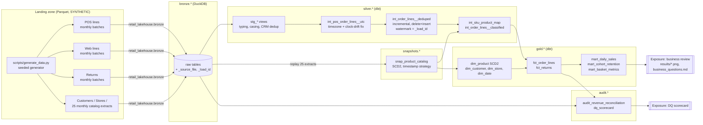

# Day 01: Retail Medallion Lakehouse with dbt + DuckDB

**Tier I - Advanced** | **Domain:** Retail | **Tools:** DuckDB, dbt-duckdb, SQL, Parquet, Python | **Data:** SYNTHETIC

## Executive summary

The retailer's POS and e-commerce exports disagree because they contain re-sent duplicates, training-lane receipts, unmapped SKUs, late uploads and a POS clock that silently switched to UTC. Summing them naively overstates net revenue by 1.69%. This project builds a bronze/silver/gold lakehouse in DuckDB with dbt over 2.0M synthetic order lines. Its gold layer reconciles to the raw data to the cent once each documented exclusion is removed ($0.00 difference on $124.6M), and it keeps full price and name history for every product, so every team can report from one set of tables.

## Architecture



## Data provenance

- **Synthetic only.** Everything comes from `src/retail_lakehouse/generate.py` (NumPy + Faker, seed 42). No real customer or company data is used. The optional enrichment with UCI Online Retail II was **not used**: every run takes the synthetic path.
- **Scale used for every reported number:** 2 years (2024-10-01 to 2026-09-30), 833,333 orders, 2,000,087 unique order lines (2,030,157 raw rows including re-sends), 50,000 customers, 5,000 products, 120 stores plus web. The full landing zone is about 58 MB. It is regenerated by `make run` and never committed.
- **Committed sample:** `data/sample/` (0.80 MB, 8k lines, 1k customers, 200 products, same generator and seed). Tests run against it. `tests/test_generator.py` checks that it regenerates identically.
- **Mess that is injected on purpose** (counts are in `results/metrics.json` -> `dataset`):

| Problem | Full-scale volume |
|---|---|
| Duplicate re-sends of order lines | 30,070 rows |
| Late uploads (POS 2-45 days, web 2-10 days) | 16,358 POS + 2,896 web orders |
| POS clock drift (8 stores export UTC after a firmware change) | 43,589 raw rows (42,892 unique in-scope lines) |
| Price changes / product renames / SKU re-codes | 5,994 / 150 / 75 |
| Training-lane receipts (store 999) | 1,226 lines |
| Unmapped SKUs | 2,001 lines |
| Lower-case or space-padded SKU codes in POS | 26,094 rows |
| Returns, plus duplicate return rows | 147,468 + 1,497 |
| Stale duplicate CRM customer records | 1,028 rows |

The generator also writes `_truth/order_line_truth.parquet` with the true UTC time of every line. The pipeline never reads it. It is used only to *measure* how accurate the timezone normalisation is.

## Method

1. **Bronze.** `retail_lakehouse.bronze` lands each Parquet file into `bronze.*` unchanged and adds `_source_file` and a monotonically increasing `_load_id`. A `bronze._load_log` table makes the load idempotent and batch-aware.
2. **SCD2 snapshot.** The pipeline replays the 25 monthly catalog extracts in order, running `dbt snapshot --vars '{catalog_extract_date: ...}'` for each one. The snapshot uses the `timestamp` strategy on the source `updated_at`, so `valid_from` is the true change time, not the extract date. Each product has at most one change per month, so monthly extracts capture every version.
3. **Silver.**
   - Typing: text money to `DECIMAL(18,2)`, integer cents converted by exact decimal arithmetic, epoch ms to timestamp.
   - SKU normalisation (`upper(trim())`) and CRM deduplication.
   - **Timezone normalisation:** each store's IANA timezone, plus the `pos_clock_changes` seed (the vendor change log), which says when a store's export switched to UTC.
   - **Deduplication and late arrivals:** `int_order_lines__deduped` is an incremental `delete+insert` model keyed on `order_line_id`. Its watermark is the bronze `_load_id`, not the order date, so a line uploaded six weeks late is still merged. A re-sent line keeps its first ingestion time.
4. **Gold.** A star schema:
   - `fct_order_lines` and `fct_returns`.
   - `dim_product` as SCD2. `product_sk = product_id*1000 + version`, joined on `valid_from <= order_ts_utc < valid_to`.
   - `dim_customer` (Type 1, with an anonymous member 0), `dim_store` and `dim_date`.
   - Marts for daily sales, cohort retention and basket metrics.
5. **Two-phase run.** Phase 1 builds everything against a **fresh DuckDB file** with ingestion batches up to 2026-08. Phase 2 lands the last two batches and re-runs `dbt build` incrementally.
6. **Quality.** 67 dbt tests: `unique`, `not_null`, `relationships`, `accepted_values` and 7 custom singular tests. The singular tests cover revenue reconciliation, the mart summing to the fact, SCD2 non-overlap, SCD2 contiguity with exactly one current version, receipt SKU and price matching the SCD2 version at sale, returns not exceeding quantity sold, and the trading window. A `dq_scorecard` model (stretch goal) holds 10 checks. `dbt docs generate` runs on every build, and two exposures are declared.
7. **Analysis.** `retail_lakehouse.analysis` answers five business questions from gold and writes the charts and `results/business_questions.md`.

## Results

All values are from `results/metrics.json` and the other files in `results/`, produced by `make run` on the full synthetic dataset.

| Metric | Value |
|---|---|
| `dbt build` on fresh DuckDB (phase 1) | 23 models, 1 snapshot, 1 seed, **67/67 tests pass** |
| `dbt build` incremental (phase 2) | 23 models, **67/67 tests pass** |
| Raw bronze revenue (naive spreadsheet sum) | $126,753,122.68 |
| Documented exclusions | duplicates $1,903,200.36 · training lane $71,016.80 · unmapped SKUs $131,254.62 |
| Gold net revenue (`fct_order_lines`) | $124,647,650.90 |
| **Gold vs bronze after exclusions** | **$0.00 difference (0.000000%, tolerance 0.01%)** |
| Naive total overstatement vs gold | 1.6891% |
| Timestamps matching ground-truth UTC | 100.0% of 1,996,860 lines (including 100.0% of 42,892 clock-drift lines) |
| Store lines that would land on the wrong business day using the raw POS timestamp | 8,327 lines ($522,254.32) |
| Late lines merged by the incremental phase into already-reported months | 3,322 lines ($200,112.10) |
| Returns waiting for their order line after phase 1 / phase 2 | 13 / 0 |
| SCD2: product versions / products with history / re-coded SKUs / renamed | 11,219 / 3,568 / 75 / 225 |
| SCD2: fact lines whose receipt SKU or price differs from the assigned version | **0** of 1,996,860 |
| DQ scorecard | 10/10 checks pass |
| `make run` wall time (4 vCPU, CPU only) | 142 s end to end (generate 45 s, snapshot replay 43 s, phase-1 build 31 s) |

**SCD2 example.** In `results/scd2_renamed_sku_example.md`, product 1449 changed from `SKU-101449` "Granite Bay Compact Sweater" to `SKU-901449` "Granite Bay Sweater 2.0" on 2026-03-03 14:40:18 UTC. All 17,795 earlier sales resolve to version 1 and all 7,045 later sales to version 2, with 0 mismatches.

### The five business questions (`results/business_questions.md`)

| # | Question | Answer (SYNTHETIC data) |
|---|---|---|
| Q1 | How fast is the business growing, and where? | Net sales +10.88% FY2 vs FY1 ($59.11M to $65.54M). Web +48.02%, stores -5.03%. Web share went from 29.98% to 40.02%. |
| Q2 | Which categories make the money / leak it through returns? | Footwear is the largest category after returns (23.15%). Apparel has the highest refund rate (11.87% vs 7.53% overall). |
| Q3 | Do new customers come back? | 60.62% buy again in month 1, 52.57% in month 3, 43.47% in month 6 and 30.18% in month 12 (26,902 new customers in 24 cohorts). |
| Q4 | How do baskets differ by channel? | No material difference ($150 average basket, 3.33 units). This is a property of the generator, not a finding (see Limitations). |
| Q5 | Why did the spreadsheets disagree? | Duplicates, training lane and unmapped SKUs (+1.69%), plus clock drift and late uploads moving revenue between days and months. |


## What this demonstrates

| Skill | Where |
|---|---|
| Dimensional modelling | Star schema in `dbt/models/gold/`, SCD2 `dim_product` from a dbt snapshot, anonymous customer member, deterministic surrogate keys, point-in-time fact-to-dimension join |
| dbt | Sources, staging/intermediate/gold/marts layers, an incremental model with a load-id watermark, a snapshot replayed from extracts, a seed, custom macros (`local_to_utc`, `cents_to_amount`, schema naming), exposures, docs |
| Data quality testing | 67 dbt tests including 7 singular tests, the `dq_scorecard` model, and pytest integration tests that check against generator ground truth |
| Analytical SQL | Window-function dedup, range/as-of joins, cohort retention, basket metrics, `FILTER` aggregates, full-outer-join marts, an independent bronze-to-gold reconciliation |

## Limitations

- **Synthetic data.** Effects are only as realistic as the generator. In particular, baskets for web and store are drawn from the same distribution, so Q4's null result says nothing about real retail. Growth, seasonality and web-share trends are also generator parameters, not discoveries.
- **The reconciliation is exact because the data is clean once the exclusions are removed.** The 0.01% criterion is met with a $0.00 difference. Real data would also carry rounding, FX and tax differences, which this generator does not model.
- **SCD2 granularity depends on extract frequency.** The generator allows at most one catalog change per product per month, so monthly extracts capture every version. With real data, two changes inside one extract interval would collapse into one version. Replaying 25 extracts costs 25 dbt invocations (about 43 s).
- **Cohorts are left-censored.** Customers who signed up before the window are excluded from retention. The earliest cohorts (2024-10, 2024-11) still show higher retention, because heavy buyers are acquired first.
- **Incremental scope.** Only the order-line dedup model is incremental. Gold tables are rebuilt in full each run, which takes seconds at 2M rows in DuckDB. dbt-duckdb 1.9.6 supports only `append` and `delete+insert`, so the stretch goal's "merge" strategy is implemented as `delete+insert` on the unique key. The effect is the same, but no SQL `MERGE` statement is used.
- **Informational checks.** The `pos_rows_clock_corrected_share` DQ check has a threshold of 1.0. It reports a volume and can never fail.
- **UCI Online Retail II enrichment** (optional in the brief) was not attempted.

## How to run

```bash
cd day-01-retail-medallion-lakehouse
make setup      # pip install -r requirements.txt (pinned; Python 3.11+)
make run        # generate 2M-line SYNTHETIC data, build the lakehouse twice, analyse -> results/ (~2.5 min)
make test       # pytest on the committed sample: generator, bronze loader, dbt build + acceptance checks (~1 min)
make sample-run # quick end-to-end on data/sample without touching results/
make docs       # serve dbt docs for the last full build
```

The DuckDB file is written to `data/warehouse/retail.duckdb` and is git-ignored, as are the generated data and `dbt/target/`. To explore it, run `duckdb data/warehouse/retail.duckdb` and then, for example, `select * from audit.audit_revenue_reconciliation;`.
