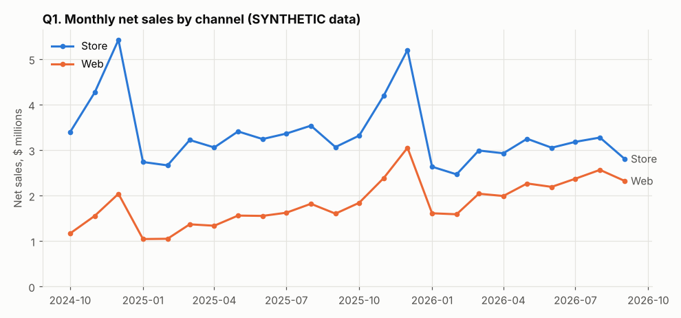
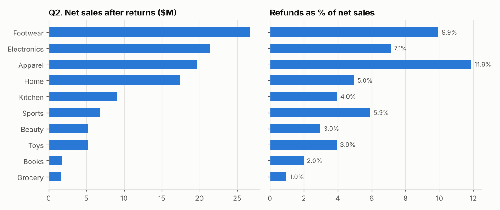
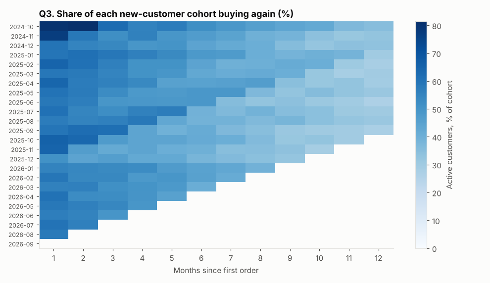
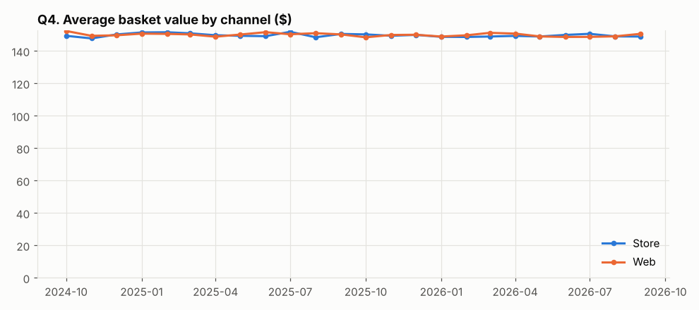
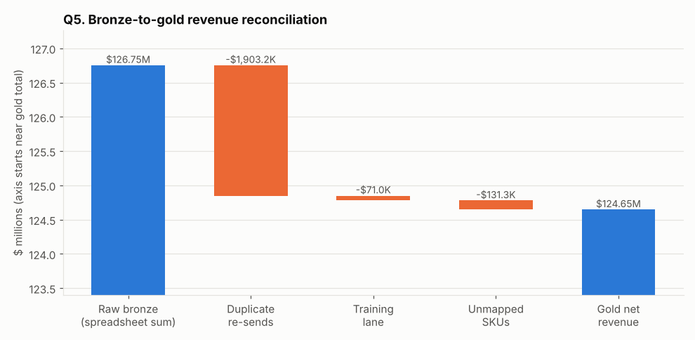

# Business questions answered from the gold layer

All figures below come from SYNTHETIC data generated by `scripts/generate_data.py` (scale `full`, seed 42).

## Q1. How fast is the business growing, and where?

Net sales grew **10.88%** from FY1 (Oct 2024-Sep 2025, $59,109,273) to FY2 (Oct 2025-Sep 2026, $65,538,378). Web changed by +48.02% and stores by -5.03%, moving web share from 29.98% to 40.02%. The peak month was 2025-12 ($8,252,511).

## Q2. Which categories make the money, and which leak it through returns?

**Footwear** is the largest category after returns ($26,688,294, 23.15% of net sales after returns). **Apparel** has the highest refund rate at 11.87% of net sales, against 7.53% overall.

## Q3. Do new customers come back?

Across 24 monthly cohorts of new customers (26,902 people), 60.62% buy again in month 1, 52.57% in month 3, 43.47% in month 6 and 30.18% in month 12 (weighted by cohort size, counting only cohorts old enough to reach that month). Customers who signed up before the window are left-censored and excluded.

## Q4. How do baskets differ by channel?

Web baskets average $150 with 3.33 units (70.7% span more than one category); store baskets average $150 with 3.33 units (70.6% multi-category). Average basket value in Nov-Dec is $149 vs $150 in other months. There is no material difference by channel or season: the generator draws basket size and product mix from the same distribution for both channels, so this null result is a property of the synthetic data, not a finding.

## Q5. Why did the teams' spreadsheet numbers disagree?

Summing the raw exports gives $126,753,123, which overstates true net revenue ($124,647,651) by 1.6891%: duplicate re-sends ($1,903,200), training-lane receipts ($71,017) and unmapped SKUs ($131,255). After exclusions the gold layer reconciles to bronze with an absolute difference of $0.00 (0.000000%; tolerance 0.01%).

Timing also moved numbers between days and months. Using the raw POS timestamp as the business date would put 8,327 store lines ($522,254) on the wrong day, because 42,892 lines came from POS units exporting UTC after a firmware change. After normalisation, 100.0% of fact timestamps match the generator's ground truth. A report run before the last two ingestion batches landed was missing 3,322 late lines ($200,112) for months it considered closed; the incremental silver model merged them in phase 2.

