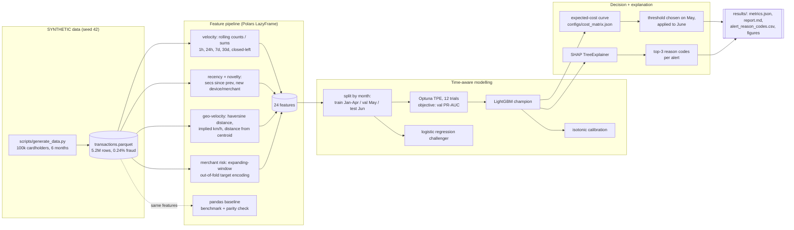
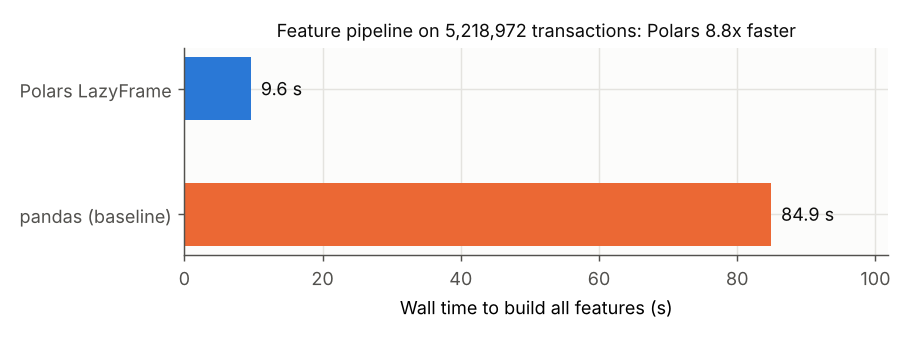
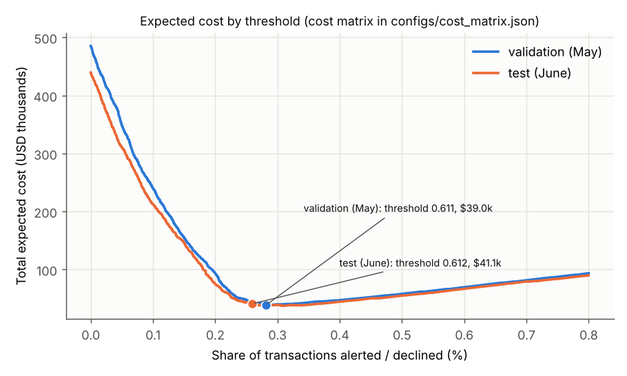
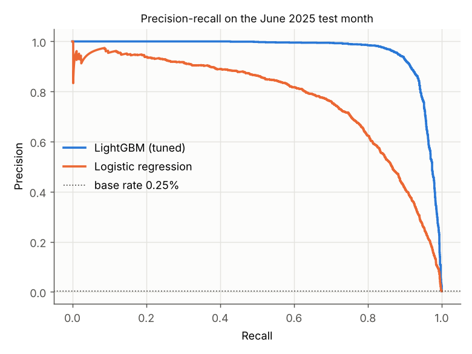
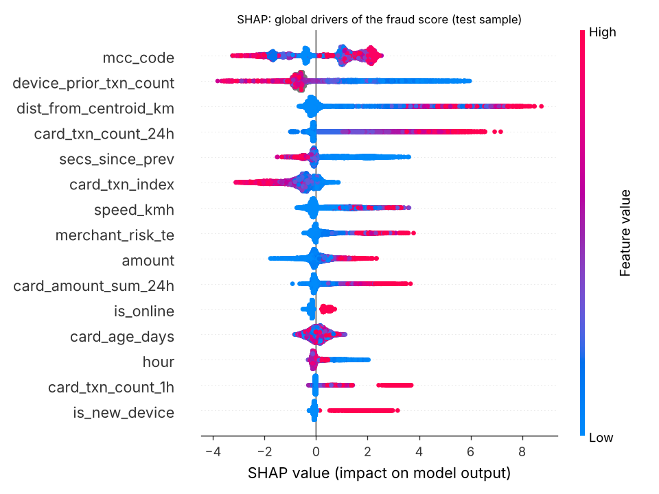
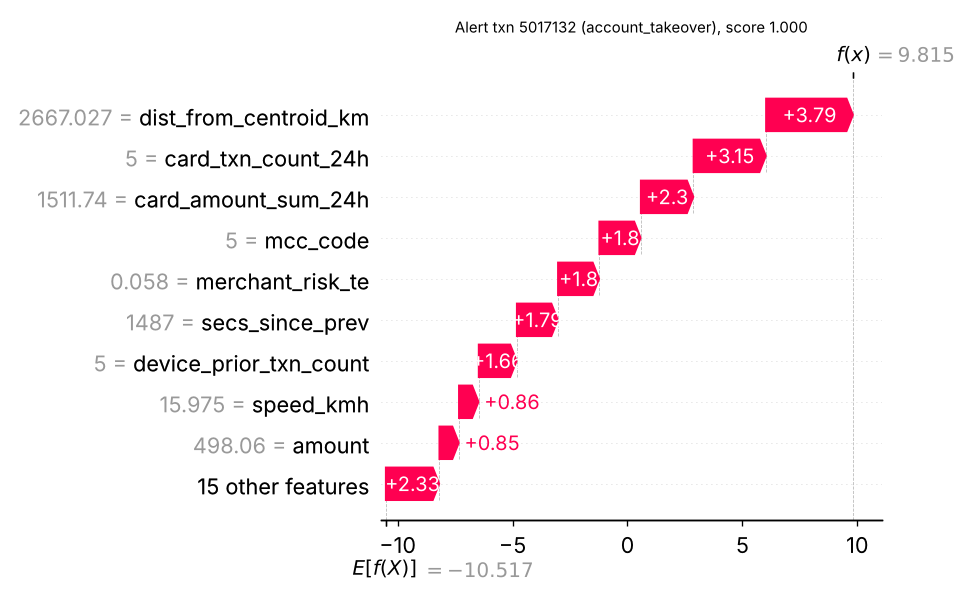
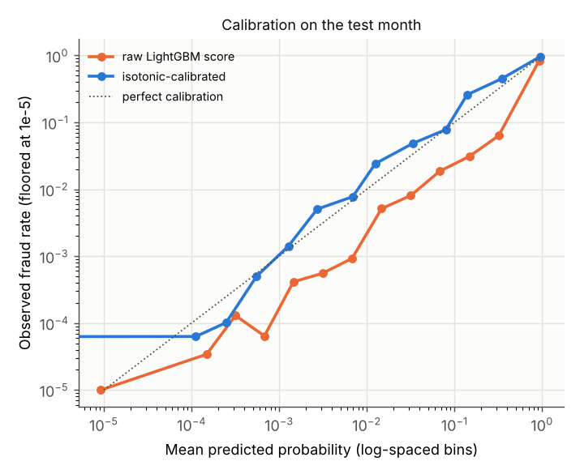

# Day 02: Card Fraud Detection at Speed with Polars + LightGBM

**Tier I - Advanced** | **Domain:** Financial services | **Tools:** Polars, LightGBM, SHAP, scikit-learn, Optuna, pandas (baseline) | **Data:** SYNTHETIC

## Executive summary

On a synthetic month of 864,422 card transactions, the tuned model blocks 92.3% of fraudulent transactions (94.5% of fraud dollars). It wrongly declines 260 good transactions, a false-positive rate of 0.030%. Its operating point was chosen to minimise expected dollar cost, not to maximise accuracy, and it cuts the month's fraud-related cost from $439,585 (approve everything) to $41,073. Every alert ships with three plain-language reason codes from SHAP, and the feature pipeline runs 8.85x faster in Polars than in an equivalent pandas implementation.

## Architecture



## Data provenance

- **Synthetic only.** Everything comes from `src/card_fraud/generate.py` (NumPy, seed 42). No real cardholder, merchant or issuer data is used, and no public dataset is downloaded, so there is no download/fallback path: every run takes the synthetic path.
- **Scale used for every reported number:** 100,000 cardholders (99,999 transacted), 20,331 merchants in 40 US and 10 foreign cities, 2025-01-01 to 2025-06-30. That is **5,218,972 transactions**, of which **12,701 are fraudulent (0.243%)**, from 1,950 attack campaigns. The 100 MB Parquet file is regenerated by `make run` into `data/generated/` and is never committed.
- **Committed sample:** `data/sample/transactions.parquet` (0.49 MB, 31,155 transactions, 600 cardholders, same generator). Fraud is boosted to 1.38% so that tests have enough positives. `tests/test_generator.py` checks that the generator reproduces it exactly (frame equality).

**Legitimate behaviour that the generator injects** (and that makes false positives possible):

| Behaviour | Detail |
|---|---|
| Personal habits | Each cardholder has a home city, a lognormal spend level, a transaction rate (mean 0.28/day), an online share and 1-3 devices. Hours follow a diurnal curve. |
| Travel | 20% of cardholders take one 2-10 day trip, 35% of them abroad. Their transactions move to the trip city, which creates genuine long jumps in location. |
| New phones | 20% of cardholders switch to a new device part-way through the window. |
| Micro-payment bursts | 5% of cardholders make bursts of 3-10 tiny in-app or ride-share payments, minutes apart, on their own device. These look like card testing. |

**Fraud patterns** (`attack_type` column; each campaign starts at a uniformly random time):

| Pattern | Transactions | Fraud $ | How it is generated |
|---|---|---|---|
| `card_testing` | 6,881 | $767,469 | 3-15 authorisations of $0.50-$9.99 at online digital-goods merchants from a fresh device, about 45 s, 4 min or 15 min apart. 65% of campaigns then cash out with 1-3 electronics or gift-card purchases of $200-$1,500 within hours. Half use an IP address in the victim's home city. |
| `account_takeover` | 3,562 | $1,126,829 | 2-8 online purchases, about 20 min or 3 h apart. 70% come from a never-seen device and 30% from the cardholder's own device (session hijack). 40% are "stealthy": home-city IP, everyday categories and ticket sizes near the victim's normal spend. The rest buy electronics, gift cards or apparel (median about $320) from a distant IP. |
| `geo_impossible` | 2,258 | $465,368 | 2-6 counterfeit card-present purchases in a city more than 800 km from home (40% abroad). They start 0.5-10 h after a genuine transaction by the cardholder. |

Fraudsters send 30-35% of their volume to a small pool of weak-control "high-risk" merchants. The merchant target encoding can learn this pool.

## Method

1. **Features (Polars LazyFrame, `src/card_fraud/features_polars.py`).** One lazy query sorts by card and time and computes 24 features:
   - *Velocity:* card transaction counts over 1h/24h/7d, spend over 1h/24h, the 30-day average ticket and the amount relative to it, and the number of sub-$5 authorisations in the last hour. These use `rolling_sum_by(..., closed="left").over("card_id")`, so the window is `[t - w, t)`.
   - *Recency and novelty:* seconds since the previous transaction, first use of a device or merchant, prior transactions on this device, card age and card transaction index.
   - *Geo-velocity:* haversine distance from the previous transaction, the implied speed in km/h, and the distance from the card's running centroid of *prior* locations.
   - *Merchant risk:* expanding-window out-of-fold target encoding. Folds are calendar months. A row in month *f* sees merchant labels from months < *f* only, capped at the last training month, and is smoothed toward the prior with m = 200. January has no history (null). Validation and test rows only ever see training labels.
2. **pandas baseline (`features_pandas.py`).** The same 24 features written idiomatically in pandas (`groupby().rolling()`, `shift`, `cumcount`, merges). The run times both on the same in-memory data and asserts that they agree, with maximum relative difference **1.3e-11**.
3. **Leak-free validation.** The split is by calendar month: train Jan-Apr (3,460,813 rows, 8,279 fraud), validation May (893,737 rows, 2,273 fraud), test June (864,422 rows, 2,149 fraud). Training keeps every fraud row and a seeded 10% of legitimate rows, giving 353,290 rows. This is negative downsampling; `scale_pos_weight` is tuned on top of it.
4. **LightGBM + Optuna.** A TPE sampler (seed 42) runs 12 trials over learning rate, leaves, min child samples, feature and bagging fractions, L2 and `scale_pos_weight`. The objective is validation PR-AUC, with early stopping on validation. Best: `learning_rate=0.0626, num_leaves=34, min_child_samples=37, scale_pos_weight=4.67`, 374 trees (`results/optuna_trials.csv`).
5. **Cost-sensitive threshold (`evaluate.py`).** Each outcome costs `fixed + pct x amount`, as set in `configs/cost_matrix.json`:

   | Outcome | Cost (default assumptions, editable) |
   |---|---|
   | Missed fraud (FN) | 100% of the amount + $25 dispute handling |
   | False decline (FP) | $12 servicing and attrition risk + 3% of the amount (lost interchange and spend) |
   | Correct decline (TP) | $6 alert handling |
   | Approved good (TN) | $0 |

   The total cost is computed exactly at every distinct score on the **validation** month, and the minimum is taken. That threshold is then frozen and applied to the **test** month.
6. **Explainability.** `shap.TreeExplainer` runs on a stratified test sample (all 2,149 fraud rows + 4,298 legit) for the global view, and on all test alerts for reason codes. Reason codes are the three features with the largest positive SHAP contribution, rendered as text such as "distance from the card's usual location = 2,667 km". The SHAP values match LightGBM's native `pred_contrib` to a maximum absolute difference of 0.0.
7. **Stretch goals.** Isotonic calibration is fitted on validation scores and evaluated on test. A logistic-regression challenger (log transforms, standardisation, one-hot MCC, class-balanced) is trained on the same rows.

## Results

All values come from `results/metrics.json` and `results/report.md`, produced by `make run` on the full synthetic dataset. Test = June 2025 (864,422 transactions, 2,149 fraud).

**Speed (acceptance: Polars at least 3x faster than pandas)**

| Feature pipeline on 5,218,972 rows | Wall time |
|---|---|
| pandas 3.0.5 baseline | 84.9 s |
| Polars 2.0.0 LazyFrame | 9.6 s |
| **Speed-up** | **8.85x** (outputs identical within 1.3e-11 relative) |

**Ranking quality (test month)**

| Model | PR-AUC | ROC-AUC | Recall @ 0.1% FPR | Recall @ 0.5% FPR | Recall @ 1% FPR |
|---|---|---|---|---|---|
| **LightGBM (champion, tuned)** | **0.961** | 0.9996 | **95.5%** | 98.6% | 99.3% |
| Logistic regression (challenger) | 0.772 | 0.9977 | 78.2% | 93.4% | 96.9% |

The base rate is 0.249%. Validation PR-AUC for LightGBM was 0.953.

**Threshold justified in dollars (test month, threshold chosen on May)**

| Policy | Threshold | Alerts | Recall | Precision | FPR | Total cost | Saving vs approve-all |
|---|---|---|---|---|---|---|---|
| Approve everything | none | 0 | 0% | n/a | 0% | $439,585 | $0 |
| **LightGBM, cost-optimal on validation** | **0.611** | 2,243 | **92.3%** | 88.4% | 0.030% | **$41,073** | **$398,512** |
| LightGBM, half as many alerts | 0.993 | 1,125 | 52.2% | 99.7% | 0.000% | $169,845 | $269,740 |
| LightGBM, twice as many alerts | 0.089 | 4,043 | 97.3% | 51.7% | 0.226% | $50,977 | $388,608 |
| LightGBM, max-F1 threshold (from validation) | 0.887 | 1,945 | 86.9% | 96.0% | 0.009% | $53,537 | $386,048 |
| LightGBM, default 0.5 | 0.500 | 2,371 | 93.7% | 84.9% | 0.041% | $38,262 | $401,324 |
| Logistic regression, cost-optimal on validation | 0.988 | 4,322 | 88.9% | 44.2% | 0.280% | $77,573 | $362,012 |

At the selected threshold the $41,073 breaks down as follows:

| Outcome | Transactions | Cost |
|---|---|---|
| Missed fraud | 166 | $25,340 |
| False declines | 260 | $3,835 |
| Alert handling | 1,983 | $11,898 |

Halving the alert volume would raise June's cost by $128,772. Doubling it would raise the cost by $9,904. The best threshold in hindsight on June costs $37,565, so the validation-chosen threshold is $3,508 (9%) above the oracle.

**Recall by attack pattern at the selected threshold (`results/recall_by_attack_type.csv`)**

| Pattern | Transactions caught | Fraud $ caught |
|---|---|---|
| Card testing | 97.3% (1,204 / 1,237) | 99.2% |
| Geo-impossible | 97.0% (319 / 329) | 98.4% |
| Account takeover | 78.9% (460 / 583) | 90.3% |

**Calibration (stretch).** Isotonic regression fitted on May scores lowers the June Brier score from 0.000475 to 0.000338. It lowers expected calibration error (15 equal-mass bins) from 0.00077 to 0.00013. The mean predicted probability moves from 0.325% to 0.237%, against an observed rate of 0.249%; the raw scores are inflated by negative downsampling and `scale_pos_weight`.

**Explainability.** The top global drivers by mean |SHAP| share are:

| Feature | Share of mean \|SHAP\| |
|---|---|
| Merchant category | 14.6% |
| Prior transactions on the device | 13.5% |
| Distance from the card's usual location | 11.6% |
| Card transactions in the last 24h | 9.9% |
| Seconds since the previous transaction | 7.6% |

The merchant target encoding contributes 3.9%. Reason codes track the attack mechanism (`results/reason_codes_by_attack_type.csv`):
- On geo-impossible alerts, the top reason is "distance from the card's usual location" 100% of the time.
- On card-testing alerts, it is "card transactions in the last 24h" (51.6%) or "prior transactions on this device" (26.5%).








Example rows from `results/alert_reason_codes.csv` (one per alert, 2,243 rows):

| txn_id | pattern | score | reason 1 | reason 2 | reason 3 |
|---|---|---|---|---|---|
| 4931016 | geo_impossible | 0.9999 | distance from the card's usual location = 10,277 km | card transactions in the last 24h = 5 | time since the card's previous transaction = 10.4 min |
| 4492300 | card_testing | 0.9999 | card transactions in the last 24h = 10 | card transactions in the last hour = 10 | distance from the card's usual location = 2,196 km |
| 5017132 | account_takeover | 0.9999 | distance from the card's usual location = 2,667 km | card transactions in the last 24h = 5 | card spend in the last 24h = $1,511.74 |

### Acceptance criteria

| Criterion | Status |
|---|---|
| Polars pipeline at least 3x faster than pandas (report timings) | Met: 8.85x (9.6 s vs 84.9 s) |
| No feature uses future information (unit test proves it) | Met: `tests/test_features.py` (see below) |
| Threshold choice justified in dollars | Met: cost curve, policy table and breakdown above |
| `make test` passes from a clean checkout | Met: 20 tests on the committed sample, about 13 s |
| `make run` reproduces every number and figure | Met: 625 s on 4 vCPU, CPU only (two consecutive runs gave identical model metrics) |

**How the leakage tests work.** They run on the committed sample:
- *Truncation:* features for rows up to a cutoff are identical whether or not the later rows exist (three cutoffs).
- *Tampering:* changing amounts, locations, devices and labels of every later row leaves earlier features unchanged.
- *Same-month labels:* flipping all March labels leaves Jan-Mar features unchanged but changes April's encoding, which proves the test is sensitive.
- *Held-out labels:* flipping every May/June label changes no feature at all.
- *Hand-checked windows:* a hand-computed example confirms the closed-left windows.

## What this demonstrates

| Skill | Where |
|---|---|
| Polars | One lazy query with `rolling_sum_by(...).over()`, window functions, `int_range().over()` novelty counters, and an expanding out-of-fold target encoding built from lazy group-bys and joins. Benchmarked and parity-checked against pandas. |
| Gradient boosting | LightGBM with a native categorical MCC, Optuna TPE tuning on a time-ordered validation month, and early stopping (`model.py`) |
| Imbalanced learning | Negative downsampling plus a tuned `scale_pos_weight`; PR-AUC and recall at fixed FPR instead of accuracy; an expected-cost threshold from a configurable cost matrix; isotonic recalibration of the shifted scores |
| Explainability | SHAP TreeExplainer global importance and beeswarm, per-alert waterfalls, and top-3 reason codes in analyst language for every alert, checked against LightGBM's native contributions |

## Limitations

- **The data is synthetic and easier than real fraud.** The attack patterns were written to be detectable by exactly the feature families the brief asks for (velocity, device novelty, geo-velocity), so PR-AUC 0.96 is far above what real card portfolios achieve. The ranking of models, the shape of the cost curve and the reason codes are meaningful. The absolute recall and dollar figures are not. Account takeover, which includes a stealthy variant, is the hardest pattern (78.9% recall) and the closest to reality.
- **The fraud rate is 0.243%, not the brief's ~0.3%.** The campaign rate was calibrated to 0.30% on an earlier version of the generator. Making the attack patterns harder shortened the campaigns, and the rate was not re-tuned afterwards.
- **The cost-optimal threshold was not the cheapest policy on the test month.** The plain 0.5 threshold cost $38,262 on June against $41,073 for the validation-chosen 0.611, and the hindsight optimum was $37,565. The cost curve is flat near its minimum, so month-to-month noise moves the best point. Choosing on validation is the honest procedure; a production version would smooth the choice over several months.
- **Instant labels.** The merchant encoding for May uses April labels as if all chargebacks were known at month end. Real chargebacks arrive over 30-90 days, which would need a label-maturity lag. The fold structure makes that a one-line change (`fold < f - lag`), but it was not done here.
- **Tuning budget.** There are only 12 Optuna trials, on a 10% negative sample, to keep `make run` around 10 minutes. Early stopping and model selection both use the validation month, and the test month is touched once.
- **Benchmark caveat.** Timings are single runs on a 4-vCPU container. Polars uses all cores while pandas is mostly single-threaded, which is part of the speed-up and is the reason to use Polars here. The pandas version is idiomatic but not hand-optimised; for example, it does not use numba.
- **Library versions.** shap 0.53 and scipy 1.18 have no Python 3.11 wheels, so `requirements.txt` pins shap 0.51.0 and scipy 1.17.1 on 3.11 (CI). The reported results were produced on Python 3.13 with shap 0.53.0.

## How to run

```bash
cd day-02-card-fraud-polars-lightgbm
make setup       # pip install -r requirements.txt (pinned; Python 3.11+)
make run         # generate 5.2M SYNTHETIC transactions, benchmark, tune, threshold, explain -> results/ (~10 min, 4 vCPU)
make test        # pytest on the committed sample: generator, Polars/pandas parity, no-future-leakage, costs, smoke run
make sample-run  # quick end-to-end on data/sample, writes to data/sample_results (not results/)
make lint        # ruff check + format check
```

To use your own economics, edit `configs/cost_matrix.json` and re-run. The threshold, policy table and cost curve are recomputed. The trained model is saved to `data/models/model_lgbm.txt`, which is git-ignored.
