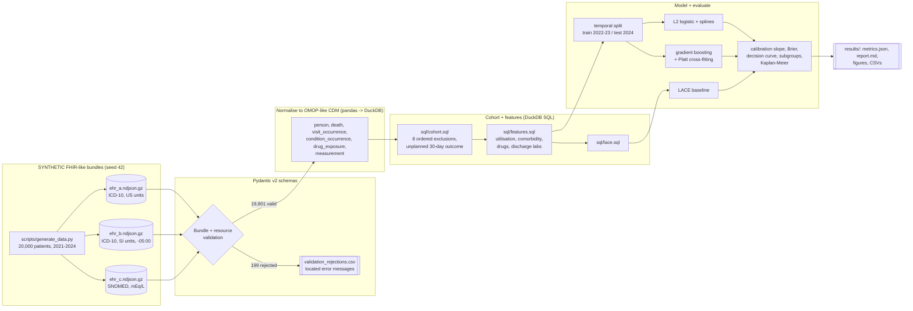
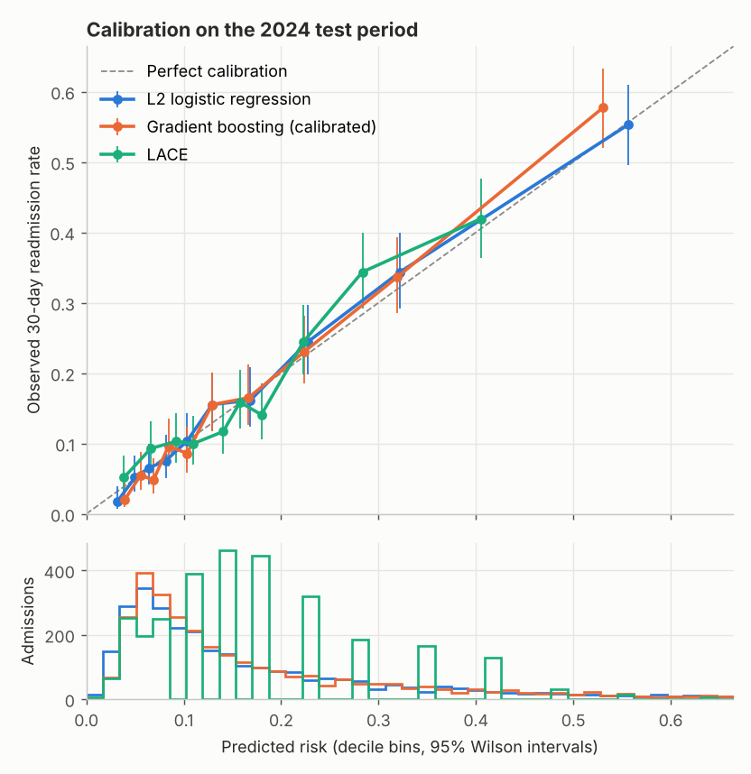
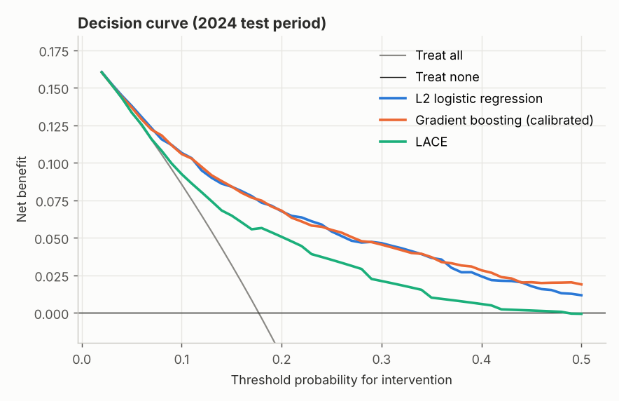
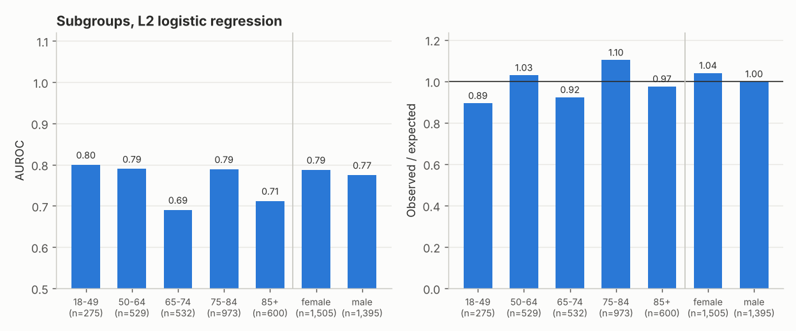
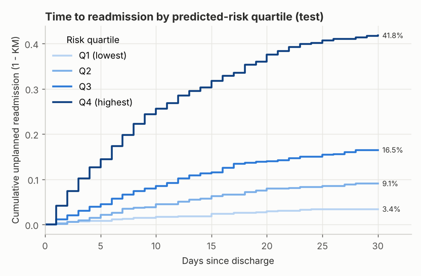

# Day 03: Hospital Readmission Risk on an OMOP-style Model

**Tier I - Advanced** | **Domain:** Healthcare | **Tools:** pandas, Pydantic, DuckDB (SQL), scikit-learn, matplotlib | **Data:** SYNTHETIC

## Executive summary

Nested FHIR-style records from three simulated EHRs are validated, mapped into one OMOP-style data model, and turned into a SQL-defined cohort of 9,301 index admissions. On a held-out 2024 period, a regularised logistic regression ranks 30-day readmission risk with AUROC 0.782, against 0.707 for the LACE index used in many hospitals. Its probabilities are well calibrated: calibration slope 1.018 (95% CI 0.928-1.113) and observed/expected 1.02. At a 20% risk threshold it flags 29% of discharges and catches 63% of readmissions, and it gives more net benefit than LACE, "treat everyone" or "treat no one" at every threshold from 2% to 50%. All patients and results here are synthetic.

## Architecture



## Data provenance

- **Path used: synthetic generator.** The brief prefers Synthea. `scripts/generate_data.py` probes the public Synthea sample-data download before generating. From the build container the probe returned `unreachable (URLError: Tunnel connection failed: 403 Forbidden)`, which is recorded in `data/generated/manifest.json`. The run then fell back to the generator automatically. This build has no Synthea FHIR adapter, so the generator would also have been used if the probe had succeeded (see Limitations).
- **Generator:** `src/readmit/generate.py` (NumPy, seed 42, one RNG stream per patient). No real patient data is used.
- **Scale used for every reported number:** 20,000 patients over 2021-01-01 to 2024-12-31. That gives 20,000 bundles holding 894,888 resources: 203,222 Encounters, 96,855 Conditions, 259,399 MedicationRequests and 315,393 Observations. They are split across three EHR feeds (8,906 / 7,091 / 4,003 bundles). The 17.5 MB of gzipped NDJSON is regenerated by `make run` into `data/generated/` and is never committed.
- **Committed sample:** `data/sample/` (0.68 MB on disk, 800 patients, seed 43, same generator). `tests/test_pipeline.py` checks that the generator reproduces it byte for byte.

**The three EHR feeds differ the way real feeds do:**

| Feed | Condition codes | Lab units | Timestamps |
|---|---|---|---|
| `ehr_a` | ICD-10-CM | g/dL, mg/dL | `...Z` |
| `ehr_b` | ICD-10-CM | g/L, umol/L, mmol/L glucose, 10\*9/L | `...-05:00` |
| `ehr_c` | SNOMED CT | sodium in mEq/L | no seconds, no zone |

**Simulated clinical structure** (correlations are written into the generator, not learned from real data):
- Age and a latent frailty score drive 11 chronic conditions, with onset before or during the window. For example, CKD is more likely with diabetes and CHF more likely after MI or AF.
- Conditions drive maintenance drugs (renewed yearly), ED visits and admission rates.
- Each admission has a primary diagnosis that depends on comorbidity (for example CHF and COPD exacerbations, sepsis, or GI bleeding with cirrhosis). It also gets a length of stay, admission and discharge labs (anaemia, hyponatraemia, AKI) and a discharge disposition.
- At each discharge, a logistic hazard of the discharge state decides whether an unplanned readmission happens within 30 days. Inputs include age, comorbidities, prior admissions, ED use, length of stay, discharge haemoglobin, sodium and creatinine, polypharmacy, disposition, an age-by-CHF interaction and unobserved frailty. Planned admissions are generated too: chemotherapy cycles every about 21 days, elective joint replacement, and staged PCI 7-25 days after an MI. The cohort must not count these as outcomes.
- **Deliberate defects:** 1% of bundles (199) get one of ten defect types, for example a mislabelled unit, a dangling reference, or care after death. The defect type is recorded in the manifest so validation can be scored.

**Vocabulary note.** Standard OMOP concept ids are used only for gender (8507/8532), visit type (9201/9202/9203) and record type (32817). Clinical concepts get local ids in the OMOP-reserved range (2,000,000,000 and above), and the original code is kept in `*_source_value`. No OHDSI Athena vocabulary is shipped. The ICD-10-CM, SNOMED CT, RxNorm and LOINC codes are hand-mapped labels on synthetic data.

## Method

1. **Schema validation (`schemas.py`).** Pydantic v2 models cover a strict subset of FHIR R4: Bundle, Patient, Encounter, Condition, MedicationRequest and Observation. A discriminated union on `resourceType` selects the model. Resource-level rules:
   - enumerated gender, encounter class and priority;
   - `period.end` not before `period.start`;
   - birth date not in the future;
   - ICD-10/SNOMED, RxNorm and LOINC code systems;
   - a finished inpatient stay must have a discharge time and disposition;
   - each LOINC lab must use an allowed unit and, after conversion, fall in a plausible range.

   Bundle-level rules: exactly one Patient, unique ids, every `subject` points to that Patient, every `encounter` reference resolves, and no encounter starts after death. A failing bundle is rejected whole, and every error carries its location, e.g. `entry.2.resource.Observation: unit 'mg' is not allowed for LOINC 718-7 (hemoglobin)`.
2. **Normalisation (`normalise.py`).** Valid bundles map to OMOP CDM v5.4-named tables with integer surrogate keys:
   - **person:** 19,801 rows
   - **death:** 1,811
   - **visit_occurrence:** 201,213
   - **condition_occurrence:** 95,880
   - **drug_exposure:** 256,719
   - **measurement:** 312,378

   Labs are converted to one canonical unit per LOINC code. SNOMED and ICD-10 codes map to the same concept. Diagnosis rank goes to `condition_status_source_value`. One non-standard column, `visit_occurrence.priority_source_value`, carries admission priority, because the CDM has no slot for it and planned readmissions need it.
3. **SQL cohort (`sql/cohort.sql`, DuckDB).** Every inpatient discharge gets exactly one exclusion reason: the first rule it fails, in this order.
   1. Discharge inside the first 365 days, which are kept as lookback.
   2. Fewer than 30 days of follow-up left.
   3. Age under 18.
   4. Died in hospital.
   5. Transferred to another acute hospital.
   6. Left against medical advice.
   7. Planned chemotherapy admission.
   8. Died within 30 days before any readmission, so the outcome cannot be observed.

   The outcome is any **unplanned** (priority not `EL`) inpatient admission starting 0-30 days after discharge. Planned readmissions are counted separately and are not outcomes. Attrition is a `GROUP BY` of the reasons, so cohort counts come from one command and are fingerprinted (SHA-256 of visit id and outcome) in `metrics.json`.
4. **Features (`sql/features.sql`).** Everything is known at discharge:
   - age and sex
   - log length of stay
   - emergent or elective admission
   - primary diagnosis and disposition
   - inpatient visits in the prior 365 days, ED visits in the prior 180 days, ambulatory visits in the prior 365 days
   - 11 comorbidity flags and a Charlson score restricted to this vocabulary
   - distinct drugs in the prior 365 days
   - last discharge labs, minimum haemoglobin and maximum creatinine

   `sql/lace.sql` computes LACE (Length, Acuity, Comorbidity, ED visits).
5. **Models (`model.py`).** The split is temporal: train on discharges in 2022-2023 (6,392 admissions, 1,048 events) and test on 2024 discharges (2,909 admissions, 515 events).
   - **Regularised logistic regression:** median imputation with missingness indicators, cubic splines (4 knots) on age and labs, standardisation and one-hot categoricals. L2 strength is chosen by 5-fold CV on log loss (C = 0.0046).
   - **Gradient boosting:** `HistGradientBoostingClassifier` with early stopping, wrapped in 5-fold Platt (sigmoid) cross-fitted calibration.
   - **LACE baseline:** the integer score, mapped to a probability by a one-variable logistic fit on train.
   - **Model choice:** the primary model is chosen *before* touching the test set, by out-of-fold log loss on the training period with patients grouped within folds. Logistic regression won (0.3685 vs 0.3734).
6. **Evaluation (`evaluate.py`).**
   - Calibration slope and calibration-in-the-large come from logistic recalibration with an offset, fitted by Newton-Raphson.
   - Also reported: Brier and scaled Brier, O/E, AUROC and AUPRC.
   - 95% CIs come from a 500-replicate bootstrap that resamples *patients*, not admissions.
   - Calibration curves use deciles with Wilson intervals.
   - Decision-curve net benefit is computed at thresholds 0.02-0.50.
   - Subgroups are age band and sex.
   - Kaplan-Meier time to readmission is shown by risk quartile.
   - The generator's own readmission probability gives a ceiling for AUROC.

## Results

All values come from `results/metrics.json` and `results/report.md`, produced by `make run` on the full synthetic dataset.

**Validation (acceptance: invalid bundles rejected with clear errors)**

| | Count |
|---|---|
| Bundles read / valid / rejected | 20,000 / 19,801 / 199 |
| Injected defects caught | **199 / 199** (all 10 defect types) |
| Valid bundles wrongly rejected | 0 |

Every rejection, with its injected defect type and full error text, is listed in `results/validation_rejections.csv`. `tests/test_schemas.py` has 19 tests that check specific messages.

**Cohort attrition (acceptance: reproducible from one command; `results/cohort_attrition.csv`)**

| Step (first failing rule) | Discharges | of which unplanned readmit ≤30d |
|---|---|---|
| 01 discharge inside 365-day lookback | 6,053 | 745 |
| 02 under 30 days of follow-up left | 370 | 26 |
| 03 age under 18 | 22 | 2 |
| 04 died in hospital | 388 | 0 |
| 05 transferred to another acute hospital | 338 | 8 |
| 06 left against medical advice | 135 | 38 |
| 07 planned admission for chemotherapy | 1,123 | 143 |
| 08 died within 30 days before any readmission | 252 | 0 |
| **Eligible index admissions** | **9,301** (5,932 patients) | **1,563 (16.8%)** |

A further 305 planned readmissions fell within 30 days of an index discharge. They are correctly *not* counted as outcomes. Two consecutive clean `make run`s produced the same cohort fingerprint and an identical `metrics.json` apart from timings.

**Test-period performance (2024 discharges: 2,909 admissions, 515 readmitted, 17.7%)**

| Model | AUROC (95% CI) | AUPRC | Brier | Scaled Brier | Calibration slope (95% CI) | CITL | O/E |
|---|---|---|---|---|---|---|---|
| **L2 logistic regression (primary)** | **0.782** (0.756-0.806) | 0.465 | **0.1200** | 0.176 | **1.018** (0.928-1.113) | 0.031 | 1.021 |
| Gradient boosting, calibrated | 0.783 (0.757-0.807) | 0.475 | 0.1191 | 0.183 | 1.104 (1.005-1.217) | 0.040 | 1.028 |
| LACE (recalibrated) | 0.707 (0.678-0.734) | 0.329 | 0.1329 | 0.088 | 1.006 (0.859-1.165) | 0.057 | 1.044 |
| *Generator's true probability (ceiling)* | *0.804* | | | | | | |

**Acceptance (calibration slope between 0.8 and 1.2 on test): met.** The point estimates are 1.018 for the primary model, 1.104 for gradient boosting and 1.006 for LACE. Training out-of-fold results were close to test: logistic AUROC 0.779, slope 1.046; boosting AUROC 0.771, slope 1.110. Both models sit about 0.02 AUROC below the ceiling set by the generator's own probabilities. Gradient boosting matches the logistic model but does not beat it. The simulated risk is mostly additive on the logit scale, and splines capture the lab thresholds.



**Decision curve (`results/decision_curve.csv`)**

| Threshold | Net benefit: logistic | Gradient boosting | LACE | Treat all | Logistic flags | Sensitivity | PPV |
|---|---|---|---|---|---|---|---|
| 10% | 0.1065 | 0.1058 | 0.0924 | 0.0856 | 56.4% | 86.0% | 27.0% |
| 15% | 0.0840 | 0.0841 | 0.0648 | 0.0318 | 39.0% | 73.4% | 33.3% |
| 20% | 0.0676 | 0.0681 | 0.0506 | -0.0287 | 29.0% | 63.3% | 38.7% |
| 30% | 0.0464 | 0.0454 | 0.0212 | -0.1757 | 16.3% | 46.0% | 49.9% |

The primary model has higher net benefit than both "treat all" and "treat none" at all 49 thresholds from 0.02 to 0.50. At a 20% threshold its net benefit of 0.068 equals finding 6.8 true readmissions per 100 discharges with no wasted interventions. LACE gives 5.1.



**Subgroups, primary model, test (`results/subgroup_performance.csv`)**

| Subgroup | n | Events | Observed | Predicted | O/E | AUROC | Slope |
|---|---|---|---|---|---|---|---|
| Age 18-49 | 275 | 13 | 4.7% | 5.3% | 0.89 | 0.799 | n/a (<20 events) |
| Age 50-64 | 529 | 55 | 10.4% | 10.1% | 1.03 | 0.789 | 1.24 |
| Age 65-74 | 532 | 70 | 13.2% | 14.3% | 0.92 | 0.690 | 0.84 |
| Age 75-84 | 973 | 221 | 22.7% | 20.6% | 1.10 | 0.789 | 1.16 |
| Age 85+ | 600 | 156 | 26.0% | 26.7% | 0.97 | 0.712 | 0.77 |
| Female | 1,505 | 285 | 18.9% | 18.2% | 1.04 | 0.787 | 1.02 |
| Male | 1,395 | 228 | 16.3% | 16.4% | 1.00 | 0.775 | 1.00 |

Nine test admissions have sex recorded as `unknown`. They are kept in the model but are too few to report as a subgroup.



**Clinical-safety discussion.**
- Calibration holds by sex, with O/E 1.04 for women and 1.00 for men.
- Discrimination is weaker at ages 65-74 (AUROC 0.690) and 85+ (0.712). In both bands most patients carry several comorbidities, so the features separate them less well.
- The 85+ slope of 0.77 means predictions there are somewhat too spread out. The 75-84 band is under-predicted by about 10% (O/E 1.10), so a fixed threshold would flag slightly too few of them. These are the patients with the most readmissions, which is the band where under-flagging does the most harm.
- A deployment should:
  - monitor O/E by age band monthly;
  - consider band-specific recalibration if the 75-84 gap persists on real data;
  - use the score to *add* transitional-care resources, never to withhold them. A low score is not a reason to skip discharge planning.
- AMA discharges are excluded from the cohort, which follows CMS convention. Their crude readmission rate is high (38 of 135, 28%), so a deployed tool needs a separate pathway for them rather than silence.
- The model has no social-determinant features. Those are a known driver of readmission and a known equity risk.

**Survival framing (stretch, `results/km_by_risk_quartile.csv`).** Among readmitted test patients, the median time to readmission is 9 days, and 43.9% return within 7 days. That argues for follow-up calls in the first week.

| Risk quartile | n | Mean predicted | KM cumulative readmission, day 7 | Day 30 |
|---|---|---|---|---|
| Q1 (lowest) | 728 | 4.5% | 1.2% | 3.4% |
| Q2 | 727 | 8.8% | 3.4% | 9.1% |
| Q3 | 727 | 16.1% | 6.6% | 16.5% |
| Q4 (highest) | 727 | 40.1% | 19.8% | 41.8% |



**Acceptance criteria**

| Criterion | Status |
|---|---|
| Invalid bundles rejected with clear errors (tests) | Met: 199/199 injected defects rejected, 0 false rejections; 19 schema tests |
| Cohort counts reproducible from a single command | Met: `make run` (or `make test`, on the sample) rebuilds attrition from SQL; fingerprint identical across runs; test asserts it |
| Calibration slope reported, 0.8-1.2 on test | Met: 1.018 (primary), 1.104 (gradient boosting), 1.006 (LACE) |
| `make test` passes from a clean checkout | Met: 37 tests, about 21 s (also run under Python 3.11 with the pinned requirements, as in CI) |
| `make run` reproduces every number and figure | Met: 303 s on 4 vCPU, CPU only (two consecutive clean runs gave identical metrics) |
| Stretch: LACE baseline | Done: AUROC 0.707 vs 0.782 |
| Stretch: survival framing | Done: Kaplan-Meier by risk quartile (no Cox model) |

## What this demonstrates

| Skill | Where |
|---|---|
| Healthcare data standards | FHIR-style bundles from three heterogeneous feeds (ICD-10 vs SNOMED, US vs SI units, time-zone styles) normalised into OMOP CDM-named tables with concept ids, source values and unit harmonisation (`generate.py`, `normalise.py`) |
| Schema validation | Pydantic v2 discriminated unions, field and model validators, cross-resource integrity checks, located error messages, rejection audit scored against injected defects (`schemas.py`, `tests/test_schemas.py`) |
| Clinical risk modelling | SQL cohort with ordered CMS-style exclusions and a planned-readmission rule, discharge-time features, temporal validation, patient-grouped CV, regularised logistic regression with splines vs calibrated boosting vs LACE (`sql/`, `model.py`) |
| Calibration | Calibration slope and intercept by offset logistic regression, patient-level bootstrap CIs, decile calibration curves, decision-curve net benefit, subgroup O/E (`evaluate.py`) |

## Limitations

- **The data is synthetic.** The generator was written to contain the relationships the model looks for, so AUROC 0.78 and good calibration show the pipeline works, not clinical validity. Real readmission models usually reach an AUROC of 0.65-0.75. The generator's own probabilities cap this data at 0.804.
- **Synthea was not used.** The brief prefers Synthea when it can be downloaded. The download was unreachable from the build container (HTTP 403 from the egress proxy), so the documented fallback ran. No Synthea-to-schema adapter was written, so even with network access the run would use the generator. Real Synthea R4 bundles use `urn:uuid` references and many more fields, and would need an adapter before these schemas accept them.
- **Simplified vocabulary.** There are 22 condition, 20 drug and 6 lab codes with local concept ids, and no Athena mapping. The Charlson score covers only the 8 weighted conditions present.
- **Simplified CMS logic.** Planned readmissions are flagged by encounter priority (`EL`) rather than the CMS planned-readmission algorithm. Only chemotherapy is excluded as a planned *index* admission. Each patient belongs to one EHR, so there is no cross-feed patient matching.
- **Gradient boosting's slope CI reaches 1.217**, just above the 1.2 bound, although its point estimate (1.104) is inside. Its predictions are slightly under-dispersed after Platt scaling. The primary logistic model's CI (0.928-1.113) is fully inside.
- **Small subgroups.** The 18-49 band has only 13 events, so no slope is reported for it.
- **The survival analysis is descriptive only**: Kaplan-Meier curves, with no Cox or competing-risk model. Deaths within 30 days are excluded (rule 08) rather than treated as a competing risk.

## How to run

```bash
cd day-03-healthcare-readmission-omop
make setup       # pip install -r requirements.txt (pinned; Python 3.11+)
make run         # probe Synthea, generate 20,000 SYNTHETIC patients, validate, OMOP, SQL cohort, models -> results/ (~5 min, 4 vCPU)
make test        # pytest: schema rejections, normalisation, cohort SQL edge cases, metrics, determinism, smoke run on data/sample
make sample-run  # quick end-to-end on data/sample, writes to data/sample_results (not results/)
make lint        # ruff check + format check
```

The OMOP tables live in an in-memory DuckDB during the run. To query them, call `readmit.pipeline.build(data_dir, db_path="data/generated/omop.duckdb")`.
