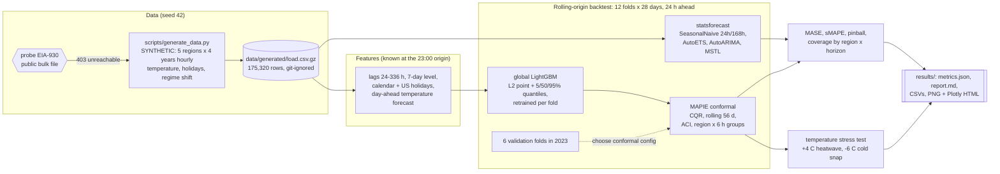
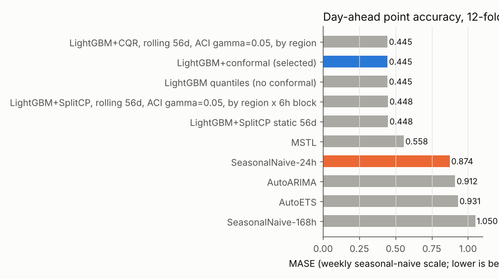
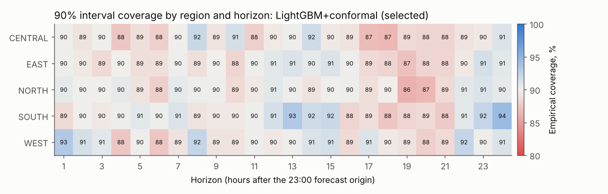
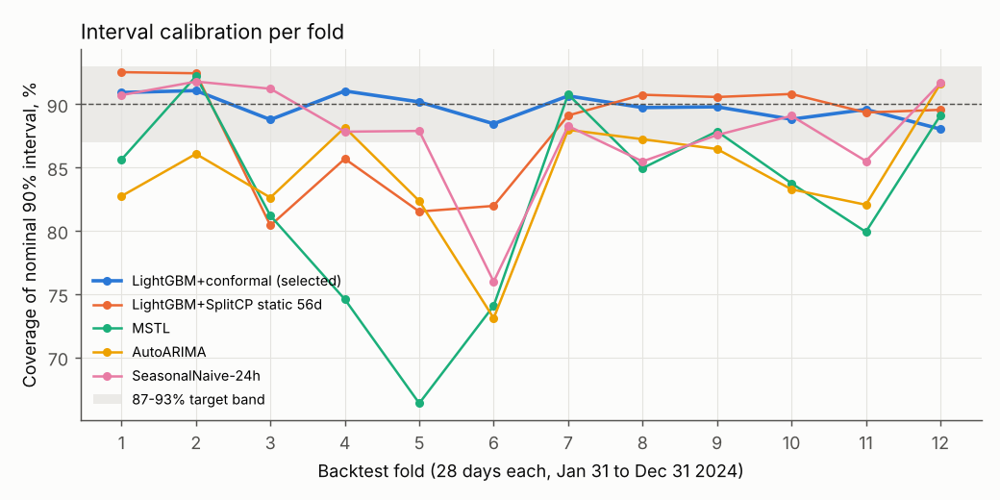
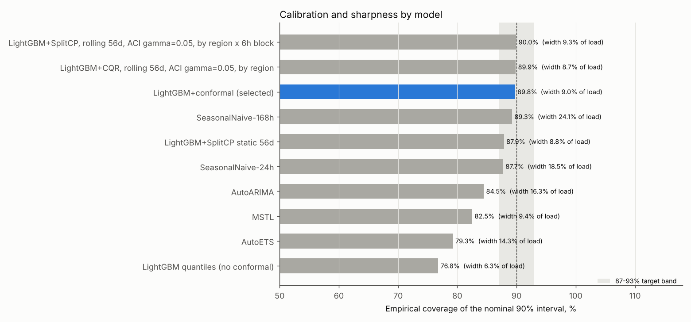
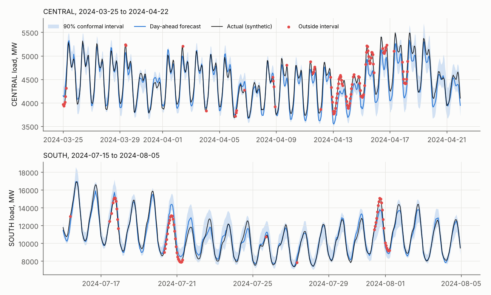

# Day 04: Grid Load Forecasting with Probabilistic Backtesting

**Tier I - Advanced** | **Domain:** Energy & utilities | **Tools:** statsforecast, LightGBM, MAPIE, pandas, Plotly, matplotlib | **Data:** SYNTHETIC

## Executive summary

A single global LightGBM model forecasts next-day hourly load for five grid regions. Over a 12-fold, 336-day rolling-origin backtest it cuts day-ahead error roughly in half against the seasonal-naive rule: MASE 0.445 vs 0.874 (49.1% lower), sMAPE 2.11% vs 4.00%. Its conformal 90% intervals contain 89.8% of actual hours overall and 89.3-90.2% in every region, while classical ETS, ARIMA and MSTL intervals contain only 79-85%, so the operator can size reserves from intervals that mean what they say. All data is synthetic: the public EIA-930 feed was unreachable from the build machine, so the documented generator was used.

## Architecture



## Data provenance

- **Path used: synthetic generator.** The brief prefers public hourly load (EIA-930 or ENTSO-E). `scripts/run_backtest.py` probes the EIA-930 six-month balance file (no API key needed) before every run. From the build container the probe returned `URLError: Tunnel connection failed: 403 Forbidden`. That result is recorded in `results/metrics.json` (`data.public_probe`) and in `data/generated/manifest.json`. ENTSO-E needs an API token, so it was not tried. This build has no EIA-930 adapter (see Limitations), so the generator would also have been used if the probe had succeeded.
- **Generator:** `src/gridcast/generate.py` (NumPy, seed 42). It produces hourly load in MW plus actual and day-ahead forecast temperature for five fictional regions. No real utility data is used.
- **Scale used for every reported number:** 5 regions x 4 years (2021-01-01 to 2024-12-31), 35,064 hours each, 175,320 rows in total. The 1.8 MB gzipped CSV is regenerated by `make run` into `data/generated/` and is never committed.
- **Committed sample:** `data/sample/load.csv.gz` (108 KB, regions NORTH and CENTRAL, 2024-01-01 to 2024-07-31, seed 43). The tests run a small backtest on it, and `tests/test_generate.py` checks that the generator rebuilds it byte for byte.

**What the generator builds in** (the structure the models should find):

| Component | How it is generated |
|---|---|
| Daily and weekly shape | Night trough, morning ramp, daytime plateau and evening peak. Weekends and holidays use a lower, later profile. |
| Annual seasonality and weather | Temperature = annual cycle + daily cycle + persistent AR(1) anomalies, partly shared across regions. Load responds to a thermally smoothed temperature (5 h half-life): heating below 15 C, cooling above 20 C (convex). Heating weighs more in the morning and evening, cooling in the afternoon. |
| Regions | NORTH (cold, heating-led), SOUTH (hot, cooling-led), EAST (largest, mixed), WEST (mild), CENTRAL (continental). Base loads range from 4,000 to 11,000 MW. |
| Holidays | US federal holidays from the `holidays` package (load x0.95), plus a Christmas-week dip. |
| Growth and noise | 1.2% a year load growth. AR(1) multiplicative noise (sd 1.2%, phi 0.9 hourly). |
| Regime shift | A data-centre cluster connects in CENTRAL on 2024-04-01. It ramps in over 14 days to +12% of base load (+480 MW) and lands inside test fold 3. |
| Day-ahead temperature forecast | Actual temperature + a persistent error (about 1.2 C). **Models only ever see this forecast for target hours**, never the realised temperature. |

Timestamps are naive local standard time with no daylight-saving shifts.

## Method

1. **Forecast set-up.** A forecast is issued every day at 23:00 for the 24 hours of the next day (horizons 1-24). This is the day-ahead scheduling problem in the brief.
2. **Rolling-origin backtest (`backtest.py`).** The test period is 12 consecutive 28-day folds covering 2024-01-31 to 2024-12-31 (336 days). That gives 336 forecast origins x 24 hours x 5 regions = 40,320 forecasts per model.
   - Each fold refits every model using only data before that fold.
   - Within a fold, the forecast origin rolls forward one day at a time.
3. **Classical baselines (statsforecast `cross_validation`, one fit per fold).**

   | Model | Settings | Training window |
   |---|---|---|
   | SeasonalNaive-24h and SeasonalNaive-168h | none | full history |
   | AutoETS | additive season 24, damped trend | 28 days |
   | AutoARIMA | seasonal 24, orders capped at p, q ≤ 2 and P, Q ≤ 1 | 14 days |
   | MSTL | seasons 24 and 168, ETS trend | 56 days |

   ETS, ARIMA and MSTL are fitted at the fold origin and then rolled forward each day with `forward` (`refit=False`). The windows and the ARIMA caps keep the run laptop-sized. Their 90% intervals are statsforecast's own model-based intervals.
4. **Global LightGBM (`features.py`, `models.py`).** One model covers all five regions (region is a categorical feature).
   - **Target:** load divided by a trailing 7-day mean ("level") that ends 24 h before the target. This makes one model work across regions of different size, and it can follow level shifts that trees could not extrapolate.
   - **Features:**
     - load lags of 24, 48, 72, 168 and 336 h, plus the previous-day mean, all scaled by the level, and the log level
     - hour, day of week, US holiday and off-day flags, Christmas week, day-of-year sine and cosine
     - day-ahead temperature forecast: raw, smoothed, HDD and CDD, and the next day's forecast max and min
     - realised temperature lagged 24 h

     Every load feature uses only values at or before t-24 h, so nothing after the origin is used. `tests/test_features.py` checks this by perturbing all data after the origin.
   - **Models per fold:** four LightGBM models (L2 point, plus 5%, 50% and 95% quantile objectives), 600 trees each. Hyperparameters are fixed and were not tuned on test data. Training ends 56 days before the fold starts, so the calibration window and the fold are both out-of-sample.
5. **Conformal intervals (`conformal.py`, MAPIE 1.5).** Cached model predictions are wrapped in a prefit `CachedPrediction` estimator and passed to `SplitConformalRegressor` (absolute residual) or `ConformalizedQuantileRegressor` (CQR). Calibration is **Mondrian**: each region gets its own calibration set, or each region x 6-hour block of horizons. In rolling mode it is **redone at every daily origin** on the last 28 or 56 days of realised out-of-sample errors. **Adaptive Conformal Inference** (ACI; Gibbs and Candès 2021) can also nudge the miscoverage level each day: alpha <- alpha + 0.05 x (0.10 - yesterday's miss rate). ACI warms up inside the calibration window, so every fold starts with an adapted alpha.
6. **Choosing the conformal configuration without touching the test year.** 16 configurations were scored on 6 validation folds in 2023 (starting 2023-02-01 and every 56 days after):
   - method: SplitCP or CQR
   - rolling window: 28 or 56 days
   - ACI: off or on (gamma 0.05)
   - groups: region, or region x 6 h block

   The criterion was the mean |coverage - 90%| over the 120 region x horizon cells, with interval width as the tie-break. The winner was **CQR, rolling 56 d, ACI gamma 0.05, by region x 6 h block** (cell error 0.014 vs 0.039-0.042 for region-only SplitCP; `results/conformal_selection_validation.csv`). It is labelled `LightGBM+conformal (selected)` everywhere.
7. **Metrics (`metrics.py`).**
   - **MASE:** scaled per region and fold by the in-sample MAE of the weekly seasonal-naive forecast over the 365 days before the fold, then averaged with equal weight.
   - **sMAPE:** on a 0-200 scale.
   - **Pinball loss:** averaged over q = 0.05, 0.5 and 0.95, reported both in MW and scaled like MASE.
   - **Interval metrics:** empirical coverage of [q05, q95], mean width as % of load, and the Winkler interval score.
8. **Temperature stress test (stretch, `backtest.stress_test`).** The *same* synthetic world (same random draws) is regenerated with temperature shifted for one week in all regions:
   - +4 C heatwave, 2024-07-22 to 07-29
   - -6 C cold snap, 2024-02-05 to 02-12

   Each scenario is forecast with that fold's trained models and the selected conformal procedure. Because the generator gives the true response, both the forecast peak and interval coverage can be checked.

## Results

All values come from `results/metrics.json`, `results/report.md` and the CSVs beside them. They were produced by `make run` on the full synthetic dataset. Two consecutive runs gave identical `summary_by_model.csv`.

**Accuracy and calibration, 12 folds, 40,320 forecasts per model (`results/summary_by_model.csv`)**

| Model | MASE | vs best seasonal naive | sMAPE | Scaled pinball | Pinball (MW) | 90% coverage | Width (% of load) | Winkler (MW) |
|---|---|---|---|---|---|---|---|---|
| **LightGBM+conformal (selected)** | **0.445** | **-49.1%** | **2.11%** | **0.115** | **44.88** | **89.8%** | 8.97 | 969 |
| LightGBM+CQR, rolling 56d, ACI, by region | 0.445 | -49.1% | 2.11% | 0.114 | 44.58 | 89.9% | 8.71 | 951 |
| LightGBM+SplitCP, rolling 56d, ACI, by region x 6h | 0.448 | -48.7% | 2.12% | 0.117 | 45.30 | 90.0% | 9.32 | 982 |
| LightGBM+SplitCP static 56d (textbook split conformal) | 0.448 | -48.7% | 2.12% | 0.119 | 46.31 | 87.9% | 8.84 | 1,043 |
| LightGBM quantiles (no conformal) | 0.445 | -49.1% | 2.11% | 0.119 | 46.87 | 76.8% | 6.27 | 1,088 |
| MSTL | 0.558 | -36.2% | 2.59% | 0.161 | 64.18 | 82.5% | 9.35 | 1,626 |
| SeasonalNaive-24h | 0.874 | 0.0% | 4.00% | 0.249 | 93.83 | 87.7% | 18.53 | 2,297 |
| AutoARIMA | 0.912 | +4.3% | 4.13% | 0.247 | 92.77 | 84.5% | 16.27 | 2,136 |
| AutoETS | 0.931 | +6.5% | 4.31% | 0.253 | 96.00 | 79.3% | 14.26 | 2,199 |
| SeasonalNaive-168h | 1.050 | +20.1% | 5.11% | 0.292 | 125.82 | 89.3% | 24.14 | 3,056 |

All LightGBM rows share the same point forecast (the median or L2 model), so their MASE and sMAPE are equal or nearly equal. They differ only in the interval. Yesterday-same-hour (24h) is the stronger seasonal-naive rule here, so it is the reference.



**Interval calibration**

- **Overall and by region.** The selected intervals contain 89.8% of actual hours. By region: CENTRAL 89.3%, EAST 89.6%, NORTH 89.6%, SOUTH 90.2%, WEST 90.1%.
- **By fold.** Coverage per 28-day fold ranges from 88.0% to 91.1%, so every fold is inside 87-93%. The regime-shift fold (fold 3) is at 88.8%.
- **By region x horizon** (`results/coverage_region_horizon.csv`). **113 of 120** cells are inside 87-93%. The range is 86.3% (NORTH, horizon 19) to 94.3% (SOUTH, horizon 24). With 336 days per cell, the sampling standard error is about 1.6 points, so a few cells outside the band are expected even when calibration is perfect.
- **Comparison methods.**
  - Raw LightGBM quantiles cover only 76.8%: quantile regression alone is over-confident.
  - Textbook static split conformal reaches 87.9% overall but falls to 80.4% in fold 3, when the CENTRAL data centre connects, and stays at 81.5-85.7% through the spring and summer folds (4-6) as cooling errors grow.
  - The classical models' own intervals cover 79.3% (ETS), 82.5% (MSTL) and 84.5% (ARIMA).







**By region (`results/metrics_by_region.csv`)**

| Region | Selected MASE | MSTL MASE | SeasonalNaive-24h MASE | Selected sMAPE | Selected coverage | Selected width (% of load) |
|---|---|---|---|---|---|---|
| CENTRAL | 0.566 | **0.503** | 0.765 | 2.78% | 89.3% | 9.06 |
| EAST | **0.419** | 0.559 | 0.858 | 1.96% | 89.6% | 8.78 |
| NORTH | **0.425** | 0.513 | 0.836 | 1.78% | 89.6% | 8.19 |
| SOUTH | **0.341** | 0.477 | 0.632 | 2.69% | 90.2% | 12.84 |
| WEST | **0.474** | 0.740 | 1.281 | 1.33% | 90.1% | 5.98 |

CENTRAL is the one region where MSTL beats LightGBM on MASE. CENTRAL has the regime shift, and MSTL's short 56-day window absorbs the new level faster than a global model trained on three years without it. LightGBM still wins on calibration there: 89.3% coverage vs 83.4% for MSTL.

**Seasonality of error (`results/metrics_by_fold.csv`).** The selected model's MASE ranges from 0.335 in late February to 0.572 in mid-August. Interval width roughly doubles from 6.3% to 11.7% of load between winter and early summer, because cooling load amplifies temperature-forecast error. The intervals widen with it while coverage stays between 88.0% and 91.1%.



An interactive version (Plotly) is in `results/forecast_examples.html`. The top panel shows CENTRAL through the April data-centre ramp (April 1-15). Misses cluster around April 9-17, while the new load is still arriving and the lags trail it. After that the rolling ACI calibration has widened the band and the lags have caught up.

**Temperature stress test (stretch, `results/stress_test.csv`)**

| Scenario (7 days, all regions) | Region | True peak (MW) | Forecast at peak hour (MW) | MAPE | 90% coverage |
|---|---|---|---|---|---|
| +4 C heatwave, Jul 22-29 | SOUTH | 15,282 | 12,676 | 4.31% | 94.6% |
| | EAST | 17,174 | 15,466 | 5.29% | 81.5% |
| | CENTRAL | 7,158 | 6,892 | 3.57% | 95.2% |
| | NORTH | 7,111 | 6,845 | 1.49% | 91.1% |
| | WEST | 8,681 | 8,392 | 1.80% | 93.5% |
| -6 C cold snap, Feb 5-12 | NORTH | 10,871 | 10,575 | 1.99% | 83.3% |
| | EAST | 15,215 | 14,530 | 2.35% | 86.9% |
| | SOUTH | 10,743 | 10,420 | 2.14% | 86.3% |
| | CENTRAL | 6,501 | 6,405 | 2.06% | 93.5% |
| | WEST | 8,333 | 8,010 | 1.51% | 85.1% |

- **Heatwave.** Average error stays modest (MAPE up to 5.3%), but the model **under-forecasts the extreme peaks**:
  - SOUTH: the true peak is 15,282 MW, but the forecast for that hour is 12,676 MW.
  - EAST: the true peak is 17,174 MW against a forecast of 15,466 MW, and interval coverage drops to 81.5%.

  Trees cannot extrapolate the convex cooling response beyond temperatures seen in training. This is the main risk a grid operator should take from this project: in record heat, add a physically based temperature-sensitivity uplift or a scenario margin on top of the conformal interval.
- **Cold snap.** Coverage drops to 83.3-86.9% in four of the five regions (NORTH, EAST, SOUTH, WEST). The conformal calibration uses recent errors, so it cannot anticipate an unprecedented week; ACI adapts only after misses occur.

**Acceptance criteria**

| Criterion | Status |
|---|---|
| 90% intervals achieve 87-93% empirical coverage in backtest | **Met**: 89.8% overall; 89.3-90.2% in each region; 88.0-91.1% in each fold. At the finer region x horizon level, 113 of 120 cells are in the band (min 86.3%, max 94.3%); see Limitations. |
| Best model beats seasonal naive MASE by at least 15% | **Met**: LightGBM MASE 0.445 vs 0.874 for SeasonalNaive-24h (the better seasonal-naive rule), 49.1% lower. MSTL, the best classical model, is 36.2% lower. |
| Backtest is a single reproducible command | **Met**: `make run` (13 min 51 s wall clock on 4 vCPU, CPU only). Two consecutive full runs produced identical `summary_by_model.csv`. |
| `make test` passes from a clean checkout | **Met**: 21 tests in about 60 s, on Python 3.13 and on Python 3.11 with the pinned requirements (as in CI). |
| `make run` reproduces every number and figure in this README | **Met**: every number above is in `results/`. |
| Stretch: temperature scenario stress test | **Done**: see above (exposes heatwave peak under-forecasting). |
| Stretch: hierarchical reconciliation | **Not attempted** |

## What this demonstrates

| Skill | Where |
|---|---|
| Time-series forecasting | Classical baselines with statsforecast (seasonal naive, AutoETS, AutoARIMA, MSTL). A global LightGBM over five regions with a level-normalised target, leak-free lag, calendar and holiday features, and day-ahead weather-forecast features (`models.py`, `features.py`). |
| Backtesting | 12-fold rolling-origin evaluation with daily origins and per-fold refits. Model selection on separate 2023 validation folds, never on test. MASE, sMAPE and pinball loss reported overall, by fold and by region. Determinism checked (`backtest.py`, `metrics.py`). |
| Uncertainty quantification | MAPIE split conformal and CQR with Mondrian groups, daily recalibration and Adaptive Conformal Inference. Coverage audited per region x horizon. Compared against raw quantile regression and model-based intervals. Stress-tested under weather scenarios with known ground truth (`conformal.py`). |

## Limitations

- **The data is synthetic.** The generator contains exactly the structure the features look for, so the 49% MASE gain shows the method works, not what it would achieve on a real grid. Real load also has DST shifts, outages, measurement errors and behind-the-meter solar, none of which are simulated.
- **No public data was used, and there is no EIA-930 adapter.** The EIA-930 probe was blocked by the build environment's egress proxy (HTTP 403), so the automatic fallback ran. Even with network access the run would use the generator: the probe only records reachability. Real EIA-930 data would also need a matching weather source, such as NOAA ISD, for the temperature features.
- **Per-cell coverage is not uniformly inside 87-93%.** 7 of 120 region x horizon cells fall outside. Four are below: CENTRAL at horizons 17-18 and NORTH at 19-20 (lowest 86.3%). Three are above (highest 94.3%). Part of this is sampling noise, with a standard error of about 1.6 points per cell. The acceptance criterion is met overall, per region and per fold.
- **The conformal design was revised once after a full run.** The first full run grouped calibration by region only and chose the configuration by region-level coverage. Its intervals were well calibrated per region but drifted with time of day: too wide overnight, too narrow in the afternoon. I then added the region x 6-hour-block grouping to the candidate grid and switched the selection criterion to cell-level coverage. Selection still happens only on the 2023 validation folds, but the decision to add this option was informed by test-period diagnostics. The region-only CQR variant is still reported above (89.9% overall).
- **Conformal guarantees are approximate here.** Hourly errors are autocorrelated and seasonal, so exchangeability does not hold. Rolling windows and ACI give good *empirical* long-run coverage, but there is no finite-sample guarantee. Coverage dips after abrupt changes: the regime-shift fold, and the cold-snap and heatwave scenarios.
- **The classical baselines are constrained to fit the 20-minute budget.**
  - AutoARIMA's orders are capped and it is trained on 14 days.
  - ETS is trained on 28 days with a daily season only.
  - ETS, ARIMA and MSTL parameters are frozen within each 28-day fold (`refit=False`); only their state rolls forward.

  Fuller versions might narrow the gap to LightGBM somewhat, though MSTL (the strongest of them) is already well behind.
- **Heatwave peaks are under-forecast** in the +4 C scenario (SOUTH peak hour: 12,676 MW forecast vs 15,282 MW true), as noted in Results.
- **Hierarchical reconciliation (stretch) was not attempted.**
- **Version note.** statsforecast publishes 2.1.x wheels only for Python 3.12+ and 2.0.x only for older versions. `requirements.txt` therefore pins 2.1.1 on 3.12+ and 2.0.1 on 3.11 (CI). Results were produced on Python 3.13 with 2.1.1. The test suite passes on both.

## How to run

```bash
cd day-04-energy-load-forecasting-conformal
make setup       # pip install -r requirements.txt (pinned; Python 3.11+)
make run         # probe EIA-930, generate SYNTHETIC data, validation + 12-fold backtest, stress test -> results/ (~14 min, 4 vCPU)
make test        # pytest: metrics, leakage check, conformal behaviour, generator determinism, smoke backtest on data/sample
make sample-run  # ~30 s end-to-end on data/sample, writes to data/sample_results (not results/)
make lint        # ruff check + format check
```

The scale is set in `src/gridcast/config.py` (`FULL` and `SAMPLE`). `make data` only generates the data, and `make sample` rewrites the committed sample.
