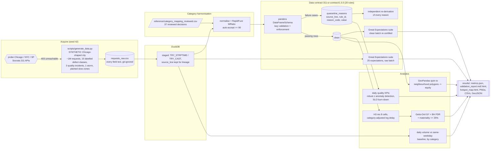
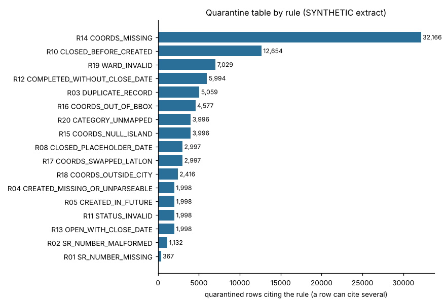
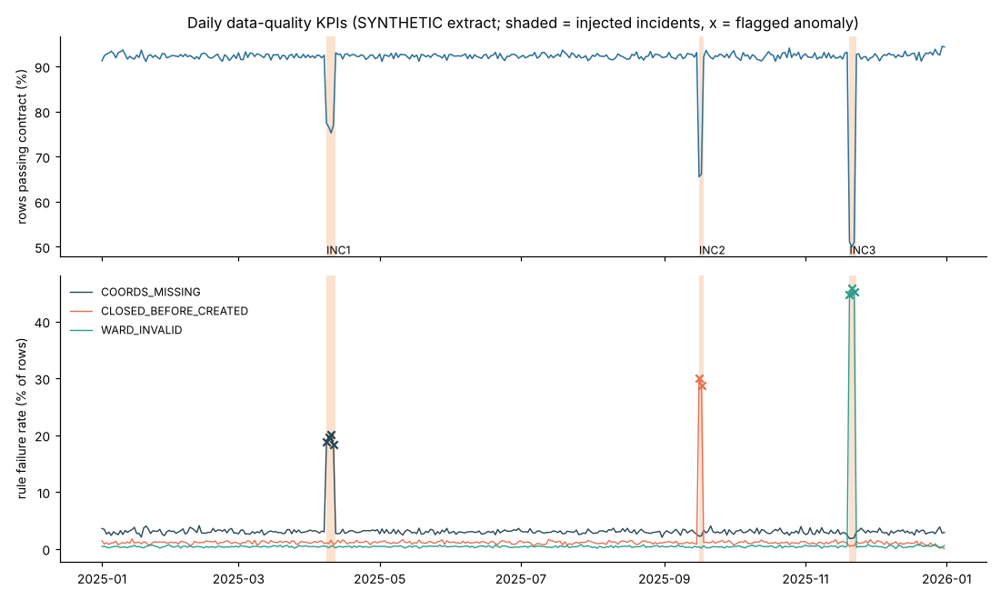
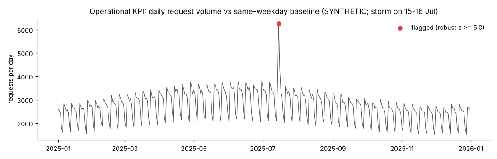
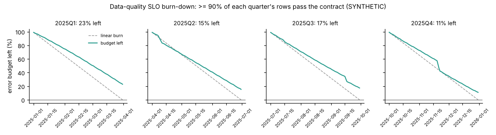
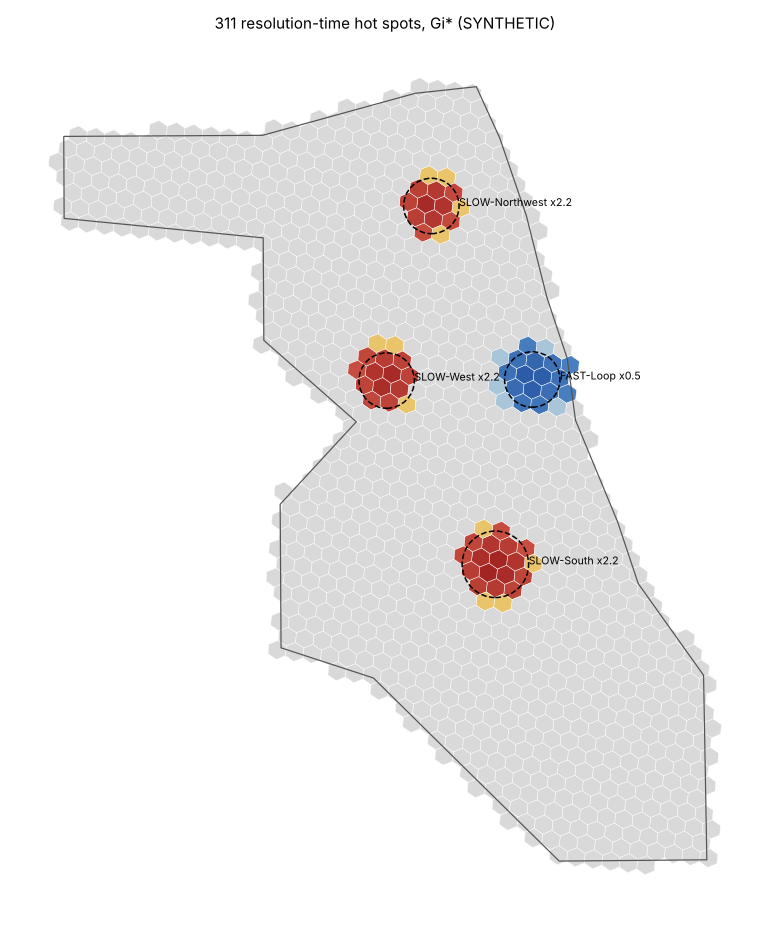
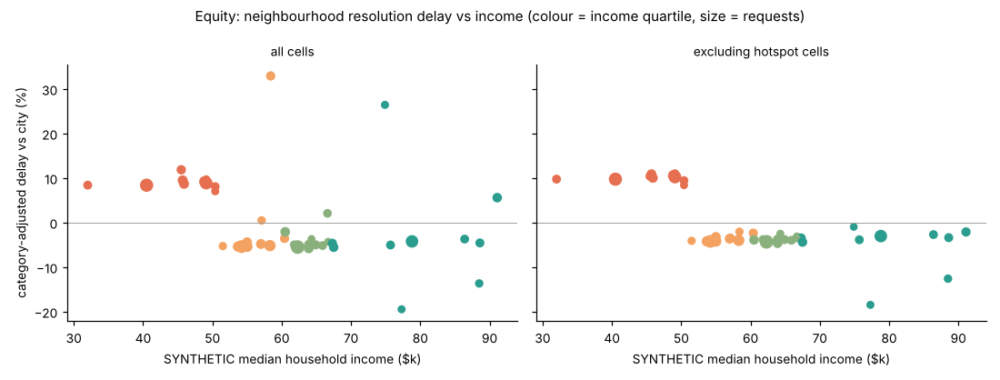

# Day 05: City 311 Data Quality and Service Hotspots

**Tier I - Advanced** | **Domain:** Public sector | **Tools:** pandera, Great Expectations, H3, GeoPandas, DuckDB, RapidFuzz, Shapely | **Data:** SYNTHETIC

## Executive summary

A 20-rule data contract quarantines 8.7% of a 1,004,073-row synthetic 311 extract: it catches every row in all 15 injected defect classes, wrongly rejects no clean rows, and traces every rejected row to a rule id and a source line. A daily anomaly detector flags all 9 days of three planted data incidents with no false alarms, and on H3 hexagons Getis-Ord Gi* finds all 36 cells in the three planted slow-service zones with 94.7% precision. All data is synthetic, because the public Socrata 311 APIs were unreachable from the build machine, so these results show that the checks work as designed, not how a real city's data would score.

## Architecture



## Data provenance

- **Path used: synthetic generator.** The brief prefers a public 311 extract. Before generating, `make run` probes the Chicago (`v6vf-nfxy`), NYC (`erm2-nwe9`) and SF (`vw6y-z8j6`) Socrata endpoints. All three returned `URLError: Tunnel connection failed: 403 Forbidden` from the build container, so the run fell back to the generator automatically. The probe results are in `results/metrics.json` under `data.public_probe`. This build has no Socrata adapter (see Limitations), so the generator would also have run if a probe had succeeded.
- **Generator:** `src/civic311/generate.py` (NumPy, seed 42). The city is a hand-digitised, simplified outline of Chicago (675 km², with the lakefront on the east). It has 50 synthetic wards and 40 synthetic neighbourhoods (Voronoi cells) with synthetic median incomes. It contains no real request data, addresses or people.
- **Scale used for every reported number:** 999,078 requests created in calendar year 2025 plus 4,995 appended duplicate rows, for **1,004,073 raw rows**. The extract time is 2026-01-01 00:00. The 127 MB raw CSV, the 62 MB truth file and the DuckDB warehouse are rebuilt in `data/generated/` by `make run` and are never committed.
- **Committed sample:** `data/sample/` holds 8,107 rows (seed 43), 308 KB in total: the gzipped raw CSV, the truth file and a manifest. The tests run the whole pipeline on it, and `tests/test_pipeline.py` checks that the generator rebuilds it exactly.

**What the generator builds in.** Every row also gets a truth label, which the pipeline never reads. Only the evaluation reads it.

| Component | How it is generated |
|---|---|
| Volume | 15 request types with their own shares and seasonality (for example potholes peak in March, rodents in July). Weekday factors run from 1.15 on Monday to 0.65 on Sunday. A two-day storm (15-16 July) multiplies Water On Street, Sewer Cave-In and Tree Trim requests 3-8x. |
| Location | 60% of requests come from 12 dense clusters and 40% are spread uniformly. All points fall inside the city polygon. |
| Resolution time | Lognormal around each type's median (12 h for signals to 480 h for tree trims), with winter backlog. Requests closing after the extract time stay `Open`. 3% are canceled. |
| Planted service zones (hotspot ground truth) | Three circles with resolution time x2.2 ("SLOW-South", "SLOW-West", "SLOW-Northwest") and one x0.5 ("FAST-Loop"). |
| Equity effect | Requests in the lowest-income quartile of neighbourhoods take x1.15 longer. |
| Category spellings | 72% of rows use the canonical name. The other 28% use one of 173 variants from a fixed catalog: case and whitespace, typos, abbreviations, legacy CRM codes (`PHF`, `SLA`...) and free-text synonyms ("Rat Problem"). |

**Injected defects.** Each class is a disjoint set of rows. "Rows" is the full-scale count from `results/defect_detection.csv`.

| Defect class | Rows | How it appears in the raw file |
|---|---|---|
| COORDS_MISSING | 32,166 | blank latitude and/or longitude (includes incident INC1) |
| COORDS_NULL_ISLAND | 3,996 | `0.0, 0.0` |
| COORDS_SWAPPED | 2,997 | latitude and longitude exchanged |
| COORDS_OUTSIDE_CITY | 3,996 | 60% in the bounding box but outside the city (lake, suburbs), 40% far away (NYC, Springfield, SF) |
| CLOSED_BEFORE_CREATED | 9,658 | closed 1 h-30 days before created (includes incident INC2) |
| CREATED_IN_FUTURE | 1,998 | created after the extract time |
| CLOSED_PLACEHOLDER | 2,997 | closed `1900-01-01` or `1970-01-01` |
| TIMESTAMP_UNPARSEABLE | 1,998 | created `N/A`, `TBD`, `00/00/0000 00:00`, `2025-13-45 25:61:00` |
| COMPLETED_WITHOUT_CLOSE | 5,994 | status Completed, closed date blank |
| OPEN_WITH_CLOSE | 1,998 | status Open with a closed date |
| STATUS_INVALID | 1,998 | `DONE`, `Closed?`, `completed - dup`, `Cancelled`, blank |
| WARD_INVALID | 7,028 | `0`, `99`, `-1`, `51`, `Ward 7`, blank (includes incident INC3) |
| SR_NUMBER_MALFORMED | 1,499 | `SR25-123`, `sr25 0001234`, `25-00001234`, blank |
| CATEGORY_UNMAPPABLE | 3,996 | `TEST ENTRY`, `Other`, `N/A`, `???`, blank, ... |
| DUPLICATE_RECORD | 4,995 | exact copy of a clean row, placed right after it |

**Data-quality incidents** (ground truth for the KPI anomaly detector):

- **INC1** (8-11 Apr): a mobile-app release drops the coordinates on 55% of Mobile App requests.
- **INC2** (16-17 Sep): an ETL bug writes closed timestamps before created on 30% of closed requests.
- **INC3** (20-22 Nov): a CRM sync outage blanks the ward on 45% of requests.

## Method

1. **Staging (DuckDB, `ingest.py`).** The CSV is read with every column as text. `source_line` (the 1-based data line in the file) is kept on every row and carried into every downstream table. Typed columns come from `TRY_STRPTIME` and `TRY_CAST`, so an unparseable value becomes NULL while the raw text is kept beside it. Shapely adds three spatial flags (`in_bbox`, `in_city_polygon`, `swapped_in_bbox`).
2. **Category harmonisation (`categories.py`).**
   - **Exact:** canonical names map directly.
   - **Normalised:** lower-case, strip punctuation, expand abbreviations (`st` to street, `lt` to light, `insp` to inspection ...), then match exactly.
   - **Fuzzy:** RapidFuzz `WRatio` against the 15 canonical names. A score of 90 or more is auto-accepted. A score of 70-90 is queued for review, and below 70 the value has no match.
   - **Review:** a reviewed mapping table (`reference/category_mapping_reviewed.csv`) overrides everything. Each entry records the decision (accept, override or reject), its basis and the reviewer.
   - **Unresolved:** a value with no reviewed decision stays unmapped and is quarantined as `CATEGORY_UNMAPPED`. The code never guesses.
3. **Data contract (`contract.py`).** 20 rules, each with a stable id (R01-R20) and a reason code, cover ids, timestamps, status, coordinates, ward, category and duplicates. They are implemented twice:
   - **pandera** `DataFrameSchema`, validated with `lazy=True`, is the enforcement layer. Column checks and nine row-wise DataFrame checks carry the reason code as their name. Each failure case becomes a row of the **reject table**: `source_line, sr_number, rule_id, reason_code, column, failure_value, detected_by, contract_version`. A row that breaks several rules gets one reject row per rule.
   - **Great Expectations 1.24** is the audit layer: an ephemeral context and a 25-expectation suite run on the raw batch, then again on the clean batch. The suite uses `row_condition` for the conditional rules (for example "Completed implies a closed date") and `expect_column_pair_values_a_to_be_greater_than_b` for closed >= created. The results feed `results/validation_report.md` and `.html` and the two GE JSON files.
   - **Traceability audit:** every reject row is re-derived by an independent plain-pandas implementation of each rule (`rule_masks`). The audit also checks that every violation found by that implementation is in the quarantine table.
4. **Quarantine (`pipeline.py`).** Rows with any reject reason leave the clean table. DuckDB persists the tables `staged`, `quarantine_reasons`, `quarantine_rows`, `category_mapping` and `clean`.
5. **Quality KPIs over time (`kpi.py`).** For each created date, the pipeline computes the contract pass rate and each rule's failure rate. Rows with no valid created date (3,996) are reported separately.
   - **Anomaly detection:** a robust z-score against the median of the previous 28 days. The scale is max(1.4826 x MAD, binomial sd at the baseline rate). The binomial sd uses the larger of the baseline and the pooled trailing rate. A day is flagged when z >= 6, the rate is at least 1 percentage point above baseline, *and* at least 5 rows fail. It runs on the overall failure rate and on each of the 20 rules.
   - **Operational KPI:** daily request volume, in total and per category, compared with the median of the same weekday over the previous 4 weeks. A day is flagged at a robust z >= 5 on the log ratio.
6. **Data-quality SLO burn-down (stretch).** The target is that at least 90% of each quarter's rows pass the contract. The error budget is 10% of the quarter's rows, and the chart tracks the share of budget left each day.
7. **Hotspots (`hotspots.py`).**
   - **Input:** completed, contract-passing requests. The response is the log of resolution hours minus the citywide mean log for that category, so the category mix does not create false hotspots.
   - **Cells:** H3 resolution 8 (about 0.74 km² each). Only cells with at least 30 requests are scored.
   - **Gi\*:** Getis-Ord Gi\* with binary weights over the cell and its six ring-1 neighbours, then Benjamini-Hochberg FDR at q < 0.05.
   - **Labels:** a cell is a **hot spot** if it is significant *and* its Gi\* window is at least 25% slower than the city. A **cold spot** is significant and at least 20% faster (1/1.25). Significant cells below that size are labelled "significant, not material".
   - **Comparison:** a naive per-cell z-score with the same FDR and materiality rules, without spatial pooling.
   - **Outputs:** the map is a self-contained HTML file with inline SVG (no scripts, tiles or CDNs), plus a GeoPandas PNG and a GeoJSON.
8. **Equity (stretch, `equity.py`).** Requests are assigned to the 40 neighbourhood polygons with a GeoPandas spatial join (`sjoin`, predicate `within`). The analysis compares the mean category-adjusted delay of the lowest-income quartile (Q1) with the highest (Q4), with a 2,000-draw bootstrap over neighbourhoods. It is run with and without the requests in Gi\* hot-spot cells.
9. **Evaluation against truth (`evaluate.py`).** Because the data is synthetic, every number above can be checked against what was injected: recall per defect class, false quarantines, harmonisation accuracy, incident days found and hotspot precision and recall.

## Results

All values come from `results/metrics.json` and the CSVs and reports beside it, produced by `make run` at full scale.

**Headline metrics**

| Metric | Value |
|---|---|
| Raw rows / quarantined / clean | 1,004,073 / **87,314 (8.696%)** / 916,759 |
| Injected defect classes caught by their expected rule | **15 of 15, 100% of rows in every class** (87,314 of 87,314 defect rows) |
| Clean (non-injected) rows wrongly quarantined | **0** of 916,759 |
| Reject reasons with a valid rule id / re-derived independently / missing from quarantine | 93,372 / 93,372 / 0 |
| Great Expectations, raw batch | 4 of 25 expectations pass (the extract fails the contract, as it should) |
| Great Expectations, clean batch | **25 of 25 pass** |
| pandera vs GE counts on the 17 rules where both count the same thing | **17 of 17 identical** |
| Category harmonisation, row accuracy (auto only -> with reviewed table) | 95.03% (0 wrong, 49,682 unresolved) -> **100%** (1,000,077 rows) |
| Quality incidents: days flagged / false-alarm days | **9 of 9** / **0** |
| Gi\* hot spots: true slow cells found / precision | **36 of 36** / 94.7% (100% within one ring) |
| Gi\* cold spots: true fast cells found / precision | 12 of 12 / 80.0% (100% within one ring) |
| `make run` wall clock | 2 min 13-17 s over three runs (4 vCPU, CPU only) |

**Quarantine by rule (`results/quarantine_by_rule.csv`).** A row can cite more than one rule. 6,058 rows cite two or more.

| Rule | Reason | Rows citing it | Sole reason | % of extract |
|---|---|---|---|---|
| R14 | COORDS_MISSING | 32,166 | 32,166 | 3.204 |
| R10 | CLOSED_BEFORE_CREATED | 12,654 | 9,657 | 1.260 |
| R19 | WARD_INVALID | 7,029 | 7,029 | 0.700 |
| R12 | COMPLETED_WITHOUT_CLOSE_DATE | 5,994 | 5,994 | 0.597 |
| R03 | DUPLICATE_RECORD | 5,059 | 4,995 | 0.504 |
| R16 | COORDS_OUT_OF_BBOX | 4,577 | 1,580 | 0.456 |
| R20 | CATEGORY_UNMAPPED | 3,996 | 3,996 | 0.398 |
| R15 | COORDS_NULL_ISLAND | 3,996 | 3,996 | 0.398 |
| R08 | CLOSED_PLACEHOLDER_DATE | 2,997 | 0 | 0.298 |
| R17 | COORDS_SWAPPED_LATLON | 2,997 | 0 | 0.298 |
| R18 | COORDS_OUTSIDE_CITY | 2,416 | 2,416 | 0.241 |
| R13 | OPEN_WITH_CLOSE_DATE | 1,998 | 1,998 | 0.199 |
| R04 | CREATED_MISSING_OR_UNPARSEABLE | 1,998 | 1,998 | 0.199 |
| R05 | CREATED_IN_FUTURE | 1,998 | 1,998 | 0.199 |
| R11 | STATUS_INVALID | 1,998 | 1,998 | 0.199 |
| R02 | SR_NUMBER_MALFORMED | 1,132 | 1,068 | 0.113 |
| R01 | SR_NUMBER_MISSING | 367 | 367 | 0.037 |

Some rules fire more often than their defect class was injected. All of these extra hits are legitimate:

- **Placeholder dates.** Every placeholder date (1900 or 1970) is also earlier than its created date, so R10 fires alongside R08.
- **Swapped coordinates.** Swapped coordinates also fall outside the bounding box, so R16 fires alongside R17.
- **Duplicate ids.** 64 malformed ids such as `SR25-123` happen to repeat and are also flagged as duplicates.
- **Rules that never fired.** R06 (created before the window), R07 (closed unparseable) and R09 (closed in future) never fired; no such defect was injected.

Examples of rejected rows, three per reason, are in `results/quarantine_examples.csv`. The full contract, the GE results for both batches and the agreement table are in `results/validation_report.md` (HTML version: `validation_report.html`).



**Category harmonisation (`results/category_mapping_applied.csv`).** The extract has 195 distinct raw values:

| Method | Distinct values |
|---|---|
| Exact | 15 |
| Normalised | 92 |
| Fuzzy auto-accepted | 51 |
| Queued for review | 16 |
| No match | 21 |

- **Auto-mapping alone.** Without the review table, nothing was mapped to a wrong category, but 49,682 rows stayed unresolved.
- **By kind, auto-mapping alone.** Legacy codes resolved 15.4% of rows and synonyms 36.9%. Typos resolved 97.7% and abbreviations 94.1%.
- **What the review added.** The 37 reviewed decisions (30 mappings, 7 rejections of junk values) resolve all of the remaining rows.
- **Wrong proposals caught.** Seven of the 16 fuzzy proposals in the review band (score 70-90) were wrong and were overridden. Four were free-text synonyms: for example, "Building Code Complaint" was proposed as Noise Complaint and "Hole in road" as Sewer Cave-In Inspection. Three were legacy codes: `SGA`, `SIE` and `SEC`.
- **Junk values.** None of the 3,996 junk-category rows was mapped to a category.

**Quality KPIs and anomaly detection (`results/kpi_incident_detection.csv`, `kpi_quality_anomalies.csv`)**

| Incident | Days | Days flagged on its rule | Peak robust z | Rule rate on incident days vs baseline |
|---|---|---|---|---|
| INC1 coordinates dropped by app release | 4 | 4 | 53.5 | 18.4-20.0% vs 3.0% |
| INC2 closed-before-created ETL bug | 2 | 2 | 153.6 | 28.7-30.1% vs 1.1% |
| INC3 ward blanked by CRM sync | 3 | 3 | 331.2 | 44.8-45.8% vs 0.45% |

No rule series was flagged on any other day of the year. The overall daily pass rate (median 92.3%) fell to 75-77%, 65-66% and 50-51% during the three incidents.



**Operational KPI: volume (`results/kpi_volume_anomalies.csv`).**

- **Storm day 1 (15 Jul).** Total volume was flagged at 1.76x its same-weekday baseline (z 11.4). Water On Street (7.6x), Sewer Cave-In (5.5x) and Tree Trim (4.6x) were each flagged as well.
- **Storm day 2 (16 Jul).** Total volume was **not** flagged, because the boost was smaller that day. Water On Street and Sewer Cave-In were still flagged at the category level.
- **Rest of the year.** No other day was flagged, either in total or for any category.



**Data-quality SLO burn-down (stretch, `results/slo_burndown.csv`).** The target is that at least 90% of each quarter's rows pass the contract.

| Quarter | Pass rate | Error budget left at quarter end |
|---|---|---|
| 2025Q1 | 92.28% | 22.8% |
| 2025Q2 | 91.54% | 15.4% |
| 2025Q3 | 91.74% | 17.4% |
| 2025Q4 | 91.10% | 11.0% |

No quarter breached the SLO. Each incident is visible as a step in the burn-down. INC3 alone used about 15 points of Q4's budget in three days.



**Hotspots (`results/hotspots_h3.csv`, `hotspots_h3.geojson`, `hotspot_map.html`)**

870,480 completed, contract-passing requests fell in 1,000 H3 cells, and 977 of them had at least 30 requests and were scored.

| Gi\* class | Cells |
|---|---|
| Hot spot (q < 0.05, window >= 25% slower) | 38 |
| Cold spot (q < 0.05, window >= 20% faster) | 15 |
| Significant, below materiality | 16 |
| Not significant | 908 |

Hot-spot cells hold 20,754 requests. Their median time to close is 146.4 h, against 78.7 h in all other cells.

**Hotspots against the planted truth.** A cell is truly slow (or fast) when its true multiplier is at least 25% above (or 20% below) the city average.

| Method | Kind | Flagged | True cells | Found | Recall | Precision | Precision within 1 ring |
|---|---|---|---|---|---|---|---|
| Gi\* | hot | 38 | 36 | 36 | 1.000 | 0.947 | 1.000 |
| Gi\* | cold | 15 | 12 | 12 | 1.000 | 0.800 | 1.000 |
| Naive per-cell z | hot | 37 | 36 | 35 | 0.972 | 0.946 | 0.973 |
| Naive per-cell z | cold | 13 | 12 | 12 | 1.000 | 0.923 | 0.923 |

Gi\* finds every truly slow cell. Its few extra cells all sit directly next to a planted zone, because the ring-1 window spills over the zone edge. The naive z-score misses one slow cell and flags one isolated cell. With roughly 900 requests per cell, both methods do well on this data. Gi\* pooling matters more when cells are sparse.



The interactive version is `results/hotspot_map.html`, a single file with no scripts and no external requests. Hover over a hexagon to see its numbers.

**Equity (stretch, `results/equity_by_neighbourhood.csv`).** Incomes are synthetic, and the generator injected a 15% delay for the lowest-income quartile. The GeoPandas spatial join assigned 100% of requests to the same neighbourhood as the generator.

| Scope | Q1 vs Q4 delay gap | 95% bootstrap CI | Spearman rho (income vs delay) |
|---|---|---|---|
| All cells | +12.9% | 4.9% to 20.6% | -0.436 (p = 0.0049) |
| Excluding Gi\* hot-spot cells | +16.6% | 13.1% to 21.3% | -0.479 (p = 0.0018) |

The planted slow and fast zones lie partly in other income quartiles and blur the raw comparison. Once the hot-spot cells are removed, the estimate (+16.6%) is close to the injected +15%, and the interval is much tighter.



**Acceptance criteria**

| Criterion | Status |
|---|---|
| Every defect class injected or found is caught by at least one check | **Met**: 15 of 15 injected classes, 100% of rows in each, caught by their expected rule. No clean rows were quarantined. No defect outside the injected classes was found: the three rules that never fired (R06, R07, R09) guard against defects that were not injected. |
| Quarantined rows are fully traceable to a rule | **Met**: all 93,372 reject rows carry a rule id from the contract, the contract version, the source line and the failing value. All of them are re-derived by an independent implementation, and none of that implementation's violations is missing. |
| Hotspot map renders offline from results/ | **Met**: `results/hotspot_map.html` is a single file with inline SVG, no scripts and no external URLs; a test checks this. A PNG and a GeoJSON are also provided. |
| `make test` passes from a clean checkout | **Met**: 19 tests in about 12 s on Python 3.13, and on Python 3.11 with the pinned requirements (as in CI). |
| `make run` reproduces every number and figure in this README | **Met**: every number above is in `results/`. Two consecutive full runs produced byte-identical results files (figures included) apart from the timings in `metrics.json`. |
| Stretch: equity analysis | **Done** (synthetic incomes, see above) |
| Stretch: data-quality SLO burn-down | **Done** |

## What this demonstrates

| Skill | Where |
|---|---|
| Data contracts | A versioned rule registry (`contract.py`) with stable rule ids and reason codes, implemented in pandera and in Great Expectations. Quarantine is enforced from the contract, and each reject row records the contract version. The category mapping is reviewed reference data (`reference/category_mapping_reviewed.csv`). |
| Data validation | pandera lazy validation with column and row-wise checks. Great Expectations suites on the raw and clean batches, with conditional and pair expectations. Agreement between the two engines and independent re-derivation of every rejection. Recall measured per defect class against injected truth. Robust anomaly detection on daily quality and volume KPIs, and an SLO error-budget burn-down. |
| Geospatial analytics | Shapely point-in-polygon and bounding-box checks, and a swapped-coordinate diagnostic. H3 aggregation, Getis-Ord Gi\* with FDR control and a materiality threshold, compared with a naive z-score. A GeoPandas spatial join to Voronoi neighbourhood polygons. A self-contained SVG map and a GeoJSON. |

## Limitations

- **The data is synthetic.** The defects, incidents, storm and slow-service zones were planted by the same author who wrote the checks. The 100% recall and zero false positives show that the contract enforces what it describes, not that it would catch every problem in a real city extract. Real 311 data would need extra rules for things not simulated here, such as merged or child requests, status history, address-only records and ward boundary changes.
- **No public data was used, and there is no Socrata adapter.** All three probes were blocked by the build environment's egress proxy (HTTP 403), so the automatic fallback ran. Even with network access, the run would use the generator: the probe only records reachability. A real Chicago extract has the same column names (`sr_number`, `sr_type`, `owner_department`, `status`, `created_date`, `closed_date`, `origin`, `ward`, `latitude`, `longitude`), but its timestamps use ISO `T` format and would need a different `STRPTIME` pattern.
- **The city outline is simplified.** It was hand-digitised from memory, has 22 vertices, and is not the official boundary. Real geofencing should use the city's published boundary file.
- **The category review was done by the build agent, not a domain expert.** The 37 decisions in `reference/category_mapping_reviewed.csv` were made by reading the review queue. Legacy codes were resolved from the code list in `categories.py`. The 100% harmonisation accuracy is measured against the generator's truth, and the review set is closed: a spelling that is not in the catalog would be quarantined as `CATEGORY_UNMAPPED` until someone reviews it.
- **One storm day was missed on total volume.** Total volume on 16 Jul (the smaller second storm day) was not flagged, although two of the affected categories were. The volume detector's threshold (z >= 5) and the quality detector's thresholds (z >= 6 and a 1-point lift) were set before evaluation and were not changed afterwards. The quality detector was changed once, after a check on the 8k-row sample (about 22 rows a day). With a baseline median of 0, single failures of rare rules raised 229 false-alarm days there. I added the pooled-rate floor and the minimum of 5 failing rows. After the change, the sample flags all 3 incidents (6 of 9 days) with 0 false alarms, and the full-scale flags did not change (only the reported peak z values moved slightly).
- **Some pandera and GE counts differ by design.** In 3 of the 20 rules the two engines count different things, so their numbers are not compared:
  - GE's uniqueness expectation flags every copy of a duplicated id, while the contract keeps the first copy.
  - The coordinate-missing and bounding-box rules use one GE expectation per coordinate, so a row can be counted twice.
- **The anomaly detector and SLO date rows by created date.** The extract has no ingestion timestamp. The 3,996 rows with a missing, unparseable or future created date cannot be placed on a day, so they are excluded from the daily KPIs and the burn-down.
- **The SLO was never breached.** The SLO target (90%) was set before the run. With a baseline pass rate around 92%, no quarter breached it, so the burn-down shows budget consumption but not an alert.
- **The equity analysis uses synthetic incomes and a planted effect.** It shows that the method recovers an injected disparity once spatial confounding (the hot-spot zones) is set aside. It says nothing about any real city. Only 10 neighbourhoods per quartile drive the bootstrap interval.
- **Version note.** `requirements.txt` pins scipy 1.18.1 and pyproj 3.8.0 on Python 3.12+, and scipy 1.17.1 and pyproj 3.7.2 on 3.11 (CI), because the newer releases have no 3.11 wheels. Results were produced on Python 3.13. The test suite passes on both.

## How to run

```bash
cd day-05-civic-311-data-quality-hotspots
make setup       # pip install -r requirements.txt (pinned; Python 3.11+)
make run         # probe Socrata APIs, generate ~1M SYNTHETIC requests, validate, quarantine, KPIs, hotspots -> results/ (~2.5 min)
make test        # pytest: contract rules, GE suite, harmonisation, Gi*, anomaly detector, end-to-end run on data/sample
make sample-run  # ~10 s end-to-end on data/sample, writes to data/sample_results (not results/)
make lint        # ruff check + format check
```

The scales are set in `src/civic311/config.py` (`FULL` and `SAMPLE`). `make data` only generates the data, and `make sample` rewrites the committed sample. After `make run`, the DuckDB warehouse is at `data/generated/civic311.duckdb`, with the tables `staged`, `quarantine_reasons`, `quarantine_rows`, `category_mapping` and `clean`.
