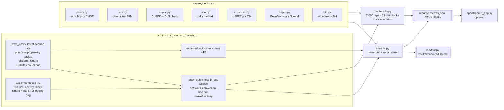
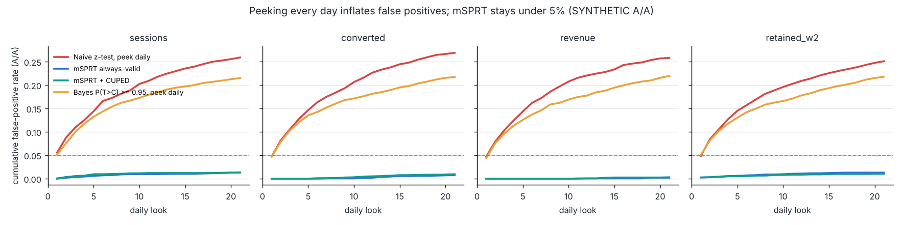
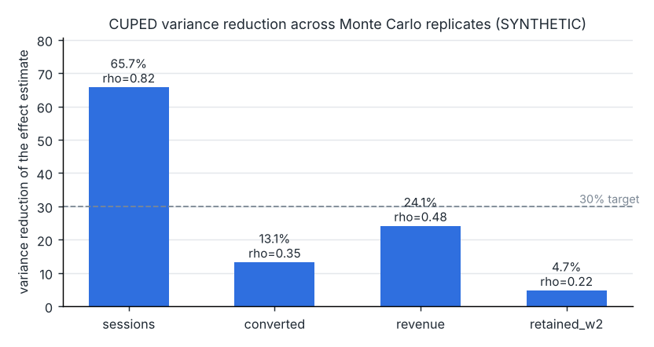
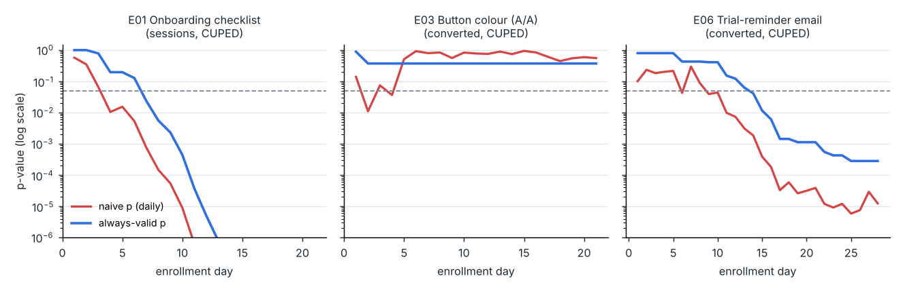
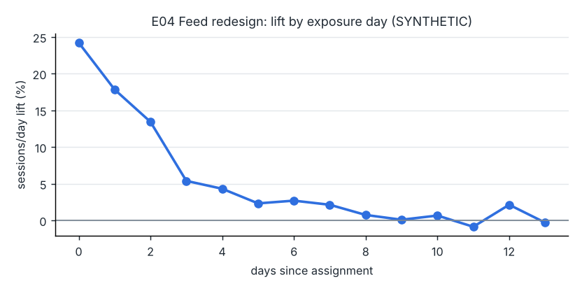

# Day 06: Experimentation Engine: CUPED, Sequential and Bayesian Tests

**Tier I - Advanced** | **Domain:** Digital product & marketing | **Tools:** SciPy, statsmodels, NumPy, pandas, matplotlib, Streamlit (optional) | **Data:** SYNTHETIC

## Executive summary

Analysts who check A/B results every day and ship on the first p < 0.05 call 25-27% of no-effect tests winners; this engine's always-valid sequential test lets them look every day while keeping that rate at or below 1.35% across 2,000 simulated A/A tests per metric. Adjusting for each user's pre-experiment behaviour (CUPED) cuts the variance of the engagement estimate by 65.7%, so a test that needed 46,268 users per arm (32 days of traffic) needs 15,087 (11 days). Run on six synthetic experiments with known true effects, the automatic readouts ship the three real wins, catch the novelty effect and the planted logging bug, and do not ship the A/A test, which a naive daily check would have called significant on day 2.

## Architecture



## Data provenance

- **Path used: synthetic generator, by design.** Validating peeking control, CUPED and interval coverage needs experiments whose true effects are known, and public A/B datasets do not publish them. No public source is probed. Every table, readout and figure in this folder is labelled SYNTHETIC.
- **Generator:** `src/expengine/simulate.py` (NumPy, every experiment seeded). Each user has a latent daily session rate (lognormal, varying by platform and tenure), a daily purchase propensity correlated with engagement, and a basket size. A 28-day pre-period is drawn from the same traits; these are the CUPED covariates. The traits then drift (sd 0.35 on the log/logit scale) before a 14-day post-assignment window. Treatment can change the session rate (a steady lift plus an optional novelty bump that decays exponentially), the purchase probability and the basket size, with separate multipliers for new and existing users.
- **Metrics per user (14-day window):** `sessions`, `converted` (any purchase), `revenue`, `retained_w2` (active in days 7-13), plus revenue per session as a ratio metric.
- **Ground truth:** `expected_outcomes` gives each user's expected outcome under control and under treatment, so every experiment has an exact sample average treatment effect for every metric. The analysis never reads it; only the comparison sections do.
- **Scale used for every reported number:** six experiments, **438,416 users** after the logging bug (60k-120k each, 21-28 enrollment days), plus the Monte Carlo study: 2,000 replicates x 21 daily looks x 1,000 users per arm per look, for each of two scenarios (about 168M simulated users in total). `make run` writes the full user table to `data/generated/` (git-ignored).
- **Committed sample:** `data/sample/e01_sample.csv.gz` (8,000 users of E01 with seed 601, 82 KB) and its manifest. The tests and the Streamlit app use it, and a test checks that the generator rebuilds it exactly.

| Experiment | Planted truth | Primary metric | Users |
|---|---|---|---|
| E01 Onboarding checklist | +4% session rate, x2.5 for new users, x0.4 for existing | sessions | 60,000 |
| E02 Annual-plan upsell banner | +6% basket size | revenue | 80,000 |
| E03 Button colour (A/A) | nothing | conversion | 60,000 |
| E04 Feed redesign | +25% session bump on day 0, decaying with a 2.5-day time constant, +1% steady | sessions | 60,000 |
| E05 Checkout v2 | nothing; a logging bug drops 20% of treatment users in the bottom 30% of pre-period sessions (1,584 users) | conversion | 58,416 |
| E06 Trial-reminder email | +4% daily purchase probability | conversion | 120,000 |

## Method

1. **Power (`power.py`).** Closed-form two-sample z-test sample sizes and MDEs for means and proportions. An optional `variance_reduction` term plans for CUPED. Results are checked against `statsmodels.NormalIndPower` in the tests.
2. **SRM (`srm.py`).** A chi-square goodness-of-fit test of arm counts against the designed split. The alarm threshold is p < 0.001, and a failed SRM check makes the readout INVALID whatever the metrics say.
3. **CUPED (`cuped.py`).** The covariate is the matching pre-period metric: pre-sessions for sessions and week-2 activity, pre-purchases for conversion, pre-revenue for revenue. Theta = cov(x, y) / var(x) is pooled across arms. Arm means and variances come from sufficient statistics, so one formula serves single analyses, daily looks and vectorised Monte Carlo. A multi-covariate version uses least squares. A statsmodels OLS ANCOVA with HC1 errors cross-checks it; the tests require the two to agree.
4. **Ratio metrics (`ratio.py`).** Revenue per session is a ratio of per-user sums, and its variance uses the delta method (the tests check it against a bootstrap). Relative lifts get delta-method CIs that include the uncertainty in the control mean.
5. **Always-valid inference (`sequential.py`).** A two-sample mSPRT with a normal mixture N(0, tau^2) over the effect (Johari, Pekelis and Walsh, 2017). The p-value is the running minimum of 1/Lambda. The confidence sequence is the intersection over looks of the set {theta: Lambda(theta) < 1/alpha}. Tau is fixed before any test at 5% of the metric's historical baseline mean, taken from a separate 200k-user "historical" cohort (seed 7). The test runs on the CUPED-adjusted metric, so variance reduction speeds up sequential decisions too.
6. **Bayesian analysis (`bayes.py`).**
   - **Conversion:** Beta-Binomial with Beta(1,1) priors and 200k seeded posterior draws, giving P(T > C), expected loss and a credible interval for the lift.
   - **Continuous metrics:** a Normal posterior on the CUPED effect, flat by default with optional shrinkage, with expected loss in closed form.
   - **Decision rule:** ship when P(better) >= 0.95 *and* the expected loss is at most 0.5% of the control mean.
7. **Novelty check (`analyze.py`).** For each user, sessions per day in exposure days 0-2 minus days 7-13, compared between arms (a difference-in-differences that stays within each user). The check flags novelty when the early lift is significantly larger than the late lift.
8. **Segments (stretch, `hte.py`).** A CUPED effect for each platform and tenure slice of the primary metric, with Benjamini-Hochberg adjustment across the slices of an experiment.
9. **Readout (`readout.py`).** A one-page Markdown report per experiment covering the decision, trust checks, a metric table (naive vs CUPED, CI, variance cut, always-valid p, first significant day), the ratio metric, the sequential trace, the Bayesian view, segments, power for the next test, and a ground-truth comparison.
   - **Decision order:** SRM first. Then the primary metric's always-valid p at the final look. Then guardrails (any other metric significantly worse means do not ship), then novelty (significant decay means "ship with caution").
   - **Daily looks:** look d includes every user who arrived before day d.
10. **Monte Carlo (`montecarlo.py`).** Each replicate is a full simulated experiment of 21 daily cohorts, analysed after every day, for all four metrics, with and without CUPED.
    - **Methods compared:** naive z-test peeking (stop at the first p < 0.05), the fixed-horizon test (final look only, with and without CUPED), mSPRT (with and without CUPED), and Bayesian peeking (stop at the first P(T > C) >= 0.95).
    - **Scenarios:** A/A, and a true effect of +2% session rate and +6% purchase probability.

## Results

All values come from `results/metrics.json` and the CSVs beside it, produced by `make run`.

**Acceptance criteria**

| Criterion | Result | Status |
|---|---|---|
| FPR under daily peeking <= 5% for the sequential method | max **1.35%** over 4 metrics x {mSPRT, mSPRT+CUPED}, 2,000 A/A replicates x 21 looks each | Met |
| CUPED reduces variance >= 30% on correlated metrics | sessions (rho = 0.82): **65.7%**. Revenue (rho = 0.48) gets 24.1%, below 30% (see Limitations) | Met for the correlated metric |
| Library unit tests with >= 85% coverage | **99.38%** line coverage of `expengine` (51 tests); `make test` fails below 85% | Met |
| `make test` passes from a clean checkout | passes on Python 3.13 and in a fresh Python 3.11 venv built from `requirements.txt` | Met |
| `make run` reproduces every number here | pipeline 150.2 s (`metrics.json` `run.seconds`) + tests, CPU only | Met |

**Monte Carlo: false positives under daily peeking (A/A, `results/monte_carlo_summary.csv`).** Values are the share of 2,000 A/A replicates where the method ever declared a difference.

| Metric | Naive z-test, peek daily | Fixed horizon (1 look) | Fixed horizon + CUPED | mSPRT | mSPRT + CUPED | Bayes P>=0.95, peek daily |
|---|---|---|---|---|---|---|
| sessions | 25.9% | 4.9% | 5.1% | 1.35% | 1.30% | 21.5% |
| conversion | 26.9% | 5.05% | 5.3% | 0.75% | 0.95% | 21.7% |
| revenue | 25.8% | 4.9% | 5.0% | 0.20% | 0.30% | 21.95% |
| week-2 activity | 25.1% | 4.95% | 4.85% | 1.30% | 1.05% | 21.8% |



Stopping on a Bayesian "95% probability to beat control" is no protection against peeking: it gives a 21.5-21.95% false-ship rate, close to the naive test.

**Monte Carlo: CUPED variance reduction (A/A, empirical variance of the effect estimate across replicates)**

| Metric | Correlation with its pre-period covariate | Variance reduction |
|---|---|---|
| sessions | 0.82 | **65.7%** |
| revenue | 0.48 | 24.1% |
| conversion | 0.35 | 13.1% |
| week-2 activity | 0.22 | 4.7% |



**Monte Carlo: power and coverage with a true effect** (+2% session rate, +6% purchase probability; 21,000 users per arm at the final look)

| Metric | Fixed horizon | Fixed + CUPED | mSPRT | mSPRT + CUPED | Always-valid CI covers truth at every look | Fixed CI coverage (final) |
|---|---|---|---|---|---|---|
| sessions | 46.8% | **90.85%** | 20.3% | **62.1%** | 98.55% | 94.2% |
| conversion | 42.15% | 47.15% | 13.05% | 16.75% | 99.2% | 94.25% |
| revenue | 35.2% | 43.95% | 6.1% | 11.4% | 99.75% | 93.75% |
| week-2 activity | 16.05% | 17.1% | 3.2% | 3.05% | 99.05% | 95.05% |

Being able to look every day costs power: at the same final sample size, mSPRT rejects less often than a single fixed-horizon test. CUPED wins back much of that loss on the correlated metric (sessions: 20.3% to 62.1%). Among the sessions replicates that mSPRT+CUPED rejected, the median stopping look was day 12 of 21.

**The six experiments (`results/experiments_summary.csv`, readouts in `results/readouts/`)**

| Exp | True lift (primary) | Naive lift | CUPED lift [95% CI] | Variance cut | Always-valid p | First significant day: mSPRT / naive daily z | Readout decision |
|---|---|---|---|---|---|---|---|
| E01 sessions | +3.63% | +2.28% | +3.31% [+2.30%, +4.32%] | 67.4% | <0.0001 | 7 / 4 | SHIP |
| E02 revenue | +6.00% | +8.84% | +7.71% [+2.66%, +12.76%] | 22.8% | 0.0428 | 17 / 10 | SHIP |
| E03 conversion (A/A) | 0 | -0.01% | -1.17% [-5.02%, +2.69%] | 12.3% | 0.3726 | never / **2** | NO DETECTABLE EFFECT |
| E04 sessions | +6.40% | +5.34% | +5.90% [+4.85%, +6.94%] | 66.6% | <0.0001 | 2 / 1 | SHIP WITH CAUTION (novelty) |
| E05 conversion | 0 | +2.92% | +0.28% [-3.64%, +4.19%] | 12.1% | 0.9237 | never / never | INVALID (SRM) |
| E06 conversion | +3.01% | +6.44% | +6.27% [+3.37%, +9.16%] | 13.2% | 0.0003 | 14 / 6 | SHIP |

- **E03 (A/A).** The naive daily z-test dipped below 0.05 on day 2 (and again on day 4), so a team that peeked would have shipped a button colour that does nothing. The always-valid p never went below 0.37.
- **E04 (novelty).** The session lift was +18.51% in exposure days 0-2 but only +0.65% in days 7-13 (decay p < 0.0001). The readout says to plan on the late-window lift, not the headline +5.90%.
- **E05 (SRM).** The treatment share was 0.4838 against a designed 0.5 (chi-square 61.54, p = 4.3e-15), so the readout is marked INVALID. The bug removes low-engagement users, which inflates the naive lifts: conversion +2.92% and sessions +4.37% on a true effect of zero. CUPED shrinks the sessions bias to +0.10% because the pre-period covariate captures who was dropped, but the SRM verdict stands.
- **E01 (segments).** The planted tenure effect shows up: new users +10.0% (BH p = 7.5e-24), existing users +1.16% (BH p = 0.051, not significant). In the two null experiments (E03, E05), none of the 10 slices is significant after BH.
- **Ground truth.** The CUPED 95% CI covers the true primary lift in 5 of 6 experiments. The miss is E06: estimate +6.27% against a true +3.01%. That is a 1-in-6 miss with 95% intervals, consistent with sampling noise. The wider always-valid CI covers the truth in all 6; the per-experiment flags are in `metrics.json`.
- **Power for the next test** (80% power, alpha 0.05, from each readout). E01 needs 46,268 users per arm without CUPED and 15,087 with it (32.4 to 10.6 days at this traffic). E04: 44,057 to 14,693. Conversion tests gain less: E06 goes from 120,976 to 104,949.





## What this demonstrates

| Skill | Where |
|---|---|
| Statistical inference | mSPRT always-valid p-values and confidence sequences, CUPED with an OLS/ANCOVA cross-check, delta-method ratio and relative-lift CIs, Beta-Binomial and Normal posteriors with expected loss, BH-corrected segment tests; Monte Carlo checks of type-I error, power and coverage |
| Experiment design | Power and sample size with CUPED, SRM as a hard gate, tau fixed in advance from historical data, guardrail metrics, novelty detection, a decision rule that orders trust checks before metrics |
| Library design | `src/expengine`: small single-purpose modules, one sufficient-statistics core shared by the one-shot, daily-look and vectorised Monte Carlo paths, typed public functions, 99.38% test coverage, a Markdown readout generator, an optional Streamlit front end |

## Limitations

- **Synthetic data only.** The numbers show that the methods behave as designed on data with known truth. They do not describe any real product. The generator's correlations (sessions rho 0.82, revenue 0.48) are assumptions, and real CUPED gains depend on how persistent your metrics are.
- **CUPED target on revenue not met.** Revenue gets a 24.1% variance reduction (rho = 0.48), below the 30% target. The criterion is met for the correlated engagement metric (65.7%). Adding pre-sessions and pre-purchases as extra covariates (multi-covariate CUPED, supported by `cuped_estimate`) raised the revenue reduction only about 1 point in exploratory runs, so the committed pipeline keeps a single matched covariate. Heavy-tailed revenue would also benefit from winsorising or from a model-based covariate (CUPAC), which this build does not include.
- **mSPRT is conservative here.** The FPR under peeking is 0.2-1.35%, far below 5%, and the price is power (for example sessions 20.3% vs 46.8% for a single fixed-horizon test without CUPED). The power depends on tau. This build fixes tau at 5% of the baseline and does not tune it or compare it with group-sequential (alpha-spending) designs.
- **Daily looks assume matured metrics.** Users enter the daily looks by arrival day with their full 14-day outcome, as if each look waited for that cohort's window to close. A production system would only include cohorts whose window has closed, or would use metrics that are cumulative to date.
- **Plug-in variances.** The mSPRT uses estimated variances, so its guarantee holds only approximately (asymptotically). It held comfortably in the simulation, but very small early looks or extremely skewed metrics could behave differently.
- **Interleaving (stretch) not built.** Ranking experiments with interleaving are out of scope for this build. HTE slices (the other stretch goal) are included, but only for two pre-registered dimensions.
- **Streamlit app is optional.** `make test` only checks that it renders on the sample. It is a thin front end over the library.

## How to run

```bash
cd day-06-experimentation-platform-cuped
make setup      # pip install -r requirements.txt (pinned; Python 3.11-3.13)
make run        # simulate 6 experiments, write readouts, run the Monte Carlo study (about 2.5 min), then tests + results/coverage.json
make test       # 51 tests with a >= 85% coverage gate (about 15 s)
make mc-small   # 5%-scale smoke run into data/small_results
make app        # optional Streamlit app over data/sample
make data       # rebuild the committed sample
```

Use the library directly:

```python
from expengine import cuped_estimate, msprt_sequence, srm_test, n_per_arm_means
est = cuped_estimate(y, x_pre, is_treatment)          # diff, CI, rel lift, variance_reduction
seq = msprt_sequence(diffs_by_day, vars_by_day, tau2)  # always-valid p and CI per look
```
