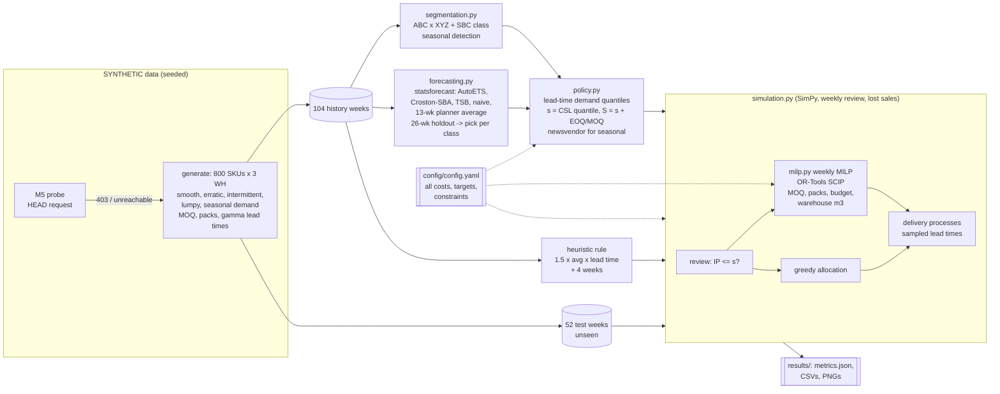

# Day 07: Demand-Driven Inventory Optimisation

**Tier I - Advanced** | **Domain:** Supply chain & logistics | **Tools:** statsforecast, OR-Tools (SCIP), PuLP (CBC), SimPy, pandas, SciPy, matplotlib | **Data:** SYNTHETIC

## Executive summary

On a synthetic distributor with 800 SKUs in 3 warehouses, replacing the planners' rule of thumb with forecast-driven reorder points and a weekly optimisation model cuts simulated annual inventory cost by 41.5% ($2.32M to $1.35M) and raises the unit fill rate from 91.1% to 97.4%. Most of the saving comes from lost sales, which fall 84% because best-sellers and volatile items get safety stock sized to their real demand and lead-time risk. The catch is that the optimised plan holds 72% more stock by value ($1.66M to $2.85M on average) and fills the warehouses, so it needs that working capital and space approved before it ships.

## Architecture



## Data provenance

- **Path used: synthetic generator (automatic fallback).** The pipeline first sends a HEAD request to the M5 (Walmart) archive URL in `config/config.yaml`. During this build it returned `HTTP Error 403: Forbidden` (the build network's proxy blocks it), so the seeded generator was used. `results/metrics.json` records this as `"data_source": "synthetic (M5 probe: unreachable)"`. There is no M5 adapter: if the probe succeeds, the code says so and still uses the generator.
- **Generator** (`src/invopt/data.py`, seed `20261017`): 800 SKUs, each stocked in 3 warehouses with demand shares of about 45/33/22% (Dirichlet noise per SKU), so 2,400 SKU-warehouse items, each with 156 weekly periods (104 of history and 52 of test). Each SKU gets one demand pattern:
  - **smooth:** Poisson with gamma noise;
  - **erratic:** negative binomial;
  - **intermittent:** Bernoulli occurrence times a small Poisson size;
  - **lumpy:** rare occurrences with lognormal sizes;
  - **seasonal:** demand only in a 10-week window starting at week 40 of each year, with the season total varying ±20% from year to year.

  Every item also has a small random trend. Unit costs are lognormal (median $18), the markup is 1.3-2.1x, pack sizes are 1/2/6/12/24 units, and the MOQ is 1-8 packs. Supplier lead times are gamma distributed, with a mean of 1-5 weeks and a CV of 0.10-0.50.
- **Committed sample:** `data/sample/` holds the first 40 SKUs (120 items x 156 weeks, 63 KB) plus a manifest labelled SYNTHETIC. A test checks that the generator rebuilds it exactly. `make run` writes the full dataset to `data/generated/` (git-ignored, about 1.2 MB).
- **Scale for every number below:** 800 SKUs, 3 warehouses, 2,400 items, 104 history weeks, 52 simulated test weeks, plus a 26-week unscored warm-up.

## Method

1. **Segmentation (`segmentation.py`).**
   - **ABC:** annual revenue per SKU, with cut-offs at 80% and 95% of cumulative revenue.
   - **XYZ:** CV of each item's weekly demand, with cut-offs at 0.5 and 1.0.
   - **SBC demand class:** smooth, erratic, intermittent or lumpy, from the ADI (cut-off 1.32) and CV² of non-zero sizes (cut-off 0.49).
   - **Seasonal items:** detected from the data, not read from the generator. An item is seasonal if at least 90% of its volume falls in the season window in both history years and it has at least 5 non-zero weeks. This finds 200 items, all of them generated as seasonal (the generator made 201).
2. **Forecasts (`forecasting.py`, statsforecast).** Five models are fitted to every non-seasonal item on weeks 0-77 and scored on weeks 78-103: Naive, a 13-week moving average (the planners' number), AutoETS, Croston-SBA and TSB (α = 0.1/0.1). In each SBC class the model with the lowest scaled RMSE wins. RMSE is used because the policy needs an unbiased mean, and MAE would reward the median, which is about 0 for intermittent demand. The winners are refitted on all 104 weeks. The holdout RMSE of the chosen model becomes the per-period forecast error σ.
3. **Quantiles of lead-time demand.** Over the protection period P = L + R (with review R = 1 week):
   - mean = μ·P;
   - variance = P·σ² + μ²·Var(L), which includes lead-time variability.

   Smooth items use a normal distribution. Erratic, intermittent and lumpy items use a gamma distribution, which is non-negative and skewed. On the unseen test year these quantiles are checked for coverage and pinball loss against the planners' empirical 13-week quantile.
4. **Policies (`policy.py`).**
   - **Optimised (s, S):** s is the quantile at the cycle-service-level target of the item's ABC x XYZ cell (99% for AX down to 93% for CZ, set in config). S = s + max(EOQ, MOQ), rounded up to whole packs.
   - **Seasonal items (newsvendor):** one pre-season buy at the critical-ratio quantile of a lognormal season-total forecast. The critical ratio is Cu / (Cu + Co), with Cu = margin + goodwill and Co = cost - salvage. The log-spread is pooled across seasonal items (σ_log = 0.297), because two seasons per item are too few to estimate it alone.
   - **Current heuristic:** s = 1.5 x the recent 13-week average x the mean lead time, S = s + 4 weeks of average demand. Seasonal items buy last season's sales.
5. **Weekly replenishment MILP (`milp.py`, OR-Tools SCIP).** Each week, every item with inventory position at or below s becomes a candidate.
   - **Variables:** integer pack counts and an order/no-order binary per item.
   - **Constraints:** semi-continuous MOQs (0 or at least the MOQ), never ordering past S except for pack rounding, a weekly purchase budget (1.30 x forecast weekly spend = $389,250), and per-warehouse volume capacity (10 weeks of forecast demand volume, which caps on-hand + pipeline + new orders).
   - **Objective:** ordering cost, plus units left below s (weighted at 1.0 x unit shortage cost), plus units left below S (0.05 x), plus one week of holding on what is bought.
   - **Solver settings:** stops at a proven 0.01% relative gap, with a 10 s time limit. PuLP/CBC re-solves the first scored week's instance as an independent cross-check, and on small instances the tests require SCIP, CBC and a brute-force search to agree.
6. **Simulation (`simulation.py`, SimPy).**
   - **Weekly cycle:** review and order at t = k. Demand is served from stock at t = k + 0.5, and unmet demand is lost. Holding cost is charged on the stock left at t = k + 1. Each order is a SimPy process that waits its sampled gamma lead time, so orders can cross.
   - **Fair comparison:** every policy sees the same demand and the same lead-time draws (common random numbers) and starts from the same stock. Each first replays the last 26 history weeks unscored to reach steady state.
   - **Costs, all from `config/config.yaml`:**
     - holding: 25% of unit cost per year;
     - ordering: $30 per order line;
     - lost sale: margin + 25% of price;
     - seasonal leftovers: salvaged at 35% of cost.
   - **Three variants:** the heuristic (greedy budget/capacity truncation in list order), the optimised (s, S) with the same greedy allocation, and the optimised (s, S) with the MILP.
7. **Stretch: lead-time variance sensitivity.** The year is re-simulated with every supplier's lead-time CV scaled by 0.5x, 1.5x and 2x. The optimised policy is re-parameterised with the new CV each time; the heuristic ignores variability by construction.

## Results

All figures come from `make run` (`results/metrics.json`, `results/simulation_summary.csv`, `results/sensitivity_lead_time_cv.csv`). SYNTHETIC data, 52-week test year.

| Metric | Current heuristic | Optimised (s,S), greedy | **Optimised (s,S) + MILP** |
|---|---|---|---|
| Total cost (holding + lost sales + ordering + seasonal leftovers) | $2,315,489 | $3,491,998 | **$1,353,909** (-41.53%) |
| Unit fill rate | 91.14% | 84.76% | **97.39%** |
| Fill rate A / B / C items | 92.64% / 88.71% / 86.16% | 82.61% / 88.05% / 89.07% | 98.89% / 96.24% / 90.58% |
| Lost-sales cost | $1,431,814 | $2,590,060 | $222,688 |
| Holding cost | $414,492 | $674,786 | $711,440 |
| Ordering cost (order lines) | $412,920 (13,764) | $166,530 (5,551) | $359,160 (11,972) |
| Average inventory value | $1,657,969 | $2,699,145 | $2,845,760 (+71.64%) |
| Weeks with warehouse m3 at >= 98% of capacity | 0 / 52 | 52 / 52 | 52 / 52 |
| Weeks with budget >= 98% used | 1 / 52 | 0 / 52 | 0 / 52 |

| Seasonal items (200) | Heuristic: last season's sales | Newsvendor |
|---|---|---|
| Fill rate | 89.80% | 92.75% |
| Leftover (overage) cost | $56,262 | $60,621 |

**MILP.** Results:
- 52 of 52 weekly solves stopped at the configured 0.01% relative gap (status OPTIMAL). The largest gap was 0.0100%. The largest instance had 652 candidate items (2,608 variables). The median solve took 0.43 s and the slowest 3.24 s.
- Week-1 cross-check (371 items): SCIP found 18,726.26 with a best bound of 18,724.40. PuLP/CBC hit its 60 s limit with an incumbent of 18,900.20, 0.93% worse and not proven optimal.
- The binding constraint is warehouse volume, not budget. Optimised reorder points plus EOQ batches want more stock than 10 weeks of cover fits. Allocating that scarce space greedily in list order is worse than doing nothing clever: the greedy variant costs $3.49M at 84.8% fill. The MILP lowers cost by 61.23% against that greedy allocation of the same (s, S) targets.

**Forecasts.** Scaled RMSE on the 26-week holdout (`results/forecast_holdout_srmse.csv`):

| SBC class (items) | Chosen model | Chosen | 13-wk planner average | Naive |
|---|---|---|---|---|
| smooth (677) | TSB | 0.4413 | 0.4461 | 0.5878 |
| erratic (195) | Croston-SBA | 1.0090 | 1.0237 | 1.3564 |
| intermittent (1,295) | Croston-SBA | 1.8757 | 1.9169 | 2.3534 |
| lumpy (233) | TSB | 2.8053 | 2.8346 | 3.2922 |

Weekly quantile forecasts on the unseen test year (2,200 non-seasonal items):

| Quantile | Coverage | Pinball loss | Pinball loss of the planners' empirical 13-wk quantile |
|---|---|---|---|
| P90 | 86.46% | 1.1148 | 1.1889 |
| P95 | 93.01% | 0.7614 | 0.8516 |

**Sensitivity to lead-time variability (stretch goal).** At every level tested the optimised policy costs 40.8-41.9% less and its fill rate falls more slowly:

| Lead-time CV multiplier | Heuristic cost / fill | Optimised + MILP cost / fill |
|---|---|---|
| 0.5x | $2,088,277 / 92.34% | $1,235,993 / 97.78% |
| 1.0x | $2,315,489 / 91.14% | $1,353,909 / 97.39% |
| 1.5x | $2,533,130 / 89.87% | $1,487,136 / 96.76% |
| 2.0x | $2,795,855 / 88.75% | $1,623,097 / 96.24% |

**Acceptance criteria.**

| Criterion | Status |
|---|---|
| Optimised policy lowers total cost at equal or better fill rate | Met: -41.53% cost with fill rate up from 91.14% to 97.39% |
| MILP solves to optimality or a documented gap | Met: 52/52 solves within the documented 0.01% relative gap (max 0.0100%) |
| All costs parameterised in a config file | Met: `config/config.yaml` (a test checks they are present) |
| `make test` passes | Met: 16 tests, about 20 s on Python 3.11 |
| `make run` reproduces every number and figure | Met: about 10.5 min on 4 vCPU; two consecutive runs gave identical metrics |

Figures in `results/`:
- `cost_breakdown.png`;
- `fill_rate_by_class.png`;
- `inventory_value_weekly.png`;
- `abc_xyz_heatmap.png`;
- `sensitivity_lead_time_cv.png`;
- `example_trajectories.png`.

Other files in `results/`: `policy_parameters.csv` (s, S, CSL target, model, μ and σ per item), `newsvendor_seasonal.csv`, and `replenishment_plan_week1.csv` (the MILP's first scored weekly plan).

## What this demonstrates

- **Operations research:** a weekly mixed-integer replenishment model with semi-continuous MOQs, integer packs, a budget and warehouse capacity, solved in OR-Tools (SCIP) and cross-checked with PuLP (CBC). Also EOQ, service-level (s, S) policies and the newsvendor critical ratio.
- **Forecasting:** ABC/XYZ and SBC segmentation; Croston-SBA, TSB and ETS chosen per demand class on a holdout; quantile forecasts of lead-time demand with random lead times, backtested for coverage and pinball loss.
- **Simulation:** a SimPy discrete-event model with stochastic, crossing deliveries, lost sales, common random numbers across policies, a warm-up period and a lead-time-variance sensitivity study.

## Limitations

- **Inventory goes up, not down.** The business brief says the distributor already holds too much slow-moving stock. In this synthetic world, under these cost parameters, the cost-minimising policy holds more stock, not less:
  - average inventory value rises 71.64% overall;
  - C items alone go from $236,634 to $393,389.

  Lost sales (margin + 25% of price) are so much more expensive than holding (25% a year) that the optimum buys service. The stylised heuristic under-protects rather than over-stocks. A real deployment would need the working-capital increase approved, or a lower service matrix or tighter capacity set in config.
- **Warehouse capacity binds in every week for both optimised variants.** Mean peak utilisation is 100.05-100.07%. It can sit just above 100% because seasonal pre-season buys bypass the weekly MILP (they are not budget- or capacity-checked). The capacity rule (10 weeks of forecast volume) is an assumption, not observed data.
- **Forecast quantiles are slightly under-dispersed.** P90 covers 86.46% and P95 covers 93.01% of test weeks. σ comes from a 26-week holdout of h-step errors, and forecasts stay fixed for the whole test year with no re-forecasting. Model choice and the reported holdout scores use the same window, so those scores are mildly optimistic. The gains over the 13-week average are small (about 1-2% scaled RMSE).
- **Model simplifications:** weekly time buckets, lost sales (no backorders), no end-of-horizon valuation of remaining stock, one supplier per SKU, and no transshipment between warehouses. The heuristic is a stylised planner rule, not observed behaviour.
- **PuLP/CBC is only a cross-check.** CBC did not prove optimality on the full-size week-1 instance within 60 s (0.93% above SCIP). On small test instances it matches SCIP exactly.
- **No real data.** The data are SYNTHETIC because M5 was unreachable (proxy 403), and no M5 adapter was built.
- **Stretch goals:** the multi-echelon extension was not attempted. Lead-time variance sensitivity was done.

## How to run

```bash
cd day-07-supply-chain-demand-inventory-opt
make setup   # pip install -r requirements.txt (pinned; Python 3.11-3.13)
make run     # regenerates data, forecasts, policies, MILP, SimPy runs, sensitivity, results/ (~10.5 min, CPU)
make test    # 16 pytest tests on small fixtures (~20 s)
make data    # optional: regenerate data/generated and the committed data/sample only
make lint    # ruff check + format check
```

Every cost, service target, budget, capacity and solver setting is in `config/config.yaml`. Use `scripts/run_pipeline.py --skus 100 --results /tmp/r --no-sensitivity` for a quick small-scale run that does not touch `results/`.
