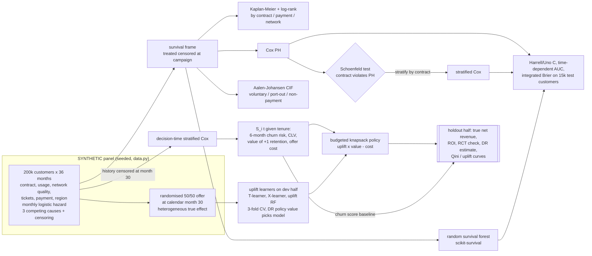

# Day 08: Telecom Retention: Survival Analysis + Uplift Modelling

**Tier II - Expert** | **Domain:** Telecommunications | **Tools:** lifelines, scikit-survival, CausalML, scikit-learn, pandas, SciPy, matplotlib | **Data:** SYNTHETIC

## Executive summary

On a synthetic carrier with 200,000 subscribers, sending a $400k retention budget to the customers an uplift model says the offer will change earns $500k of true net incremental revenue on a held-out half of the campaign. Sending the same budget to the customers most likely to churn earns $359k, so uplift targeting is worth $141k (39%) more, and its ROI is 1.19 against 0.86. Sending the offer to everyone loses $764k, because about 11% of customers are "sleeping dogs" who become more likely to leave once contacted, and many high-risk customers leave over network problems that a discount does not fix.

## Architecture



## Data provenance

- **Path used: synthetic generator, by design.** The prompt asks for a synthetic subscriber panel with a historical randomised campaign whose true effects are known, which no public dataset provides. The pipeline therefore does not try to download anything. `results/metrics.json` records `"data_source": "SYNTHETIC (...)"`, and every figure title says SYNTHETIC.
- **Generator** (`src/retention/data.py`, seed `20261018`):
  - **Customers:** 200,000, joining uniformly over calendar months 0-29 and observed to month 36. Each has a contract type (55% month-to-month, 25% one-year, 20% two-year), fiber or DSL, monthly charges, data usage, dropped-call rate, support tickets, autopay, a senior flag and one of four regions.
  - **Churn:** a monthly logistic hazard. Month-to-month customers have a high hazard early on that decays. One-year and two-year contracts have a low hazard that spikes when the term ends (months 12-13 and 24-25), which deliberately breaks proportional hazards for `contract`. Covariate effects are the same at every tenure.
  - **Competing causes:** each churn is voluntary, port-out or non-payment. Port-out is more likely with dropped calls and high bills, and non-payment is more likely without autopay.
  - **Censoring:** random dropout of 0.4% a month before the campaign, plus administrative censoring at month 36. 71,707 churn events, and 64.2% of customers are censored.
  - **Campaign:** every customer active at calendar month 30 (130,877) was randomised 50/50 to a retention offer (65,740 treated). The offer is 20% off the bill for 3 months plus a $2 contact cost. Its effect on the churn logit in months 30-35 varies by customer:
    - price-sensitive customers respond (persuadables);
    - customers with dropped-call rate > 3.5% or ≥ 3 tickets barely respond (lost causes);
    - two-year or long-tenure customers with no tickets become *more* likely to churn (sleeping dogs, 11.2% of the holdout).
  - **Ground truth:** for every campaign customer the true 6-month churn probability with and without the offer, the true 36-month CLV, the true incremental value and the true cost are computed exactly from the hazard model (`campaign_truth`).
- **Committed sample:** `data/sample/` holds the first 5,000 customers of the panel (83 KB) and their campaign ground truth (126 KB), labelled SYNTHETIC. A test checks that the generator rebuilds the sample exactly. `make run` writes the full panel to `data/generated/` (git-ignored, 13 MB).
- **Scale for every number below:** the full 200,000 customers. The survival split is 140,000 train and 60,000 test customers; the metrics use the first 15,000 test customers, and the RSF is trained on 40,000 of the training customers. The campaign split is a 65,439-customer development half and a 65,438-customer holdout half.

## Method

1. **Survival frame (`survival.py`).** Durations are in tenure months. Customers treated in the campaign are censored at the start of the campaign. Treatment was randomised, so this is independent censoring, and the curves describe untreated churn.
2. **Kaplan-Meier** curves by contract, payment method and network type, with multivariate log-rank tests.
3. **Cox PH and diagnostics.** A Cox model with all covariates is fitted, then the proportional hazards assumption is tested with lifelines' scaled Schoenfeld residual test (rank time transform) on a 40,000-customer subsample. The full 140k training set would flag trivially small departures. Both contract dummies fail badly, and the residual plot (`schoenfeld_contract.png`) shows the renewal spikes. **Handling:** the model is refitted **stratified by contract**, so each contract gets its own baseline hazard. The test is then re-run on the remaining covariates.
4. **Random survival forest** (scikit-survival): 100 trees, minimum leaf 40, `max_features="sqrt"`.
5. **Evaluation** on held-out customers:
   - Harrell's C and Uno's C, using the risk 1 − S(12 | x);
   - cumulative/dynamic AUC at 3, 6, 12, 18, 24 and 30 months;
   - integrated Brier score.
   Test follow-up is truncated at month 33, because the IPCW censoring weight is zero at month 36, where everyone left is administratively censored.
6. **Competing risks (stretch).** Discrete-time Aalen-Johansen cumulative incidence for each cause.
7. **CLV from survival curves (`clv.py`).** A second stratified Cox model is fitted on the history censored at calendar month 30, which is only what was known when the campaign was planned. For each campaign customer at tenure t0 it gives the conditional survival S(t0 + k) / S(t0) for k = 1..36. Beyond month 30, the cumulative hazard is extended at each customer's average hazard over the last 4 months. From that curve:
   - **CLV** = Σ S(k) · 55% margin · monthly charge / 1.01^k;
   - **6-month churn risk** = 1 − S(6);
   - **offer cost** = $2 + 20% of the charge for each of the 3 discount months the customer is expected to stay;
   - **value of +1 in retention probability** = a part-window term plus the CLV of a survivor from month 6.
8. **Uplift models (`uplift.py`).** The outcome is "retained through the 6-month window":
   - **T-learner:** CausalML `BaseTClassifier` with HistGradientBoosting;
   - **X-learner:** CausalML `BaseXClassifier` with the known propensity of 0.5;
   - **Uplift random forest:** CausalML `UpliftRandomForestClassifier`, KL criterion, 100 trees, depth 8, trained on 40k customers.

   **Model selection never touches the holdout.** Each learner is scored by 3-fold cross-validation on the development half. The score is the doubly robust (AIPW, cross-fitted outcome models) value of the budgeted policy that learner would choose, which is the business objective. The X-learner wins and is the pre-selected policy reported below.
9. **Policy (`policy.py`).** For each customer, expected net value = predicted uplift × value of retention − expected cost. The policy keeps customers with positive expected net value and ranks them by net value per dollar (greedy knapsack) until the **$400,000** budget is used.

   Comparators under the same budget:
   - churn score: top Cox 6-month risk;
   - value at risk: churn risk × CLV;
   - a depth-3 policy tree trained on doubly robust net-value scores (stretch: policy learning);
   - random targeting;
   - an oracle that uses the true net value.
10. **Evaluation on the holdout half** (65,438 customers):
    - **true** incremental revenue, spend, net and ROI from the generator;
    - two checks an analyst could run without ground truth: the randomised difference in means of retained customers inside each targeted set, and a doubly robust net-revenue estimate;
    - Qini and uplift curves.

## Results

All numbers come from `results/metrics.json` and the CSVs next to it (`make run`, 88 s on 4 vCPU). Data is SYNTHETIC.

**Targeting under a $400k budget (holdout half, 65,438 customers)**

| Policy | Customers targeted | True spend | True net incremental revenue | True ROI | Sleeping dogs targeted | RCT check: extra retained (± SE) vs truth |
|---|---|---|---|---|---|---|
| **Uplift value, X-learner (selected by CV)** | 9,389 | $420,499 | **$500,314** | **1.19** | 8 | 1,239 ± 74 vs 1,170 |
| Uplift value, T-learner | 9,947 | $419,046 | $459,750 | 1.10 | 16 | 1,154 ± 76 vs 1,111 |
| Value at risk (churn risk × CLV) | 8,871 | $418,740 | $445,651 | 1.06 | 90 | 1,097 ± 76 vs 1,044 |
| Churn score (Cox 6-month risk) | 10,879 | $418,056 | $359,254 | 0.86 | 85 | 1,198 ± 88 vs 1,070 |
| Uplift value, uplift random forest | 8,526 | $414,746 | $279,917 | 0.67 | 88 | 836 ± 60 vs 793 |
| DR policy tree, depth 3 (stretch) | 9,658 | $415,530 | $264,513 | 0.64 | 0 | 1,016 ± 73 vs 890 |
| Random | 12,003 | $405,026 | -$147,364 | -0.36 | 1,297 | 446 ± 63 vs 328 |
| Oracle (true net value) | 8,863 | $399,983 | $594,349 | 1.49 | 0 | 1,340 ± 69 vs 1,250 |
| Treat everyone (no budget) | 65,438 | $2,216,587 | -$764,426 | -0.34 | 7,321 | 2,152 ± 146 vs 1,844 |

- **Uplift vs churn score:** +$141,060 true net incremental revenue (+39%). The uplift policy captures 84% of the oracle's net value, against 60% for the churn score.
- **Expected ROI at decision time:** the selected policy's model-based expected ROI was 1.00 (expected net $399,373); the realised true ROI is 1.19. Its doubly robust net estimate, computed from holdout outcomes only, is $537,929.
- **Budget sweep** (`budget_curve.csv`): the uplift policy beats the churn score at every budget tested ($209k vs $103k at $100k; $496k vs $408k at $600k). Above about $600k it stops spending, because nobody else has positive expected value. The churn-score policy keeps spending and falls to $92k at $1.2M.

**Uplift model quality (holdout)**

| Model | Qini coefficient (observed) | Spearman with true uplift | True cumulative gain vs oracle | CV DR policy value (dev) |
|---|---|---|---|---|
| X-learner | 0.00562 | 0.766 | 0.857 | $420,535 |
| T-learner | 0.00463 | 0.640 | 0.775 | $380,888 |
| Uplift random forest | 0.00446 | 0.573 | 0.696 | $345,599 |
| Churn score (as a ranking) | 0.00471 | 0.678 | 0.705 | $378,040 |

In the holdout, the true average effect is +2.82 points of 6-month retention and the observed RCT difference is +3.29 points. In the X-learner's top decile the observed uplift is 15.0 points and the true uplift is 14.5 points. In its bottom decile the observed uplift is -2.1 points and the true uplift is -2.6 points (`uplift_by_decile.png`).

**Survival models (15,000 test customers)**

| Model | Harrell C | Uno C | Mean time-dependent AUC (3-30 m) | Integrated Brier |
|---|---|---|---|---|
| Cox PH (unstratified) | 0.7797 | 0.7570 | 0.8155 | 0.1579 |
| Cox PH stratified by contract | 0.7798 | 0.7554 | 0.8169 | 0.1575 |
| Random survival forest | 0.7774 | 0.7536 | 0.8133 | 0.1590 |

- **Proportional hazards:**
  - `contract_one_year` fails the Schoenfeld test (χ² = 392.5, p = 2.3e-87), and so does `contract_two_year` (χ² = 266.9, p = 5.5e-60).
  - Every other covariate has p > 0.02 (the smallest is `senior`, p = 0.0287).
  - After stratifying by contract, no covariate is below p = 0.01; the smallest p is 0.064 (`senior`).
- **Kaplan-Meier:**
  - The log-rank p-value underflows to 0 for contract, payment method and network type.
  - Survival at 12 months is 0.549 for month-to-month, 0.880 for one-year and 0.962 for two-year contracts.
  - Median tenure for month-to-month customers is 15 months.
- **Competing risks at 36 months:** cumulative incidence is 24.8% voluntary, 18.9% port-out and 6.0% non-payment.
- **CLV from the survival curves (130,877 campaign customers):**
  - The mean model CLV is $716.43, against a true mean of $711.25. Pearson r with the true CLV is 0.9999 and the mean absolute error is 0.8%.
  - By contract, the model CLV is $484 for month-to-month, $831 for one-year and $952 for two-year contracts.
  - The 6-month churn risk has AUC 0.784 on the control arm, with a mean prediction of 10.1% against 10.5% observed.

**Acceptance criteria:**
- The proportional hazards assumption is tested and the violation is handled by stratification: **met**.
- Uplift targeting beats churn-score targeting on incremental revenue in the holdout: **met**, +$141k.
- CLV is computed from the survival curves: **met**.
- `make test` passes: **met**, 15 tests in about 22 s.
- `make run` reproduces every number in this README: **met**, the pipeline is deterministic.

## Figures

`results/` holds these figures:
- `km_by_segment.png`;
- `schoenfeld_contract.png`;
- `time_dependent_auc.png`;
- `competing_risks_cif.png`;
- `clv_model_vs_true.png`;
- `qini_curves.png`;
- `uplift_true_gain.png`;
- `uplift_by_decile.png`;
- `policy_comparison.png`;
- `budget_curve.png`.

## What this demonstrates

- **Survival analysis:**
  - Kaplan-Meier with log-rank tests;
  - Cox PH with a formal Schoenfeld test, and stratification to handle the contract violation;
  - a random survival forest;
  - Harrell and Uno concordance, time-dependent AUC and integrated Brier score with IPCW;
  - Aalen-Johansen competing risks;
  - CLV from conditional survival curves fitted only on information available at decision time.
- **Uplift modelling:**
  - T-learner, X-learner and uplift random forest (CausalML);
  - Qini and uplift curves on randomised outcomes, checked against known true effects;
  - doubly robust (AIPW) scores used for model selection, holdout policy evaluation and policy learning.
- **Decision science:**
  - a budget-constrained knapsack policy that maximises expected incremental margin net of offer cost;
  - ROI reported both as expected at decision time and as realised;
  - head-to-head comparison against churn-score, value-at-risk, random, treat-everyone and oracle policies, plus a budget sweep.

## Limitations

- **The data is SYNTHETIC.** The hazard is a logistic model with time-invariant covariates and no unobserved confounding of churn. That is close to Cox's assumptions, which is why the CLV error is so small (0.8%). On real data, CLV from a Cox model would be much less accurate, and the stratified baseline would need checking for drift across cohorts.
- **Stratification fixes the assumption, not the ranking.** The stratified Cox model passes the PH test but does not discriminate better than the unstratified one: Uno C is 0.7554 against 0.7570. Its benefit is correctly shaped survival curves per contract, which the CLV relies on. The RSF (40k training customers) did not beat either Cox model, which is expected when the true model is log-linear.
- **Not every uplift learner beats the churn score.** The uplift random forest ($280k) and the depth-3 DR policy tree ($265k) both earned less than the churn-score policy ($359k). The uplift forest was trained on 40k of the 65k development customers to keep runtime down, and was tuned only by hand. The acceptance criterion is met by the X-learner policy, chosen by cross-validation before the holdout was scored. The T-learner ($460k) also beats the churn score.
- **Expected and realised ROI differ.** The selected policy expected ROI 1.00 and realised 1.19. For the T-learner, the expected ROI of 1.54 overstated the realised 1.10, the usual winner's-curse effect of ranking on noisy estimates.
- **Value of retention is an approximation.** It assumes that after the 6-month window a saved customer churns like any other survivor, and that saves are spread evenly through the window. The truth used for scoring is exact.
- **One horizon.** CLV and value use a 36-month horizon with extrapolated hazards beyond the 30 observed tenure months.
- **No real campaign mechanics.** There is no channel choice, no offer fatigue and no interference between customers.
- **Library notes:** causalml 0.18.0 switches matplotlib to the "fivethirtyeight" style on import, so `report.reset_style()` restores the default. Its optional `duecredit` import prints a harmless message.

## How to run

```bash
cd day-08-telecom-churn-survival-uplift
make setup   # pip install -r requirements.txt (Python 3.11+)
make run     # regenerates the SYNTHETIC panel and every file in results/ (~1.5 min on 4 vCPU)
make test    # 15 pytest tests on 20k-customer fixtures (~25 s)
make data    # optional: rewrite data/generated and the committed data/sample
make lint    # ruff check + format check
```
