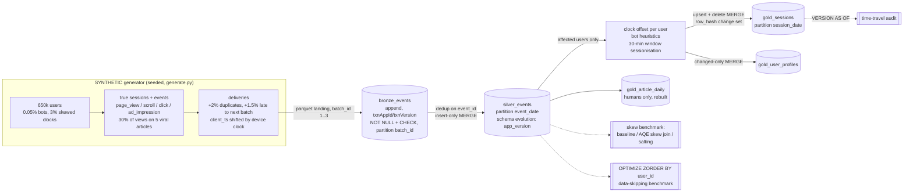

# Day 09: Clickstream Sessionisation at Scale with PySpark + Delta Lake

**Tier II - Expert** | **Domain:** Media & e-commerce | **Tools:** PySpark 4.0.1, Delta Lake 4.0.1, Spark SQL, pytest, chispa | **Data:** SYNTHETIC

## Executive summary

A synthetic publisher clickstream of 13.9 million event deliveries (duplicates, late arrivals, clock-skewed devices, bots and a few viral articles included) flows through incremental bronze, silver and gold Delta tables on a 4-core laptop-class machine. The pipeline recovers 99.995% of the true human sessions exactly, against 84.1% for naive sessionisation on the raw feed, and flags all 317 bots with no false positives. Replaying a batch changes zero rows, incremental output equals a full recompute, and AQE skew-join handling makes the viral-article join 1.76x faster while Z-ordering silver by user cuts a single-user lookup from 11 files (618 MB) to 5 files (51 MB).

## Architecture



## Data provenance

- **Path used: synthetic generator, by design.** The prompt asks for a synthetic clickstream with planted defects, so the pipeline does not try to download anything. `results/metrics.json` records `"data_source": "SYNTHETIC (seeded Spark generator, src/clickstream/generate.py); no public download attempted"`, and every figure title says SYNTHETIC.
- **Generator** (`src/clickstream/generate.py`, seed `20261019`): pure Spark. Every random draw is a hash of (seed, stream, key), so the output does not depend on partitioning or core count.
  - **Users:** 650,000, of which 541,493 are active in the 3 simulated days (2026-10-01 to 2026-10-03). 3% of users have a device clock skewed by -8, -5, -3, +1, +2 or +9 hours.
  - **Bots:** 0.05% of users (317 active), of three kinds:
    - kind 0 declares a crawler user agent;
    - kind 1 hits at a metronome-like interval with a browser user agent;
    - kind 2 sends bursts at a very high rate.
    Bots produce 1,718,952 deliveries, and 12.4% of silver events are bot events.
  - **Humans:** about 1.25 sessions a day at random times, about 7 events per session, and gaps under 30 minutes inside a session, so the true sessions are known exactly.
  - **Articles:** 200,000. 24.5% of page views fall on 5 viral articles, and the top article alone gets 14.7%.
  - **Delivery defects:** 272,024 duplicate deliveries (+1 s to +6 h after the original) and 136,099 late events delivered in the next day's batch.
  - **Totals:** 13,911,541 deliveries holding 13,639,517 unique events, in three ingest batches of 4.55M, 4.65M and 4.71M.
- **Committed sample:** `data/sample/deliveries_sample.csv.gz` (383 KB) holds all deliveries of the tiny `TEST` preset (300 users), labelled SYNTHETIC. A test checks that the generator rebuilds it exactly. `make data` writes the full landing zone to `data/generated/` (git-ignored).
- **Scale note:** the prompt asks for about 50M events. This build uses about 14M so that `make run` stays under 20 minutes on a 4-core CPU (see Limitations).

## Method

1. **Bronze (`lakehouse.py`).** Each landing batch is appended with Delta's `txnAppId`/`txnVersion` idempotent-write options, so replaying a batch is a no-op. The table is partitioned by `batch_id` and enforces NOT NULL on its key columns and a CHECK constraint `valid_event_type`. Batch 3 carries a new `app_version` column that is added through `mergeSchema` (schema evolution).
2. **Silver.** Within each batch, duplicate deliveries are reduced to the earliest delivery of each `event_id` (`row_number`). An insert-only `MERGE` on `event_id`, pruned to the event dates the batch touches, removes duplicates across batches and lets late events land in their true `event_date` partition.
3. **Gold, recomputed only for users touched by the batch.** For each affected user, all of that user's silver events are recomputed:
   - **Clock correction:** the per-user offset is the mode of round((client_ts - ingest_ts) / 1 h); offsets above 14 h are ignored.
   - **Bot flags:** a user is flagged for a crawler user agent, for ≥150 events in a day with an inter-event gap coefficient of variation < 0.35 (regular interval), or for more than 600 events in an hour (rate).
   - **Sessionisation:** `lag` over `Window.partitionBy(user_id).orderBy(event_ts)` finds the gaps. A gap over 1,800 s starts a new session, and a running sum assigns `session_seq`. `session_id = sha2(user_id | session_start)` is deterministic.
   - **Changes:** a late event can join two sessions or extend one. Old sessions of the affected users that no longer exist are deleted, and new or changed ones (detected by `row_hash`) are upserted in one `MERGE`. Unchanged rows are filtered out before the merge, so a replay writes nothing.
   - **Article table:** `gold_article_daily` (humans only) is rebuilt from silver.
4. **Idempotency and correctness checks (`pipeline.py`).** After batches 1-3, batch 2 is replayed through bronze, silver and gold, and table versions, changed-row counts and order-independent checksums are compared. Gold is also rebuilt from scratch from silver and compared with the incremental result.
5. **Schema enforcement.** Three bad writes are attempted: a string timestamp, a null `event_id` and an unknown event type. Each one must be rejected, and the bronze version must not change.
6. **Time travel.** `VERSION AS OF` compares day-1 sessions after batch 1 with the current table, showing what late data changed.
7. **Skew benchmark (`skew.py`).** All 8,287,875 silver page views are joined to a campaign targeting table: each viral article has 120 campaigns and other articles 1-3. The join is a sort-merge join with broadcast disabled, and the result is revenue per campaign. Variants:
   - `baseline`: AQE on, skew join off;
   - `aqe_skew`: AQE skew join on (factor 3, threshold 1 MB, advisory partition 512 KB);
   - `salted`: manual salting of the top-5 keys into 24 salts.
   Runtimes are medians of 2 runs after a warm-up. Stage task metrics come from the Spark UI REST API, and the plans are saved to `results/explain_skew_*.txt`. Outputs are checked to be identical across variants.
8. **Layout benchmark (`layout.py`).** Three silver reads are measured before and after `OPTIMIZE ... ZORDER BY (user_id)` with 16 MB target files: a single user, a single article, and one day. Files and bytes read come from the SQL scan metrics.
9. **Evaluation (`evaluate.py`).** Because the data is synthetic, results are scored against ground truth:
   - bot precision and recall;
   - exact session recovery: same user, start within 1 s, same event count;
   - the same sessionisation run on raw deliveries without deduplication or clock correction (the naive baseline).

## Results

Every number comes from `results/metrics.json` produced by `make run` (full preset, Spark 4.0.1 local[4]).

| Area | Metric | Value |
|---|---|---|
| Volume | deliveries → unique silver events | 13,911,541 → 13,639,517 (272,024 duplicates removed) |
| Volume | gold sessions (human / bot) | 1,589,950 (1,588,999 / 951) |
| Sessionisation | exact true-session recovery, pipeline | **0.999952** (1,588,923 / 1,588,999) |
| Sessionisation | exact recovery, naive (no dedup, no clock fix) | 0.840799 |
| Clock skew | skewed active users whose offset was recovered | 16,521 / 16,527 |
| Bots | precision / recall (317 true bots, 541,493 users) | **1.0 / 1.0** (185 user agent, 83 regular interval, 49 rate) |
| Idempotency | replay of batch 2: rows changed in bronze / silver / gold_sessions | **0 / 0 / 0** (table versions unchanged) |
| Idempotency | gold checksums identical after replay | true |
| Correctness | incremental gold == full recompute (sessions, profiles) | true, true |
| Schema | string timestamp / null event_id / bad event_type | rejected (`DELTA_FAILED_TO_MERGE_FIELDS` / `DELTA_NOT_NULL_CONSTRAINT_VIOLATED` / `DELTA_VIOLATE_CONSTRAINT_WITH_VALUES`) |
| Schema evolution | `app_version` added by batch 3 | in silver columns |
| Late data | day-1 sessions at v1 → now: updated / removed / added | 46,743 / 6,817 / 7,859 of 528,132 |
| Skew (24.5% of views on 5 articles) | join runtime baseline → AQE skew join | **8.78 s → 5.00 s (1.76x)** |
| Skew | slowest join task baseline → AQE → salted | 6.55 s → 1.57 s → 0.91 s (median task 76 / 55 / 224 ms) |
| Skew | salted runtime | 7.59 s (1.16x), results identical in all variants |
| Layout | user lookup: files / MB read before → after Z-ORDER | **11 / 617.6 → 5 / 50.5** (0.531 s → 0.227 s) |
| Layout | one-day read (partition pruning) | 3 files / 204.1 MB before, 12 / 198.7 MB after |
| Layout | article lookup (not a Z-order column) | 11 → 38 files, 0.402 s → 0.582 s (worse, see below) |
| Runtime | pipeline total (batches, replay, recompute, eval, benchmarks) | 821.3 s, plus 56.7 s data generation |
| Human sessions | median duration / mean events / bounce rate | 193.8 s / 7.52 / 13.3% |

Per-batch timings (bronze / silver / gold, seconds): batch 1 14.8 / 35.2 / 67.5, batch 2 9.4 / 36.8 / 94.2, batch 3 10.3 / 38.1 / 105.4. Gold gets slower as more history per user has to be re-read and rewritten (`numTargetRowsCopied` 474,572 then 1,004,207).

Figures (`results/`): `skew_benchmark.png`, `layout_benchmark.png`, `session_distribution.png`, `batch_timings.png`. Other outputs:
- `delta_history.csv`: the Delta commit log for every table;
- `explain_skew_*.txt`: the `aqe_skew` plan shows `SortMergeJoin(skew=true)` over `AQEShuffleRead skewed`, and the salted plan shows the `(article_id, salt)` join keys;
- `top_articles.csv`;
- `_session_sample.csv.gz`: a 200k-session sample.

### Partitioning and Z-order strategy (justification)

- **bronze by `batch_id`.** Each append and each replay check touches one partition.
- **silver by `event_date`.** Every gold MERGE and the silver dedup MERGE carry an `event_date IN (...)` predicate, so only the dates a batch touches are scanned. Late events land in their true date. A date-range read touches 3 of 11 files.
- **gold_sessions by `session_date`.** This matches how the sessions are queried and keeps late-data rewrites to the affected dates.
- **Z-ORDER BY `user_id` inside silver date partitions.** The expensive incremental step reads all events of the affected users, and debugging is usually per user. Z-ordering co-locates each user's rows, so per-file min/max statistics skip most files: a user lookup reads 5 of 38 files and 8% of the bytes. Article analytics read `gold_article_daily`, not silver, so article lookups were deliberately not optimised. Run against silver, they read every file after the OPTIMIZE (38 smaller files instead of 11), and the extra file-open cost makes them 45% slower. That is the trade-off of choosing a single Z-order key.

## What this demonstrates

| Skill | Where |
|---|---|
| **Apache Spark** | Window-function sessionisation (`lag`, running `sum`, `row_number` dedup), deterministic hash-based generation at about 14M rows, Spark SQL `MERGE`, plan inspection and Spark UI REST metrics in local mode (`transforms.py`, `generate.py`, `uimetrics.py`). |
| **Lakehouse table formats** | Delta bronze/silver/gold with NOT NULL and CHECK constraints, `mergeSchema` evolution, idempotent `txnAppId` appends, insert-only and upsert/delete `MERGE`, `VERSION AS OF` audits, `DESCRIBE HISTORY` export, `OPTIMIZE ZORDER BY` (`lakehouse.py`, `pipeline.py`, `layout.py`). |
| **Performance tuning** | AQE skew-join tuning versus manual salting, with task-level evidence (slowest task 6.55 s → 1.57 s), partition pruning, Z-order data skipping, change-set prefiltering so replays rewrite nothing, and caching of the per-batch working set (`skew.py`, `layout.py`, `lakehouse.py`). |

## Limitations

- **Scale is about 14M deliveries, not about 50M.** At 50M events in local mode on 4 cores, batch processing alone would push `make run` well past the 20-minute budget, so the full preset was reduced to 650k users and 3 days. Everything above is measured at that scale, and the code takes the scale from `config.py` without changes.
- **The skew speed-up is modest in absolute terms** (8.8 s → 5.0 s). In local mode all "executors" share 4 cores, so a straggler costs less than it would on a cluster. To make AQE split partitions at this data size, the skew thresholds were lowered (1 MB / 512 KB advisory), partition coalescing was disabled, and broadcast joins were turned off. Manual salting cut the slowest task further than AQE (0.91 s) but replicated the hot rows of the dimension 24 times, so it was only 1.16x faster overall. The timings are medians of only 2 runs on a shared machine.
- **Z-order helps one access path and hurts another.** Article lookups on silver got slower after OPTIMIZE (above). A one-day read now spans 12 smaller files instead of 3, with about the same bytes and a lower runtime (0.30 s → 0.18 s).
- **The gold incremental cost grows with history.** Affected users are recomputed from all of their silver events, and `gold_article_daily` is fully rebuilt each batch, which is cheap at 527,668 rows but would need an incremental MERGE at real scale.
- **Bot and clock heuristics are tuned on synthetic behaviour.** Perfect bot precision and recall mean the planted bot types are separable, not that the rules would hold on real traffic. 6 of 16,527 skewed users got the wrong offset, and 76 offsets are wrong across all 541,493 users.
- **Stretch goals** (Structured Streaming silver, change data feed consumers) were not attempted.
- `make run` needs Java 17+ and downloads the `io.delta:delta-spark_2.13:4.0.1` jars from Maven Central on first use.

## How to run

```bash
cd day-09-clickstream-spark-delta
python3.11 -m venv .venv && . .venv/bin/activate
make setup      # pinned requirements; Java 17+ must be installed
make test       # 17 chispa/pytest tests on tiny SYNTHETIC fixtures (about 3 min, includes Spark start-up)
make run        # generate ~14M SYNTHETIC deliveries, run batches 1-3, replay, checks, benchmarks, results/ (about 15 min on 4 cores)
make lint       # ruff
```

`make run` reuses `data/generated/` if the generator config is unchanged. `make clean` removes generated data and Spark scratch directories. The driver memory default is 10g (`scripts/run_pipeline.py --driver-memory`).
