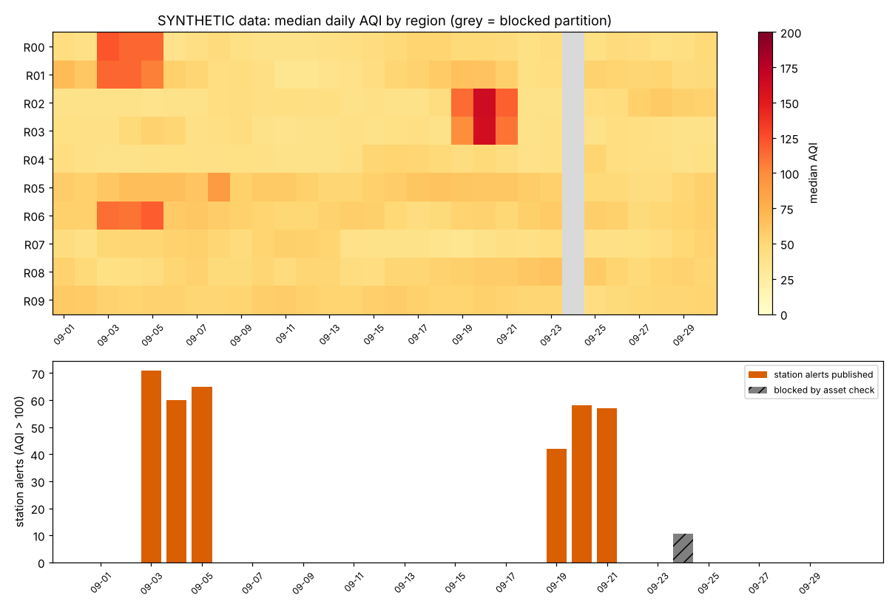
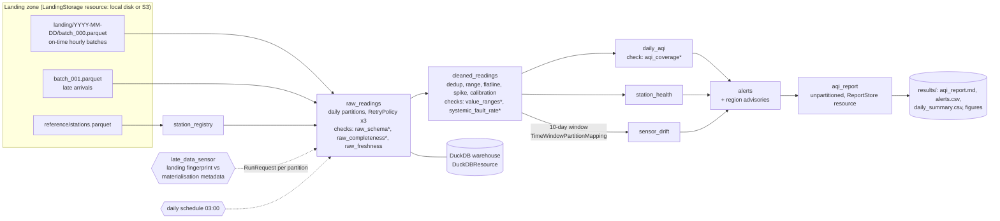

# Day 10: Air Quality Intelligence with Dagster Software-Defined Assets

**Tier II - Expert** | **Domain:** Environment & climate | **Tools:** Dagster 1.13.26, DuckDB 1.5.6, pandas, Pandera 0.34.1, Plotly | **Data:** SYNTHETIC

## Executive summary

A fragile chain of cron scripts is replaced by eight Dagster software-defined assets that ingest hourly PM2.5, NO2 and O3 readings from 300 synthetic monitoring stations, clean them, score station health and sensor drift, compute the US EPA daily AQI and publish alerts for 30 daily partitions. Blocking asset checks withheld alerts on the two days the feed was broken (a backhaul outage and a firmware unit bug). Without that gating, the old approach would have published 130 false alerts on the unit-bug day alone. Against ground truth, the published alerts reach precision 0.966 and recall 0.955, compared with precision 0.430 for the ungated, uncleaned baseline. When late data landed, a sensor re-ran exactly the 4 affected partitions. That re-run released the outage day's alerts and added 5 wildfire-smoke alerts on 2026-09-20 that had been missed.



## Architecture



`*` marks a blocking check. If a blocking check fails with ERROR severity, Dagster does not execute the downstream steps of that run, so no alerts are published for that partition.

## Data provenance

- **Path used: synthetic generator (automatic fallback).** The prompt prefers the OpenAQ API. From the build environment, `api.openaq.org` was refused by the network proxy (HTTP 403 on CONNECT), and OpenAQ v3 also requires an API key. The project therefore uses its seeded generator, and `results/metrics.json` records `"data_source": "SYNTHETIC ..."`. Every figure and report is titled SYNTHETIC.
- **Generator** (`src/air_quality/generate.py`, seed `20261020`):
  - **Network:** 300 stations in 10 regions (25% traffic sites), hourly, 2026-09-01 to 2026-09-30, giving 216,000 station-hours.
  - **Regional fields:** AR(1) synoptic variability with diurnal cycles. Three episodes are planted: an ozone heat wave on 09-03 to 09-05 in 3 regions, wildfire smoke on 09-19 to 09-21 in 2 regions, and a winter-style inversion on 09-08 in 1 region.
  - **Measurement faults:**
    - 30 stations with calibration offsets, which are recorded in the station registry;
    - 15 stations with slow PM2.5 drift, which is not recorded anywhere;
    - 9 stations with multi-day outages;
    - 2% random gaps;
    - stuck loggers (flatlines) on 1,346 station-hours;
    - 659 spikes;
    - 1,030 duplicate deliveries.
  - **Incidents:**
    - **Backhaul outage on 2026-09-12.** 60% of stations were silent from 04:00 to 20:00. 85% of the buffered readings land 2 days late, and 476 station-hours are lost.
    - **Firmware unit bug on 2026-09-24.** 123 stations report NO2 in ppt instead of ppb (x1000).
    - **Late evening readings.** On 09-06, 09-20 and 09-27, evening readings from some stations land 2 days late.
  - **Volumes:** 208,123 on-time rows and 3,535 late rows.
  - **Ground truth:** the noise-free concentrations and the drift parameters are written to `data/truth/`. They are used only for scoring and are never read by the assets.
- **Committed sample:** `data/sample/` (435 KB) holds the station registry and every on-time reading of 2026-09-01 as CSV. A test checks that the generator reproduces it. The full landing zone (about 3.3 MB of parquet) is written to the git-ignored `data/` by `make data` or `make run`.

## Method

1. **Assets and partitions (`assets.py`).** All assets except `station_registry` and `aqi_report` use a `DailyPartitionsDefinition` covering 30 days, with `BackfillPolicy.single_run()`. Each asset loops over `context.partition_keys`, so the same code serves:
   - one-partition runs from the sensor or the schedule;
   - multi-run backfills;
   - single-run ranges (`dagster asset materialize --partition-range`).

   Each asset deletes and re-inserts only its own partitions in DuckDB, so re-running a partition is idempotent. `sensor_drift` reads a 10-day window of `cleaned_readings` through a `TimeWindowPartitionMapping(start_offset=-9)`.
2. **Asset checks.** Checks are declared with `check_specs` and evaluated inside the asset per partition. Results are written to Dagster's event log and to an audit table, `check_results`.

   | Check | Asset | Rule | Blocking |
   |---|---|---|---|
   | `raw_schema` | raw | Pandera contract (ids, dtypes, `landed_at >= ts`, strict columns) on every batch | yes |
   | `raw_completeness` | raw | distinct station-hours ≥ 85% of registry × 24 | yes |
   | `raw_freshness` | raw | data reaches 23:00 and median ingest latency ≤ 90 min | no (WARN) |
   | `value_ranges` | cleaned | Pandera: PM2.5 0-1000, NO2 0-2000, O3 0-500, unique (station, ts) | yes |
   | `systemic_fault_rate` | cleaned | raw values rejected as out of range ≤ 5% | yes |
   | `aqi_coverage` | daily AQI | registry stations with a valid PM2.5 sub-index ≥ 75% | yes |

3. **Cleaning (`cleaning.py`).** The cleaning steps are:
   - keep the latest delivery of each (station, hour);
   - null values outside physical bounds, and clip noise between -3 and 0 to 0;
   - null runs of 4 or more identical consecutive hours (flatlines);
   - null spikes above 4× the 5-hour rolling median plus a per-pollutant floor;
   - subtract the registry's calibration offsets.
4. **Daily AQI (`aqi.py`).** The daily AQI follows the US EPA method with the 2024 PM2.5 breakpoints:
   - PM2.5: 24-hour mean, which needs at least 18 valid hours;
   - NO2: daily maximum 1-hour value;
   - O3: maximum 8-hour running mean, which needs at least 6 valid hours per window.

   Concentrations are truncated as the EPA specifies before the sub-index is computed. The daily AQI is the maximum sub-index.
5. **Station health and drift (stretch goal).** `station_health` records uptime and flagged hours and labels each station `ok`, `degraded` or `offline`. `sensor_drift` regresses each station's hourly PM2.5 on its regional median and a time trend over a 10-day window. A station is flagged when the drift rate is at least 0.5 µg/m³/day and |t| ≥ 6. A flag latches until recalibration, because a sensor that drifts down to 0 is nulled as a flatline and no longer shows a slope.
6. **Alerts.** An alert is raised for each station-day with AQI > 100 at a station that is not offline and not drift-suspect. A regional advisory is raised when at least 20% of a region's eligible stations are in alert.
7. **Late-data sensor (`sensors.py`).** `raw_readings` stores a fingerprint of each partition's landing files (names and sizes) in its materialisation metadata. On each tick, the sensor compares the current landing fingerprint with the latest materialisation of that partition. It emits one `RunRequest(partition_key=...)` per changed partition, with `run_key = partition:fingerprint`, so the daemon launches each data version once.
8. **Reliability.**
   - **Retries:** `raw_readings` has `RetryPolicy(max_retries=3, delay=0.2s, backoff=EXPONENTIAL)`. `make run` injects one simulated storage timeout on 2026-09-03.
   - **Storage resources:** `LandingStorage` and `ReportStore` resources have local and S3 implementations, selected with `AQ_STORAGE`.
   - **Executor:** the in-process executor is used, because DuckDB allows only one writer process.
9. **`make run` (`scripts/run_pipeline.py`).** The script runs these steps:
   1. Regenerate the data.
   2. Backfill all 30 partitions, one run per partition.
   3. Deliver the late batches, tick the sensor, execute its run requests, and tick it again.
   4. Materialise the `aqi_report` asset.
   5. Run a single-run backfill of the same 30 partitions on a copy of the data, to compare the two backfill modes.
   6. Score the alerts and drift flags against the ground truth.

## Results

Every number below is from `results/metrics.json`, `results/check_evaluations.csv` and `results/daily_summary.csv`, produced by `make run` (Python 3.11, CPU, 89.1 s end to end).

**Orchestration and reliability**

| Metric | Value |
|---|---|
| 30-partition backfill (one run per partition) | **30/30 runs completed** in 65.6 s (median 2.225 s per partition); 28 succeeded, 2 failed at a blocking check by design |
| Blocked by asset checks in the backfill | 2026-09-12 `raw_completeness` = 0.5632 (< 0.85); 2026-09-24 `systemic_fault_rate` = 0.1411 (> 0.05) |
| Alerts materialised for blocked partitions | 0. The `alerts` step was skipped, and `alerts.csv` has no rows for these dates |
| Transient storage error on 2026-09-03 | 1 step retry; run succeeded |
| Late batches delivered → sensor tick 1 | 4 files → 4 run requests (09-06, 09-12, 09-20, 09-27), all `late_data`; 4/4 runs succeeded in 9.4 s |
| Sensor tick 2 (no new data) | 0 run requests |
| 2026-09-12 after late data | completeness 0.5632 → 0.9147, alerts released (`raw_freshness` WARN with median latency 93.6 min, non-blocking) |
| 2026-09-20 after late data (smoke peak) | AQI coverage 0.8367 → 0.9633; station alerts 53 → 58 |
| Single-run range backfill of 30 partitions (`--partition-range` path) | ran in 8.1 s; raw and cleaned materialised for 30 partitions; 09-24's failed check blocked alerts for **all** 30 |
| Asset-check evaluations | 200, of which 3 failed (2 blocking ERROR, 1 WARN) |
| Final state | 29 partitions published, 1 blocked (2026-09-24) |

**Alert quality against SYNTHETIC ground truth (357 true station-day alerts, AQI > 100)**

| Pipeline | Alerts | Precision | Recall | F1 |
|---|---|---|---|---|
| Dagster assets (cleaned, calibrated, gated, drift-excluded) | 353 | **0.966** | **0.9552** | **0.9606** |
| Naive cron-style AQI on raw data, all 30 days | 797 | 0.4304 | 0.9608 | 0.5945 |
| Naive, only on the 29 days the pipeline published | 667 | 0.5142 | 0.9608 | 0.6699 |

- **Unit-bug day:** the naive baseline raises 130 false alerts on 2026-09-24. The pipeline raises none, because the partition is blocked.
- **Drifting sensors:** the naive baseline raises 36 false alerts from drifting sensors, against 1 for the pipeline.
- **Regional advisories:** 15 were published (`results/region_advisories.csv`). They cover the heat wave (R00, R01, R06 on 09-03 to 09-05) and the smoke episode (R02, R03 on 09-19 to 09-21).

**Data quality and drift detection**

| Metric | Value |
|---|---|
| Raw rows → cleaned rows | 211,658 → 210,628 (1,030 duplicates removed) |
| Values nulled | 5,112 out of range, 5,133 flatline, 585 spike |
| Station-days by health status | 8,372 ok, 309 degraded, 19 offline |
| Drifting sensors flagged at least once | **15/15**, precision 1.0, 0 false-suspect station-days |
| Drift flagged on the last day (09-30) | 10/15. The 5 downward drifters that reached 0 were nulled as flatlines and lost their slope before the latch existed for them |
| Detection delay after drift onset | median 4.0 days, max 7.0 days |
| Drift-rate estimation error (median) | 0.031 µg/m³/day |

The published outputs are:

- `results/aqi_report.md`: the daily AQI report, with the latest day, the most recent alert day, the blocked partitions and a day-by-day table;
- `results/alerts.csv`: the alert list;
- `results/daily_summary.csv`;
- `results/figures/aqi_heatmap.html` (interactive Plotly) and `results/figures/aqi_overview.png`;
- the run and check logs, `results/run_log.csv` and `results/check_evaluations.csv`.

## Dagster vs an Airflow DAG (stretch write-up)

| Concern | Airflow DAG (task-centric) | This Dagster design (asset-centric) |
|---|---|---|
| Unit of work | tasks; datasets are implicit side effects | assets (tables) with lineage, metadata and per-partition materialisation history |
| Daily partitions | `logical_date` templating; a backfill is a DAG-run range | `DailyPartitionsDefinition`; status is tracked per asset partition, and ranges run per partition or as a single run |
| Data quality | a separate validation task, often with `ShortCircuitOperator` | `check_specs` on the asset; `blocking=True` skips downstream steps, and results are attached to the asset |
| Late data | an external sensor or a cleared DAG run; downstream re-runs are manual | the sensor compares the landing fingerprint with the materialisation metadata and requests only the stale partitions |
| Windowed dependency (drift) | `ExternalTaskSensor` or a hand-written lookback | `TimeWindowPartitionMapping(start_offset=-9)` declared on the dependency |
| Local vs cloud | Connections plus environment branches in DAG code | `ConfigurableResource` subclasses swapped through `Definitions(resources=...)` |
| Testing | DAG-integrity tests, with task logic often tested separately | `execute_in_process`, `build_sensor_context` and a headless CLI in pytest, with no scheduler needed |

Airflow would still be a reasonable choice for an agency already running it, especially to orchestrate non-Python systems. The asset model pays off here because the products being published, alert lists for specific dates, are themselves partitions of an asset, so their status, checks and backfills are tracked per asset partition.

## Limitations

- **The data is synthetic.** OpenAQ was unreachable from the build network (403), so no real station data was used. The fault rates, episode sizes and thresholds are design choices, and the precision and recall figures describe this simulation, not a real network.
- **Single-run range backfills gate coarsely.** A single run's checks cover all of its partitions, so one bad partition blocks alerts for the whole range. In this build, 09-24 blocked all 30. Per-partition runs (the default for the sensor, the schedule and `make run`) avoid this. Dagster's partitioned asset checks were still a preview feature in 1.13 and were not used.
- **Backfills ran without the daemon.** The 30-partition backfill is a loop of in-process runs, one per partition, rather than a daemon-managed backfill. `dagster dev` can launch the same backfill from the UI. The sensor and schedule are ticked programmatically in `make run`; under `dagster dev` they need to be turned on in the UI and need the daemon.
- **Late data does not propagate forward.** When the sensor re-runs a partition, the next 9 days of `sensor_drift`, which read it through the 10-day window, are not refreshed.
- **Most of the alert recall loss is structural.** 2026-09-24 stays blocked until a person fixes the feed. Nothing in the pipeline auto-corrects the unit bug.
- **Five drifting sensors were missed on the last day.** Five downward-drifting sensors that reached 0 were not flagged on 09-30. They had already been flagged earlier in the month and are excluded from alerts, but recall on the last day alone is 10/15.
- **The S3 resources are untested.** `S3LandingStorage` and `S3ReportStore` are implemented but not exercised: there is no network, and boto3 is not pinned. Only resource construction is tested.
- **No substitutions.** All tools named in the prompt are used (Dagster, DuckDB, pandas, Pandera, Plotly).

## How to run

```bash
cd day-10-air-quality-dagster-assets
make setup        # pip install -r requirements.txt (Python 3.11+)
make run          # generate SYNTHETIC data, backfill, sensor, range demo, report, metrics (~1.5 min CPU)
make test         # pytest on a tiny SYNTHETIC preset (20 stations x 30 days), ~2 min
make dev          # Dagster UI at http://localhost:3000 (DAGSTER_HOME=data/dagster_home, filled by make run)
```

The same pipeline can be run headlessly from the CLI. The tests run exactly these commands:

```bash
export PYTHONPATH=src DAGSTER_HOME=$PWD/data/dagster_home
dagster asset materialize -m air_quality.definitions --select station_registry
dagster asset materialize -m air_quality.definitions \
  --select '(group:ingest or group:quality or group:publish) and not key:station_registry' \
  --partition-range 2026-09-01...2026-09-05
```

Environment variables: `AQ_DATA_DIR` (default `./data`), `AQ_RESULTS_DIR` (default `./results`), and `AQ_STORAGE=local|s3` (with `AQ_S3_BUCKET` and optional `AQ_S3_ENDPOINT`; needs `boto3`).

## What this demonstrates

| Skill | Where |
|---|---|
| Data orchestration | software-defined assets with daily partitions, a partition mapping for the drift window, a partitioned job, a schedule, a sensor that issues partition run requests, and single-run and multi-run backfills (`assets.py`, `sensors.py`) |
| Pipeline reliability | blocking asset checks that stop alerts on bad data, a RetryPolicy proven against an injected fault, idempotent partition writes, swappable local/S3 resources, and headless CLI runs in tests |
| Observability | per-partition check values in the Dagster event log and the `check_results` table, materialisation metadata (row counts, completeness, landing fingerprints, alert previews), a run log, a day-by-day report, and scoring against ground truth |
