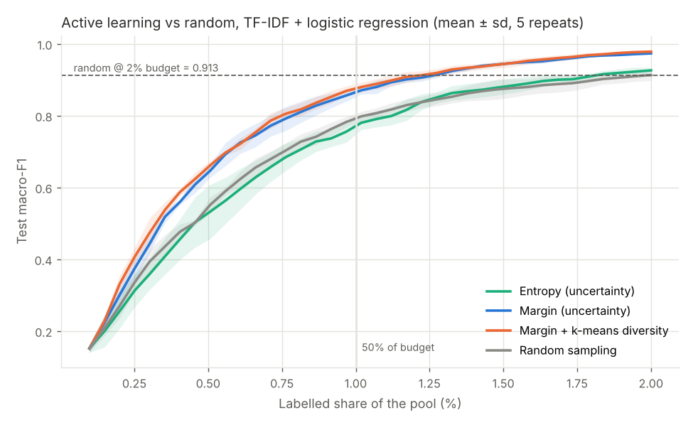
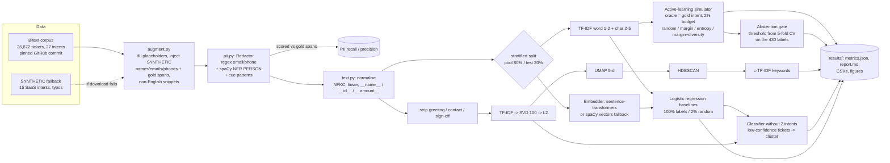

# Day 11: Support Ticket Intelligence: NLP Classification with Active Learning

**Tier II - Expert** | **Domain:** Customer operations | **Tools:** spaCy 3.8 (`en_core_web_md`), scikit-learn 1.9, UMAP 0.5, HDBSCAN (scikit-learn), matplotlib | **Data:** PUBLIC Bitext corpus + SYNTHETIC PII layer

## Executive summary

A routing model trained on just 430 labelled tickets (2% of the pool), chosen by uncertainty-based active learning, assigns 27 support intents with macro-F1 0.974. With the same 430 labels chosen at random, macro-F1 is 0.913; random labelling needs about 1,290 labels (3x as many) to match the active-learning model. Before any model sees a ticket, names, emails and phone numbers are redacted with 99.93% span recall on 23,664 labelled PII spans. A confidence gate auto-routes 81.4% of tickets at 99.6% accuracy and sends the rest to people. Clustering the tickets the model is unsure about surfaced two intents it had never been trained on, with clusters that are 97-99% pure.



## Architecture



## Data provenance

- **Path used: public corpus.** The data is the Bitext customer-support intent dataset ("Bitext Sample Customer Support Training Dataset 27K responses v11", licence CDLA-Sharing-1.0, 26,872 user requests, 27 intents in 10 categories). It is downloaded from GitHub at the pinned commit `72ea2203` (`src/ticket_intel/config.py`). Hugging Face is tried first, but `huggingface.co` was blocked by the build network's proxy; the GitHub raw URL worked. The file (19.2 MB) is cached in the git-ignored `data/raw/`. `results/metrics.json` records the path as `"data.path": "bitext"`.
- **Automatic fallback.** If both downloads fail, `make run` switches to the seeded SYNTHETIC generator (`src/ticket_intel/synth.py`): 15 SaaS intents (login, SSO, billing, refunds, API rate limits and so on), templated text with slot fillers, and keyboard typos. The tests always use this generator, so they never touch the network. `TICKET_SOURCE=synthetic|bitext|sample` forces a path.
- **SYNTHETIC PII layer (on both paths).** The Bitext texts contain placeholders such as `{{Person Name}}` and no real PII. `augment.py` (seed `20261022`) fills the placeholders. It then adds randomly generated, fictitious greetings ("Hi, this is Priya Patel."), contact lines and signatures with names, emails (only `example.*`/`.test` domains) and phone numbers in 11 international formats to 37.0% of tickets. Non-English courtesy snippets ("Gracias de antemano.", "Merci beaucoup.") go to 7.8% of tickets. Every injected PII value is recorded as a gold character span. This gives 23,664 labelled spans: 13,301 names, 5,236 emails and 5,127 phones.
- **Hand-labelled PII set.** `data/sample/pii_handlabelled.txt` holds 40 tickets written by hand with fictitious identities, including 41 gold spans and 5 PII-free tickets with order numbers, amounts and a date. Their phrasing deliberately differs from the generator's templates.
- **Committed sample.** `data/sample/tickets_sample.csv` (211 KB) has 60 augmented tickets per intent with gold spans. Bitext's licence (CDLA-Sharing-1.0) allows redistribution.

## Method

1. **PII redaction (`pii.py`).** Three detectors run on each ticket, and overlapping detections are merged. Each detected span is replaced with `[EMAIL]`, `[PHONE]` or `[NAME]`.
   - **Email:** a regular expression.
   - **Phone:** a separator-tolerant pattern with an optional country code and area code. A match must have 7-15 digits and must not follow `#`, `ORD-` or a currency sign, and ISO dates are excluded.
   - **Names:**
     - spaCy `en_core_web_md` NER `PERSON` entities, extended by one adjacent capitalised word to repair partial names;
     - cue patterns such as "my name is", "Regards,", "-- " and "X here";
     - a weaker "from X" cue, which is dropped when NER tags X as a place or date;
     - a stop-list of non-English greetings that NER mislabels as people.

   **Scoring:** a gold span counts as recalled only if every alphanumeric character in it is masked.
2. **Normalisation (`text.py`).** Every model sees the redacted text after NFKC normalisation and lowercasing, with typed placeholders (`__name__`, `__id__` for order and invoice numbers, `__amount__`, `__num__`) and repeated punctuation collapsed. For topic discovery only, greeting, contact and sign-off phrases around redacted PII are also removed, so clusters form on the request rather than on email boilerplate.
3. **Baselines.**
   - **TF-IDF:** word 1-2-grams plus character 2-5-grams, with a multinomial logistic regression (C=20, newton-cg).
   - **Embedding:** dense sentence vectors with a logistic regression. The planned model, sentence-transformers `all-MiniLM-L6-v2`, could not be used because Hugging Face is blocked and installing torch was out of scope for CI. The `Embedder` falls back automatically to mean-pooled `en_core_web_md` 300-d word vectors and records the reason in `metrics.json`. Set `TICKET_EMBEDDER=st` with sentence-transformers installed to use the transformer.
4. **Active learning (`active.py`).** The pool is the 80% training split (21,497 tickets). The remaining 5,375 tickets form the test set, which is never queried.
   - **Budget:** 2% of the pool, 430 labels, starting from 21 random seed labels and querying batches of 11. The seed set is identical for every strategy within a repeat.
   - **Simulated annotator:** returns the gold intent for each queried ticket.
   - **Strategies:** random, margin (the primary, pre-declared uncertainty strategy), entropy, and margin plus k-means diversity (the 110 lowest-margin tickets are clustered into 11 groups and the most uncertain ticket in each group is labelled).
   - **Repeats:** 5 seeds, run on both feature spaces.
   - **Criterion:** compare the mean F1 of random sampling at 430 labels with the first point where the mean margin-AL curve reaches it.
5. **Calibrated abstention (stretch).** The threshold uses only the 430 labels. 5-fold cross-validated probabilities on them give the lowest confidence threshold at which auto-routed accuracy is at least 95%. That threshold is then applied to the test set.
6. **Topic discovery (`topics.py`).** The boilerplate-stripped TF-IDF is reduced to a 100-d LSA embedding with TruncatedSVD, then to 5 dimensions with UMAP (cosine, 15 neighbours). HDBSCAN (min cluster size 40) clusters the result, and BERTopic-style class-based TF-IDF supplies keywords for each cluster. As a comparison, the same pipeline is run on the spaCy vectors.
7. **Emerging-issue simulation.**
   - A classifier is trained without two intents, `check_cancellation_fee` and `newsletter_subscription`.
   - Test tickets with top-class probability below 0.5 are flagged.
   - The flagged tickets are clustered (min cluster size 15), and each cluster is described by its keywords.

## Results

Every number below is from `results/metrics.json`, `results/al_curves.csv`, `results/random_extended_curve.csv`, `results/per_intent_f1.csv` and `results/topic_clusters.csv`. These files were produced by `make run` on Python 3.11, CPU only, in 375 s end to end.

**Acceptance criteria**

| Criterion | Target | Result | Met? |
|---|---|---|---|
| Active learning reaches random-sampling F1 with ≤ 50% of the labels | ≤ 0.50 | margin AL reaches random's 2%-budget F1 (0.9132) at 274 labels = **63.7%** of the budget (per repeat: 53.5%-74.0%); margin plus diversity is also 63.7% | **No** (see Limitations) |
| PII redaction recall ≥ 95% on a labelled set | ≥ 0.95 | **99.93%** on 23,664 generator-labelled spans; **100%** on the 41-span hand-labelled set | Yes |
| Macro-F1 per intent with a confusion matrix | reported | `results/per_intent_f1.csv`, `results/report.md`, `figures/confusion_*.png` | Yes |
| `make test` passes / `make run` reproduces the README | - | both pass (Python 3.11) | Yes |

**Classification (test set, 5,375 tickets, 27 intents)**

| Model | Labels | Macro-F1 | Accuracy |
|---|---|---|---|
| TF-IDF + LR | 100% (21,497) | **0.9993** | 0.9993 |
| spaCy-vector embedding + LR | 100% | 0.9413 | 0.9412 |
| TF-IDF + LR, margin active learning (repeat 0) | 2% (430) | **0.9757** | 0.9756 |
| TF-IDF + LR, random sample (repeat 0) | 2% (430) | 0.9327 | 0.9321 |
| Embedding + LR, random sample (repeat 0) | 2% (430) | 0.6641 | 0.6636 |

**Active learning (TF-IDF, mean of 5 repeats)**

| Strategy | Macro-F1 @ 1% labels | Macro-F1 @ 2% labels (± sd) | Labels to reach random's 2% F1 |
|---|---|---|---|
| Random | 0.7926 | 0.9132 ± 0.0154 | 430 (100%) |
| Margin (primary) | 0.8655 | **0.9737 ± 0.0035** | 274 (63.7%) |
| Margin + k-means diversity | 0.8760 | 0.9785 ± 0.0037 | 274 (63.7%) |
| Entropy | 0.7713 | 0.9264 ± 0.0081 | 395 (91.9%) |

- **Matching the other way round.** Random sampling needs **1,290 labels** (3x the budget, mean F1 0.9808) to reach margin AL's 2%-budget F1 of 0.9737; at 860 labels it is still at 0.9657. Measured this way, AL reaches the random-sampling F1 with at most 33% of the labels. This comparison was chosen after the primary criterion had been computed, so it is reported as context, not as a pass.
- **Embedding feature space.** Margin AL reaches 0.6933 against random's 0.6554, and needs 84.2% of the labels to match random (`figures/learning_curve_emb.png`).

**PII redaction**

| Detector | Span recall | Name recall | Email / phone recall | Char precision | PII-free tickets with a false redaction |
|---|---|---|---|---|---|
| **NER + regex + cues (used)** | **0.9993** | 0.9988 | 1.0 / 1.0 | 0.9816 | 0.64% |
| NER + regex (no cue patterns) | 0.9566 | 0.9228 | 1.0 / 1.0 | 0.9820 | 0.58% |
| Regex + cues (no NER) | 0.9992 | 0.9985 | 1.0 / 1.0 | 0.9948 | 0.87% |
| Used detector on the hand-labelled set (41 spans) | 1.0 | 1.0 (24) | 1.0 (9) / 1.0 (8) | 0.9876 | 0 of 5 |

After redaction, 0 of the injected email domains remain anywhere in the corpus.

**Calibrated abstention (stretch).** The model trained on the 430 margin-AL labels gets a confidence threshold of 0.5076 from 5-fold cross-validation on those labels. On the test set it then:

- auto-routes **81.4%** of tickets at **99.59%** accuracy;
- sends the other 18.6% to people (the model's accuracy on that share would have been 88.7%);
- reaches 97.56% accuracy overall without abstention.

The figure is `figures/abstention.png`.

**Topic discovery (unsupervised, test set)**

| Representation | Clusters | Noise | NMI vs intents | ARI vs intents |
|---|---|---|---|---|
| LSA (TF-IDF → SVD 100) → UMAP → HDBSCAN | 52 | 9.0% | **0.711** | 0.419 |
| spaCy vectors → UMAP → HDBSCAN | 29 | 16.5% | 0.584 | 0.252 |

- **Clusters vs intents.** 26 of the 52 clusters are at least 80% pure and cover 17 of the 27 intents. NMI is moderate because the clusters are finer than the intent labels: `check_cancellation_fee` splits into "early termination", "withdrawal penalty" and "exit fee" phrasings, and one cluster collects tickets with the Spanish snippet "por favor, es urgente".
- **Emerging issues.** The classifier was trained without `check_cancellation_fee` and `newsletter_subscription`.
  - It flagged 73.1% of their test tickets as low-confidence, but only 0.1% of the known-intent tickets.
  - 98.3% of the 290 flagged tickets belong to the new intents.
  - Clustering the flagged tickets gave 5 clusters, all with an unseen intent as the majority:
    - **`check_cancellation_fee`:** 3 clusters, keywords "early termination fee", "withdrawal penalties" and "exit fee"; 78.9% of the intent's tickets, 99.3% purity.
    - **`newsletter_subscription`:** 2 clusters, keywords "company newsletter" and "corporate newsletter, unsubscribe"; 67.5% of the intent's tickets, 97.1% purity.

Figures in `results/figures/`:

- `learning_curve_tfidf.png`, `learning_curve_emb.png`: active learning vs random;
- `confusion_al_2pct.png`, `confusion_full.png`: confusion matrices;
- `per_intent_f1.png`: per-intent F1;
- `pii_recall.png`: PII recall by type and detector;
- `abstention.png`: coverage vs accuracy;
- `topics_umap.png`: 2-D UMAP of the test tickets.

`results/report.md` has the per-intent F1 table for every model and the full cluster table.

## What this demonstrates

| Skill | Where |
|---|---|
| NLP | redaction-aware text normalisation; word and character TF-IDF vs dense embeddings; c-TF-IDF topic keywords; UMAP + HDBSCAN clustering; open-set detection of new intents |
| Active learning | pool-based simulator with a shared seed set, four query strategies over 5 repeats, a label-efficiency criterion computed both ways, and an abstention threshold learned only from the queried labels |
| Data privacy | redaction runs before any model; span-level recall, precision and false-redaction rates with detector ablations; a separate hand-labelled set; checks that no injected email survives; only synthetic identities and reserved domains in the repo |

## Limitations

- **The active-learning criterion (≤ 50% of labels) is not met.** Margin sampling needed 63.7% of the 2% budget to reach random's F1, with a per-repeat range of 53.5% to 74.0%. What was tried:
  - in the final run: entropy sampling (worse) and margin with k-means diversity (the same 63.7%);
  - during development (not in the final run): a k-means cold-start seed set (the `cluster_margin` strategy in `active.py`), batch sizes of 5, 10 and 21, and regularisation strengths C = 5, 20 and 100.

  Over 2-3 repeats, none of these got below about 55% of the labels. With 27 intents and only 21 seed labels, every strategy spends its first rounds discovering the classes. At 1% of the pool, margin AL is ahead of random but not yet at random's 2% level (0.866 vs 0.793). AL's advantage is large later in the curve: at the full 2% budget, margin AL gets macro-F1 0.974 against 0.913 for random, and random needs 3x the labels to catch up.
- **Embeddings are a fallback.** sentence-transformers could not be used: Hugging Face was unreachable from the build network, and a torch install was kept out of CI. The spaCy static-vector fallback is clearly weaker (0.941 macro-F1 with full labels, against 0.999 for TF-IDF), so the active-learning headline uses TF-IDF. The code switches to `all-MiniLM-L6-v2` automatically when it is available.
- **PII recall is optimistic.** The PII in the corpus is synthetic, and the generator and the cue patterns were written by the same author. Without cue patterns, spaCy NER plus regex reaches 95.7% overall and 92.3% on names, which is a better estimate for unseen phrasing. The hand-labelled set was used during development (it exposed missed 8-digit phone groups, date false positives and partial names), so it is a development set, not a blind test. Real tickets would also contain addresses, account numbers and names in lowercase, none of which are covered.
- **The corpus is easy.** Bitext requests are short, generated by templates, and evenly spread over the intents (about 1,000 per intent). A full-label F1 of 0.999 would not carry over to real ticket traffic, where intents overlap and are imbalanced. The prompt's "10k tickets a week" scale was not simulated; the corpus has 26,872 tickets.
- **The emerging-issue test is a simulation.** It uses held-out existing intents, not a real drift in what customers ask about. The other 26.9% of the held-out tickets got a top-class probability of at least 0.5, so they were silently routed to a known intent.
- **The weak-supervision stretch goal was not attempted.** No external LLM API is used, so nothing needs an API key.

## How to run

```bash
cd day-11-support-ticket-nlp-active-learning
make setup   # pip install -r requirements.txt (Python 3.11+, CPU; includes the en_core_web_md wheel from GitHub)
make data    # optional: download + cache the Bitext corpus to data/raw/
make run     # full pipeline -> results/ (about 6-7 min on 4 CPU cores)
make test    # pytest on small SYNTHETIC fixtures (no network)
```

Environment switches:

- `TICKET_SOURCE=auto|bitext|synthetic|sample` chooses the data source (default `auto`: Bitext, with the SYNTHETIC fallback).
- `TICKET_EMBEDDER=auto|st|spacy` chooses the embedder (default `auto`: sentence-transformers if installed and reachable, otherwise spaCy vectors).
