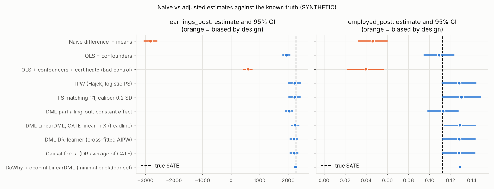
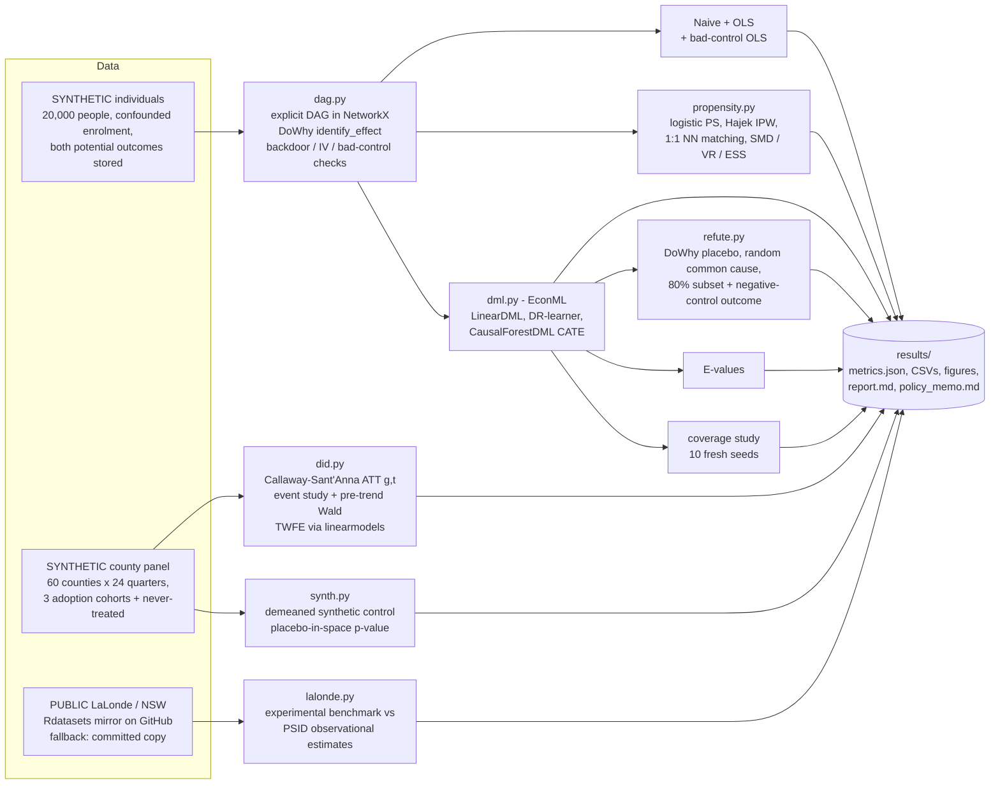
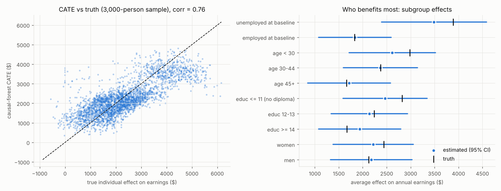
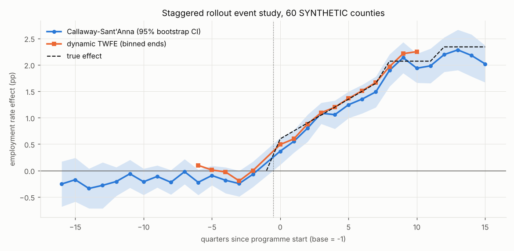

# Day 12: Did the Programme Work? Causal Inference with Double ML

**Tier II - Expert** | **Domain:** Public policy & workforce | **Tools:** DoWhy 0.14, EconML 0.17, statsmodels 0.15, linearmodels 7.1, NetworkX 3.6, scikit-learn 1.9 | **Data:** SYNTHETIC individuals + county panel (known truth), PUBLIC LaLonde/NSW replication

## Executive summary

On a SYNTHETIC population of 20,000 adults where the true effect is known, double machine learning estimates that the job-training programme raises next-year earnings by $2,243 (95% CI $2,111 to $2,375). The true effect is $2,283. The naive enrolled-vs-not comparison says the programme *cuts* earnings by $2,818, an error of $5,101, because the people who enrol were already poorer. The gains are largest for people who were unemployed when they enrolled ($3,488 vs $1,835), and the staggered county rollout points the same way: Callaway-Sant'Anna estimates a +1.35 pp rise in the employment rate (truth +1.47 pp), where the textbook two-way fixed-effects regression understates it at +1.04 pp.



The plain-language **policy memo** is in [`results/policy_memo.md`](results/policy_memo.md), and the full technical tables are in [`results/report.md`](results/report.md).

## Architecture



## Data provenance

- **Individual records: SYNTHETIC by design.** `src/policy_causal/simulate.py` (seed `20261022`) generates 20,000 adults with age, sex, schooling, marital status, urban residence, baseline unemployment, earnings one and two years before, and distance to a training centre. The probability of enrolling is a nonlinear function of these covariates. Enrolees are more often unemployed, younger, poorer and closer to a centre, so 58.3% enrol and the raw groups are badly unbalanced (max |SMD| 0.70). Each person carries *both* potential outcomes (annual earnings censored at $0, and employment from a probit), so the true sample average treatment effect (SATE) is known exactly: **$2,283** for earnings and **11.21 pp** for employment. The effects are heterogeneous: they are bigger for the unemployed, the young and people with less schooling. Two features make adjustment non-trivial:
  - an unobserved "ability" drives a post-enrolment **certificate** and both outcomes, so the certificate is a mediator *and* a collider that must not be adjusted for;
  - distance to the centre affects enrolment only, so it acts as an instrument.
- **County panel: SYNTHETIC.** There are 60 counties over 24 quarters. Counties adopt in quarter 8, 12 or 16 (15 counties each), and 15 never adopt. Employment rates follow county and quarter effects plus an interactive factor (loading × common random walk) plus noise. Early adopters are poorer counties, which affects *levels*, and DiD can absorb that. Effects grow with exposure and differ by cohort. The true overall ATT is **1.47 pp**.
- **Why synthetic.** The acceptance criteria require checking estimates against a known true effect, which no observational public dataset provides. No public download is attempted for these two datasets; the seeded generator is the primary path, and `results/metrics.json` records `data.individual_path = "synthetic ..."`.
- **Public LaLonde/NSW replication: download path used.** The Dehejia-Wahba NSW experimental sample (`causaldata::nsw_mixtape`, 445 people) and NSW treated + PSID comparison group (`MatchIt::lalonde`, 614 people) were downloaded from the Rdatasets GitHub mirror (`config.LALONDE_URLS`). The build network's proxy allowed `raw.githubusercontent.com`. The run recorded `lalonde_path = "download"`. If the download fails, the loader falls back automatically to the cached copy in `data/raw/`, then to the committed copy in `data/sample/` (57 KB). The tests always use the committed copy.
- **Committed samples (`data/sample/`, 392 KB in total).**
  - `individuals_sample.csv`: the first 3,000 SYNTHETIC people, including the `true_*` oracle columns.
  - `county_panel.csv`: the full SYNTHETIC panel.
  - The two LaLonde CSVs.

  `make data` writes the full SYNTHETIC data to the git-ignored `data/raw/`.

## Method

1. **DAG and identification (`dag.py`).** The causal graph is written out explicitly (14 nodes, 43 edges) and drawn in `results/figures/dag.png`.
   - **DoWhy.** `CausalModel.identify_effect` returns the backdoor set {age, educ, female, prior_earn_1, unemployed_base, urban}. It flags `distance_km` as an instrument and finds no frontdoor.
   - **NetworkX.** `find_minimal_d_separator` gives the same minimal set. `is_d_separator` on the backdoor graph confirms three checks:
     - the analysis set (minimal set + `married`, `prior_earn_2` as precision covariates) is valid;
     - the empty set is invalid;
     - adding `certificate` makes the set invalid.
2. **Naive vs adjusted.** The naive difference in means is compared with OLS on the confounders, with OLS that also includes the certificate (a bad control), and with every estimator below. Bias is always measured against the true SATE.
3. **Propensity methods (`propensity.py`).** The propensity model is logistic regression on all squares and pairwise interactions, clipped to [0.01, 0.99]. On top of it:
   - Hajek-normalised IPW for the ATE;
   - 1:1 nearest-neighbour matching on the logit propensity score, with replacement, in both directions, with a caliper of 0.2 SD.

   Balance is checked with standardised mean differences, variance ratios and the effective sample size. The 95% CIs come from 200 nonparametric bootstrap replicates, with the propensity score refitted in each one.
4. **Double ML (`dml.py`, EconML).** Every nuisance model is a cross-fitted (5-fold) histogram gradient boosting model.
   - **Headline: `LinearDML`.** The CATE is linear in six effect modifiers, and the ATE is the sample average of the CATE.
   - **For comparison:**
     - constant-effect partialling-out DML (Chernozhukov et al. 2018), which targets an *overlap-weighted* effect when effects are heterogeneous;
     - a cross-fitted AIPW DR-learner;
     - `CausalForestDML` (600 honest trees), giving a doubly robust ATE, individual CATEs and subgroup effects with CIs.

   A **coverage study** re-simulates 10 fresh populations and records how often the headline CI covers the truth.
5. **Refutations (`refute.py`).** The effect is re-estimated through DoWhy with the econml `LinearDML` backend on the minimal backdoor set. Three DoWhy refuters run 20 simulations each, for both outcomes:
   - placebo treatment (permuted), which passes if the placebo effect is under 10% of the estimate;
   - random common cause, which passes if the estimate moves less than 5%;
   - a random 80% subset, which passes if the estimate moves less than 10%.

   A **negative-control outcome** completes the set. Earnings two years *before* enrolment cannot be caused by the programme, so the adjusted "effect" on them must have a 95% CI that contains 0.
6. **Sensitivity (stretch).** E-values (VanderWeele & Ding 2017):
   - for employment, the risk ratio at the IPW baseline risk;
   - for earnings, the standardised-difference approximation RR ≈ exp(0.91 d).
7. **Staggered DiD (`did.py`).** Callaway & Sant'Anna (2021) group-time ATT(g,t) with a universal base period g-1, using never-treated counties (main) or not-yet-treated counties (robustness) as controls. These are aggregated to an overall ATT, to cohort ATTs and to an event study. The 95% CIs come from a 499-replicate county-cluster bootstrap. Pre-trends are tested jointly with a Wald test on all 15 pre-period coefficients, using the bootstrap covariance. The comparisons are static and dynamic TWFE from `linearmodels.PanelOLS`, with county-clustered SEs.
8. **Synthetic control (stretch, `synth.py`).** A demeaned synthetic control (Ferman & Pinto 2021) is built for one pilot county from the 15 never-treated donors, with weights on the simplex fitted by SLSQP. Inference uses a placebo-in-space RMSPE-ratio p-value.
9. **LaLonde (`lalonde.py`).** The experimental difference in means is the benchmark. On the observational NSW-vs-PSID design, it is compared with:
   - the naive difference;
   - HC1 OLS;
   - IPW-ATT;
   - a cross-fitted doubly robust ATT with random-forest nuisances.

## Results

All numbers come from `results/metrics.json` (seed 20261022, Python 3.11, 4 CPU cores, `make run` took 605 s).

**Individual-level study: 20,000 SYNTHETIC people. The true SATE is $2,283 for earnings and 0.1121 (11.21 pp) for employment.**

| Method | Earnings estimate [95% CI] | Bias | Employment estimate [95% CI] | Bias |
|---|---|---|---|---|
| Naive difference in means | -$2,818 [-$3,045, -$2,591] | **-$5,101** (-223% of truth) | 0.0461 [0.0324, 0.0598] | **-0.0660** (-59%) |
| OLS + confounders | $1,937 [$1,811, $2,064] | -$346 | 0.1090 [0.0947, 0.1233] | -0.0031 |
| OLS + certificate (bad control) | $587 [$441, $734] | -$1,696 | 0.0395 [0.0223, 0.0566] | -0.0727 |
| IPW (Hajek) | $2,223 [$2,006, $2,440] | -$60 | 0.1280 [0.1120, 0.1441] | +0.0159 |
| PS matching 1:1 | $2,220 [$2,021, $2,419] | -$63 | 0.1302 [0.1121, 0.1483] | +0.0181 |
| DML partialling-out, constant effect | $2,030 [$1,901, $2,158] | -$253 | 0.1128 [0.0984, 0.1273] | +0.0007 |
| **DML LinearDML, CATE linear in X (headline)** | **$2,243 [$2,111, $2,375]** | **-$40** | **0.1286 [0.1135, 0.1437]** | **+0.0165** |
| DML DR-learner (AIPW) | $2,200 [$2,063, $2,337] | -$83 | 0.1280 [0.1126, 0.1434] | +0.0159 |
| Causal forest (DR ATE) | $2,206 [$2,070, $2,342] | -$77 | 0.1277 [0.1123, 0.1431] | +0.0156 |
| DoWhy + econml LinearDML (minimal set) | $2,255 | -$28 | 0.1288 | +0.0167 |

| Check | Result |
|---|---|
| Earnings: truth inside the headline 95% CI | **Yes** ($2,283 in [$2,111, $2,375]) |
| Employment: truth inside the headline 95% CI | **No** (0.1121 vs [0.1135, 0.1437]; see Limitations) |
| Coverage study, 10 fresh seeds (headline CI covers truth) | earnings 10/10 (mean bias -$5.6), employment 10/10 (mean bias +0.0003) |
| Balance: max abs SMD raw → IPW → matched | 0.695 → 0.006 → 0.013 |
| Overlap | estimated PS in [0.124, 0.99], 3.7% outside [0.05, 0.95]; IPW ESS 10,029 treated / 4,201 control; 99.93% of units matched within caliper |
| DAG checks | DoWhy and NetworkX give the same minimal backdoor set; adding `certificate` makes the adjustment set invalid |

**Refutation tests (7 reported, 7 passed)**

| Test | Earnings: original → new | Employment: original → new | Passed |
|---|---|---|---|
| Placebo treatment (permute, 20 sims) | $2,255 → $17 | 0.1288 → 0.0009 | yes / yes |
| Random common cause (20 sims) | $2,255 → $2,253 | 0.1288 → 0.1283 | yes / yes |
| Data subset 80% (20 sims) | $2,255 → $2,237 | 0.1288 → 0.1270 | yes / yes |
| Negative-control outcome (earnings 2 yrs before) | adjusted effect $27 [-$70, $125]; CI contains 0 | | yes |

**Heterogeneity (causal forest)**

| Earnings effect | Estimated [95% CI] | Truth |
|---|---|---|
| Unemployed at baseline | $3,488 [$2,393, $4,584] | $3,889 |
| Employed at baseline | $1,835 [$1,075, $2,595] | $1,831 |
| Age < 30 | $2,616 [$1,714, $3,517] | $2,985 |
| Age 45+ | $1,718 [$852, $2,584] | $1,663 |
| 11 or fewer years of school | $2,465 [$1,588, $3,343] | $2,820 |
| 14+ years of school | $1,937 [$1,078, $2,796] | $1,669 |

- **Subgroup coverage.** The truth lies inside the subgroup CI in 11 of 11 groups for earnings and 11 of 11 for employment.
- **Agreement with the true effects.** Individual CATEs correlate with the true individual effects at 0.76 for earnings and 0.68 for employment.
- **Targeting value.** Targeting the 30% with the highest estimated CATE yields a true average gain of $3,502 per participant. That compares with $2,283 under random targeting and $3,779 for an oracle that knows each person's true effect.



**Staggered county rollout: 60 SYNTHETIC counties. The true overall ATT is 1.470 pp.**

| Estimator | ATT (pp) [95% CI] | Bias | Truth in CI |
|---|---|---|---|
| Callaway-Sant'Anna, never-treated controls | 1.345 [1.115, 1.576] | -0.125 | yes |
| Callaway-Sant'Anna, not-yet-treated controls | 1.349 [1.130, 1.568] | -0.121 | yes |
| Static TWFE (county + quarter FE) | 1.036 [0.881, 1.192] | **-0.434** | **no** |

- **Pre-trend test.** The joint Wald test on 15 pre-period event-time coefficients gives chi2 = 22.27, p = 0.101, so parallel trends are not rejected at 5%.
- **Event-time CIs.** All 16 post-period event-time CIs contain the true dynamic effect (100% coverage).
- **Cohort ATTs.** The cohort ATTs are 1.754, 1.344 and 0.530 pp, against true values of 1.901, 1.350 and 0.788 pp.



**Stretch goals**

- **Synthetic control.** The pilot county is matched by four donors with pre-period RMSPE 0.266 pp. The average post-launch gap is +1.42 pp, against a true +1.90 pp. The placebo-in-space p-value is 0.0625, the smallest attainable with 15 donors.
- **E-values.** For employment, RR = 1.245, giving an E-value of 1.80 (1.73 for the CI bound). For earnings, the E-value is 1.89 (1.85 for the CI bound). An unmeasured confounder would need risk-ratio associations of about 1.8 with both enrolment and the outcome to explain away the effect.

**Public LaLonde / NSW replication (download path)**

| Estimate of the NSW effect on 1978 earnings | Value [95% CI] | Benchmark in CI |
|---|---|---|
| Experimental benchmark (185 treated vs 260 randomised controls) | $1,794 [$479, $3,109] | - |
| Naive, NSW treated vs 429 PSID controls | -$635 | no |
| OLS + covariates (HC1) | $866 [-$582, $2,313] | yes |
| IPW-ATT (bootstrap CI) | $2,269 [-$464, $5,003] | yes |
| Cross-fitted DR ATT (random forests) | $90 [-$1,771, $1,950] | yes |

The PSID comparison group barely overlaps the NSW participants. The raw max |SMD| is 1.67, and 60.8% of PSID controls have an estimated propensity below 0.05. As a result, every adjusted estimate has a CI too wide to be useful, and the point estimates range from $90 to $2,269.

## What this demonstrates

- **Causal inference.**
  - An explicit DAG with machine-checked adjustment sets: DoWhy identification, cross-checked with NetworkX d-separation.
  - Collider and mediator bias, shown empirically: the certificate bad control.
  - Propensity methods with full balance diagnostics.
  - Double ML and causal forests with honest CIs.
  - Four refutation tests plus E-values.
  - A Monte Carlo coverage check against known truth.
- **Econometrics.**
  - Callaway-Sant'Anna staggered DiD built from scratch: ATT(g,t), aggregation, cluster bootstrap and a joint pre-trend test.
  - A demonstration of the negative-weight bias of TWFE.
  - Panel regressions with linearmodels.
  - Synthetic control with placebo inference.
  - The LaLonde replication, which shows why observational comparison groups are dangerous.
- **Policy communication.**
  - A three-sentence executive summary.
  - A plain-language policy memo (`results/policy_memo.md`) generated from the metrics. It states the effect, its uncertainty, who benefits and a staged-rollout recommendation.

## Limitations

- **Employment acceptance criterion missed on the committed seed.** The headline employment CI [0.1135, 0.1437] misses the true 0.1121 by 0.0014. Every ATE-targeting estimator on this seed (IPW, DR-learner, causal forest, LinearDML) lands about 0.016 high, which points to a sampling fluctuation in this particular draw rather than an estimator flaw. Across 10 fresh seeds the same estimator covers the truth 10/10 times, with mean bias +0.0003. The seed was fixed before the results were seen, and it was not changed afterwards. The earnings criterion is met on the committed seed.
- **Some estimators do not target the ATE.** The constant-effect partialling-out DML and OLS estimate overlap- or variance-weighted effects, not the ATE. They land close for employment only by coincidence, and for earnings they are biased by $253 and $346. They are reported as a cautionary comparison.
- **Synthetic control underestimates the pilot effect.** The gap is 1.42 pp against a true 1.90 pp. With 15 donors, the placebo p-value cannot go below 0.0625.
- **CS DiD is slightly low.** It underestimates the truth by 0.125 pp (still inside the CI). The pre-period coefficients are mostly negative (max |coef| 0.34) because the interactive factor structure means that, in a finite sample, the cohorts' average loadings differ from the controls'. The pre-trend test does not reject it (p = 0.10), but a stricter analyst would add covariates or use an interactive-fixed-effects estimator.
- **Assumptions are true by construction.** Unconfoundedness given the DAG and parallel trends hold by construction in the simulation. In real data they are assumptions, and the refutation tests and E-values bound the risk rather than remove it.
- **The LaLonde replication is not conclusive.** The NSW/PSID data lack overlap, so all the adjusted CIs include the benchmark but are too wide to be informative. This is the well-known result, not a validation.
- **Scale.** The run uses 20,000 people (not a full state), 200 bootstrap replicates for the propensity methods and 20 simulations per DoWhy refuter, to stay under the 20-minute CPU budget.

## How to run

```bash
cd day-12-policy-causal-inference-dml
make setup   # pip install -r requirements.txt (Python 3.11+, CPU)
make data    # optional: full SYNTHETIC data to data/raw/, refresh data/sample/, cache LaLonde
make run     # everything -> results/ (about 10 min on 4 CPU cores)
make test    # pytest on small SYNTHETIC fixtures + committed LaLonde sample (no network)
```

Environment switches:

- `LALONDE_SOURCE=auto|download|sample` controls the LaLonde path. The default is `auto`: download, then the cache, then the committed sample.
- `DAY12_QUICK=1` runs a scaled-down smoke version in about 1 minute. It writes to `results/`, so rerun `make run` afterwards.
