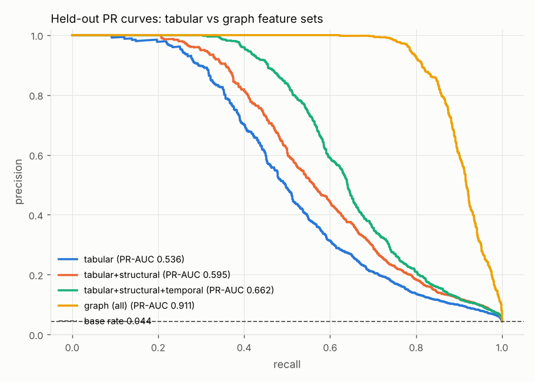
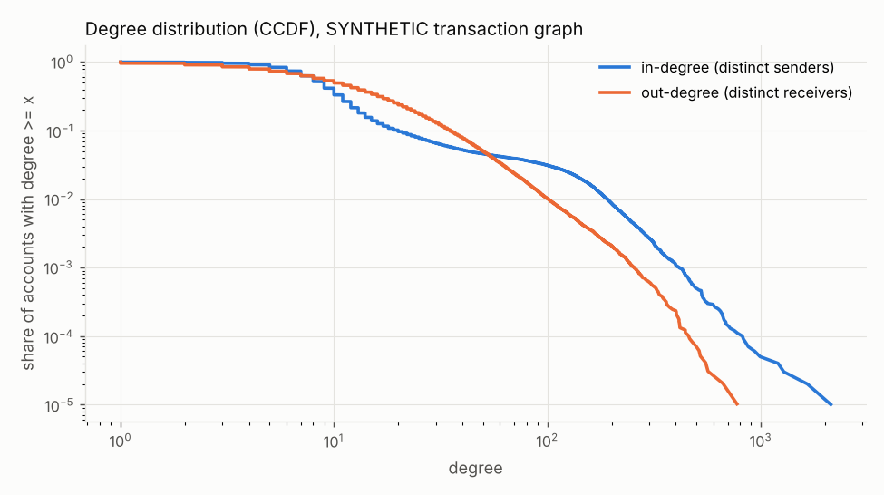
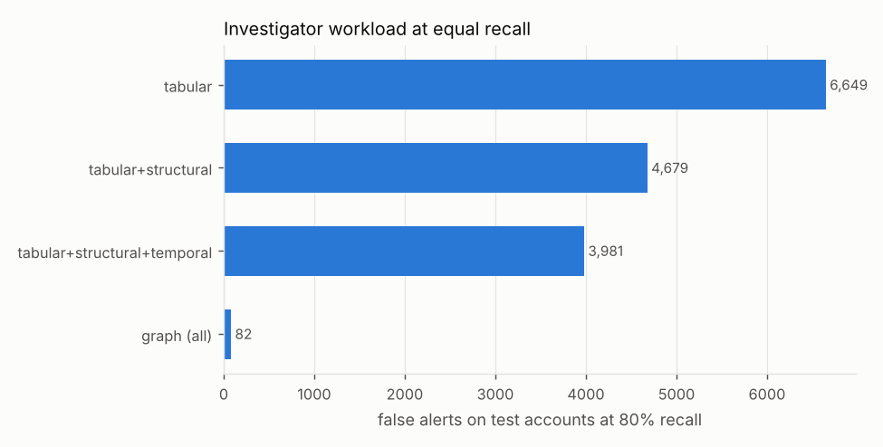
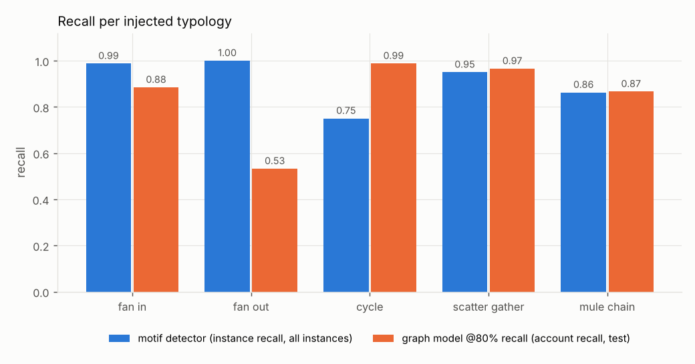
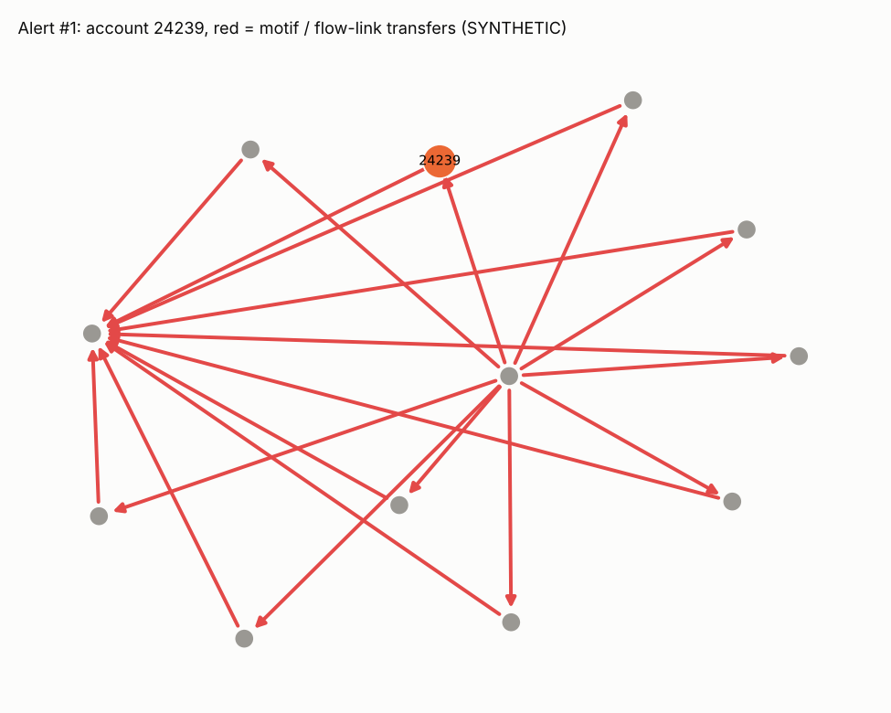
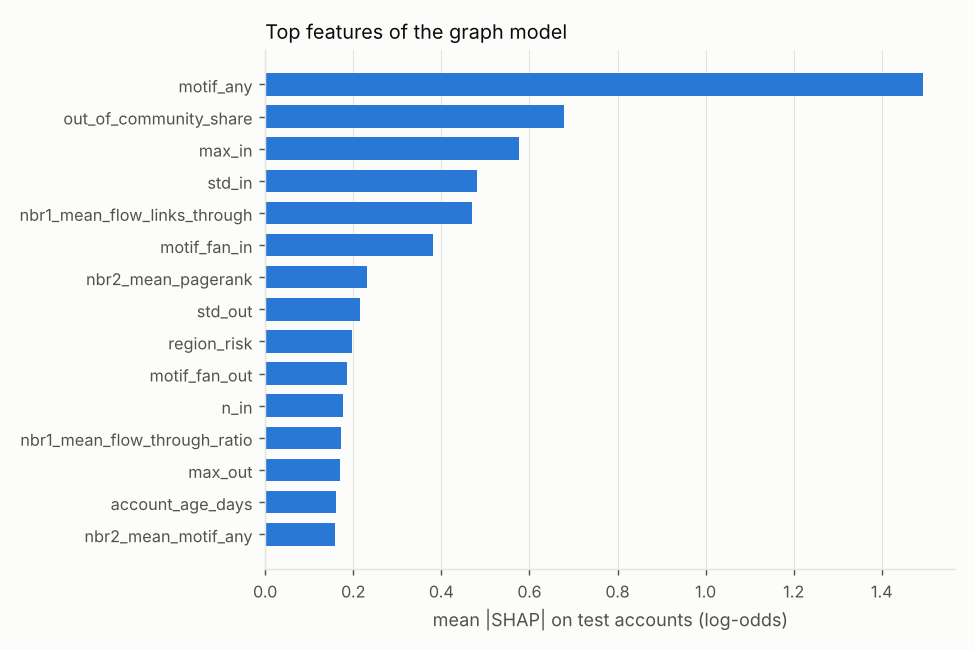

# Day 13: Anti-Money-Laundering with Transaction Graph Analytics

**Tier II - Expert** | **Domain:** Banking & compliance | **Tools:** python-igraph 1.0 (graph build, PageRank, betweenness, Louvain/Leiden), NetworkX 3.6 (alert subgraphs), LightGBM 4.7 (node classifier + TreeSHAP), scikit-learn 1.9, pandas 3.1, pyvis 0.3 | **Data:** SYNTHETIC transaction graph (100,000 accounts, 1,980,990 transfers) with injected laundering typologies

## Executive summary

On a SYNTHETIC bank of 100,000 accounts and 1,980,990 transfers, adding network features to the account-level model raises held-out PR-AUC from 0.536 to 0.911. The paired bootstrap 95% CI on the gain is +0.352 to +0.399. To catch 80% of laundering accounts, investigators would review 1,137 alerts instead of 7,704, and false alerts fall from 6,649 to 82, a 98.8% cut. Every injected typology is measured separately: the label-free motif detectors find 98.8% of fan-in schemes, 100% of fan-out, 75.0% of cycles, 95.0% of scatter-gather and 86.3% of mule chains. Each alert ships with an interactive subgraph that shows the money trail and the top reasons behind its score.



Investigator view: open any file in [`results/alerts/`](results/alerts/) in a browser, for example [`alert_01_acct_24239.html`](results/alerts/alert_01_acct_24239.html). The technical tables are in [`results/report.md`](results/report.md).

## Architecture

```mermaid
flowchart LR
    subgraph DATA[Data acquisition]
        IBM[PUBLIC IBM AML dataset<br/>Kaggle probe] -->|403 via proxy| FB{fallback}
        FB --> SIM[SYNTHETIC generator<br/>100k accounts, ~2M transfers, 180 days<br/>5 injected typologies, seed 20261023]
    end
    SIM --> TG[graph.py<br/>temporal multigraph -> collapsed weighted digraph<br/>summary stats + weekly snapshots]
    TG --> COM[community.py<br/>Louvain + Leiden on igraph<br/>modularity, NMI vs planted regions]
    SIM --> MOT[motifs.py<br/>72 h flow links = temporal 2-paths<br/>cycles, chains, scatter-gather,<br/>fan-in / fan-out stars]
    TG --> FEAT[features.py<br/>tabular | structural | temporal-flow |<br/>motif | SAGE-style neighbour means]
    COM --> FEAT
    MOT --> FEAT
    FEAT --> ML[model.py<br/>LightGBM per feature set<br/>grouped split by scheme<br/>PR-AUC + paired bootstrap]
    ML --> AL[alerts.py<br/>top alerts -> NetworkX subgraph<br/>TreeSHAP reasons -> pyvis HTML]
    MOT --> EVAL[typology recall<br/>per instance]
    ML & AL & EVAL & COM --> OUT[(results/<br/>metrics.json, report.md,<br/>figures, alerts/*.html)]
```

## Data provenance

- **Public source attempted first.** `aml_graph.data.acquire` probes the public IBM "Transactions for Anti Money Laundering" dataset (Altman et al., 2023) at its Kaggle download URL. In this build the network proxy refused the connection. `results/metrics.json` records `data.source = "synthetic"` and the note `IBM AML probe: URLError: <urlopen error Tunnel connection failed: 403 Forbidden>; fell back to seeded SYNTHETIC generator (seed 20261023)`. If you place `HI-Small_Trans.csv` in `data/raw/`, the loader maps it onto the same schema (`load_ibm_csv`, covered by a unit test). That path was **not** exercised for the reported results, and the IBM transaction file has no per-account typology labels, so per-typology recall would not be computed on it.
- **SYNTHETIC generator (the path used).** `src/aml_graph/simulate.py` builds the bank from a fixed seed:
  - **Accounts.** 100,000 accounts (87.5% personal, 9% business, 3.5% merchant) across 400 regions with Zipf-like sizes. Each region has a 0/1/2 risk tier, and 10% of accounts open during the window.
  - **Background traffic (180 days).** Person-to-person, large personal transfers, card purchases, business-to-business invoices, payroll runs on fixed days, and merchant settlements. Most of it stays inside a region. Payroll runs and merchant settlements are deliberate hard negatives: they look like fan-out bursts and pass-through flows.
  - **Injected laundering.** 400 scheme instances, 80 each of `fan_in`, `fan_out`, `cycle`, `scatter_gather` and `mule_chain`. In total, 3,778 laundering accounts (3.78%) and 3,964 laundering transfers.
    - Schemes reuse existing accounts, which keep their normal camouflage traffic.
    - About 35% of mules are freshly opened accounts.
    - 23% of instances are "slow": hold times run past the 72 h detector window.
    - 40% of fan-in schemes use amounts outside the structuring band.
    - Mules come slightly more often from high-risk regions.
- **Committed sample.** `data/sample/` (623 KB) holds a 4,000-account SYNTHETIC graph (38,859 transfers) produced by the same generator at small scale. `make data` writes the full graph to the git-ignored `data/raw/` as Parquet. `make run` regenerates it in memory (about 5 s), so it needs no files.

## Method

1. **Temporal graph construction (`graph.py`).**
   - Transfers form a timestamped multigraph. They are collapsed to 1,623,588 weighted directed pairs (count, amount, first/last time) in igraph.
   - Summary statistics: density, reciprocity, degree Gini, and WCC/SCC shares (see `metrics.json → graph`).
   - Weekly snapshots of active accounts, edges, new-pair share and laundering volume: `results/weekly_snapshots.csv`.
2. **Community detection (`community.py`).** Louvain (`community_multilevel`) and Leiden (`community_leiden`, modularity objective) run on the undirected graph, weighted by transaction counts. Each partition is checked against the planted regions with NMI. Two community features feed the model: community size, and the account's share of counterparties outside its own community.
3. **Typology detectors (`motifs.py`), label-free.**
   - A *flow link* joins an incoming transfer to an onward transfer from the same account. It requires both transfers ≥ 1,000, an onward transfer within 72 h, and an amount ratio between 0.8 and 1.0. Flow links are temporal 2-path motifs, and the build found 36,629 of them among 563,435 material transfers.
   - **Cycle:** a temporal path of flow links, 3 to 7 hops, that returns to its start account.
   - **Mule chain:** a maximal temporal path of at least 4 hops through distinct accounts, not contained in a detected cycle.
   - **Scatter-gather:** at least 3 distinct intermediates linking the same source to the same sink.
   - **Fan-in / fan-out:** a temporal star with at least 5 counterparties and at least 20,000 within 72 h. It must also pass money through: for fan-in, at least 60% of the amount leaves within 7 days; for fan-out, at least 60% arrived in the 7 days before.
   - **Scoring.** Recall is scored per scheme instance, with the matching rules listed in `evaluate_detectors`.
4. **Node features (`features.py`).**
   - **Tabular (23 features):** KYC attributes plus aggregates of the account's own transfers: counts, sums, means, max/std of amounts, structuring-band share, round-amount share, night share and active days.
   - **Structural (+11):** distinct in/out counterparties, amount-weighted PageRank (forward and reverse), betweenness estimated from 64 sampled sources, reciprocity, local clustering, k-core, community size, out-of-community share, and the community's motif rate.
   - **Temporal-flow (+8):** flow-through ratio, net-flow share, Goh-Barabási burstiness, flow-link counts, median hold time, and max transfers in any 72 h window.
   - **Motif (+9):** detector participation counts.
   - **Neighbour (+11):** GraphSAGE-style, non-learned means of key features over 1 and 2 hops, plus the count of motif-flagged neighbours.
5. **Classifier (`model.py`).**
   - One LightGBM model per cumulative feature set, all with identical hyper-parameters.
   - The train/test split is 70/30, grouped by scheme instance so that no laundering ring straddles the split: 30,171 test accounts, 1,318 of them positive.
   - Metrics: PR-AUC, ROC-AUC, precision in the top 1%, and the alert count and false alerts at the threshold that reaches 80% recall.
   - The graph-vs-tabular gain gets a paired bootstrap with 300 resamples.
6. **Explainable alerts (`alerts.py`).** The 10 highest-scoring test accounts become alerts. Each alert gets:
   - an evidence subgraph: the motifs and flow links it takes part in, plus its 25 largest material transfers;
   - its top-5 TreeSHAP contributions (LightGBM `pred_contrib`);
   - the list of detectors that fired.

   Each alert is exported as a standalone pyvis HTML page with the reasons in a header. A further 5 pages show one detected true-positive structure per typology.

## Results

All numbers come from `results/metrics.json` (SYNTHETIC data, seed 20261023). A second `make run` in a fresh Python 3.11 venv reproduced every value except the timings.

**Graph.** 100,000 accounts; 1,980,990 transfers; 1,623,588 distinct directed pairs over 180 days. Mean in-degree is 16.2 (max 2,129), the in-degree Gini is 0.544, and reciprocity is 0.021. The largest SCC holds 97.95% of accounts.



**Communities.**

| Algorithm | Communities | Modularity | NMI vs planted regions |
|---|---|---|---|
| Louvain | 322 | 0.712 | 0.984 |
| Leiden | 348 | 0.712 | 0.990 |

Laundering schemes cut across communities: only 0.25% of instances keep at least half of their accounts in one Leiden community. On average, laundering accounts send or receive 32.9% of their counterparties outside their own community, against 23.9% for normal accounts, and `out_of_community_share` is the model's second most important feature.

**Typology detection.** The table shows instance recall for the label-free detectors, using all 80 instances per typology.

| Typology | Recall | Recall (fast) | Recall (slow, > 72 h holds) | Flagged accounts | Account precision |
|---|---|---|---|---|---|
| fan_in | 0.988 | 1.000 | 0.944 | 8,142 | 0.134 |
| fan_out | 1.000 | 1.000 | 1.000 | 37,810 | 0.052 |
| cycle | 0.750 | 1.000 | 0.231 | 323 | 0.991 |
| scatter_gather | 0.950 | 1.000 | 0.733 | 710 | 0.965 |
| mule_chain | 0.863 | 1.000 | 0.353 | 970 | 0.546 |

Taken together, the rules flag 42,028 accounts at 8.3% precision (92.8% account recall). That is the false-alert flood from the business context. The structural detectors (cycle, scatter-gather) are precise. The star detectors fire on payroll runs and settlements.

**Tabular vs graph features.** Held-out test set, 30,171 accounts.

| Feature set | Features | PR-AUC | ROC-AUC | Alerts @ 80% recall | False alerts @ 80% recall | Precision @ 80% recall |
|---|---|---|---|---|---|---|
| tabular only | 23 | 0.536 | 0.886 | 7,704 | 6,649 | 0.137 |
| + structural | 34 | 0.595 | 0.913 | 5,734 | 4,679 | 0.184 |
| + temporal-flow | 42 | 0.662 | 0.921 | 5,036 | 3,981 | 0.209 |
| **graph (all)** | 62 | **0.911** | **0.986** | **1,137** | **82** | **0.928** |

PR-AUC gain (graph minus tabular): **+0.375**, paired bootstrap 95% CI +0.352 to +0.399, positive in 300/300 resamples.



**Graph model, account recall per typology at the 80%-recall threshold:** fan-in 0.885, fan-out 0.532, cycle 0.988, scatter-gather 0.966, mule chain 0.866. Fan-out recipients receive a single sub-threshold payment and look like ordinary customers.



**Explainable alerts.** All 10 top alerts are true laundering accounts in the SYNTHETIC ground truth. All 10 have a non-empty motif subgraph, with 4 to 62 highlighted motif transfers each. For 9 of them, the top TreeSHAP reason is the motif that also lights up in the subgraph. Index: [`results/alerts.csv`](results/alerts.csv).





**Runtime:** `make run` took 113.8 s on 4 CPU cores. The scale is the full ~100k accounts and ~2M transfers the prompt asks for.

## What this demonstrates

| Skill | Where |
|---|---|
| Graph analytics | Temporal graph build and stats in igraph; Louvain/Leiden with NMI validation; PageRank, sampled betweenness, k-core and clustering on 1.6M edges; SAGE-style neighbourhood aggregation |
| Financial crime | Five AML typologies modelled and detected with time-respecting motifs (pass-through, hold time, structuring band); the rules-only false-alert flood measured against a model at equal recall; scheme-grouped evaluation to stop ring leakage |
| Explainable alerts | One pyvis evidence subgraph per alert, with TreeSHAP reason codes and the detectors that fired; per-typology gallery |

## Limitations

- **Synthetic data only.** The public IBM AML dataset was unreachable (proxy 403), so every number here comes from a generator whose typologies I designed. The detectors were also written knowing those typology shapes, and the shared 72 h window is part of that design. Real laundering is more varied, so real-world recall and precision would be lower.
- **Typology recall is not uniform.** Cycle-detector recall is 0.750 and mule-chain recall 0.863. Every miss is a "slow" instance whose hold times exceed the 72 h window (fast-instance recall is 1.000 for all five typologies). A wider window raises recall but adds background flow links. That trade-off was not tuned. The graph model reaches only 0.532 account recall on fan-out recipients.
- **Star detectors are noisy.** The fan-in rule has 14.2% hub precision, and fan-out 9.5%, because of payroll runs and merchant settlements. They are useful as model features, not as alerts on their own.
- **Community risk ranking adds no lift.** Ranking Leiden communities by their motif-flag rate puts 6.7% of laundering accounts in the top decile of communities, which hold 7.3% of all accounts, so the ranking does no better than chance. The generator draws mules from across regions, so the signal is in cross-community edges, not in "bad communities".
- **The 80% operating threshold is set on the test set.** It is used only to compare feature sets at equal recall. A production threshold would be set on a separate validation window.
- **Evaluation is transductive.** Graph features are computed on the full 180-day graph, without labels. There is no out-of-time test.
- **Optional stretch goals.** The GNN comparison (PyTorch Geometric GraphSAGE) was not run, to keep the build CPU-light with no torch dependency. Non-learned SAGE-style mean aggregation stands in for it. Node2vec embeddings were not attempted. Temporal motif counting was done: time-respecting 2-paths, paths, cycles and stars.
- **Betweenness is an estimate** from 64 sampled source nodes, not exact.

## How to run

```bash
cd day-13-aml-transaction-graph-analytics
make setup   # pip install -r requirements.txt (Python 3.11+, CPU only)
make run     # ~2 min: regenerates the SYNTHETIC graph, writes results/
make test    # 18 pytest tests on small SYNTHETIC fixtures + committed sample (~10 s, no network)
make data    # optional: probe IBM dataset, write full graph to data/raw/ (Parquet), refresh data/sample/
```

Layout: `src/aml_graph/` (simulate, data, graph, community, motifs, features, model, alerts, plots, pipeline), `scripts/` (entry points), `tests/`, `data/sample/`, `results/`.
