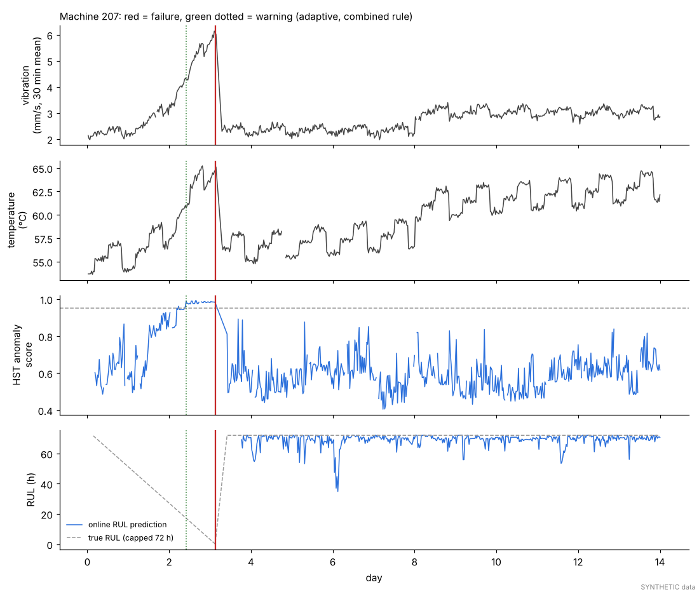
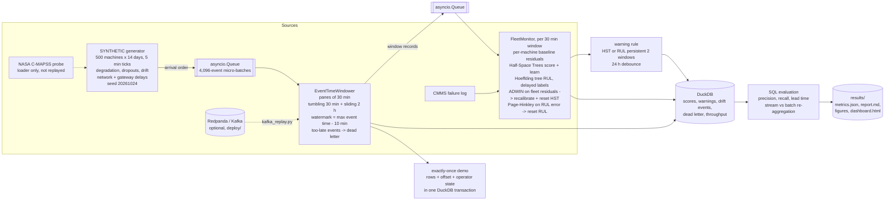
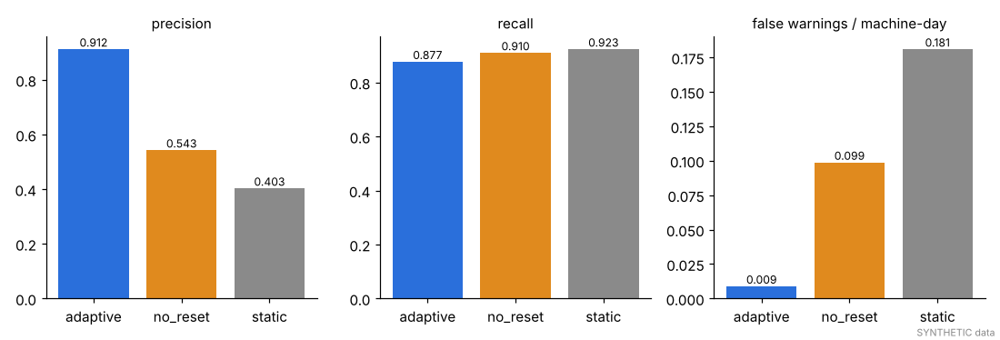
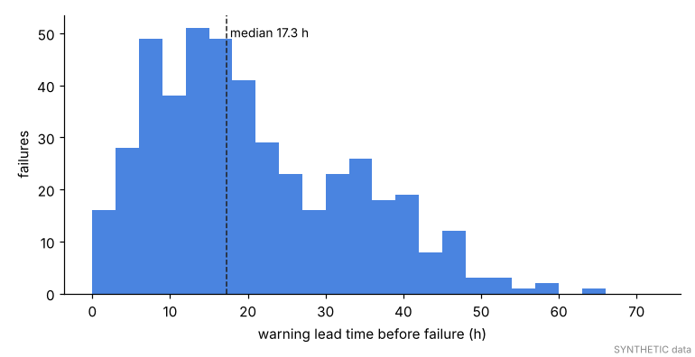
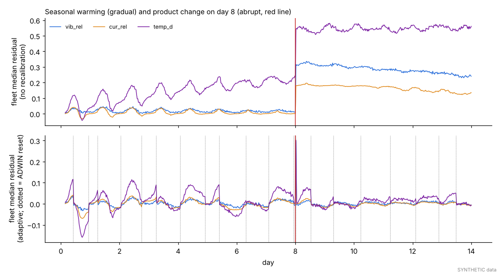
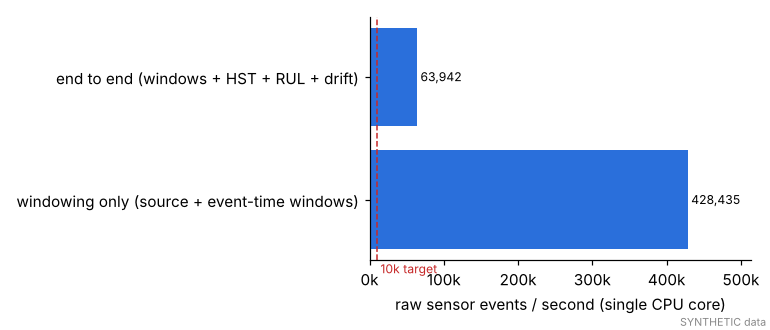
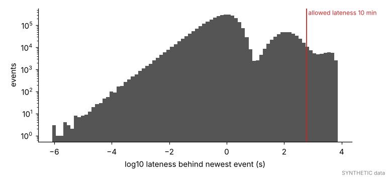

# Day 14: Streaming Predictive Maintenance for Manufacturing IoT

**Tier II - Expert** | **Domain:** Manufacturing | **Tools:** River 0.26 (Half-Space Trees, Hoeffding tree regressor, ADWIN, Page-Hinkley), asyncio (in-process dataflow), DuckDB 2.0 (metrics store + batch cross-check), Plotly 7.1, matplotlib 3.11, NumPy/pandas | **Data:** SYNTHETIC stream from 500 machines over 14 days (5,804,889 sensor events, 562 failures), plus Redpanda/Kafka compose files as an optional artefact

## Executive summary

On a SYNTHETIC fleet of 500 machines streaming 5.8 million vibration, temperature and current readings over 14 days, the adaptive streaming monitor raised 704 failure warnings. 91.2% of them were followed by a real failure within 72 hours, and they caught 87.7% of all failures (99.1% of failures with a degradation signature), with a median lead time of 17.3 hours. When a drift detector sees the whole fleet shift, the monitor recalibrates. Without that, the same models issue 11 times as many false warnings (0.099 against 0.009 per machine-day), and a model frozen after five days issues 20 times as many. The pipeline handles 63,942 events per second end to end on one CPU core, and the windowing stage alone handles 428,435.



Interactive view: open [`results/dashboard.html`](results/dashboard.html) in a browser (pick a machine from the dropdown). The technical tables are in [`results/report.md`](results/report.md).

## Architecture



## Data provenance

- **The stream is SYNTHETIC by design.** The prompt asks for a simulated high-rate stream with out-of-order and late events, dropouts and drift, and no public dataset has those event-time properties. `results/metrics.json → data.source` records the path the run took.
- **Public data probe.** Before simulating, `iot_stream.data.probe_cmapss` probes the public NASA C-MAPSS turbofan archive (the optional replay named in the prompt). In this build it was **reachable** (`reachable (206)` from `phm-datasets.s3.amazonaws.com`). C-MAPSS was still **not replayed** for any reported number. Its 21 cycle-indexed channels have no event-time disorder, sensor dropouts or fleet-wide drift to test, and the feature limits and thresholds here are tuned for the IoT sensors. `load_cmapss_as_stream` maps a C-MAPSS training file onto the stream schema; it is covered by a unit test on a small fixture, but that path was not exercised on the real file. If the probe fails, the run records the error and continues on the seeded generator; nothing else depends on the network.
- **What the SYNTHETIC generator does** (`src/iot_stream/simulate.py`, seed 20261024):
  - **Fleet.** 500 machines, each sensor read every 5 minutes, for 14 days. Each machine has its own baselines (vibration about 2 mm/s, temperature about 55 °C, current about 20 A). Each also has its own 3-shift load schedule with a random phase.
  - **Run-to-failure lifecycles.** Lifetimes are Weibull (shape 2, scale 16 days), and machines join the window part-way through life. Degradation starts 24 to 96 h before failure and grows as a power curve: vibration rises 1.8x to 3.5x, temperature rises 4 to 12 °C, and current rises 5% to 25%. 12% of failures are *sudden*, with no precursor. After a failure the machine is down for 2 to 8 h, then restarts with a new baseline. The run has 562 failures, 63 of them sudden.
  - **Drift.**
    - *Gradual:* ambient warming of +5 °C over 14 days for every machine.
    - *Abrupt:* a product change on day 8 raises vibration by 30%, current by 18% and temperature by 3 °C fleet-wide.
    - *Sensor calibration:* 5% of machines have a temperature sensor that drifts +0.4 °C per day.
  - **Data quality.** Each sensor has about 0.25 outages per day lasting 10 to 240 minutes, plus 0.3% random point loss.
  - **Out-of-order and late delivery.**
    - Event times jitter inside each 5-minute tick.
    - Network delay is exponential with a 1 s mean.
    - 7.0% of events are delayed by a lognormal with a 2-minute median.
    - 0.72% are buffered by gateway outages lasting 15 to 120 minutes, then flushed together.
    - 59.5% of events arrive behind the newest event seen, 6.0% more than 60 s behind. 50,844 arrive more than the allowed 10 minutes behind.
- **Committed sample.** `data/sample/` (401 KB) holds 16 machines over 3 days (38,233 events, 14 failures) from the same generator. Tests, `make run-quick` and the exactly-once demo use it. `make data` writes the full stream to the git-ignored `data/raw/` as Parquet. `make run` regenerates it in memory in seconds, so it needs no files.

## Method

1. **Stream processor (`windowing.py`, `stream.py`).**
   - **Dataflow.** Three asyncio stages (source, windower, models) are linked by bounded queues for back-pressure. The source yields 4,096-event micro-batches in arrival order, the shape a Kafka consumer `poll` returns.
   - **Panes and windows.** Each event updates a single per-machine **pane** of 30 minutes (count, sum, sum of squares, min, max per sensor). A **tumbling** 30-minute window is one pane. The **sliding** 2-hour window with a 30-minute slide merges the last 4 panes, which gives a mean, standard deviation and least-squares slope. Each event therefore costs O(1), whatever the window overlap.
   - **Watermark.** The watermark is `max event time seen − 10 min`. A window fires once the watermark passes its end. An event whose pane has already closed goes to a dead-letter table. Any event at most 10 minutes behind the newest one therefore always lands in its correct window, whatever the arrival order or batch size. Tests check this against a brute-force oracle with batch sizes from 1 to 2,000.
2. **Online models (`monitor.py`, River), updated on every windowed event.** A windowed event is one machine x one 30-minute window: 329,690 such records over the run.
   - **Features.** Each machine's first 6 windows after a (re)start form its healthy baseline. Features are residuals against that baseline: relative vibration (30 min and 2 h), the vibration standard-deviation ratio, the vibration slope, relative current, the temperature offset and the temperature slope. A sensor that drops out of a pane falls back to the 2-hour mean, then to the last known value.
   - **Half-Space Trees** (15 trees, height 8, window 1,000) score each record, then learn from it. The anomaly flag is score ≥ 0.95.
   - **Online RUL regression.** A `StandardScaler | HoeffdingTreeRegressor` predicts RUL capped at 72 h, using the residuals plus per-machine moving averages. Labels arrive late, as they would in production. When a machine fails, the CMMS event releases exact labels for its pending windows. A window that survives 72 h gets the label "≥ 72 h". RUL predictions are switched on only after 10,000 survived-the-cap labels. Without that guard, the model sees almost only failure labels in its first 3 days and under-predicts RUL for the whole fleet. In this run, predictions started on day 3.77.
   - **Warning rule.** A machine gets a warning when either the HST flag or `RUL ≤ 24 h` holds for 2 consecutive windows. There is at most one warning per machine per 24 h.
3. **Drift detection and resets.**
   - **ADWIN** (δ = 0.002) receives every machine's clipped residual for vibration, current and temperature, so a fleet-wide shift shows up as hundreds of points per window. On detection, the *adaptive* variant does three things:
     1. Shifts every machine's baseline by the fleet-median residual. Machines that are degrading keep their excess over the fleet.
     2. Re-instantiates the Half-Space Trees.
     3. Restarts the detectors.
   - **Page-Hinkley** (δ = 10 h, λ = 50,000) watches the absolute error of the RUL model on released labels and resets the model when the error rises.
   - **Ablations** use the same stream:
     - `no_reset`: detectors run and are logged, but no reset happens.
     - `static`: models stop learning at day 5 and never reset. This stands in for a model retrained on a fixed batch schedule.
4. **Evaluation (`evaluate.py`, DuckDB SQL).**
   - **Precision and recall.** A warning is a true positive if its machine fails within the next 72 h. Recall is computed per failure, counting warnings in the 72 h before it within the same lifecycle. Failures in the first 24 h are excluded as warm-up, which leaves 520 of 562.
   - **Lead time** is the time from a failure's first in-horizon warning to the failure.
   - **Throughput** is wall-clock time for the full 5.8 M-event stream on one core.
   - **Batch cross-check.** Every streamed tumbling window is re-aggregated in SQL from the accepted raw events and diffed against the stream output.
   - **Tuning.** Thresholds and the RUL model choice were tuned on a separate development seed (111). The reported numbers are the first full run on seed 20261024 with those settings.
5. **Exactly-once sink (`sink.py`, stretch goal).** Fired window rows, the source offset and the pickled windower state are committed in **one** DuckDB transaction every 5 batches. The demo crashes the job after batch 23 and restarts it from the last checkpoint. It then compares the result with a clean run, and with a naive at-least-once sink that writes rows as they fire and checkpoints separately.

## Results

All numbers below come from `results/metrics.json`, `results/warning_eval.csv`, `results/rul_accuracy.csv` and `results/throughput.csv`, produced by `make run` on SYNTHETIC data.

**Failure warnings**

Combined rule (HST or RUL), 520 evaluated failures, 72 h horizon:

| Variant | Warnings | Precision | Recall (all) | Recall (gradual) | Recall (sudden) | Median lead (h) | Lead IQR (h) | False warnings / machine-day |
|---|---|---|---|---|---|---|---|---|
| **adaptive** (ADWIN resets) | 704 | **0.912** | 0.877 | 0.991 | 0.016 | **17.3** | 10.8 - 30.6 | **0.009** |
| no_reset | 1,511 | 0.543 | 0.910 | 1.000 | 0.230 | 24.3 | 15.0 - 42.8 | 0.099 |
| static (frozen at day 5) | 2,120 | 0.403 | 0.923 | 1.000 | 0.344 | 25.1 | 14.6 - 43.8 | 0.181 |

Signal ablation within the adaptive variant:

| Rule | Precision | Recall | Median lead (h) |
|---|---|---|---|
| HST only | 0.946 | 0.810 | 10.9 |
| RUL only | 0.910 | 0.662 | 21.1 |
| HST or RUL | 0.912 | 0.877 | 17.3 |





**Stream processing and drift**

| Metric | Value |
|---|---|
| Throughput, windowing only (source + event-time windows) | **428,435 events/s** |
| Throughput, end to end (windows + HST + RUL + drift detectors) | **63,942 events/s** (5,804,889 events in 90.8 s, 1 core) |
| Late events within the 10 min allowed lateness | 3,405,864, **all assigned to their correct window** (0 oracle mismatches) |
| Events beyond the allowed lateness | 50,844: 29,408 dropped to dead letter (0.51% of all events), 21,436 still assigned because their window was open |
| Streamed tumbling windows vs batch SQL re-aggregation | 329,690 / 329,690 matched, 0 count mismatches, max abs diff 0.0 |
| Abrupt product change (day 8.000) detected by ADWIN | day 8.021, the first window that closed after the change |
| ADWIN detections (adaptive) | 22, causing 20 recalibrations + HST resets (mostly the gradual warming) |
| Page-Hinkley RUL resets (adaptive) | 0 (the detector never fired in the adaptive run; it fired once in `no_reset`, logged only) |
| Online RUL MAE, capped at 72 h (adaptive / no_reset / static) | 7.31 / 18.56 / 14.60 h |
| Online RUL MAE where true RUL ≤ 72 h (adaptive / no_reset / static) | 14.94 / 14.62 / 14.31 h |
| Exactly-once demo: rows after crash + restart (clean run 2,180) | transactional: 2,180, 0 duplicates, identical; at-least-once: 2,355, **175 duplicates** |
| `make run` wall time | 4 min 1 s (pipeline 236 s) |







## What this demonstrates

| Skill | Where |
|---|---|
| **Stream processing** | Event-time tumbling + sliding windows on shared panes, watermarks, allowed lateness with a dead-letter side output, micro-batch asyncio dataflow with back-pressure (`windowing.py`, `stream.py`). Correctness is proven against a brute-force oracle, an independent DuckDB batch re-aggregation and batch-size invariance tests. Exactly-once sink via transactional state + offset checkpoints (`sink.py`). Optional Redpanda compose + Kafka consumer (`deploy/`, `scripts/kafka_replay.py`). |
| **Online ML** | River Half-Space Trees scored then learned on every windowed event. Online Hoeffding tree RUL regression with realistic delayed labels released by CMMS failure events and by 72 h survival. Includes a label-delay guard for the cold-start bias. |
| **Drift detection** | ADWIN on per-machine residual streams detects the gradual warming and the abrupt day-8 change. It triggers baseline recalibration and HST resets. Page-Hinkley guards the RUL error. Ablations quantify the value of resets (false warnings 0.099 → 0.009 per machine-day). |
| **DuckDB** | Metrics store (scores, warnings, drift events, dead letter, throughput) and all evaluation queries, including ASOF joins for time-to-failure. |
| **Plotly** | `results/dashboard.html`: a per-machine explorer of vibration, HST score, RUL prediction vs truth, warnings and failures. |

## Limitations

- **SYNTHETIC data only.** The degradation shapes, noise levels and drift were designed by the author, so the absolute precision, recall and lead-time numbers say nothing about a real plant. C-MAPSS was reachable but not replayed (see Data provenance).
- **Sudden failures are not predicted.** Recall on the 61 evaluated sudden failures (no precursor) is 0.016 for the adaptive monitor. The higher sudden-failure recall of `no_reset` and `static` (0.230 and 0.344) is a side effect of their much higher false-warning rate, not real skill.
- **Precision costs some recall and lead time.**
  - The adaptive monitor has lower recall than the non-adaptive variants (0.877 against 0.910 and 0.923) and a shorter median lead (17.3 h against 24.3 h and 25.1 h).
  - Recalibrating baselines on the fleet median, and resetting the HST, mutes part of the early signal for machines degrading at that moment.
  - The positive median lead-time criterion is met, but warnings come a median 17.3 h before failure, not days ahead.
- **Model updates are per windowed event, not per raw reading.** HST and RUL learn on each machine's 30-minute window (329,690 updates), not on each of the 5.8 M raw readings. The 10k events/s criterion is met end to end (63,942 events/s), but the model stage alone runs at about 4,800 window records/s (`no_reset` replay). Updating Half-Space Trees on every raw reading would not reach 10k/s in pure Python.
- **Throughput was measured on a 4-vCPU cloud container (Intel Xeon 2.8 GHz), one core used, not a laptop.** The two full runs in this build gave 428k and 441k events/s for windowing alone, and 63.9k and 63.0k events/s end to end.
- **RUL quality is modest.** MAE within 72 h of failure is 14.9 h for the adaptive variant, which is no better than `no_reset` (14.6 h) or `static` (14.3 h). Its lower capped MAE (7.3 h against 18.6 h) comes from fewer false "imminent failure" predictions on healthy machines after drift. RUL predictions only start on day 3.77, because of the label-delay guard. Page-Hinkley never reset the RUL model in the adaptive run, so the RUL reset path is tested but not exercised at scale.
- **Gradual drift triggers frequent resets.** 22 ADWIN detections give a reset roughly every 17 h. Each one re-instantiates the HST, which loses its learned mass profile for about 2 windows. Baselines are set in the first 3 h after each (re)start, so the fleet-median residual has a daily ripple that comes from the shift schedules (visible in the drift figure).
- **Not built: Bytewax and a live Kafka run.** The processor is the clean asyncio option the prompt allows, not Bytewax. The Redpanda compose file and `scripts/kafka_replay.py` were **not run** in this build (no Docker or broker). That consumer checkpoints offsets after sink commits but does not checkpoint windower state. The full exactly-once pattern is shown only in the broker-free, single-process DuckDB demo on the sample stream.
- **Settings were tuned on one development seed (111).** These are the HST threshold (0.95), the RUL model (Hoeffding tree, which beat the adaptive tree and a linear model), the label-delay guard, and dropping an `age` feature that hurt generalisation. No confidence intervals across seeds are reported.

## How to run

```bash
cd day-14-iot-streaming-anomaly-detection
make setup      # pip install -r requirements.txt (Python 3.11+, CPU only; no Docker, no broker)
make test       # 22 tests on small SYNTHETIC fixtures + committed sample (~20 s)
make run        # full run: 500 machines x 14 days -> results/ (~4 min)
make run-quick  # same pipeline on data/sample/ in seconds -> data/quick_results/
make data       # optional: probe C-MAPSS, refresh data/sample/, write full stream to data/raw/ (Parquet)

# optional broker path (artefact, not needed for anything above)
docker compose -f deploy/docker-compose.yml up -d && pip install confluent-kafka==2.15.1
python scripts/kafka_replay.py produce && python scripts/kafka_replay.py consume
```

Set `DAY14_OFFLINE=1` to skip the C-MAPSS network probe. The DuckDB metrics database is written to `data/stream_metrics.duckdb` (git-ignored). Everything quoted above is exported to `results/`.
