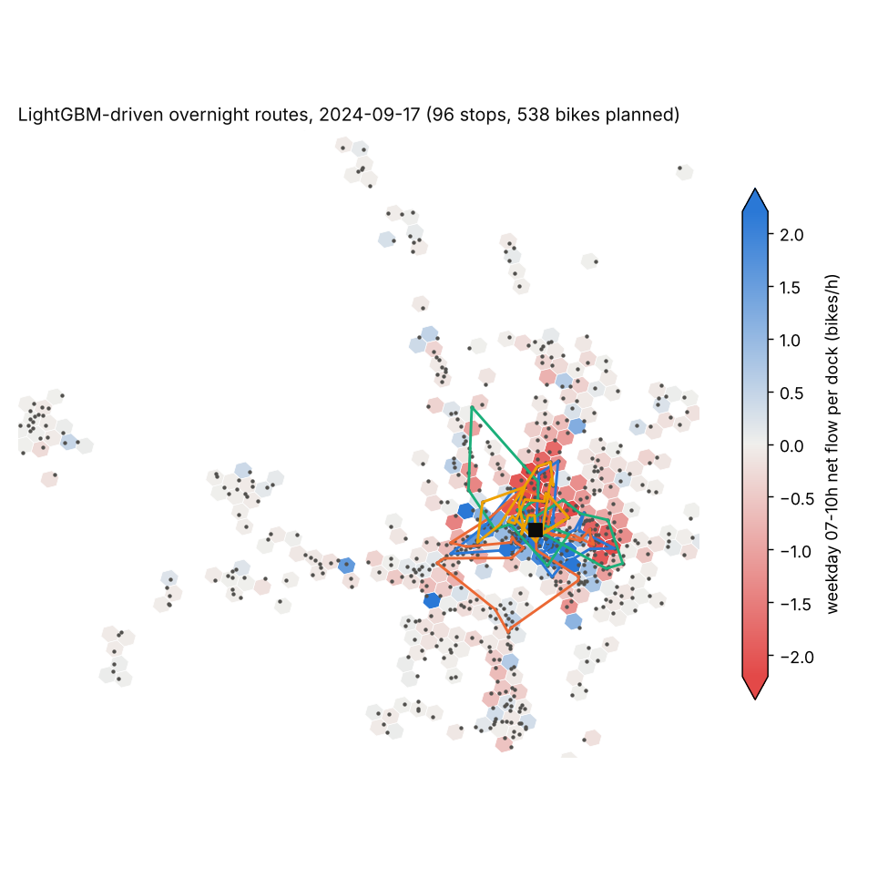
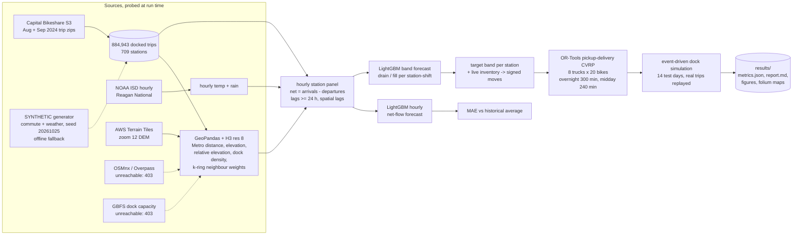
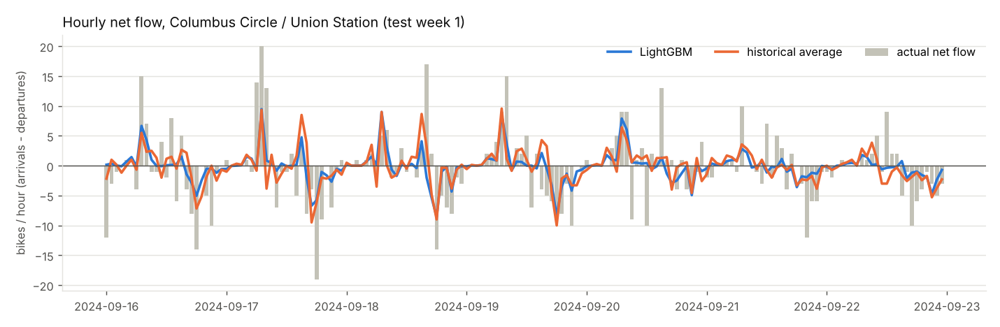
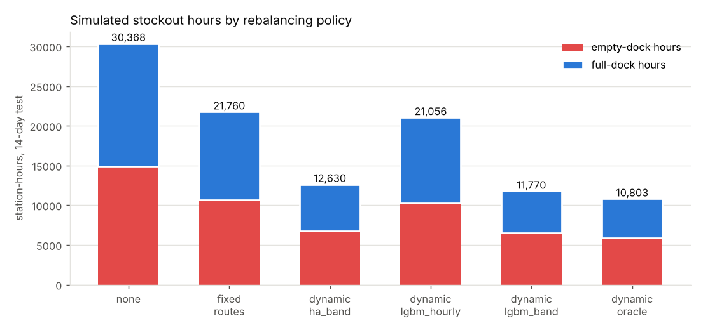

# Day 15: Bike-Share Demand and Fleet Rebalancing

**Tier II - Expert** | **Domain:** Urban mobility & transport | **Tools:** GeoPandas 1.2, H3 4.5, OSMnx 2.1 (probe; OSM was unreachable), LightGBM 4.7, OR-Tools 9.15, folium 0.20, matplotlib | **Data:** public Capital Bikeshare trips (Washington DC, 1 Aug to 29 Sep 2024: 884,943 docked trips, 709 stations), NOAA hourly weather, AWS Terrain Tiles elevation

## Executive summary

We replayed two weeks of real Capital Bikeshare trips against simulated docks. The current practice, trucks running the same routes every day, left stations empty or full for 21,760 station-hours. Re-planning the same 8 trucks twice a day from a LightGBM forecast of each station's needs cut that to 11,770 station-hours (45.9% less), and cut riders who found no bike from 6,561 to 4,352. The station-hour forecast beats the historical-average baseline (MAE 0.663 against 0.747 bikes, better at 99.6% of stations), and every one of the 28 route plans kept within the 20-bike truck capacity and its shift length.



Interactive maps (open in a browser):
- [`results/maps/station_h3_features.html`](results/maps/station_h3_features.html): H3 cells and stations with their spatial features.
- [`results/maps/routes_overnight_2024-09-17.html`](results/maps/routes_overnight_2024-09-17.html) and [`routes_midday_2024-09-17.html`](results/maps/routes_midday_2024-09-17.html): one layer per truck, with stop order, ETAs and pickups or deliveries.
- [`results/maps/stockouts_before_after.html`](results/maps/stockouts_before_after.html): stockout hours per station under no rebalancing, fixed routes and the forecast-driven policy.

The full tables are in [`results/report.md`](results/report.md) and [`results/metrics.json`](results/metrics.json).

## Architecture



## Data provenance

`results/metrics.json → data` records the path each source took in the run.

- **Trips: public data (this run).**
  - Source: Capital Bikeshare system data, from the public S3 bucket `capitalbikeshare-data`, files `202408-` and `202409-capitalbikeshare-tripdata.zip`.
  - Only docked trips are kept, meaning both a start and an end station. Dockless e-bike trips without stations are dropped.
  - Trips shorter than 1 minute or longer than 3 hours are dropped.
  - Stations with fewer than 60 starts plus ends in the training window are dropped, along with their trips.
  - That leaves 884,943 trips over 709 stations. Station coordinates are the median start coordinates.
- **SYNTHETIC fallback (not used for any reported number).**
  - If the S3 archive is unreachable, `bikeshare.synthetic` generates seeded SYNTHETIC trips over the committed real station layout.
  - It models residential-to-downtown morning commutes and the reverse in the evening, midday and weekend leisure hops, distance decay and weather damping.
  - It is exercised by a unit test and by `make run-synthetic`, which writes to `results/synthetic/`. That path ran end to end in this build (945,299 SYNTHETIC trips). Its outputs are committed separately and are discussed only under Limitations.
- **Weather:** NOAA Integrated Surface Database, hourly METAR at Reagan National Airport (`noaa-global-hourly-pds`). UTC times are converted to local time. The run uses temperature and 1-hour precipitation.
- **Elevation proxy:** AWS Terrain Tiles (terrarium PNG, zoom 12, 24 tiles), sampled at each station.
- **Transit proximity:** the distance from each station to the nearest of the 53 Capital Bikeshare docks whose name marks them as at a Metrorail station (for example "Metro Center / 12th & G St NW"), computed with GeoPandas `sjoin_nearest` in UTM 18N. This is a proxy built from the operator's own naming, not WMATA station coordinates.
- **Unreachable in this build** (the proxy returned 403 for both; the run recorded this and fell back):
  - **OSM POIs via OSMnx/Overpass.** POI density is proxied by dock density: the number of stations in the H3 k=2 ring.
  - **GBFS dock capacities.** Capacity is estimated as `clip(round(9 + 1.5 * sqrt(mean daily starts + ends)), 11, 39)`, which gives a mean of 17.1 docks.
- **Committed sample (`data/sample/`, 220 KB):**
  - `stations.csv`: the real station table with elevations.
  - `weather_hourly.csv`: the NOAA hourly series.
  - `trips_2024-09-17.csv.gz`: one real weekday of trips.
  - Tests and the offline path use them. The raw zips stay in the git-ignored `data/raw/`.

## Method

1. **Spatial features (`geo.py`).**
   - Each station gets an H3 resolution-8 cell (335 occupied cells).
   - It gets the features listed under Data provenance: Metro distance, DEM elevation, and dock density / POI proxy.
   - It also gets elevation relative to its k=2 ring, which captures being uphill (downhill stations fill and uphill ones drain), plus the distance to the activity-weighted core and projected x/y.
   - Spatial weights are the other stations in the k=1 ring, or the 3 nearest stations if the ring has fewer than 3.
2. **Hourly net-flow forecast (`features.py`, `forecast.py`).**
   - The target is arrivals minus departures per station-hour.
   - Every temporal feature is at least 24 h old, so a forecast for day D can be made at midnight:
     - lags of 24, 48 and 168 h;
     - a 7-day same-hour mean;
     - an expanding same-hour-of-week mean over past weeks only;
     - yesterday's departure and arrival totals.
   - Spatial lags are the k-ring means of those features. The model also sees calendar features, observed weather (treated as a perfect weather forecast) and the static spatial features.
   - LightGBM was trained on 8 Aug to 8 Sep, with 9 to 15 Sep for early stopping and for choosing between the L2 and Huber objectives (L2 won), then refit on 8 Aug to 15 Sep.
   - Test period: 16 to 29 Sep (Monday to Sunday, twice).
   - **Baseline:** each station's mean for the same hour of the week over 1 Aug to 15 Sep. Seasonal-naive (t − 168 h) and all-zero forecasts are also reported.
3. **Decision-focused band forecast (`band.py`).**
   - A truck must leave a station with enough bikes for the deepest dip in its running net flow over the coming horizon (*drain*) and enough free docks for the highest rise (*fill*). The horizons are 00 to 14 h for the overnight shift and 10 to 24 h for the midday shift.
   - The extremes of a mean hourly path understate the mean extremes. On the test period, the hourly path implies an average drain of 1.315 bikes against an actual 2.737. So drain and fill are forecast directly, with LightGBM on station × day × shift rows.
   - Features: their own lags (1 day, 7 days), 7-day means, expanding same-day-type means, k-ring means of these, horizon weather, and the static features.
4. **Target inventory and routing (`simulate.py`, `routing.py`).**
   - At each shift start the policy reads live inventory *x* and computes the band `[2 + drain, capacity − 2 − fill]`.
   - The signed move is the distance from *x* to the nearest level inside the band, or to the band's midpoint if it is empty.
   - Moves of at least 3 bikes go to the solver, at most 150 per shift (largest first), each capped at 20 bikes.
   - OR-Tools solves a capacitated pickup-and-delivery VRP:
     - 8 trucks of 20 bikes start and end at the depot, the activity-weighted station centroid in downtown Washington.
     - Trucks start and finish **empty**, so routes only redistribute bikes.
     - Load stays within [0, 20] at every stop (a capacity dimension).
     - Driving plus handling time stays within the shift: 300 min overnight from 00:00, 240 min midday from 10:00.
     - Drive times are straight-line distance × 1.35 circuity at 18 km/h. Handling is 2 min per stop plus 20 s per bike.
     - Stations can be skipped at a penalty of 900 s per bike not moved.
   - The search uses guided local search with a fixed solution limit, so it is deterministic.
   - `check_plan` re-verifies every plan independently.
5. **Simulation (`simulate.py`).**
   - Real test-period trips are replayed in time order. Each station starts at half capacity on 16 Sep.
   - A departure from an empty dock is a lost trip, and its arrival is cancelled.
   - An arrival at a full dock is diverted to the nearest dock with space.
   - Trucks act at the solver's ETAs. Each executed move is clipped to what is physically possible, and a truck never picks up more than the rest of its route plans to drop off. Bikes still on board at the end of a route are left at the nearest docks with space.
   - Empty-dock and full-dock time is integrated per station over the 14 days.
   - **Policies:**
     - `none`: no rebalancing.
     - `fixed_routes`: the status quo. One overnight and one midday route set is planned once from training weekday averages. Stops and volumes come from each station's chronic daily imbalance, and drivers level each dock to a fixed target. The same routes run every day.
     - `dynamic_ha_band`: re-planned each shift, with the band from historical averages.
     - `dynamic_lgbm_hourly`: re-planned each shift, with the band read off the hourly LightGBM path.
     - `dynamic_lgbm_band`: re-planned each shift, with the LightGBM band forecast.
     - `dynamic_oracle`: re-planned each shift, with the realised band (an upper bound).
6. **Policy selection without touching the test set.** Before the test run, the pipeline refits both forecasters on data up to 8 Sep, simulates the four forecast-driven candidates on the validation week (9 to 15 Sep), and picks the best. The selection was `lgbm_band`, at 6,225.9 stockout hours against 6,536.2 for `ha_band`, 7,658.0 for `ha_hourly` and 9,558.1 for `lgbm_hourly`. The fleet parameters in `config.py` were set before any test-period simulation.

## Results

All numbers are from `results/metrics.json` and `results/report.md`, produced by `make run` on the public Capital Bikeshare data (pipeline 585 s, 9 min 47 s wall time, on 4 vCPUs).

**Forecast, test period (238,224 station-hours)**

| Model | MAE | RMSE | MAE, weekday peaks (07-09, 16-18 h) |
|---|---|---|---|
| **LightGBM (spatial + temporal lags)** | **0.6627** | **1.3567** | **1.027** |
| Historical average (station × hour-of-week) | 0.7471 | 1.4324 | 1.1349 |
| Seasonal naive (t − 168 h) | 0.9599 | 1.9129 | 1.4404 |
| All-zero | 0.6838 | 1.543 | 1.227 |

LightGBM's MAE is 11.3% lower than the historical average, and lower at 99.58% of stations. The top features by gain are the 7-day same-hour mean (0.369), the past same-hour-of-week mean (0.303) and its spatial lag over H3 neighbours (0.096).



**Band forecast (bikes per station-shift, test)**

| Target | LightGBM band | Historical average | Extremes of the hourly LightGBM path | Mean actual |
|---|---|---|---|---|
| drain | **1.6332** | 1.6609 | 1.8227 | 2.737 |
| fill | **1.6517** | 1.674 | 1.8452 | 2.732 |

**Rebalancing simulation, 16-29 Sep 2024 (709 stations, real trips)**

| Policy | Stockout station-hours | Empty | Full | Lost trips | Diverted arrivals | Bikes moved | Truck km | vs none | vs fixed routes |
|---|---|---|---|---|---|---|---|---|---|
| none | 30,368.5 | 14,931.8 | 15,436.7 | 11,493 | 13,997 | 0 | 0 | 0% | -39.6% |
| fixed_routes (status quo) | 21,759.6 | 10,710.1 | 11,049.4 | 6,561 | 7,749 | 11,036 | 5,799.5 | 28.4% | 0% |
| dynamic_ha_band | 12,630.3 | 6,729.9 | 5,900.3 | 4,595 | 5,222 | 11,142 | 5,806.1 | 58.4% | 42.0% |
| dynamic_lgbm_hourly | 21,056.0 | 10,275.0 | 10,781.0 | 6,994 | 8,684 | 5,254 | 2,719.4 | 30.7% | 3.2% |
| **dynamic_lgbm_band (selected)** | **11,770.2** | 6,478.9 | 5,291.3 | **4,352** | 4,692 | 11,580 | 5,933.2 | **61.2%** | **45.9%** |
| dynamic_oracle (perfect band) | 10,802.9 | 5,866.6 | 4,936.2 | 2,999 | 4,372 | 10,412 | 5,222.8 | 64.4% | 50.4% |

With about the same truck-kilometres as the fixed routes (5,933 against 5,800 km), the forecast-driven policy cuts stockout hours by 45.9% and lost trips by 33.7%. It closes 91% of the gap between fixed routes and the perfect-foresight oracle.



**Routing constraints (independent re-check of every executed plan)**

| Policy | Plans | All feasible | Max truck load / capacity | Longest route, overnight (limit 300 min) | Longest route, midday (limit 240 min) |
|---|---|---|---|---|---|
| fixed_routes | 2 (reused daily) | yes | 20 / 20 | 292.5 | 234.1 |
| dynamic_ha_band | 28 | yes | 20 / 20 | 293.5 | 239.8 |
| dynamic_lgbm_hourly | 28 | yes | 20 / 20 | 295.3 | 234.4 |
| dynamic_lgbm_band | 28 | yes | 20 / 20 | 296.1 | 238.4 |
| dynamic_oracle | 28 | yes | 20 / 20 | 290.8 | 239.6 |

## What this demonstrates

| Skill | Where |
|---|---|
| **Geospatial data science** | GeoPandas station layer in UTM 18N, with nearest-Metro distance via `sjoin_nearest`. H3 res-8 indexing, k-ring densities and neighbour weights, and hexagon polygons for maps. Elevation sampled from public DEM tiles. An OSMnx POI probe with a recorded fallback. folium maps of cells, routes and before/after stockouts (`geo.py`, `maps.py`). |
| **Spatio-temporal ML** | A day-ahead hourly panel with leakage-free temporal lags and spatial lags over H3 neighbours. LightGBM beats the historical-average baseline on station-level MAE. A decision-focused band model fixes the Jensen gap between forecast accuracy and decision quality: the hourly model is more accurate, but used naively it is worse for routing (`features.py`, `forecast.py`, `band.py`). |
| **Vehicle routing** | An OR-Tools capacitated pickup-and-delivery VRP with empty start and end, load and time dimensions, shift limits, and optional nodes with prize-style penalties. Plans are re-planned twice a day and audited independently. Executed in an event-driven simulation with physical clipping (`routing.py`, `simulate.py`). |

## Limitations

- **The simulation is not the real system.**
  - Dock capacities are estimated, because GBFS was unreachable (mean 17.1 docks).
  - Every station starts half full.
  - Lost trips do not come back, and a rider who finds a full dock moves to the nearest dock with space.
  - Real operators also rebalance with valets, e-bike swaps and user incentives, none of which is modelled.
  - The absolute stockout hours depend on these assumptions. The comparison between policies is the meaningful output.
- **The status-quo baseline is our own construction.** We do not know Capital Bikeshare's actual routes. `fixed_routes` uses the same fleet, solver and shifts, and is planned from training-period chronic imbalance. It moved 11,036 bikes, about as many as the dynamic policies. 969 of them were bikes left at the nearest open docks when a planned drop-off was impossible.
- **The hourly forecast is only modestly better than trivial baselines.** It beats the historical average by 11.3% MAE but the all-zero forecast by only 3.1% (0.6627 against 0.6838). Most station-hours have zero net flow, so the zero forecast is hard to beat on MAE. The historical average does worse than zero on MAE, though better on RMSE.
- **Better hourly MAE did not translate directly into better routing.**
  - Over the midday horizon, the summed hourly LightGBM forecast is slightly worse than the historical average (cumulative MAE 2.903 against 2.880). It is better overnight (2.259 against 2.396).
  - Read naively, the hourly LightGBM path gives the worst dynamic policy (21,056 h), because its smooth forecasts understate how far a station will swing.
  - The band model fixes this. Its own MAE gain over the historical-average band is small (1.6332 against 1.6609 for drain), and its policy beats `dynamic_ha_band` by 6.8% (11,770 against 12,630 h).
- **Weather is the observed value**, a perfect day-ahead weather forecast. A real deployment would use forecast weather and lose some accuracy.
- **Drive times are straight-line × 1.35 at 18 km/h.** OSM was unreachable, so no road network was used. The depot is a nominal central point, not a real Capital Bikeshare warehouse.
- **There are no POIs.** POI density is proxied by dock density. Transit proximity comes from station names, not WMATA geometry.
- **One city and one fortnight.** No confidence intervals across periods or seeds are reported. The validation week chose the policy (the rankings agreed on validation and test), but only one test window was run.
- **Maps need a browser with network access for the folium JavaScript and basemap.** All data layers (hexagons, markers, routes) are embedded in the HTML. Without tiles they render on a blank background. Static PNG versions are in `results/figures/`.
- **The SYNTHETIC fallback is a weak stand-in for the real data** (`results/synthetic/`).
  - It ran end to end but took 1,323 s, over the 20-minute budget. The real-data `make run` took 585 s.
  - Its network drains much more than the real one: 101,205.9 empty-dock hours against 16,951.8 full-dock hours with no rebalancing.
  - The hourly forecast still beats the historical average there (MAE 0.7397 against 0.8182). But forecast-driven routing helps far less: `dynamic_lgbm_band` is 2.76% below fixed routes, and `dynamic_ha_band` is 3.63% below.
  - The validation week selected `ha_hourly` on that data.
  - The generator's commute structure has not been calibrated against real flows, so do not read the headline results into it.
- **Stretch goals were not attempted:** dynamic incentive pricing and the equity-of-access analysis.

## How to run

```bash
cd day-15-bikeshare-geospatial-rebalancing
make setup          # pip install -r requirements.txt (Python 3.11+, CPU only)
make test           # 14 tests on small fixtures + the committed sample, no network (~10 s)
make run            # download (or reuse data/raw/) -> features -> forecasts -> routes -> simulation -> results/ (~10 min)
make run-synthetic  # the offline path: SYNTHETIC trips over the committed station layout -> results/synthetic/ (~22 min)
make data           # optional: just download public data and refresh data/sample/
```

If the Capital Bikeshare archive cannot be downloaded, `make run` switches to the SYNTHETIC generator automatically. `metrics.json → data.trips.synthetic` then says `true`, and the README numbers above would no longer apply. NOAA weather and DEM tiles fall back to the committed sample in the same way.
