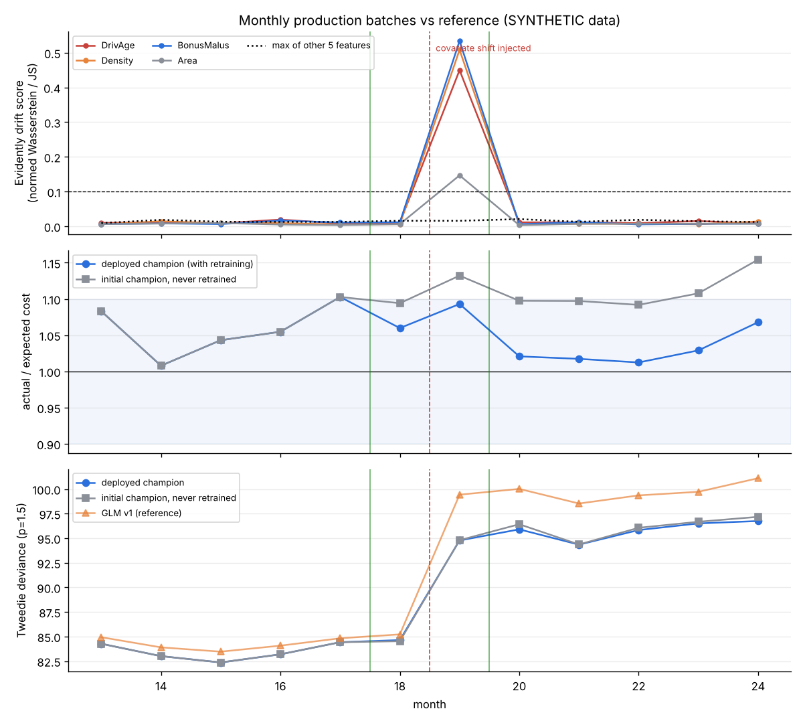
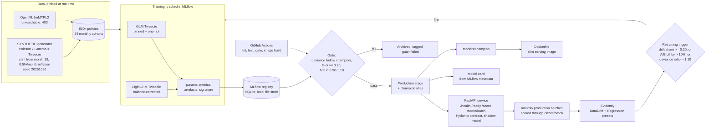
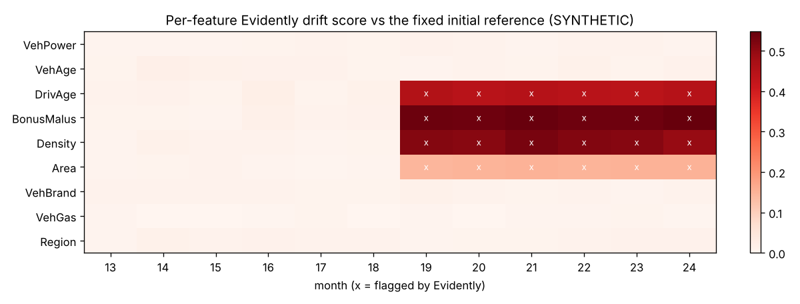
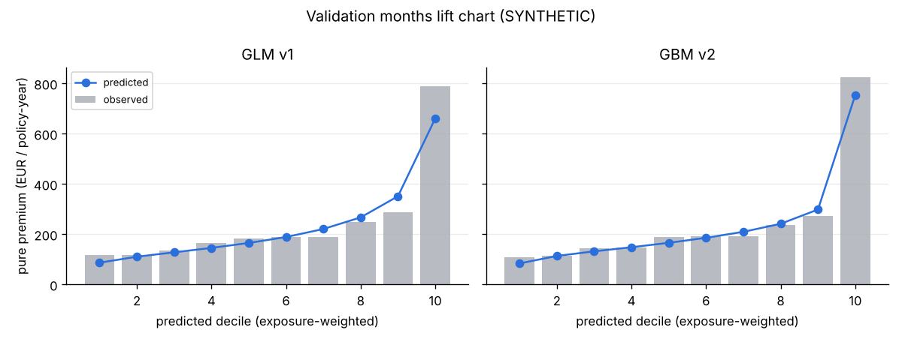

# Day 16: Insurance Claims Severity: Full MLOps Lifecycle

**Tier III - Principal** | **Domain:** Insurance | **Tools:** MLflow 3.17 (local SQLite tracking and model registry), FastAPI 0.162 with Pydantic 2, Evidently 0.7, LightGBM 4.7, scikit-learn 1.9, Docker (image definition), GitHub Actions (workflow definition) | **Data:** SYNTHETIC freMTPL2-style motor TPL book, 600,000 policies over 24 months. The public freMTPL2 dataset on OpenML was unreachable (proxy 403), so the seeded generator was used automatically.

## Executive summary

Every model change now goes through one recorded path. Each training run is logged in MLflow, a model goes live only if it beats the current live model on the same holdout data, and every version in the registry shows who replaced whom and why. On 12 months of simulated production, monitoring flagged the injected shift toward young urban drivers in the month it started, with 0 false alarms in the 6 months before. The trigger policy retrained the model twice, and both new versions passed the gate on their own. Over the last 7 months, the gap between actual and predicted claim cost averaged 4.3% for the retrained model against 11.1% for a model left untouched. A deliberately weak challenger was rejected automatically. All data is SYNTHETIC.



Full tables: [`results/report.md`](results/report.md), [`results/metrics.json`](results/metrics.json), [`results/monthly_monitoring.csv`](results/monthly_monitoring.csv), [`results/registry.csv`](results/registry.csv), [`results/gate_decisions.json`](results/gate_decisions.json), and the generated [`results/model_card.md`](results/model_card.md). Evidently HTML reports: [month 18, before the shift](results/reports/drift_month_18.html) and [month 19, at the shift](results/reports/drift_month_19.html). Download them and open them in a browser.

## Architecture



## Data provenance

`results/metrics.json → data` records the path taken in the run.

- **Public path (attempted, unreachable).** `claims_mlops.data.acquire` tries to download freMTPL2freq (OpenML 41214) and freMTPL2sev (41215). In this build the proxy refused the tunnel (`URLError: Tunnel connection failed: 403 Forbidden`), so the run fell back automatically. If the download works, `monthly_from_public` would split real policies into random monthly batches and add the same shift and inflation by resampling. That path is covered by a unit test on freMTPL2-shaped frames only.
- **SYNTHETIC path (used for every number here).** `claims_mlops.data.generate_synthetic`, seed 20261026, creates 24 monthly cohorts of 25,000 policies. They use freMTPL2's columns and value ranges: VehPower, VehAge, DrivAge, BonusMalus, Density, Area, VehBrand, VehGas, Region and Exposure.
  - **Claim counts** are Poisson with a log-linear frequency. The frequency includes non-additive terms: young driver with a powerful car, high bonus-malus in a dense area, and older diesel driver in a rural area.
  - **Claim costs** are a sum of Gamma draws (shape 2), so the pure premium follows a compound Poisson-Gamma, that is Tweedie, distribution. 8.8% of policies have a claim.
  - **Injected covariate shift from month 19.** A young-driver urban product launches. The share of drivers under 27 goes from 6% to 30%, and log Density rises by 0.9. BonusMalus and Area change as a result, because they depend on age and density.
  - **Claims inflation** of 0.5% per month, compounding, applies to severity from month 1.
- **Committed sample:** `data/sample/policies_sample.csv`, 3,984 rows stratified by month (252 KB). The tests use it for the offline path. The full book is written to `data/raw/` (git-ignored).

## Method

1. **Training and tracking.**
   - Train on months 1-10 and validate on months 11-12.
   - Both model families predict pure premium (cost per policy-year), weighted by exposure.
     - **GLM:** `TweedieRegressor`, power 1.5, log link. Numerics go into 8 quantile bins, log Density is standardised, and categoricals are one-hot encoded.
     - **GBM:** LightGBM with the Tweedie objective, power 1.5, 350 trees and 15 leaves, with categoricals declared as categorical.
   - Both are wrapped in `BalancedModel`. It rescales predictions so total predicted cost equals total observed cost on the training data, the actuarial balance property. LightGBM's Tweedie model under-predicts the total without it: its balance factors in this run were 1.027-1.033, against 1.011 for the GLM (`results/gate_decisions.json`).
   - Each run logs to MLflow its parameters, its validation metrics (Tweedie deviance, exposure-weighted normalised Gini, A/E, MAE, null deviance and balance factor), a JSON artefact, and the model with its signature and input example. Each run also registers a new model version.
2. **Registry and gate.**
   - The store is local: `sqlite:///mlruns/mlflow.db` with artefacts under `mlruns/artifacts`. No tracking server is needed.
   - Every candidate gets the `challenger` alias, and the current champion is reloaded from the registry.
   - Both are scored on the candidate's holdout. A candidate is promoted to the `Production` stage, with the `champion` alias and the old version archived, only if all three checks pass:
     - its deviance is strictly below the champion's (or below the null model's when there is no champion);
     - its Gini is at least 0.20;
     - its A/E is in [0.90, 1.10].
   - Otherwise the candidate is archived and tagged `gate=failed`.
   - The initial run registers three candidates in turn: a GLM bootstrap champion, a GBM challenger, and an under-specified 2-feature GLM as a negative control.
3. **Serving.**
   - `claims_mlops.api.create_app` builds the FastAPI app.
   - The Pydantic models enforce types, ranges, enums and a Region pattern, reject extra fields, and limit a batch to 1-10,000 policies.
   - `/health` is liveness. `/ready` scores a canary policy and returns 503 when no model is loaded.
   - `/score` and `/score/batch` return the pure premium and the expected cost (pure premium times exposure). `/model` returns metadata.
   - An optional shadow model scores the same traffic, and `/shadow/summary` compares it with the champion.
   - The pipeline scores every production month through `/score/batch` with an in-process `TestClient`, so no server has to keep running.
   - At the end the champion is exported to `models/champion/` (git-ignored), which the Dockerfile copies into the image.
4. **Monitoring and retraining (months 13-24).**
   - Each month: score the batch through the API, then assume labels arrive at month end and compute deviance, A/E and Gini.
   - Run Evidently `DataDriftPreset` on the 9 features against the deployed champion's reference: its validation window, or after a retrain the month it was retrained on. Add `RegressionPreset` for the HTML reports.
   - Evidently's own column tests set the drift flags. With more than 1,000 rows it uses normed Wasserstein distance for numerics and Jensen-Shannon distance for categoricals, both with threshold 0.1.
   - To score the detector itself, every month is also compared with the fixed initial reference.
   - **Trigger policy:** retrain when at least 20% of features drift, or |A/E - 1| > 0.10, or monthly deviance / reference deviance > 1.10. Triggers are suppressed for 1 month after a promotion.
   - **On a trigger:** train a GBM on the trailing 11 months plus 70% of the current month. Validate on the other 30% (7,500 policies), comparing against the champion, and run the same gate.
   - After a promotion, the previous champion runs as a shadow (canary comparison).
   - A never-retrained copy of the initial champion is scored every month as the counterfactual.

## Results

All numbers come from `results/metrics.json` and the CSVs produced by `make run` (SYNTHETIC data, 600,000 policies; the run took 98.9 s on 4 CPU cores).

**Initial training (validation months 11-12, 50,000 policies)**

| Candidate | Version | Tweedie deviance | Gini | A/E | Gain vs gate reference | Gate decision |
|---|---|---|---|---|---|---|
| Null model (mean pure premium) | - | 90.53 | - | - | - | - |
| GLM Tweedie (bootstrap) | v1 | 83.50 | 0.356 | 1.041 | 7.77% vs null | promoted |
| LightGBM Tweedie (challenger) | v2 | **82.18** | **0.369** | 1.038 | 1.58% vs GLM v1 | **promoted** |
| GLM, DrivAge + Area only (negative control) | v3 | 86.72 | 0.271 | 1.038 | -5.53% vs GBM v2 | **rejected** (deviance check) |

**Monitoring and retraining (production months 13-24)**

| Metric | Value |
|---|---|
| Pre-shift months (13-18) with any feature flagged, fixed reference | **0 of 6** (max drift score 0.019, threshold 0.1) |
| Post-shift months (19-24) flagging both injected features (DrivAge, Density) | **6 of 6** (min score 0.440) |
| Features flagged after the shift | DrivAge, Density (injected), BonusMalus and Area (downstream of age and density); 0 flags on the other 5 |
| Month the live monitor first flagged the shift | 19, the first shifted month (drift share 0.44) |
| Retraining triggers | 2: month 17 (A/E 1.103, inflation) and month 19 (drift share 0.44 and deviance ratio 1.116) |
| Candidates promoted by the gate after a trigger | 2 of 2 (v4: deviance gain 0.15%, holdout A/E 1.074 vs 1.110; v5: gain 0.13%, A/E 1.049 vs 1.090) |
| Months 18-24 mean \|A/E - 1\|: retrained vs never retrained | **4.3% vs 11.1%** |
| Months 18-24 mean Tweedie deviance: retrained vs never retrained | 94.11 vs 94.29 (0.19% lower) |
| Shadow (previous champion) vs new champion, months 20-24 | the new v5 had lower deviance in 4 of 5 months and A/E 1.012-1.068 vs 1.049-1.111 for the v4 shadow |
| API batch scoring, `/score/batch` in-process | median 27,741 rows/s; max \|API - direct prediction\| = 0.0 |
| Exported champion through the API | `/ready` 200 (v5); valid `/score` 200; invalid payload 422 with 2 field errors |





**Acceptance criteria**

| Criterion | Status |
|---|---|
| API contract tests pass with TestClient | Met. 17 API tests in `tests/test_api.py`: health and readiness (including 503 without a model), single and batch scoring, exposure handling, 10 invalid-payload cases (9 parametrised plus a missing field), batch limits, shadow summary. |
| Model promotion is automatic only if the gate passes | Met. 4 of 4 passing candidates were promoted with no manual step, and the failing negative control was archived. Tests cover gate edge cases, including a candidate that ties the champion. |
| Drift report flags the injected covariate shift | Met. 6 of 6 shifted months flag DrivAge and Density, with 0 flags in the 6 months before. |
| `make test` passes from a clean checkout | Met. 36 tests in about 21 s, no network and no server. |
| `make run` reproduces every number and figure | Met. About 1.5-2 min on CPU. |

**Stretch goals:** shadow deployment and canary comparison (done: the API's shadow model, plus a per-month comparison of champion and shadow in `metrics.json → canary`); model card generated from MLflow metadata (done: `results/model_card.md`).

## What this demonstrates

- **MLOps.**
  - Experiment tracking: params, metrics, artefacts and signatures in MLflow.
  - A model registry that uses both stages and aliases.
  - A champion/challenger promotion gate written as code, with a negative control.
  - A retraining trigger policy with a cooldown, and a model card generated from registry metadata.
  - A CI gate script (`scripts/validate_gate.py`) that exits 1 if the challenger does not beat the champion.
- **API engineering.**
  - A FastAPI app factory with Pydantic contract validation and liveness/readiness endpoints that differ.
  - Batch and single scoring, and shadow scoring.
  - A slim serving image definition, and contract tests run with TestClient.
- **Monitoring.**
  - Evidently drift and regression reports on monthly batches.
  - The detector is scored separately from the live trigger (fixed vs moving reference).
  - Performance monitoring with A/E and deviance, compared with a counterfactual model that is never retrained.

## Limitations

- **SYNTHETIC data only.** OpenML was blocked (403), so the freMTPL2 path never ran on real data. Effect sizes, the GBM's 1.58% gain over the GLM, and the drift magnitudes all come from the simulator's design. The simulator includes interactions that a main-effects GLM cannot fit. In development runs with weaker interaction terms, the GBM's gain over the GLM was much smaller, so this gap reflects the simulator's design, not the general merit of GBMs.
- **Retraining gains in deviance are within noise.** Both retrained candidates beat the champion by only 0.13-0.15% in deviance on a 7,500-policy holdout. The benefit of retraining shows in calibration (A/E), not in ranking. In month 18 the retrained v4 even had slightly higher deviance than the never-retrained model (84.64 vs 84.53). The gate requires a strictly lower deviance plus an A/E band, so a lucky draw could pass it. A bootstrap confidence interval on the gain would be the next step.
- **Label latency is ignored.** Claim costs are treated as fully known at month end. Real claim costs take months to years to develop, so the performance trigger would lag and drift checks would carry more of the load.
- **Inflation is handled only by retraining.** Neither model has a trend term, so A/E creeps up between retrains (1.068 in month 24).
- **Downstream drift flags.** BonusMalus and Area are flagged with the injected columns because the simulator derives them from age and density. That is correct behaviour, but the drift report alone cannot separate the root cause.
- **Docker and GitHub Actions were not run end to end here.**
  - There is no Docker daemon in the build environment, so `docker build` was not run.
  - The serving dependencies (`requirements-serve.txt`) were checked instead in a fresh Python 3.11 virtualenv: uvicorn loaded `models/champion` and answered `/ready` and `/score`.
  - The folder workflow `.github/workflows/day16-mlops.yml` (lint, tests, model gate, image build and container smoke test) lives inside this folder, because builds may only change their own day folder. GitHub runs workflows only from the repository root, so the file must be copied there to activate it. Until then, the repository's root CI runs `make test` for this folder.
- **Evidently HTML reports** are about 4 MB each, so only months 18 and 19 are committed. All other months are written to `data/reports/` (git-ignored) on each run.
- **Small run-to-run differences.** The GLM's deviance moved in the 4th significant digit between two development environments with identical pins. The numbers above are from the committed run.

## How to run

```bash
cd day-16-insurance-claims-mlops
make setup        # pip install -r requirements.txt (Python 3.11+)
make test         # 36 tests, ~20 s, offline
make run          # full lifecycle -> results/ (about 1.5-2 min CPU); mlruns/ and models/ are git-ignored
make gate         # CI model-validation gate alone (exit 1 if the challenger loses)
make serve        # uvicorn on 127.0.0.1:8000 with the exported champion (Ctrl+C to stop)
mlflow ui --backend-store-uri sqlite:///mlruns/mlflow.db   # optional: browse runs and the registry
make docker-build # optional: needs a Docker daemon and models/champion from make run
```

Example request:

```bash
curl -X POST localhost:8000/score -H 'content-type: application/json' \
  -d '{"VehPower":7,"VehAge":3,"DrivAge":42,"BonusMalus":50,"Density":1200,"Area":"D","VehBrand":"B12","VehGas":"Diesel","Region":"R11","Exposure":0.5}'
```

Layout: `src/claims_mlops/` holds data, models, registry, monitoring, api, pipeline, modelcard, plots and report. `scripts/` holds `get_data.py`, `run_pipeline.py` and `validate_gate.py`. `tests/` holds data, models, registry and gate, monitoring and API contract tests. `results/` holds metrics, CSVs, figures, Evidently HTML and the model card.
