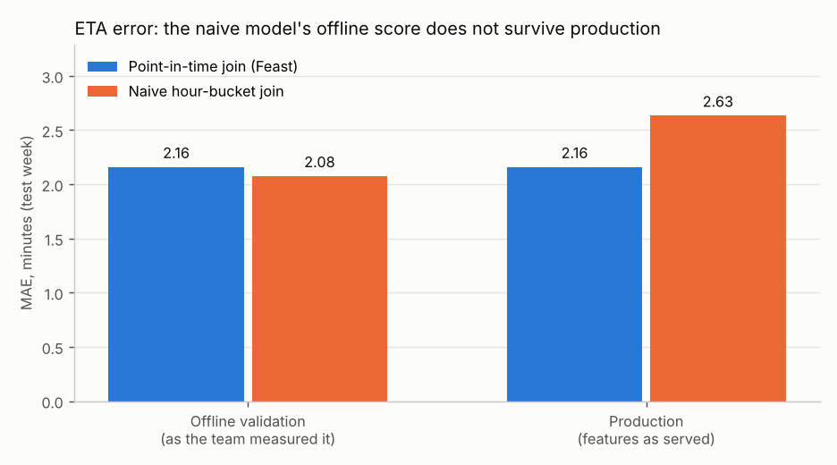
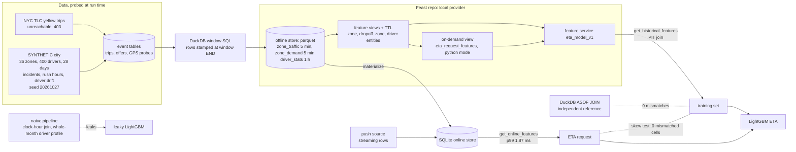
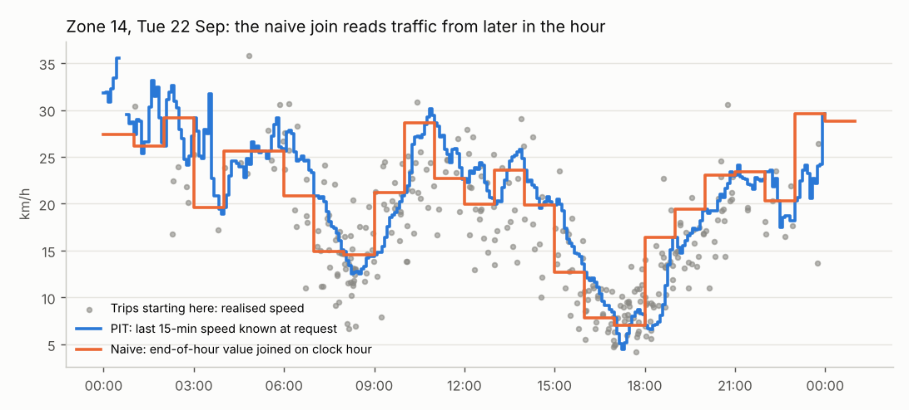
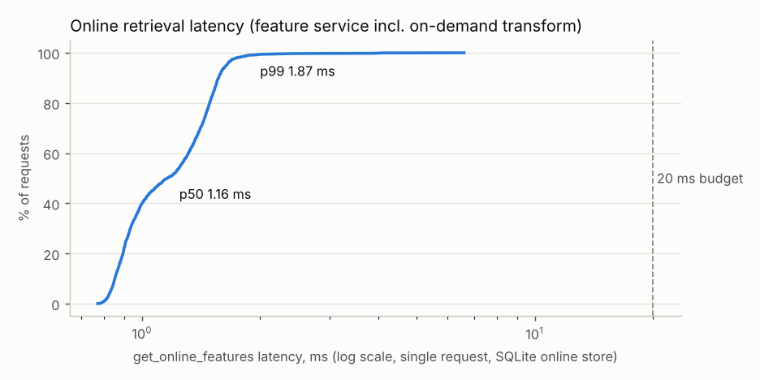

# Day 17: Point-in-Time Correct Feature Store for Ride-Hailing ETA

**Tier III - Principal** | **Domain:** Mobility marketplace | **Tools:** Feast 0.67 (DuckDB offline store, SQLite online store, push source, on-demand feature view), DuckDB 1.5, LightGBM 4.7, pandas 2.3 | **Data:** SYNTHETIC city, 28 days, 164,854 trips. NYC TLC trip records were unreachable (proxy 403), so the seeded generator was used automatically.

## Executive summary

An ETA model trained on features joined by clock hour scored 2.075 min mean absolute error (MAE) in offline validation, but 2.633 min on the features production can actually serve. That is a 26.9% gap, caused by joins that let the training data see up to an hour of future traffic and a driver profile computed over the whole month. Rebuilt on a Feast feature store with point-in-time joins, the model scores 2.159 min both offline and in production, 21.9% better than the leaky model once deployed. On 1,142 replayed requests, the online store returned exactly the training values (0 mismatched cells), with a single-request retrieval p99 of 1.87 ms. All data is SYNTHETIC.



Full outputs: [`results/report.md`](results/report.md), [`results/metrics.json`](results/metrics.json), [`results/model_comparison.csv`](results/model_comparison.csv), [`results/skew_sample_online_features.csv`](results/skew_sample_online_features.csv), [`results/latency_summary.csv`](results/latency_summary.csv).

## Architecture



## Data provenance

`results/metrics.json → data` records which path ran.

- **Public path (tried, unreachable).** `ridehail_fs.data.try_download_tlc` requests the January 2024 NYC TLC yellow-taxi parquet. In this build the proxy refused the tunnel (`URLError: Tunnel connection failed: 403 Forbidden`), so the run fell back automatically. TLC records have no driver ids, dispatch offers or GPS pings. `tlc_to_tables` would therefore assign drivers with a seeded hash, synthesise offers, and emit one probe per trip at drop-off. That mapping is unit-tested on a TLC-shaped frame only.
- **SYNTHETIC path (used for every number here).** `ridehail_fs.data.simulate_city` with seed 20261027 builds the following:
  - **Zones.** A 6 x 6 grid of 2 km zones with a congested centre, where free-flow speed falls from about 42 km/h at the edge towards the centre.
  - **Traffic.** Congestion per zone every 5 minutes is a weekday/weekend profile with morning and evening peaks, plus an AR(1) term, plus about 0.8 incidents per zone per day. Each incident lasts 20-120 min, cuts speed by 25-50%, and reaches full severity within 10 minutes.
  - **GPS probes.** 1,261,639 speed pings with multiplicative noise.
  - **Requests and dispatch.** 164,854 fulfilled trips, with drop-offs drawn by gravity towards the centre. Each request is offered to up to 3 drivers in turn (221,416 offers).
  - **Drivers.** 400 drivers. Each has an acceptance propensity and a speed skill that drifts as a daily random walk.
  - **Trip duration (the label).** Depends on the traffic the trip meets *during* the ride (future traffic at request time), the driver's current skill, and a pickup overhead.
- **Timestamps.** Each event is stamped when it becomes known: offers at offer time, probes at ping time, and a trip's outcome at drop-off.
- **Committed sample.** `data/sample/*_sample.csv.gz` holds the first day's 06:00-12:00 window (about 100 KB). A test builds features from it. The full tables are written to `data/raw/`, which is git-ignored.

## Method

1. **Feature tables (DuckDB).** Window SQL computes three tables over complete entity x time grids. Each row is stamped at the *end* of its window, so a row stamped 08:15 uses only events before 08:15.
   - `zone_traffic`, every 5 min: probe speed over 15 and 60 min, probe count, trend.
   - `zone_demand`, every 5 min: requests in 15 and 60 min, demand index.
   - `driver_stats`, hourly: 7-day acceptance rate, trips in 24 h, and a 7-day slowness ratio (actual / free-flow duration). Trips count only after drop-off.
2. **Feast repository** (`src/ridehail_fs/feature_repo.py`, with a config equivalent to `feature_repo/feature_store.yaml`).
   - **Entities:** `driver`, `zone` and `dropoff_zone`.
   - **Feature views:** `zone_traffic` (behind a `PushSource` for streaming), `zone_demand`, `driver_stats`, and `dropoff_traffic`. `dropoff_traffic` reads the same table re-keyed through `field_mapping`. TTLs are 30 min for zones and 3 h for drivers.
   - **On-demand view:** `eta_request_features`, in python mode, uses request data (distance, hour, weekday) to compute a heuristic ETA, a driver-adjusted ETA, hour sin/cos and a weekend flag. The same function runs offline and online.
   - **Feature service:** `eta_model_v1`.
   - **Stores:** DuckDB offline store, SQLite online store, file registry. The Redis variant is an artefact only: `feature_repo/feature_store.redis.yaml`.
3. **Three joins for the same trips.**
   - **Naive.** The bug from the business context. Zone features come from end-of-hour roll-ups joined on `date_trunc('hour', request_ts)`, so the row reaches 29.9 min past the request on average. Driver features come from a profile computed over the whole export, reaching 311.5 h ahead on average and including the trip's own label. 78.0% of feature cells differ from the PIT values.
   - **Feast PIT.** `get_historical_features` with the feature service.
   - **Reference.** An independent DuckDB `ASOF JOIN` with the same TTL rule, used to check Feast.
4. **Models.** LightGBM with an L1 objective and 600 rounds, using 19 features (distance, both zone ids as categoricals, and the 16 store and on-demand features). Training covers trips requested from 2026-09-03 that finished before 2026-09-22; days 1-2 are feature warm-up. The test set is the week of 2026-09-22 to 2026-09-28 (40,951 trips). Each model is scored two ways on the test week:
   - **offline:** with the features its own training pipeline produces, which is how the team validated;
   - **production:** with the features the online store serves, which are the PIT values.
5. **Online replay and skew test.**
   - Pick 78 random 5-minute boundaries T in the test week.
   - At each T, `materialize` everything known at T into SQLite, then serve every request arriving in (T, T+4 min] through `get_online_features`.
   - No feature row newer than T exists for those requests, so the online answer must equal the training (PIT) answer. All 16 model features from the store and the on-demand view are compared cell by cell.
   - As a contrast, a hand-rolled serving path recomputes `avg_speed_15m` from the raw probe stream at the request second.
6. **Latency, push and freshness.**
   - **Latency:** 2,000 single-request `get_online_features` calls on the full feature service, including the on-demand transform, after 100 warm-up calls, plus 200 batches of 50 rows.
   - **Push:** one streaming row is pushed to the online store and read back.
   - **Freshness:** feature age at request time is measured against SLAs of 10 min for zones and 65 min for drivers.

## Results

All numbers are from `results/metrics.json` (test week, 40,951 trips unless stated).

| Metric | Value |
|---|---|
| Naive model: offline MAE, as validated | 2.075 min |
| Naive model: production MAE, on served features | 2.633 min |
| **Naive offline-to-production gap** | **+0.558 min (+26.9%)** |
| PIT model: offline MAE = production MAE | 2.159 min (gap +0.000) |
| Naive vs PIT model in production | naive MAE 21.9% higher |
| Production MAPE: naive / PIT | 12.3% / 9.9% |
| Heuristic baseline (distance / PIT speed x driver factor), MAE | 4.597 min |
| PIT correctness: Feast vs DuckDB ASOF reference | 0 mismatched cells of 2,444,448 (152,778 rows) |
| Skew test: online store vs training features | 0 mismatched cells of 18,272 (1,142 requests, 78 checkpoints) |
| Max prediction difference, online vs offline features | 0.0 min |
| Online-replay MAE on those 1,142 requests: PIT / naive model | 1.827 / 2.276 min |
| Online retrieval, single request: p50 / p95 / p99 / max | 1.16 / 1.64 / **1.87** / 6.60 ms |
| Online retrieval, batch of 50: p50 / p99 | 14.06 / 17.29 ms |
| Push to online store: write latency, visible on read | 14.4 ms, yes |
| Feature age at request (p99): zone / driver | 4.95 min / 59.4 min (SLA met for 100% / 100%) |
| Feast PIT join, 152,778 rows (DuckDB offline store) | 9.5 s |
| Full `make run` wall time | 89.2 s on CPU |



The timeline shows why the naive join leaks. For any request in a clock hour, the naive pipeline hands the model the zone's speed at the *end* of that hour (orange). That is closer to the speed the trip will actually achieve (grey dots) than anything known at request time (blue). 67.4% of test trips finish before the end of their request hour, so the naive feature summarises traffic the trip itself drove through.



## What this demonstrates

- **Feature stores:** a Feast repository with entities, TTL'd feature views, a view re-keyed to the drop-off zone, an on-demand view, a feature service, a push source, materialisation and online retrieval, all local and serverless.
- **Leakage prevention:** windows stamped at their end, PIT joins with TTL, an independent ASOF reference (0 mismatches), unit tests on hand-built timelines (`tests/test_pit.py`, `tests/test_features.py`), and a quantified 26.9% offline-to-production gap for the leaky pipeline.
- **ML system design:** training and serving share one definition of every feature, including request-time transforms. Skew is tested by replaying production with incremental materialisation rather than assumed. Latency is benchmarked against a 20 ms budget, and freshness is measured against SLAs.

## Limitations

- **SYNTHETIC data only.** NYC TLC was unreachable (proxy 403). The TLC mapping is tested only on a TLC-shaped frame and has never run on real records. Real TLC data has no drivers, dispatch or GPS, so those tables would still be partly synthetic.
- **Simplified dispatch.** A driver can be dispatched while already on a trip, because availability is not modelled. Pickup time is folded into the duration label.
- **"Production" MAE is a stand-in.** It means the PIT feature values, which are what the online store serves (proven equal on the 1,142 replayed requests). It is not a live deployment. The replay covers 78 checkpoints, not every request.
- **Latency is in-process.** It is measured through the Feast Python SDK on one machine with SQLite and no network hop. A Redis or HTTP feature server would add network latency. The 20 ms p99 criterion is met (1.87 ms) for single requests. Batches of 50 had a p99 of 17.29 ms, which is close to that budget.
- **The hand-rolled contrast did not hurt accuracy here.** Recomputing `avg_speed_15m` from the raw stream at the request second differed by more than 1% on 59.0% of rows. Because that value is *fresher*, the PIT model's MAE on those requests moved from 1.8265 to 1.8135 min, slightly better, not worse. The point it supports is that skew goes undetected without a test, not that every re-implementation degrades accuracy.
- **Freshness is met by design.** The SLA check passes trivially because the offline tables are complete grids. There is no live alerting, and the stretch goals (freshness monitoring and streaming push) are only demonstrated: one push, plus age percentiles.
- **One seed.** Results come from a single seed. The gap size depends on how strongly traffic autocorrelates and on incident frequency in the simulator.

## How to run

```bash
cd day-17-ridehail-feature-store-pit
make setup   # pip install -r requirements.txt (Python 3.11+)
make run     # data (TLC probe -> SYNTHETIC fallback), features, Feast, models, replay, latency -> results/ (~1.5 min)
make test    # 16 pytest tests, about 15 s, no network or server
make lint    # ruff check + format check
```

`make data` only regenerates `data/raw/` and `data/sample/`. `python scripts/run_pipeline.py --offline` skips the TLC download attempt. Nothing needs Redis, Docker or a running server. The Feast store lives in `data/store/` (registry and `online.db`) and is rebuilt on every run.
