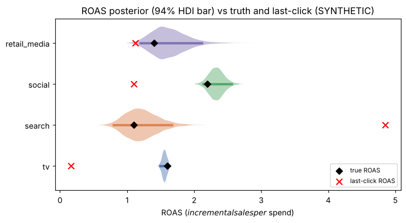
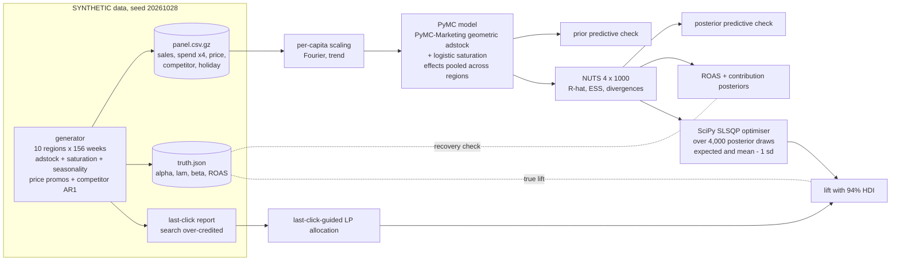
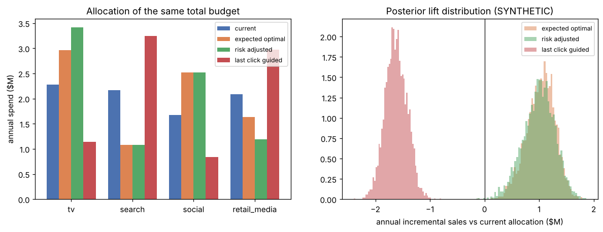
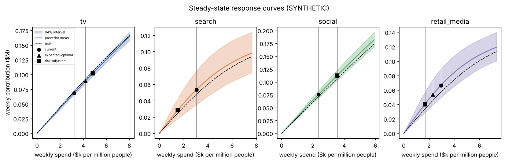
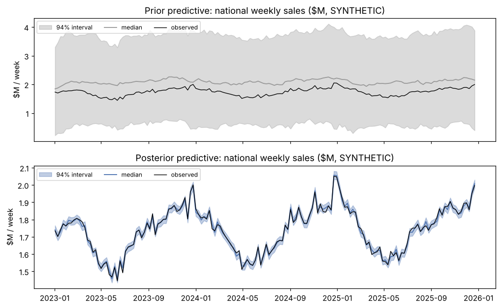
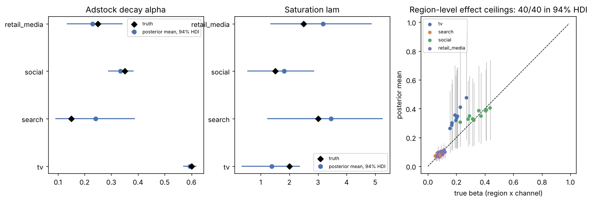
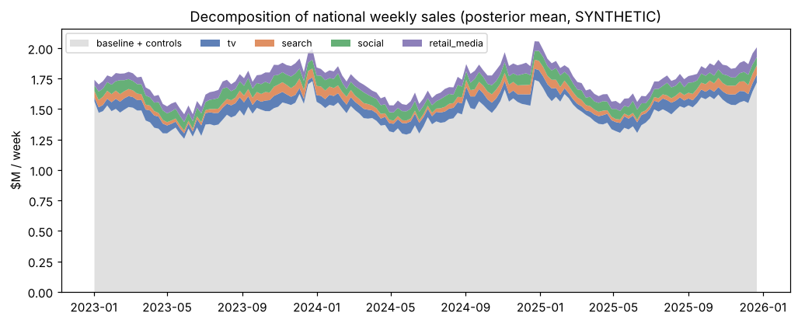

# Day 18: Bayesian Marketing Mix Model and Budget Optimiser

**Tier III - Principal** | **Domain:** Consumer goods & marketing | **Tools:** PyMC 5.28, PyMC-Marketing 0.19 (geometric adstock, logistic saturation), ArviZ 0.23, SciPy 1.17, pandas 2.3 | **Data:** SYNTHETIC, 156 weeks x 10 regions x 4 channels (1,560 region-weeks), seeded generator with known ground truth.

## Executive summary

A hierarchical Bayesian marketing mix model recovered the true return on ad spend (ROAS) of all 4 channels inside its 94% credible interval. For example, it estimates search at 1.22 (94% HDI 0.80-1.67) against a true 1.10, where last-click attribution reports 4.85. Moving the same $8.20M annual budget to the model's expected-optimal split adds $1.03M of sales a year (94% HDI $0.52M-$1.48M, P(lift > 0) = 0.9998). Checked against the generator's true response curves, that split delivers $1.13M. Following last-click ROAS instead would lose $1.61M a year. All data is SYNTHETIC.



Full outputs: [`results/report.md`](results/report.md), [`results/metrics.json`](results/metrics.json), [`results/roas.csv`](results/roas.csv), [`results/parameter_recovery.csv`](results/parameter_recovery.csv), [`results/budget_allocation.csv`](results/budget_allocation.csv), [`results/convergence.csv`](results/convergence.csv).

## Architecture



## Data provenance

- **Path used: `synthetic_generator`** (recorded in `results/metrics.json → data.path_used`). The prompt asks for simulated data so that recovered parameters can be checked against truth. No public dataset carries ground-truth channel effects, so no download is attempted and the run makes no network calls.
- **Generator** (`bayes_mmm.data.simulate`, seed 20261028). It builds 10 regions with populations of 0.6-3.0 million and 156 weekly observations (2023-01-02 onwards). It works per capita, then multiplies by population.
  - **Baseline.** Region level about 100 $k per million people per week, with 8% spread. A 6% trend over three years, yearly seasonality peaking in December, and a +12 holiday bump in the last two weeks of December.
  - **Controls.** Price promotions in about 12% of weeks cut price by 5-15%, with an effect of -150 per unit of price index, so a 10% discount gives +15. Competitor activity follows a standardised AR(1) process, with an effect of -4 per sd.
  - **Media.**
    - TV runs in 4-week flights.
    - Search spend follows seasonal demand, the classic confounder.
    - Social is always on, with bursts.
    - Retail media is heavier in Q4.
  - **Media response.** Normalised geometric adstock (8-week window) with true decay alpha = 0.60 / 0.15 / 0.35 / 0.25, followed by logistic saturation with lam = 2.0 / 3.0 / 1.5 / 2.5. Effect sizes are calibrated to a national true ROAS of 1.6 / 1.1 / 2.2 / 1.4 (TV / search / social / retail media). Region effects vary by about 20% on the log scale.
  - **Noise.** Gaussian, 2.5 per million per week.
  - **Last-click report (SYNTHETIC, illustrative assumptions).** TV keeps 10% of its true incremental sales, social 50% and retail media 80%. Search, as the final click, collects 70% of what the others lose plus 5% of baseline (brand-search) sales.
- **Committed sample.** `data/sample/panel_sample.csv.gz` (35 KB) is the full panel, because it is small, and `data/sample/truth.json` holds the ground truth. A test checks that the sample matches the generator. `data/raw/` is git-ignored. No trace file is committed.

## Method

1. **Scaling.** Sales and spend are divided by population, giving per-capita values. Sales are then divided by their mean, and each channel's spend by its maximum.
2. **Model** (`src/bayes_mmm/model.py`).
   - Sales are explained by a region intercept (centred hierarchical), trend, 2nd-order yearly Fourier terms, holiday, price and competitor terms, plus the sum over channels of beta[r,c] * logistic(adstock(x)).
   - Adstock and saturation use `pymc_marketing.mmm.transformers.geometric_adstock` and `logistic_saturation`.
   - Decay alpha_c ~ Beta(2,2) and lam_c ~ Gamma(3,1) are shared by all regions.
   - **Hierarchy.** Channel effects are partially pooled across regions: log effect[r,c] = mu_c + sigma_c * z[r,c] (non-centred).
   - **Parameterisation.** The effect is measured *at the channel's mean spend*. The effect ceiling is then derived as beta = effect / logistic(x_mean; lam). This removes the beta-lam ridge of a saturation curve. A first version parameterised by beta directly needed tree depth of about 8 and twice the sampling time.
3. **Prior predictive check.** 500 prior draws were compared with the observed sales.
4. **Inference.** NUTS ran 4 chains x 1,000 draws after 1,000 tuning steps, with target_accept 0.9. Diagnostics are R-hat, bulk and tail ESS, and divergences over every posterior quantity (785, including the 624 weekly contribution deterministics).
5. **Posterior predictive check.** Measures coverage of the 94% intervals, R², and MAPE (mean absolute percentage error) on region-weeks and national weeks.
6. **Recovery.** Truth is mapped into the model's scaled parameterisation (`analysis.true_values`). For 101 parameters (alpha, lam, 40 betas, 40 effects, controls, sigma, ROAS), the check is whether truth falls inside the 94% HDI.
7. **ROAS and contribution.** Computed as deterministics in the model: sum over weeks and regions of the contribution, divided by spend.
8. **Budget optimiser** (`src/bayes_mmm/optimiser.py`).
   - **Decision.** Weekly per-capita spend per channel, applied in every region.
   - **Response.** Steady-state weekly contribution: with normalised adstock, constant spend settles at its own level. The response is evaluated on all 4,000 posterior draws.
   - **Constraints.** Total budget fixed at the last 52 weeks' spend ($8.20M a year). Each channel may move between 50% and 150% of its current spend.
   - **Objectives.** (a) maximise expected contribution; (b) risk-adjusted: maximise mean - 1 sd of contribution. Solved with SLSQP using analytic gradients and 8 starts.
   - **Comparisons.** A last-click-guided allocation (an LP that trusts last-click ROAS) and an oracle optimum on the true curves. Every allocation is also scored on the true response.

## Results

All numbers come from `results/metrics.json` (one `make run`, 260.5 s total, 246.4 s of sampling, on 4 CPU cores).

| Metric | Value |
|---|---|
| Max R-hat (785 quantities) | **1.004** (0 at or above 1.01) |
| Min bulk / tail ESS | 1,370 / 1,322 |
| Divergences | 0 of 4,000 draws |
| Prior predictive 94% interval coverage (region-weeks) | 1.000 (median width 2.0x observed: weakly informative) |
| Posterior predictive 94% coverage, region-week / national week | 0.946 / 0.936 |
| Posterior R² / MAPE (region-week) | 0.998 / 1.54% |
| True ROAS inside 94% HDI | **4/4 channels** |
| All parameters inside 94% HDI | 99/101 (alpha 4/4, lam 4/4, beta 40/40, effect-at-mean 38/40, controls 8/8, ROAS 4/4) |

**ROAS** (incremental sales $ per $ spent over 3 years):

| Channel | Spend ($k) | True ROAS | Posterior mean | 94% HDI | Last-click ROAS |
|---|---|---|---|---|---|
| TV | 7,532 | 1.60 | 1.560 | 1.493-1.630 | 0.160 |
| Search | 6,509 | 1.10 | 1.220 | 0.797-1.667 | 4.846 |
| Social | 5,132 | 2.20 | 2.333 | 2.133-2.561 | 1.100 |
| Retail media | 6,241 | 1.40 | 1.623 | 1.197-2.115 | 1.120 |

**Budget reallocation** (same $8,197k annual budget, 52-week horizon, lift vs the current split; current media contribution $13,724k, 94% HDI $12,389k-$15,198k):

| Allocation | TV / Search / Social / Retail ($k a year) | Posterior lift ($k), 94% HDI | P(lift > 0) | True lift ($k) |
|---|---|---|---|---|
| Current | 2,275 / 2,163 / 1,677 / 2,082 | - | - | - |
| Expected-optimal | 2,965 / 1,081 / 2,516 / 1,635 | **1,028** (516 to 1,482); +7.6% of media contribution | 0.9998 | 1,125 |
| Risk-adjusted (mean - 1 sd) | 3,412 / 1,081 / 2,516 / 1,188 | 993 (426 to 1,504) | 0.9988 | 1,184 |
| Last-click-guided | 1,137 / 3,244 / 839 / 2,977 | -1,620 (-2,001 to -1,268) | 0.000 | -1,614 |
| Oracle (true curves) | 3,412 / 1,081 / 2,516 / 1,188 | 993 | 0.9988 | 1,184 |

The expected-optimal split captures 95% of the oracle's true lift (1,125 / 1,184). The risk-adjusted split lands on the same corner as the oracle, because the bounds bind for TV, search and social.







`results/figures/rank_alpha_lam.png` holds the rank plots for alpha and lam.

### Acceptance criteria

| Criterion | Status |
|---|---|
| All R-hat below 1.01 | Met: max 1.004 over all 785 quantities |
| True channel ROAS within the 94% HDI for most channels | Met: 4/4 |
| Optimised budget shows expected lift with uncertainty bands | Met: +$1,028k a year, 94% HDI $516k-$1,482k |
| `make test` passes from a clean checkout | Met: 14 tests, about 30 s, in a fresh Python 3.11 venv from `requirements.txt` |
| `make run` reproduces every number here | Met: deterministic with seed 20261028; two consecutive runs gave identical ROAS and diagnostics |

## What this demonstrates

- **Bayesian modelling.**
  - A hierarchical PyMC model built from PyMC-Marketing transformers, reparameterised for sampler efficiency.
  - Centred and non-centred hierarchies chosen per parameter, not by habit.
  - Prior and posterior predictive checks, plus full-coverage R-hat and ESS diagnostics.
  - Parameter recovery against known truth.
- **Marketing science.**
  - Adstock (carry-over) and saturation (diminishing returns), with demand-confounded search spend.
  - Price and competitor controls.
  - ROAS and contribution posteriors.
  - A quantified demonstration of why last-click over-credits search.
- **Decision under uncertainty.**
  - Optimisation over the full posterior with expected and risk-adjusted objectives under budget and channel bounds.
  - Lift reported as a distribution with P(lift > 0).
  - Each decision scored on the true response, so the gap between "modelled" and "real" value is visible.

## Limitations

- **SYNTHETIC data, correctly specified model.** The fitted model has the same functional form as the generator: geometric adstock, logistic saturation, Fourier seasonality, linear controls. Real MMMs face misspecification, unobserved confounders and much shorter, collinear histories. Recovery here is therefore an upper bound on what to expect in practice.
- **Search and retail media are weakly identified.** Their ROAS intervals are wide (0.80-1.67 and 1.20-2.12), and their saturation lam has 94% HDIs of roughly 1.2-5.3. Search is confounded with seasonal demand. 2 of 40 region-level "effect at mean spend" values fall outside their 94% HDI, which is about what a 94% interval should produce across 40 checks.
- **The risk-adjusted objective penalises the spread of total contribution, not of the lift.** In this run it cut the contribution sd from $620k to $556k. But its lift HDI is slightly wider (426 to 1,504) and its 5th-percentile lift is lower ($492k vs $563k) than the expected-optimal split. Its true lift happened to be higher ($1,184k vs $1,125k). A CVaR-of-lift objective would target downside risk more directly; it was not tried.
- **Steady-state response.** The optimiser assumes constant weekly spend. It ignores flighting (TV is actually bursty), reach/frequency effects and cross-channel synergies. Allocation is by channel only: the regional split stays proportional to population.
- **Last-click numbers are illustrative.** The last-click report uses invented crediting rules (see Data provenance). It shows the direction of the bias, not its size in any real business.
- **No out-of-time holdout.** Fit is assessed in-sample: posterior predictive coverage and recovery against known truth.
- **Stretch goals not attempted:** lift-test calibration priors and time-varying (Gaussian random walk) coefficients.
- **No library substitution was needed.** PyMC-Marketing 0.19's transformers use PyTensor's labelled xtensor API, so `media_response` wraps them with named dims. A test checks them against a NumPy reference implementation.

## How to run

```bash
cd day-18-bayesian-marketing-mix-model
make setup   # pip install -r requirements.txt (Python 3.11+, needs gcc/g++ for PyTensor's C backend)
make data    # optional: writes data/raw/ and data/sample/ (SYNTHETIC)
make run     # about 4-5 min on 4 CPU cores; writes results/
make test    # about 30 s; tiny-chain smoke fit plus generator, transform and optimiser tests
```

`MMM_DRAWS`, `MMM_TUNE` and `MMM_CHAINS` override the sampler for quick experiments. The reported results use the defaults (1000 / 1000 / 4).
