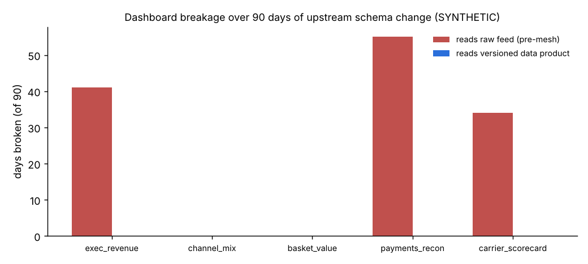
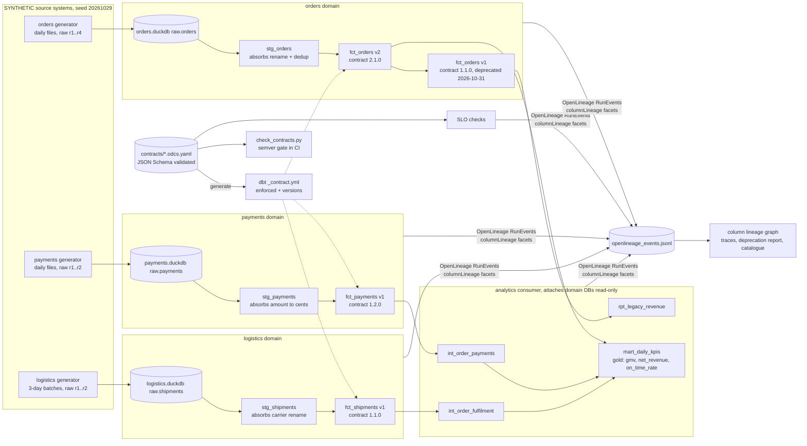
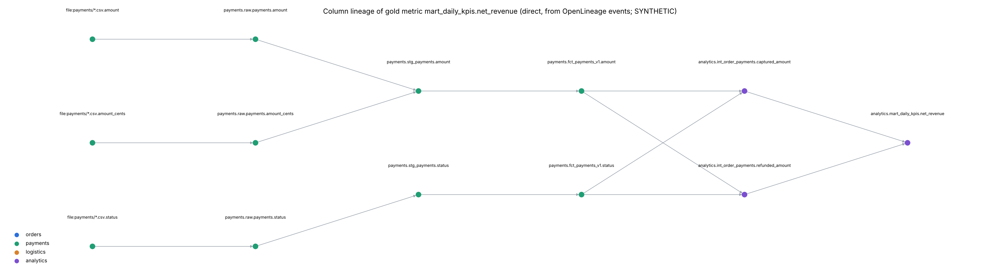

# Day 19: Data Mesh in Practice: Contracts, Versioning and Lineage

**Tier III - Principal** | **Domain:** Enterprise data platform | **Tools:** dbt-core 1.12 (enforced model contracts, model versions) on dbt-duckdb 1.11 / DuckDB 2.0, OpenLineage Python client 1.54 (column-lineage facets), JSON Schema (jsonschema 4.26), sqlglot 30, networkx, GitHub Actions (gate artefact) | **Data:** SYNTHETIC, 3 independent domain generators over 90 days (46,841 order, 51,379 payment and 42,167 shipment raw rows) with 5 raw schema changes.

## Executive summary

Three domains (orders, payments, logistics) now publish versioned data products behind ODCS-style contracts, and a CI gate checks every contract change. Over 90 simulated days of upstream schema churn, dashboards reading raw domain tables were broken on 130 of 370 dashboard-days (3 of 5 dashboards). The same dashboards reading the versioned products were broken on 0, because each domain absorbed its raw changes. The one real breaking change (orders `order_total` renamed to `order_amount`) shipped as a major version, with v1 kept published until 2026-10-31. The gate blocked all 15 deliberately breaking proposals in a labelled suite and passed all 9 safe ones. Each gold metric traces back to its raw source columns through OpenLineage events. Each product reports its SLO status: logistics currently **fails** its 48 h freshness SLA, at 76 h. All data is SYNTHETIC.



Full outputs: [`results/report.md`](results/report.md), [`results/metrics.json`](results/metrics.json), [`results/catalog.md`](results/catalog.md) / [`catalog.html`](results/catalog.html), [`results/slo_status.csv`](results/slo_status.csv), [`results/contract_gate_scenarios.csv`](results/contract_gate_scenarios.csv), [`results/contract_gate_history.csv`](results/contract_gate_history.csv), [`results/consumer_replay.csv`](results/consumer_replay.csv), [`results/deprecation_report.json`](results/deprecation_report.json), [`results/lineage/openlineage_events.jsonl`](results/lineage/openlineage_events.jsonl), [`results/lineage/net_revenue_trace.md`](results/lineage/net_revenue_trace.md). The governance ADR is in [`docs/adr/0001-contract-governance-tradeoffs.md`](docs/adr/0001-contract-governance-tradeoffs.md).

## Architecture



## Data provenance

- **Path used: `synthetic_generator`.** This is recorded in `results/metrics.json → data.path_used`. The prompt asks for synthetic multi-domain data from three independent generators, so no download is attempted and the run makes no network calls.
- **Generators** (`src/mesh/generators.py`, seed 20261029). They cover 2026-07-01 to 2026-09-28 (90 days). Each domain has its own release cadence and its own schema evolution.
  - **Orders.** About 420 orders a day, with growth and a weekend uplift. Order values are lognormal. Statuses: completed 87%, cancelled 5%, returned 8%. 0.4% of rows are re-sent duplicates. One file lands daily at 01:00. Raw schema history:
    - r2 (2026-07-22) adds `sales_channel`.
    - r3 (2026-08-19) **renames `order_total` to `order_amount`**, and the source starts reporting `returned` (earlier files report returns as `completed`).
    - r4 (2026-09-09) adds `discount_amount`.
  - **Payments.** Each order gets one capture. 3% of captures fail first and are retried. Cancelled orders get a failed payment, and returned orders get a refund 3-14 days later. 0.2% of events have no `order_id` (an orphan bug). Raw schema history: r2 (2026-08-05) **replaces dollar `amount` with integer `amount_cents`** and adds `payment_method`.
  - **Logistics.** One shipment per non-cancelled order, with 2-30 h to ship and gamma-distributed transit time. Carrier lateness differs: UPS < FDX < DHL < USPS. The promised date is the order date + 4 days. Files land in **3-day batches**, so the final batch (2026-09-26 to 09-28) has not landed at the evaluation time of 2026-09-29 06:00. Raw schema history: r2 (2026-08-26) **renames `carrier` to `carrier_code`** and adds `carrier_service`.
- **Scale.** 46,841 / 51,379 / 42,167 raw rows in 90 / 90 / 87 files. `data/raw/` (12 MB) and `data/warehouse/` are git-ignored.
- **Committed sample.** `data/sample/` holds the same 90-day timeline and every schema change at about 6 orders a day (670 / 732 / 612 rows, 194 KB). The tests build all four dbt projects on it, and a test checks that it matches the generator.

## Method

1. **Contracts.** There are three contracts in Open Data Contract Standard (ODCS v3) style (`contracts/<domain>/*.odcs.yaml`). Each records id, owner/team, semantic version, schema (logical and physical types, required, primary key, enums, PII classification), SLAs (freshness, completeness, uniqueness, volume), server and `dualPublish` metadata. Every version is kept in `history/`.
   - Contracts are validated by a JSON Schema subset of ODCS (`contracts/odcs-lite.schema.json`), plus semantic rules: an owner is required, the primary key must be required, and the physical name must carry the major version (`_v2`).
2. **dbt projects with model contracts and versions.** Each domain is its own dbt project with its own DuckDB file.
   - `_contract.yml` is **generated from the contract**. Each model gets `contract: enforced`, column types, `not_null` constraints, `unique` and `accepted_values` tests, and one dbt **model version** per published major, with a `deprecation_date`.
   - The orders project publishes `fct_orders_v2` (2.1.0) and `fct_orders_v1` (1.1.0). v1 is derived from v2 and keeps `order_total` and the old status domain (`returned` maps to `completed`).
   - The **consumer project** (`dbt/analytics`) attaches the three domain databases read-only. It reads only the published, major-pinned interfaces through dbt sources, and builds the cross-domain gold mart `mart_daily_kpis` (order date, orders, GMV, net revenue = captured - refunded, on-time delivery rate). The mart has its own enforced contract.
   - All 4 projects build 11 models and run 16 data tests (16 pass).
3. **CI gate** (`scripts/check_contracts.py`, rules in `src/mesh/diff.py`). The gate diffs the old and new contract from the consumer's point of view:
   - **Major:** removal or rename, non-widening type change, required → optional, primary key change, enum value removed, weaker SLA, a dual-published version retired before its date.
   - **Minor:** additions, widening, tightening.
   - **Patch:** metadata.
   - The gate fails if the version bump is below the required level, if the version does not increase, or if a major release does not keep the previous major published. In git mode (`--base origin/main`) it also rejects edits to released `history/` files and a `_contract.yml` that is out of sync.
   - `ci/contract-gate.yml` is the workflow artefact. In this repo, the root CI runs `make test`, which includes the gate tests.
4. **Second line of defence.** dbt's enforced contract refuses to build a model whose SQL drifts from the contract.
5. **SLOs** (`src/mesh/slo.py`). Each product's SLAs are evaluated on its published table at 2026-09-29 06:00:
   - freshness = hours since max `loaded_at`;
   - completeness = minimum non-null rate over required columns;
   - uniqueness of the primary key;
   - volume = row count.
6. **Lineage** (`src/mesh/lineage.py`). Each ingest (file to raw table), each dbt model (from the manifest's compiled SQL) and each SLO check emits OpenLineage START and COMPLETE `RunEvent`s. The events carry these facets:
   - `schema`, `columnLineage` and `sql`;
   - `ownership`, `version` (the contract version) and `documentation` on published products;
   - `dataQualityAssertions` for SLO results.

   Direct column lineage comes from sqlglot's lineage over the compiled SQL, qualified against the live DuckDB catalog. INDIRECT lineage (join, filter, group-by and window columns) goes in the facet's dataset-level list.

   The **graph is rebuilt from the JSONL events alone** (`src/mesh/graph.py`). Traces, the deprecation report ("who still reads v1?") and the catalogue are computed from it. Setting `OPENLINEAGE_URL` also sends the events to an optional Marquez (`lineage/marquez/docker-compose.yml`). The run does not need one.
7. **Consumer replay** (`src/mesh/consumers.py`). Five dashboards, built on different days, are replayed day by day in two setups:
   - against the raw feed schema of that day (the pre-mesh status quo);
   - against the contract version in force that day for their pinned major.

   A dashboard counts as broken on a day if any column it references (found by static sqlglot analysis) is missing.

## Results

All numbers come from `results/metrics.json` and `results/report.md`, produced by `make run` (about 34 s on CPU). All data is SYNTHETIC.

| Area | Metric | Value |
|---|---|---|
| Consumer impact | dashboard-days broken, raw reads (pre-mesh) | **130 / 370** (3 of 5 dashboards; first breaks 2026-08-05, 08-19, 08-26) |
| | dashboard-days broken, versioned data products | **0 / 370** (0 of 5) |
| | raw schema changes / of which removed a column | 5 / 3 (all absorbed by domain staging models) |
| CI gate | real release transitions passing the gate | 7 / 7 |
| | deliberately breaking proposals blocked | **15 / 15** |
| | safe proposals accepted | 9 / 9 |
| | dbt build after an unannounced SQL rename (`order_amount` → `amount`) | **blocked** (enforced-contract mismatch) |
| dbt | models built / data tests passing | 11 / 16 of 16 |
| SLOs | orders `fct_orders_v2` 2.1.0 | **PASS** 4/4 (freshness 5.0 h vs 12 h; uniqueness 100%; 46,665 rows) |
| | payments `fct_payments_v1` 1.2.0 | **PASS** 4/4 (freshness 5.0 h vs 12 h; 51,379 rows) |
| | logistics `fct_shipments_v1` 1.1.0 | **FAIL** 3/4 (freshness **76.0 h vs 48 h**; the 3-day batch cadence) |
| Lineage | OpenLineage events / jobs / column nodes / direct edges | 34 / 17 / 128 / 107 |
| | `mart_daily_kpis.net_revenue` direct sources | `payments` raw `amount`, `amount_cents`, `status` (12 upstream columns, 5 hops, 5 jobs) |
| | incl. INDIRECT (join, group-by, filter) | 8 source columns from all 3 domains |
| Deprecation | readers still on `fct_orders_v1` (deprecated 2026-10-31) | 1 (`analytics.rpt_legacy_revenue`), so it is not yet safe to retire |
| Gold KPIs | orders / GMV / net revenue / on-time delivery | 46,665 / 2,685,405.53 / 2,357,328.44 (87.8% of GMV) / 82.0% of 42,167 shipments |

**Column lineage of the gold metric `net_revenue`, reconstructed from OpenLineage events only:**



The direct lineage of all three gold metrics is in `results/figures/lineage_gold_metrics.png`, and the dataset-level graph in `results/figures/lineage_datasets.png`. `net_revenue` reaches **both** `amount` (raw r1) and `amount_cents` (raw r2). This shows the payments domain absorbing a breaking raw change without the consumer noticing.

**A finding from building it.** The first draft of the payments release history tightened the freshness SLA from 24 h to 12 h and shipped it as patch `1.1.1`. The gate flagged it: a tightened SLA is a minor change. That release was re-cut as `1.2.0`.

### Acceptance criteria

| Criterion | Status | Evidence |
|---|---|---|
| A deliberate breaking change is caught by CI (test) | ✅ | `tests/test_gate.py::test_deliberate_breaking_change_is_caught_by_ci` (column rename with a minor bump makes the CLI exit with 1). `tests/test_end_to_end_sample.py::test_dbt_contract_blocks_unannounced_rename` (dbt refuses the build). 15/15 breaking scenarios blocked. |
| Lineage graph traces a gold metric back to source columns | ✅ | `results/lineage/net_revenue_trace.md`, `lineage_net_revenue.png`, `tests/test_end_to_end_sample.py::test_gold_metric_traces_back_to_source_columns` |
| Each data product reports its SLO status | ✅ | `results/slo_status.csv`, the catalogue, and `dataQualityAssertions` facets in the events (2 PASS, 1 FAIL) |
| `make test` passes from a clean checkout | ✅ | 20 tests in about 30 s; a fresh Python 3.11 venv from `requirements.txt` was used |
| `make run` reproduces every number in this README | ✅ | about 34 s |
| Stretch: catalogue page generated from contracts | ✅ | `results/catalog.md`, `results/catalog.html` |
| Stretch: deprecation workflow with dual-publishing | ✅ | the `dualPublish` contract field, dbt model versions with `deprecation_date`, gate rules (major needs dual-publish; early retirement is major), and a lineage-based deprecation report |

## What this demonstrates

- **Data architecture.**
  - Domain-owned storage and dbt projects, with consumers reading only published interfaces.
  - Versioned interfaces are pinned by physical name, and one versioned dbt model dual-publishes both majors.
  - Domain staging models act as the anti-corruption layer that absorbed all 5 raw changes.
- **Governance.**
  - The contract is the single source of truth. dbt YAML is generated from it, JSON Schema validates it, and released history files are immutable.
  - Semver rules are written for consumers and tested on a labelled suite. SLAs, ownership and a deprecation lifecycle are recorded.
  - The trade-offs are written up in an ADR.
- **Platform engineering.**
  - The CI gate works both as a CLI and as a workflow, and lineage is emitted as a standard (OpenLineage) by every job.
  - Impact analysis and the catalogue are derived from events.
  - Everything runs offline in about 30 s, with no Docker and no server. Marquez and an HTTP transport are optional artefacts.

## Limitations

- **SYNTHETIC data and hand-written scenarios.** The breakage replay measures the failure mode the brief describes (a renamed column), using static column checks. It does not count *silent* semantic breaks. For example, raw readers would also have seen `returned` appear in `status`, and the v1 interface deliberately maps it away. The gate suite is a labelled set of 24 cases I wrote to cover the rules, so 24/24 measures rule coverage, not precision on real pull requests.
- **The logistics SLO failure is structural.** Its 3-day batch cadence cannot meet a 48 h freshness SLA at the evaluation time. It was left failing to show SLO reporting, not fixed.
- **No cross-project `ref`.** dbt Mesh cross-project `ref()` is a dbt Cloud feature, and dbt-loom was not used. The consumer reads the producers' published relations as **sources** pinned to a major version, with contract metadata in `meta`. dbt model versions and deprecation dates are enforced inside each producer project only.
- **Column lineage is static SQL analysis** (sqlglot over compiled SQL).
  - `count(*)` has no direct column lineage, so `orders` in the mart only has INDIRECT lineage.
  - Indirect lineage through CTE aliases is not resolved. For example, the dedup filter `rn = 1` in `stg_orders` is recorded only as WINDOW inputs.
  - Ingest-job column types in the file dataset are recorded as VARCHAR.
- **Rule choices are opinionated.** Adding an enum value is minor, and making a column required is minor. See the ADR.
- **The CI workflow is an artefact.** `ci/contract-gate.yml` is written for a repo that hosts the contracts at its root. In this monorepo the root CI runs `make test` (gate tests included) only for changed day folders. `make contract-gate BASE=origin/main` runs the git-mode gate locally.
- **Event times are fixed for reproducibility.** OpenLineage event times are anchored to the as-of time, and run IDs are deterministic UUIDv5s rather than the wall clock.

## How to run

```bash
cd day-19-data-mesh-contracts-lineage
make setup        # pip install -r requirements.txt (Python 3.11+)
make test         # 20 tests, ~30 s: generator, contracts, CI gate, consumer replay, dbt e2e on data/sample
make run          # ~35 s: regenerates data, builds all dbt projects, writes results/
make contract-gate BASE=origin/main   # semver gate against a git ref (exit 1 on breaking change without major bump)
python scripts/check_contracts.py --old contracts/payments/history/fct_payments-1.1.0.odcs.yaml \
                                  --new contracts/payments/fct_payments.odcs.yaml
make contracts    # regenerate dbt _contract.yml after editing a contract
# optional: OPENLINEAGE_URL=http://localhost:5000 make run   (with lineage/marquez/docker-compose.yml up)
```
