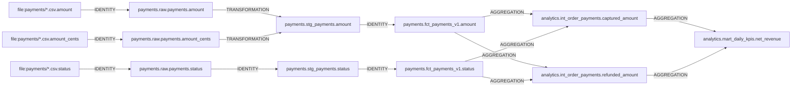

# Column lineage: `analytics.main.mart_daily_kpis.net_revenue`

Reconstructed only from `openlineage_events.jsonl` (direct column lineage). SYNTHETIC data.

Source columns: `payments/payments_*.csv::amount`, `payments/payments_*.csv::amount_cents`, `payments/payments_*.csv::status`

