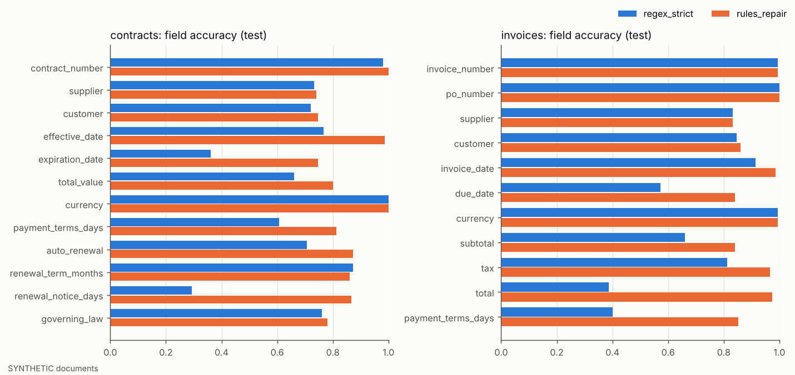
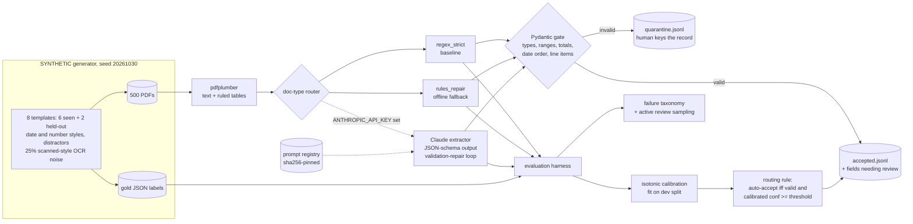
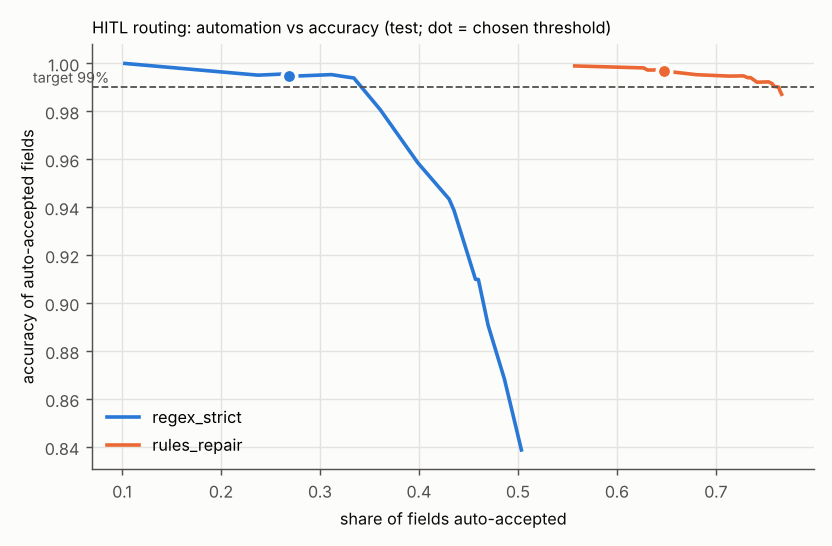
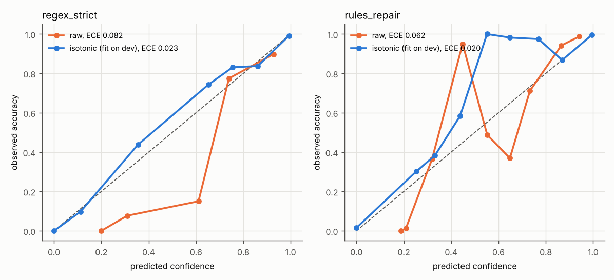
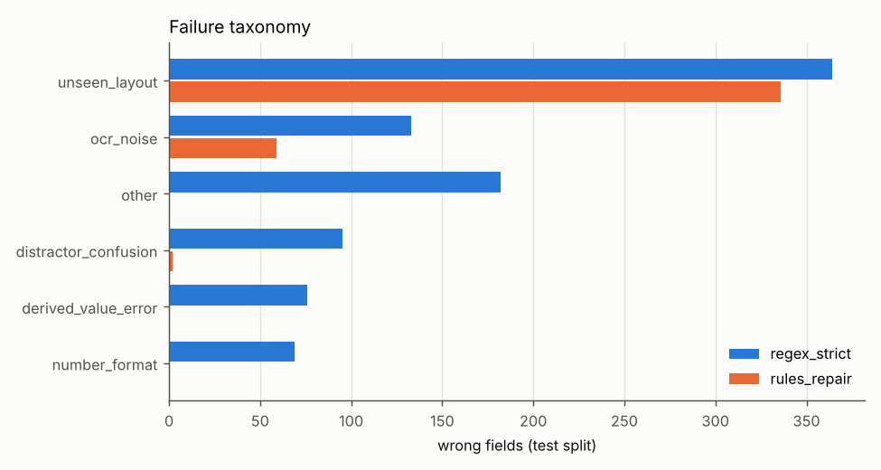

# Day 20: LLM Structured Extraction with a Rigorous Evaluation Harness

**Tier III - Principal** | **Domain:** Legal & procurement | **Tools:** Pydantic 2 (target schemas + validation gate), pdfplumber (PDF text and tables), reportlab (PDF rendering), rapidfuzz (fuzzy matching), scikit-learn (isotonic calibration), pandas, Anthropic SDK (optional Claude extractor) | **Data:** SYNTHETIC, 500 generated contracts and invoices as PDFs with gold JSON labels.

## Executive summary

This project measures, field by field, how far automated extraction from supplier contracts and invoices can be trusted. Each document is checked against Pydantic schemas before anything is written downstream, and each field is either auto-accepted or sent to a person based on calibrated confidence. On 300 held-out SYNTHETIC documents the offline rules extractor gets **88.5%** of fields right, against 73.4% for a strict-regex baseline. The confidence-based routing auto-accepts **64.7%** of fields at **99.7%** accuracy and sends 390 of the 397 wrong fields (98.2%) to review. **0** invalid records reached the downstream store. The main risk is layout drift: on the two held-out layouts the rules extractor gets only **47.4%** of fields right (100% on the layouts it was written for).

> **No live LLM results in this build.** No `ANTHROPIC_API_KEY` was available in the build environment, so every number below comes from the offline path (strict regex baseline and rules+repair extractor). The Claude extractor is implemented and unit-tested against a fake client. It runs automatically when a key is set, but no LLM accuracy, cost or latency figures are reported, because none were measured.



Full outputs: [`results/metrics.json`](results/metrics.json), [`results/report.md`](results/report.md), [`results/per_field_metrics.md`](results/per_field_metrics.md) / [`.csv`](results/per_field_metrics.csv), [`results/error_analysis.md`](results/error_analysis.md), [`results/field_predictions_test.csv`](results/field_predictions_test.csv), [`results/downstream/`](results/downstream/) (accepted and quarantined records per extractor), and [`results/figures/`](results/figures/).

## Architecture



## Data provenance

- **Path used: `synthetic_generator`** (recorded in `results/metrics.json → data.path_used`). The prompt asks for generated contracts and invoices, so no public source is downloaded and the run makes no network calls. All documents, company names and amounts are **SYNTHETIC**.
- **Generator:** [`src/extract_eval/generator.py`](src/extract_eval/generator.py), seed 20261030. It produces 500 documents: 250 contracts (IDs `C*`) and 250 invoices (IDs `I*`). Each is rendered to PDF with reportlab and saved with its source text and a gold JSON label. Variation built in:
  - **Templates.** Contracts: prose MSA, key-value cover sheet, procurement letter (customer named first), and the held-out `order_form_unseen` (a ruled grid with labels Provider/Client/Start/Rollover). Invoices: ruled table, unruled text table, compact `qty x item @ price = amount` lines, and the held-out `eu_layout_unseen` (Seller/Buyer/Gross total). The rules extractor was written against the six seen templates before the two held-out layouts were added, so those 20% of documents test generalisation.
  - **Formats.** Six date styles (ISO, US `MM/DD/YYYY`, `March 3, 2026`, `3 March 2026`, `the 3rd day of March, 2026`, `03-Mar-2026`). European number formatting (`1.234,56`) on most EUR documents. Currency shown as a symbol or a code. Party names sometimes in upper case or with a long legal suffix (`Incorporated`).
  - **Distractors.** Liability caps alongside contract values. Superseded-agreement and signature dates alongside effective dates. Termination-for-convenience notice periods in contracts that do not auto-renew. Order dates and paid "previous balance" or "balance forward" amounts on invoices.
  - **Derived fields.** About half the contracts give only "an initial term of N months", so expiration = effective date + N months. Some invoices print only payment terms, so due date = invoice date + terms.
  - **Scanned-style noise.** About 25% of documents get OCR-like corruption at a 3-10% token rate, injected into the PDF text layer and rendered in Courier. The corruptions are 0/O, 1/l, 5/S, 8/B and m/rn swaps, merged and split tokens, and flipped decimal separators. Limitation: these are text-layer PDFs, not rasterised scans, so there is no real OCR step.
- **Committed sample:** the first 30 documents (PDF, text, gold) in [`data/sample/`](data/sample/), 376 KB. `data/raw/` is regenerated by `make run` and git-ignored.

## Method

1. **Target schemas** ([`schemas.py`](src/extract_eval/schemas.py)). `ContractRecord` holds parties, effective and expiration dates, total value, currency, payment terms, auto-renewal, renewal term and notice, and governing law. `InvoiceRecord` holds numbers, parties, dates, currency, subtotal, tax, total, terms and `LineItem`s. Both models forbid extra keys. Cross-field validators check that subtotal + tax = total, that line items sum to the subtotal, that each line is qty x price = amount, that due date ≥ invoice date, that expiry > effective, and that no renewal term is given without auto-renewal.
2. **Extractor interface** ([`extractors/base.py`](src/extract_eval/extractors/base.py)). Every extractor returns fields, line items, per-field confidence, latency, tokens, cost and attempts. A shared deterministic router picks the schema from the document header.
   - `regex_strict`: first-match regexes, US number format only, no OCR repair, no derived fields. Represents a quick in-house script.
   - `rules_repair`: the documented **offline fallback** ([`extractors/rules.py`](src/extract_eval/extractors/rules.py)). It adds:
     - label synonyms with fuzzy label matching and OCR repair in numeric and date contexts;
     - fuzzy month names, European and OCR-flipped number parsing, and legal-suffix normalisation;
     - derived expiry and due dates;
     - an arithmetic repair when exactly one of subtotal, tax or total is inconsistent with the line items;
     - low-confidence generic fallbacks for unknown layouts.

     Its raw confidence is the pattern tier x a document-level OCR-repair penalty x the arithmetic cross-check outcome.
   - `claude` ([`extractors/llm.py`](src/extract_eval/extractors/llm.py)): enabled only when `ANTHROPIC_API_KEY` is set. It sends the pdfplumber text and tables with a versioned system prompt and requests schema-constrained JSON (`output_config.format` with a closed JSON schema, plus model-reported per-field confidence). The SDK retries transient errors (`max_retries=4`). On a Pydantic validation failure, the errors are sent back and the model re-extracts, up to 2 repair rounds. `refusal` and `max_tokens` stop reasons are recorded, never raised. Server-side refusal fallbacks are on by default (`ANTHROPIC_FALLBACKS=0` turns them off). Configuration: model via `ANTHROPIC_MODEL` (default `claude-opus-5-5`), effort via `ANTHROPIC_EFFORT` (default `low`), prices via `ANTHROPIC_PRICE_IN/OUT` (cost = tokens x price), and a document cap via `LLM_MAX_DOCS`.
3. **Validation gate** ([`downstream.py`](src/extract_eval/downstream.py)). Every output is re-validated by the gate itself; an extractor's own `valid` flag is never trusted. Valid records go to `accepted.jsonl` together with the fields the routing rule flags. Invalid records go to `quarantine.jsonl` with their errors. `write_accepted` raises on an invalid record.
4. **Evaluation harness** ([`evaluate.py`](src/extract_eval/evaluate.py)). Documents are split by seed into 200 dev and 300 test, stratified by type; all headline numbers are on test.
   - Per-field exact match is on normalised values. Fuzzy match (party names and governing law) is rapidfuzz `token_sort_ratio` ≥ 90 after legal-suffix canonicalisation. A null predicted against a null gold counts as correct.
   - Line-item precision, recall and F1 use greedy one-to-one matching: loose = description ≥ 90 and amount within a cent; strict also requires quantity and unit price.
   - Calibration is reported as ECE (10 bins) and Brier score, before and after per-field isotonic regression fitted on dev.
   - Cost and latency per document are p50 and p95 of PDF parse plus extraction, along with tokens and USD.
5. **Human-in-the-loop routing.** A field is auto-accepted only if its record passed the gate and its calibrated confidence is at or above a threshold. The threshold is chosen on dev as the lowest value whose auto-accepted fields are ≥ 99% correct, then applied unchanged to test.
6. **Error analysis.** Each wrong field gets one root cause: distractor confusion, number format, date format, unseen layout, OCR noise, derived-value error, entity normalisation, or other. It also gets a mode: missed, spurious or wrong value.
7. **Stretch goals (both done).**
   - Prompt registry: [`src/extract_eval/prompts/`](src/extract_eval/prompts/) pins each prompt by SHA-256, so an edited prompt cannot load without a new version. A regression snapshot of rules outputs on the committed sample catches silent behaviour changes.
   - Active sampling: documents are ranked for review by expected error count (sum of 1 - calibrated confidence, invalid records first) and compared with random review.

## Results

300 SYNTHETIC test documents (150 contracts, 150 invoices), 3,450 field predictions per extractor. Source: `results/metrics.json` and `results/report.md`.

| Metric (test split) | regex_strict | rules_repair (offline fallback) |
|---|---|---|
| Field accuracy (fuzzy for names and law, exact otherwise) | 0.734 | **0.885** |
| Field accuracy (exact) | 0.716 | 0.882 |
| Documents with every field correct | 0.083 | 0.703 |
| Records passing the schema gate | 0.493 | 0.767 |
| Line-item F1 (loose / strict) | 0.703 / 0.701 | 0.901 / 0.901 |
| ECE raw → isotonic-calibrated | 0.082 → 0.023 | 0.062 → 0.020 |
| Brier raw → calibrated | 0.114 → 0.073 | 0.059 → 0.037 |
| Routing threshold (chosen on dev) | 0.895 | 0.900 |
| Fields auto-accepted | 26.9% | **64.7%** |
| Accuracy of auto-accepted fields (target ≥ 99%) | 99.5% | **99.7%** |
| Wrong fields sent to review | 914 / 919 (99.5%) | 390 / 397 (98.2%) |
| Documents fully straight-through (all fields auto-accepted) | 0.0% | 10.3% (all of them fully correct) |
| Invalid records written downstream (all 500 docs) | 0 of 255 accepted | 0 of 373 accepted |
| Doc-type routing accuracy (all 500 docs) | 1.000 | 1.000 |
| Latency per doc, p50 / p95 (PDF parse + extraction) | 27.2 / 82.0 ms | 27.7 / 82.6 ms |
| Extraction alone, p50 | 0.24 ms | 0.66 ms |
| Cost per document | $0 | $0 |

**Accuracy by slice** (field accuracy, test):

| Slice | regex_strict | rules_repair |
|---|---|---|
| Seen templates, clean (180 docs) | 0.814 | 1.000 |
| Seen templates, scanned-style (66 docs) | 0.777 | 0.919 |
| Held-out templates, clean (47 docs) | 0.425 | 0.474 |
| Held-out templates, scanned-style (7 docs) | 0.361 | 0.398 |

The 1.000 on seen, clean templates comes from building the rules against those exact templates; read it as an upper bound, not as a sign the rules generalise. The held-out rows are the honest measure of generalisation.

**Failure taxonomy** (wrong fields on test, from [`results/error_analysis.md`](results/error_analysis.md)):

| Root cause | regex_strict | rules_repair |
|---|---|---|
| unseen_layout | 364 | 336 (298 missed, 38 wrong) |
| ocr_noise | 133 | 59 |
| other (pattern gaps) | 182 | 0 |
| distractor_confusion | 95 | 2 |
| derived_value_error | 76 | 0 |
| number_format | 69 | 0 |

The strict baseline falls for the planted traps. It reads 52 termination notices as renewal notices and 34 superseded or signature dates as effective dates, gets "auto-renewal" wrong whenever a clause says "shall *not* renew automatically", and turns European amounts into values 1,000x too small. For the rules extractor, 84.6% of the remaining errors come from the two held-out layouts, and most of those are *missed* fields (nulls), not wrong values. The calibrated confidence therefore sends them to review instead of letting them through.

**Active sampling for review** (rules_repair, test): reviewing the 20% of documents ranked highest by expected errors finds 353 of 397 field errors (88.9%), against 19.7% for random review of the same number of documents (mean of 500 draws). At a 10% budget the figures are 53.4% against 10.1%.







Full runtime of `make run`: 26.7 s on CPU (Python 3.11.17). Latency figures change slightly from run to run; every accuracy, calibration and routing number is deterministic given the seed.

## What this demonstrates

| Skill | Where |
|---|---|
| **LLM engineering** | Claude extractor with schema-constrained JSON output, versioned prompt registry, validation-repair loop, retry, refusal and fallback handling, per-call token and cost accounting, configurable model and effort, and a fake-client test suite so the LLM path is tested without a key |
| **Evaluation design** | Gold-labelled corpus with planted distractors and held-out layouts; exact vs fuzzy metrics; line-item F1; dev/test split; isotonic calibration with ECE and Brier; threshold chosen on dev and reported on test; root-cause taxonomy; active-sampling comparison against a random baseline |
| **Document AI** | PDF text and ruled-table parsing with pdfplumber; OCR-noise repair; European and US number and date normalisation; derived fields; Pydantic contracts guarding the downstream store |

## Limitations

- **No live LLM was evaluated.** `ANTHROPIC_API_KEY` was not set in the build environment. The Claude extractor's code path is covered only by fake-client unit tests (repair loop, refusal, API errors, cost accounting, schema shape). There are no measured LLM accuracy, calibration, cost or latency numbers, so the README makes no claim that an LLM beats the rules. To get them, run `ANTHROPIC_API_KEY=... make run`; set `LLM_MAX_DOCS` to cap spend, in which case every extractor is scored on the same subset. The prompt has never been run against a live model, so its first live run is untested.
- **The rules overfit the seen templates by construction**, which is why seen, clean documents score 1.000. The held-out layouts (0.474) show what happens with a new supplier format. In production that slice would be larger and messier than two synthetic layouts.
- **Synthetic data only.** Templates, clauses and noise are generated, and real contracts are longer, multi-page and far more varied. The scanned-style noise is injected into a PDF text layer (no rasterisation or OCR engine), so real scan quality problems such as skew, stamps and handwriting are not represented.
- **Straight-through processing is low (10.3% of documents).** The routing rule is per field and needs ≥ 99% accuracy, and absent-but-optional fields (for example no PO number) get modest calibrated confidence. Most documents therefore still have at least one field for a reviewer. Relaxing the target, or treating confident nulls separately, would raise automation; this was not tuned.
- **Calibration bins are sparse** in the middle of the confidence range (see the reliability diagram), because the rules emit a small set of discrete confidence levels. ECE on 3,450 test fields is low, but per-field calibration for rare fields falls back to a pooled isotonic model.
- **Doc-type routing is a shared keyword rule.** The LLM path uses it too, so a misrouted document would be extracted with the wrong schema. In this run it routed all 500 documents correctly (`doc_type_routing_accuracy_all_docs` = 1.0 in metrics.json).
- **Acceptance criteria:** all met. The harness runs fully offline. The per-field metrics table is committed. Tests show that invalid outputs are never written downstream. `make test` passes from a clean Python 3.11 venv. `make run` reproduces every number above, with the exception noted under Results that latency varies slightly from run to run.

## How to run

```bash
cd day-20-llm-document-extraction-eval
make setup   # pip install -r requirements.txt (pinned, Python 3.11 wheels)
make run     # regenerate 500 SYNTHETIC PDFs -> extract -> gate -> evaluate -> results/ (~30 s, offline)
make test    # 32 pytest tests (~10 s): schemas, gate, extractors, evaluator, calibration/routing, prompt registry, LLM loop (fake client), e2e
make lint    # ruff check + format check

# optional: also run the Claude extractor (billed to your key)
ANTHROPIC_API_KEY=sk-... ANTHROPIC_MODEL=claude-opus-5-5 LLM_MAX_DOCS=100 make run
```

Library substitutions: none. All tools named in the prompt were used; reportlab was added to render the PDFs and scikit-learn for isotonic calibration.
