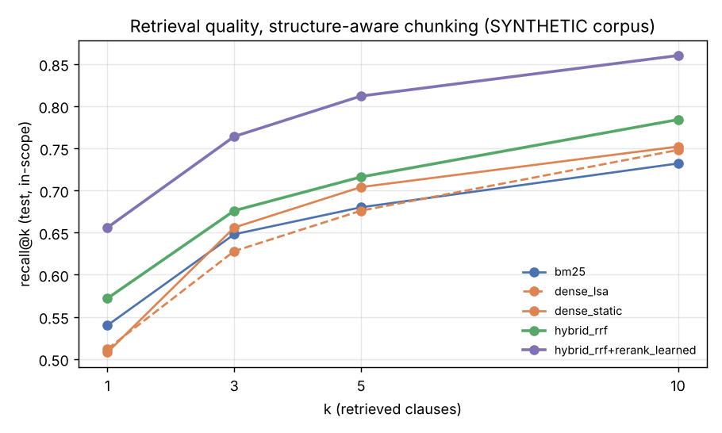
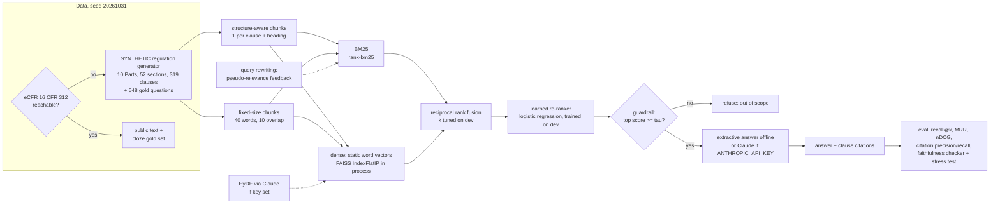
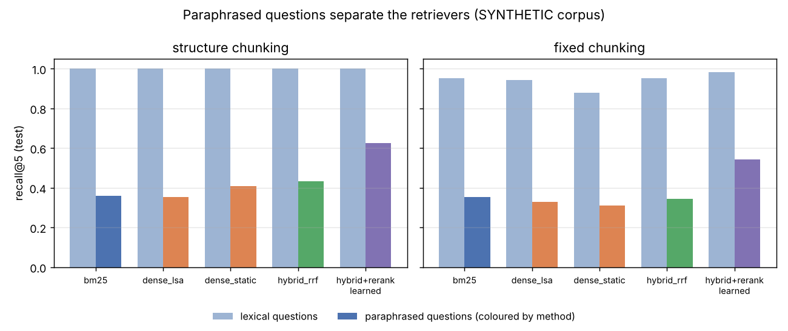
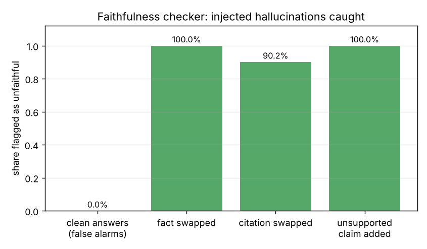

# Day 21: Regulatory Q&A: Hybrid-Search RAG with Measured Faithfulness

**Tier III - Principal** | **Domain:** Government & regulation | **Tools:** rank-bm25 (lexical), FAISS (in-process dense index), spaCy `en_core_web_md` static vectors (dense encoder, substitute for sentence-transformers), scikit-learn (LSA fallback encoder, learned re-ranker), matplotlib, Anthropic SDK (optional Claude generator) | **Data:** SYNTHETIC regulation, 319 clauses, 548 gold questions (eCFR was unreachable, see provenance).

## Executive summary

This project is a question-answering assistant for compliance analysts. It finds the exact clause of a regulation that answers a question, quotes it with a clause-level citation, and refuses when nothing relevant is found. On 250 held-out SYNTHETIC test questions, hybrid search followed by a learned re-ranker puts the right clause in the top 5 for **81.2%** of questions, against 68.0% for keyword search (BM25) alone. Every one of the 173 answers it gave carried a valid citation, and **86.6%** of them were correct. The main risk: an answer can quote its source faithfully and still be wrong, because the source is the wrong clause. The faithfulness checker caught 100% of injected wrong numbers but cannot catch a wrong clause, so retrieval quality is what drives answer accuracy.

> **No live LLM results in this build.** No `ANTHROPIC_API_KEY` was available in the build environment, so every answer number below comes from the offline **extractive** generator. The Claude generator (and Claude-based HyDE) is implemented and unit-tested against a fake client, and runs automatically when a key is set. No LLM accuracy, cost or latency figures are reported, because none were measured.



Full outputs: [`results/metrics.json`](results/metrics.json), [`results/report.md`](results/report.md) (all tables plus example answers), [`results/retrieval_results.csv`](results/retrieval_results.csv), [`results/answers_test.csv`](results/answers_test.csv) (every test answer with its citation and faithfulness checks), and [`results/figures/`](results/figures/).

## Architecture



## Data provenance

- **Path used: `synthetic_generator`** (recorded in `results/metrics.json → data.path_used`). `make run` first tries the public-domain eCFR API for 16 CFR Part 312 (`public_attempted: true`). The build environment's proxy blocked it (`public_reachable: false`), so the run fell back to the seeded generator automatically. The public path ([`ecfr.py`](src/regrag/ecfr.py)) parses eCFR XML into sections and paragraphs and builds a cloze gold set by masking stated numbers. Only its parser is tested, on an XML fixture. It has never run against the live API, and it falls back to synthetic data if it yields fewer than 100 questions.
- **Generator:** [`src/regrag/corpus.py`](src/regrag/corpus.py), seed 20261031. The output is a **SYNTHETIC** "Model Data Protection and Conduct Regulation". It is not a real regulation and is not legal guidance.
  - **Structure.** Part 1 holds scope and definitions. Parts 2-11 each cover one data category (customer, vendor, biometric, ...), with 5 sections per Part, each on one topic (e.g. § 4.2 *Customer complaints*). Each section has six lettered clauses: a deadline, a retention period, a civil penalty, an approver and frequency, a small-firm exemption, and a general clause. In total that is 319 clauses (about 7,700 words).
  - **Why it is hard.** Clauses in different sections are near-duplicates that differ only in topic and facts, so retrieval has to match both the topic and the kind of obligation being asked about.
  - **Terminology varies, as in real drafting.** Each mention of a topic word, actor, authority or verb is drawn from a synonym set: customer/client/consumer, complaints/grievances/disputes, Supervisory Authority/Commission/regulator, and so on. Headings always use the canonical term.
- **Gold set:** 548 questions, each with its supporting clause id and answer.
  - **500 in-scope questions**, two per answerable clause. *Lexical* questions reuse the clause's own words. *Paraphrase* questions reword the question and swap in synonyms that the clause does not use (topic words with p = 0.6, at least one always swapped; generic words with p = 0.7).
  - **48 out-of-scope questions** use the same question frames on topics the regulation does not cover, e.g. "Who must approve wine import labels?".
  - **Split.** The split is by *section* (no test question shares a section with a dev question): 250 in-scope + 24 out-of-scope for dev and the same for test. Dev is used for every tuning step (RRF k, re-ranker training, guardrail threshold). All headline numbers are on test.
- **Committed sample:** the full generated corpus and gold set in [`data/sample/`](data/sample/) (about 360 KB). A test checks that the generator reproduces it byte for byte. `data/raw/` is regenerated by `make run` and git-ignored.

## Method

1. **Chunking** ([`chunking.py`](src/regrag/chunking.py)). Two strategies are compared.
   - **Structure-aware:** one chunk per clause, prefixed with "§ section heading (letter)". Each chunk is a citable unit.
   - **Fixed-size:** 40-word windows with a 10-word overlap over the flattened document. Each window maps to the clauses it overlaps, and a window counts as relevant only if it contains the full answer span. The size was chosen so that windows are about as long as the structure-aware chunks (mean 39.9 vs 27.9 words). The comparison therefore tests the chunk boundaries, not the amount of text retrieved.
2. **Retrieval** ([`retrieval.py`](src/regrag/retrieval.py)), all in process with no vector-DB server.
   - **BM25:** `rank_bm25.BM25Okapi`, k1 = 1.2, b = 0.75, lower-casing, stop-word removal and light stemming.
   - **Dense:** pretrained 300-d `en_core_web_md` word vectors. A chunk or query vector is the IDF-weighted mean of its unit-normalised content-word vectors, searched with exact inner product in a FAISS `IndexFlatIP`. **LSA** (TF-IDF + 128-d truncated SVD) is reported as a second dense baseline that needs no pretrained weights at all.
   - **Hybrid:** reciprocal rank fusion of the top 50 from BM25 and the top 50 from dense. The constant k ∈ {10, 30, 60, 100} is chosen on dev: 100 for structure-aware chunks, 30 for fixed.
   - **Query rewriting (stretch):** RM3-style pseudo-relevance feedback adds the top 5 tf-idf terms from the top 3 BM25 hits.
3. **Re-ranking** ([`rerank.py`](src/regrag/rerank.py)). A logistic regression scores the top 30 hybrid candidates. It is trained on dev questions only, using 10 features:
   - BM25 and dense scores and ranks, and the RRF score;
   - exact query-term coverage and heading coverage;
   - soft coverage: the mean over query words of the best cosine to any chunk word;
   - an **answer-type match**: does the question ask for a deadline, retention period, penalty, approver or exemption, and does the chunk state one?

   Answer-type match has by far the largest coefficient (3.19 for structure-aware chunks, see `metrics.json`). Its cue rules were written knowing the five clause types the generator produces, so its lift is partly a property of this corpus (see Limitations). A cross-encoder (`RERANKER=cross-encoder`, sentence-transformers) is wired in but could not be downloaded, so it is not measured.
4. **Guardrail (stretch).** The system refuses if the top re-ranker probability is below τ. τ is chosen on dev to maximise balanced accuracy between answering in-scope questions and refusing out-of-scope ones: τ = 0.4405 for structure-aware chunks. The test-set trade-off curve is in `report.md`.
5. **Generation** ([`generate.py`](src/regrag/generate.py)). Both generators see the same context: the citable units of the top 5 re-ranked chunks.
   - **Extractive (offline default).** It takes the best-matching clause in the top chunk and answers in the form `Answer: <fact lifted from that clause> [§x.y(z)]. Source: "<clause text>" [§x.y(z)].`. It adds a second cited clause if the second chunk scores ≥ 0.5 × the top score and states the same type of fact.
   - **Claude (when `ANTHROPIC_API_KEY` is set).** The prompt requires a citation on every sentence, allows only facts from the passages, and asks for `INSUFFICIENT_CONTEXT` when the passages do not answer. Configuration: `ANTHROPIC_MODEL` (default `claude-opus-5-5`), `ANTHROPIC_EFFORT` (default `low`), server-side refusal fallbacks (on unless `ANTHROPIC_FALLBACKS=0`), `LLM_MAX_QUESTIONS` (default 80), and `HYDE=1` for a Claude-written hypothetical clause as an extra dense query. The guardrail runs before any API call. API errors and `refusal`/`max_tokens` stop reasons are recorded, never raised.
6. **Evaluation** ([`evaluate.py`](src/regrag/evaluate.py)).
   - **Retrieval:** recall@{1,3,5,10} (hit rate: each question has one supporting clause), MRR@10 and nDCG@10, plus a paired bootstrap 95% CI (2,000 resamples) for hybrid minus each single method.
   - **Answers:** valid-citation rate (the cited id exists *and* was in the context shown to the generator), citation precision and recall against the gold clause, answer accuracy (the gold fact appears in the answer), and out-of-scope refusal.
   - **Faithfulness:** a deterministic checker splits each answer into cited claims. A claim is supported only if it cites a clause from the context, every number in it appears in the cited text, and at least 80% of its content words do.
   - **Stress test.** The checker is itself tested by injecting hallucinations into every answered test question: a swapped fact, a citation swapped to another clause in the context, and an added unsupported claim. The test counts what it catches and its false-alarm rate on clean answers.

## Results

Test split: 250 in-scope questions (125 lexical, 125 paraphrased) and 24 out-of-scope questions, all SYNTHETIC. Source: `results/metrics.json` and `results/report.md`. Runtime of `make run`: 12.8 s of pipeline time on CPU.

**Retrieval, structure-aware chunking (319 chunks)**

| method | recall@1 | recall@5 | recall@10 | MRR@10 | nDCG@10 | recall@5 lexical | recall@5 paraphrase |
|---|---|---|---|---|---|---|---|
| BM25 | 0.540 | 0.680 | 0.732 | 0.600 | 0.632 | 1.000 | 0.360 |
| BM25 + PRF query rewriting | 0.348 | 0.660 | 0.712 | 0.477 | 0.535 | 0.976 | 0.344 |
| dense, LSA (no pretrained weights) | 0.512 | 0.676 | 0.748 | 0.586 | 0.624 | 1.000 | 0.352 |
| dense, static vectors (FAISS) | 0.508 | 0.704 | 0.752 | 0.593 | 0.632 | 1.000 | 0.408 |
| **hybrid (RRF)** | 0.572 | **0.716** | 0.784 | 0.637 | 0.672 | 1.000 | 0.432 |
| hybrid + PRF | 0.484 | 0.704 | 0.784 | 0.588 | 0.636 | 1.000 | 0.408 |
| **hybrid + learned re-ranker** | **0.656** | **0.812** | **0.860** | **0.723** | **0.756** | 1.000 | **0.624** |

**Hybrid vs single methods on recall@5 (the acceptance criterion)**

| chunking | hybrid | BM25 | dense | hybrid beats both? | hybrid - BM25 [95% CI] | hybrid - dense [95% CI] |
|---|---|---|---|---|---|---|
| structure-aware | 0.716 | 0.680 | 0.704 | **yes** | +0.036 [+0.004, +0.072] | +0.012 [-0.012, +0.036] |
| fixed-size | 0.648 | 0.652 | 0.596 | **no** | -0.004 [-0.036, +0.028] | +0.052 [+0.020, +0.084] |

**Chunking.** With the same pipeline, structure-aware chunks beat fixed windows at every stage. Hybrid recall@5 is 0.716 vs 0.648, and with the re-ranker 0.812 vs 0.764. Fixed windows also cost answer quality: citation precision 0.718 vs 0.833, and accuracy on answered questions 0.808 vs 0.866.

**Answers (structure-aware chunking, extractive generator, τ = 0.4405 chosen on dev)**

| metric | value |
|---|---|
| in-scope questions answered | 68.4% (171 of 250); the other 31.6% refused as low-confidence |
| out-of-scope questions refused | 91.7% (22 of 24) |
| accuracy of answered in-scope questions | **86.6%** |
| accuracy over all in-scope questions (refusal = not correct) | 59.2% |
| answers with ≥ 1 valid citation | **100%** (173 of 173 answers, 0 without) |
| citation precision / recall vs gold clause | 0.833 / 0.854 |
| claims supported by their cited clause (faithfulness checker) | 100% |

**Faithfulness checker stress test** (structure-aware, the 173 answered test questions)

| injected error | flagged as unfaithful |
|---|---|
| none (clean answers: false alarms) | 0.0% (0 / 173) |
| fact swapped (number or approver changed) | 100% (173 / 173) |
| citation swapped to another clause in the context | 90.2% (156 / 173); misses are clauses that happen to state the same number |
| unsupported extra claim added | 100% (173 / 173) |




**Reading the results**

- **Lexical questions are solved by every method.** recall@5 is 1.000 on structure-aware chunks. All the separation between methods comes from paraphrased questions.
- **Hybrid search alone helps only a little.** It beats BM25 with a CI that excludes zero, but it beats the dense retriever by 0.012 (three questions out of 250), and that CI includes zero.
- **The re-ranker is where the gain is.** It lifts paraphrase recall@5 from 0.432 to 0.624.
- **Query rewriting by pseudo-relevance feedback hurt** (BM25 recall@1 fell from 0.540 to 0.348). Near-duplicate clauses feed back the wrong topic words.
- **"Faithful" is not "correct".** Extractive answers are always faithful to the clause they cite, yet 13.4% of answered questions are wrong because the wrong clause was retrieved. That is why the stress test and retrieval metrics are reported next to the faithfulness score.
- **The guardrail threshold sets a coverage/safety trade-off.** On test, τ = 0.3 answers 75.6% of in-scope questions at 83.6% accuracy and refuses 83.3% of out-of-scope ones; τ = 0.6 answers 53.2% at 88.7%. A compliance team should pick τ from this table, not accept the dev-optimal default blindly.

## What this demonstrates

| skill (from the prompt) | where |
|---|---|
| Information retrieval: BM25, dense FAISS index, RRF fusion, learned re-ranking, query rewriting | `retrieval.py`, `rerank.py`; retrieval tables above |
| RAG: structure-aware vs fixed chunking, citation-grounded generation, out-of-scope guardrail, optional Claude generator and HyDE | `chunking.py`, `generate.py`, `pipeline.py` |
| LLM evaluation: recall@k, MRR, nDCG, citation precision and recall, a faithfulness checker validated by injected hallucinations, bootstrap CIs, dev/test discipline | `evaluate.py`; stress-test table |

## Limitations

- **Acceptance criterion "hybrid beats both single methods on recall@5":**
  - **Met for the production configuration (structure-aware chunks).** Hybrid scores 0.716 vs 0.704 dense and 0.680 BM25, but the margin over dense is not statistically significant (95% CI −0.012 to +0.036).
  - **Not met with fixed-size chunks.** Hybrid 0.648 is just below BM25 at 0.652, within noise.

  The RRF constant was the only fusion setting tuned, and only on dev. Weighted fusion was not tried.
- **No live LLM run.** No API key was available, so Claude answer quality, cost, latency and HyDE are unmeasured. The extractive fallback copies clause text, so its 100% faithfulness is by construction. The checker's value is shown by the stress test, not by that number.
- **Synthetic, templated corpus.**
  - **Patterns.** Questions and clauses follow a limited number of templates, so absolute scores will not transfer to real regulations.
  - **Re-ranker cue rules.** The answer-type rules (deadline, retention, penalty, approver, exemption) were written with knowledge of the generator's five clause types. Their large re-ranker weight therefore overstates what the same features would give on real text.
  - **Lexical questions.** They are too easy (recall@5 = 1.0 everywhere).
  - **Public path.** The eCFR path was never exercised live.
- **Weak dense encoder.** Hugging Face downloads (sentence-transformers models and cross-encoders) were blocked by the proxy. The dense retriever therefore uses averaged static word vectors from spaCy's `en_core_web_md` (installed from its GitHub release), substituting for sentence-transformers. These capture some synonyms (complaints/grievances) and miss others (records/files). With a modern sentence encoder or a cross-encoder the dense and re-ranked numbers would likely be higher, but that was not measured. Code paths for both exist (`DENSE_BACKEND=sentence-transformers`, `RERANKER=cross-encoder`).
- **High false-refusal rate.** The dev-tuned guardrail refuses 31.6% of in-scope test questions, mostly paraphrases where retrieval is unsure. Only 24 out-of-scope test questions exist, so the 91.7% refusal rate has a wide uncertainty band.
- **Cheap faithfulness check.** The checker is lexical (numbers + 80% content-word overlap). It cannot judge entailment for abstractive paraphrases, so a Claude answer that rewords heavily may be flagged falsely. An NLI or LLM-judge check would be the next step.
- **pandas** (listed in the prompt) was not needed. Results are written with the standard `csv`/`json` modules.

## How to run

```bash
cd day-21-regulatory-rag-hybrid-search
make setup        # pip install -r requirements.txt (Python 3.11+, CPU only; ~60 s, includes the 33 MB vector wheel)
make run          # data (tries eCFR, falls back to SYNTHETIC) -> retrieval -> re-rank -> guardrail -> answers -> eval -> results/
make test         # 26 pytest tests, ~16 s, no network or API key needed
make lint         # ruff check + format --check
```

Optional:

- `ANTHROPIC_API_KEY=... make run` adds Claude answers for up to `LLM_MAX_QUESTIONS` test questions; set `HYDE=1` for HyDE as well. The model is set with `ANTHROPIC_MODEL` (default `claude-opus-5-5`).
- `DATA_SOURCE=synthetic` skips the eCFR attempt.
- `DENSE_BACKEND=lsa` uses the encoder that needs no pretrained weights.
