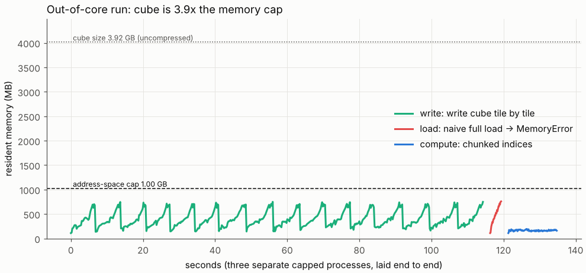
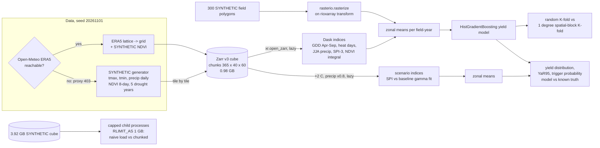
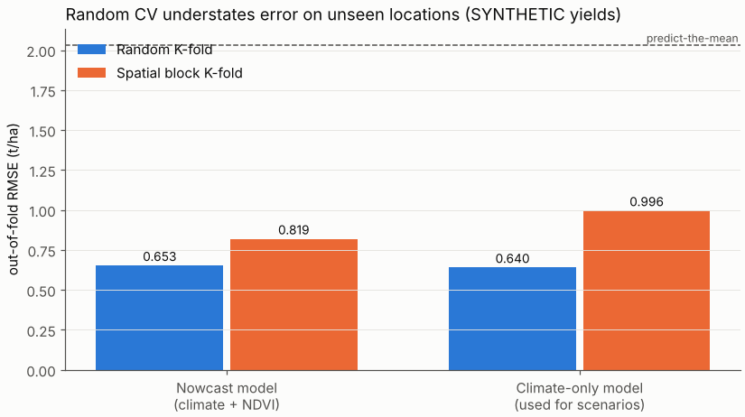
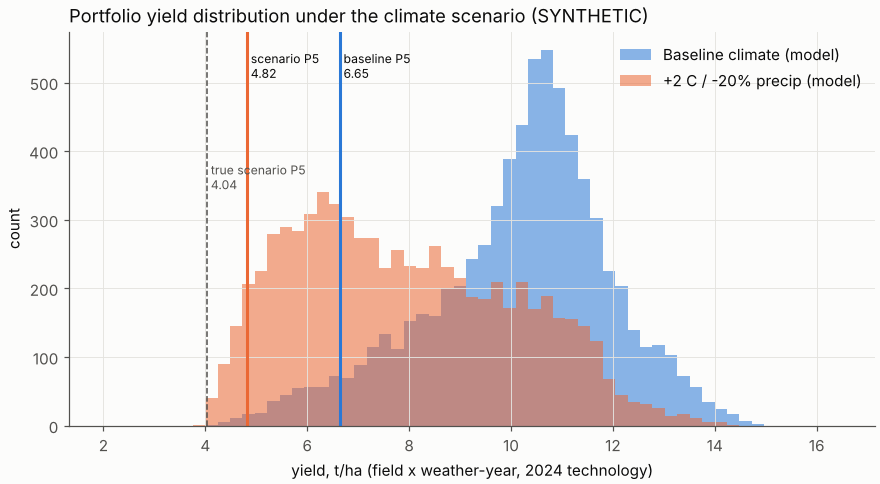
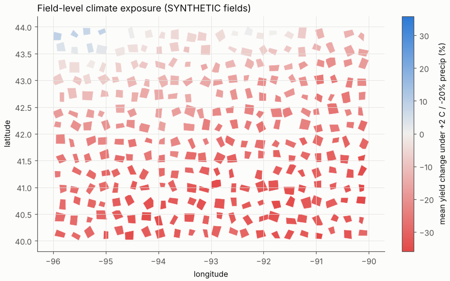
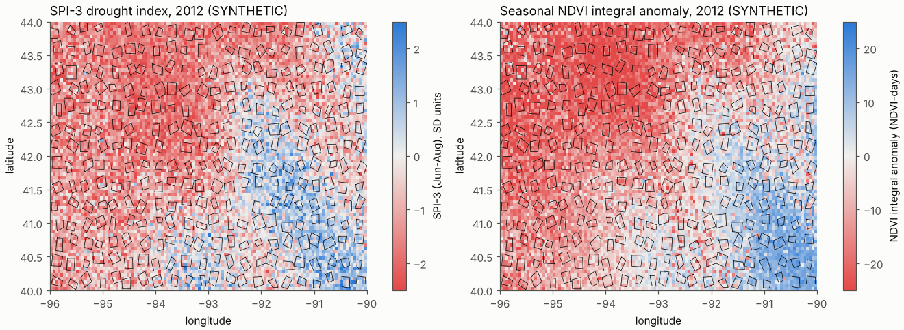

# Day 22: Crop Yield and Climate Risk with xarray + Dask

**Tier III - Principal** | **Domain:** Agriculture & climate | **Tools:** xarray, Dask (local threaded scheduler), Zarr v3, rioxarray + rasterio (raster-vector zonal statistics), shapely, scikit-learn, SciPy, matplotlib | **Data:** SYNTHETIC daily climate + 8-day NDVI cube (80 x 120 cells x 8,766 days, 2001-2024), 300 SYNTHETIC field polygons and yields. The public ERA5 source was unreachable, see provenance.

## Executive summary

This project gives an agricultural lender a yield expectation and a drought-risk figure for each field, computed from daily climate grids and satellite-style vegetation data. If the climate is 2 °C warmer with 20% less rain, the portfolio's mean yield falls **22.1%** (10.15 to 7.90 t/ha), and the share of field-years more than 20% below their normal yield rises from **11.3% to 58.3%**. Because the data is synthetic, the true answer is known: -23.8%, and a bad-year (5th percentile) yield of 4.04 t/ha where the model says 4.82. So the model understates the worst years. A naive random cross-validation would also understate how wrong the model is on new locations: spatially blocked validation shows **55.5%** higher error (RMSE 0.996 vs 0.640 t/ha).



Full outputs: [`results/metrics.json`](results/metrics.json), [`results/report.md`](results/report.md), [`results/performance.md`](results/performance.md), [`results/field_risk.csv`](results/field_risk.csv) (per-field scenario yield and yield-at-risk), [`results/drought_exposure_map.html`](results/drought_exposure_map.html) (interactive map: hover a field) and [`results/figures/`](results/figures/).

## Architecture



## Data provenance

- **Path used: `synthetic_generator`.** This is recorded in `results/metrics.json → data.path_used`. `make run` first probes the Open-Meteo archive API for ERA5 daily data (`public_attempted: true`). The build environment's proxy refused it (`Tunnel connection failed: 403 Forbidden`), so the run fell back to the seeded generator automatically.
  - If the API is reachable, [`public.py`](src/agriclimate/public.py) fetches tmax, tmin and precipitation on a 5 x 7 lattice and interpolates them onto the grid. NDVI is then derived from that climate, and fields and yields stay synthetic.
  - Only the response parser and the interpolation are tested, on a fixture. The public path has never run against the live API.
- **Generator** ([`generate.py`](src/agriclimate/generate.py), seed 20261101). All of this is **SYNTHETIC**: a 4° x 6° box (40-44°N, 96-90°W) shaped like the US Corn Belt, on a 0.05° grid of 80 x 120 cells, daily from 2001 to 2024.
  - **Temperature:** a seasonal cycle plus spatially coherent weather. Daily anomalies are AR(1) coefficients on 16 random Fourier basis functions, plus a summer anomaly for each year.
  - **Precipitation:** a latent-Gaussian wet/dry occurrence with gamma-distributed amounts.
  - **NDVI:** 8-day composites with MODIS-style timing. Values come from a double-logistic phenology scaled by soil productivity and damaged by trailing 60-day water deficit and 30-day heat. About 3% of values are cloud gaps (NaN).
  - **Droughts:** five drought years (2003, 2006, 2012, 2017, 2023), each with a seeded Gaussian footprint that adds heat and removes up to 65% of summer rain.
  - **Climatology produced:** mean April-September GDD of about 1,617 and annual precipitation of about 867 mm (measured on the out-of-core cube, `performance.out_of_core.compute`).
- **Fields and yields** ([`zonal.py`](src/agriclimate/zonal.py), [`model.py`](src/agriclimate/model.py)). There are 300 non-overlapping, rotated, jittered quadrilaterals covering a median of 8 grid cells each (minimum 3).
  - Yield (t/ha) = 12 x soil x f(GDD) x f(heat days) x f(SPI-3) + a 0.08 t/ha per year trend + a smooth, year-specific spatial residual (SD 0.55; stands in for pests, hail and management) + noise (SD 0.35).
  - The soil index and the residual are hidden from the model. Because they are spatially smooth, random CV can borrow from neighbouring fields, which is exactly the leak that spatial CV removes.
- **Scale:** the main cube is 0.98 GB uncompressed and 689 MB in Zarr (git-ignored). The out-of-core cube is 160 x 240 x 8,766, 3.92 GB uncompressed and 2.68 GB on disk; it is deleted after the run.
- **Committed sample** in [`data/sample/`](data/sample/), about 0.9 MB in total:
  - `fields.geojson`
  - `field_year_yields_SYNTHETIC.csv`: the zonal features and yields for all 7,200 field-years
  - `cube_sample_2012_SYNTHETIC.nc`: an 8 x 8-cell cut of the cube for 2012. A test regenerates it byte for byte from the generator.

## Method

1. **Zarr cube.**
   - The cube is written one spatial tile (all 24 years) at a time into a pre-created Zarr v3 store using `to_zarr(region=...)`, so it is never held in memory at once.
   - Storage chunks are 365 days x 40 x 60 cells, or 3.34 MB per chunk and 100 chunks per variable. That is large enough to keep the graph small and small enough for 4 threads to hold several chunks each.
   - NDVI is stored in one time chunk per tile (10.1 MB), because it is small.
2. **Indices with Dask** ([`indices.py`](src/agriclimate/indices.py)). All indices are lazy xarray operations on the Zarr-backed arrays, run with Dask's local threaded scheduler only (no distributed cluster, no worker processes).
   - **GDD:** modified growing degree days (base 10 °C, tmax capped at 30 °C), summed April-September.
   - **Heat days:** days with tmax above 32 °C in June-August.
   - **JJA precipitation:** the June-August total.
   - **SPI-3 (August):** a gamma distribution is fitted per pixel across the 24 years (Thom MLE with a zero-probability term) via `apply_ufunc(dask="parallelized")`, then transformed to a standard normal.
   - **NDVI:** the seasonal integral (mean May-September NDVI x 153 days) and the seasonal peak.
   - **Seasonal sums as a contraction.** Seasonal sums are computed with a (time x year) indicator matrix, `xr.dot`, rather than `resample().sum()`. The numbers are identical, but on the 3.92 GB cube the contraction peaked at **77 MB** of extra memory against **623 MB** for resample (see Performance).
3. **Zonal statistics.** Field polygons are burned onto the cube grid with `rasterio.features.rasterize`, using the affine transform from `rioxarray`, with the cell-centre rule. Fields that hit no cell centre fall back to their centroid cell; 0 fields needed this. Per-field means come from an xarray `groupby` on the label raster. A test checks them against `rioxarray.clip` and against a manual mask.
4. **Yield models and validation.** Two `HistGradientBoostingRegressor` models are trained on 7,200 field-years:
   - a **nowcast** model: climate + NDVI + lat/lon + year
   - a **climate-only** model: needed for scenarios, because NDVI is not observable under a hypothetical climate

   Each is scored with 5-fold **random** CV and with 5-fold **spatial-block** CV (GroupKFold over 1° x 1° blocks, 24 blocks).
5. **Climate scenario.** The cube is perturbed lazily (+2 °C on tmax and tmin, precipitation x 0.8) and every index is recomputed. SPI is scored against the *baseline* gamma fit, so drier means lower SPI.
   - The climate-only model, fitted on all data, predicts every field under each of the 24 historical weather-years at 2024 technology, giving 7,200 baseline and 7,200 scenario yields.
   - **Yield-at-risk:** YaR95 = mean - 5th percentile. CVaR95 is the mean of the worst 5%.
   - **Loss trigger:** P(yield < 80% of the field's baseline mean).
   - Because the data is synthetic, the **true** scenario yields come from the generating function, which checks the model's extrapolation.
6. **Performance and out-of-core.**
   - GDD is timed under three Dask chunkings, each in a fresh process.
   - Each out-of-core stage (write, naive load, chunked compute) runs in a separate child process whose address space is hard-capped at 1.00 GB with `RLIMIT_AS`, so the kernel enforces the memory limit rather than the code claiming it.

## Results

All numbers come from `results/metrics.json` produced by `make run` (Python 3.11, 4 threads, total 242 s).

### Yield model: random vs spatial cross-validation (SYNTHETIC yields)

| Model | CV scheme | RMSE (t/ha) | MAE (t/ha) | R² |
|---|---|---|---|---|
| Nowcast (climate + NDVI) | random 5-fold | 0.653 | 0.520 | 0.897 |
| Nowcast (climate + NDVI) | **spatial block 5-fold** | **0.819** | 0.644 | 0.838 |
| Climate-only | random 5-fold | 0.640 | 0.509 | 0.901 |
| Climate-only | **spatial block 5-fold** | **0.996** | 0.763 | 0.760 |
| Predict the mean | - | 2.034 | - | 0 |

- **Random CV is optimistic.** It understates out-of-area error by 25.5% for the nowcast model and 55.5% for the climate-only model.
- **NDVI matters most for new locations.** Under random CV, NDVI adds nothing (0.653 vs 0.640). Under spatial CV it cuts error from 0.996 to 0.819, because vegetation vigour carries the soil productivity that lat/lon can no longer interpolate.



### Climate-risk scenario: +2 °C, -20% precipitation (7,200 field x weather-years, 2024 technology)

| | Mean yield (t/ha) | P5 (t/ha) | YaR95 (t/ha) | CVaR95 (t/ha) | P(yield < 80% of field baseline) |
|---|---|---|---|---|---|
| Model, baseline | 10.15 | 6.65 | 3.50 | 5.83 | 11.3% |
| **Model, scenario** | **7.90** (-22.1%) | **4.82** | 3.08 | 4.54 | **58.3%** |
| Truth, baseline | 10.09 | 6.62 | 3.48 | 5.79 | 11.9% |
| Truth, scenario | 7.69 (-23.8%) | 4.04 | 3.65 | 3.55 | 59.7% |

- **What drives the change.** Under the scenario, mean GDD rises by 265, heat days rise by 20.8 per season, and SPI-3 falls by 0.7.
- **Most fields are exposed.** 195 of 300 fields lose more than 20% of mean yield.
- **The model gets the mean right but not the tail.** It is within 1.7 pp of the true mean change but understates the tail: P5 is 4.82 vs a true 4.04, and CVaR95 is 4.54 vs 3.55. 20.4% of scenario field-years have GDD above anything in the training data, and gradient-boosted trees cannot extrapolate past it.





### Performance notes (from `results/performance.md`)

**Out-of-core run.** The cube is **3.92 GB** uncompressed (2.68 GB on disk) and each process was capped at **1.00 GB** of address space, so the cube is **3.9x the cap**.

| Stage (separate capped process) | Result | Wall time | Peak RSS |
|---|---|---|---|
| Write cube tile by tile | succeeded | 114 s | 751 MB |
| Naive `ds.load()` | **MemoryError** | - | - |
| Chunked GDD + heat days + JJA precip + SPI + annual precip | **succeeded** | 13.5 s | **193 MB** (4.8% of the cube) |

**Chunk size vs graph size** (annual GDD on the 0.98 GB main cube, fresh process each):

| Dask chunks | Chunk MB | Tasks (raw / optimised) | Wall s | Peak RSS increase MB |
|---|---|---|---|---|
| tiny 73 x 20 x 20 | 0.11 | 36,003 / 4,059 | 26.80 | 34 |
| stored 365 x 40 x 60 | 3.34 | 1,271 / 171 | **1.85** | 32 |
| large 1460 x 80 x 120 | 53.47 | 97 / 20 | 3.30 | 512 |

- **Tiny chunks:** the scheduler overhead dominates, making them 14x slower than the stored chunks.
- **Large chunks:** 16x the memory and still slower, because only 7 chunks cannot keep 4 threads busy.
- **Stored chunks** (a few MB) are the sweet spot here.

**Seasonal-sum implementation** (GDD on the 3.92 GB cube, uncapped):

| Method | Tasks | Peak RSS increase |
|---|---|---|
| `resample(time="YS").sum()` | 5,693 | 623 MB |
| indicator-matrix `xr.dot` | 2,607 | 77 MB |

The two give the same result. The first version of the out-of-core run used resample; it ran out of memory under the 1 GB cap, which is why the contraction is now the default.

The in-memory main pipeline peaked at 976 MB RSS. It holds the 0.98 GB cube's derived features and the models, not the cube itself.

## What this demonstrates

| Skill (from the prompt) | Where |
|---|---|
| **Scientific computing**: labelled N-d arrays, chunked out-of-core computation | xarray cube on Zarr. Lazy Dask indices (GDD, SPI via `apply_ufunc`, NDVI integrals). The kernel-enforced memory-cap demonstration. Chunk, graph and memory measurements, and a memory-saving reformulation of seasonal sums. |
| **Geospatial rasters**: raster-vector zonal statistics | rioxarray CRS and affine transform, `rasterio.features.rasterize`, zonal `groupby`, a `rio.clip` cross-check, the GeoJSON field layer, and the interactive SVG exposure map. |
| **Climate risk**: scenario yield distribution, yield-at-risk | A delta-change scenario on the cube, with SPI scored against the baseline climate. YaR95, CVaR95 and trigger probabilities, validated against the known truth, with the model's tail error reported. |
| Spatio-temporal ML | Gradient-boosted yield models, with spatial-block vs random CV quantifying spatial leakage. |

## Limitations

- **All data is SYNTHETIC.** The ERA5 path is implemented but was blocked by the network proxy (403), so it has never run against the live API. The NDVI, field and yield models are stylised. The yield truth uses the same climate features the model sees, which flatters the model compared with real data.
- **"Larger than available RAM" is shown against a 1 GB per-process cap (`RLIMIT_AS`), not against the 15 GB of the build machine.** A cube larger than the host's RAM would have needed more than 15 GB of disk and far longer than the 20-minute budget. The chunked code path does not depend on the cap: its peak memory is set by chunk size x threads, as the 193 MB peak on a 3.92 GB cube shows.
- **Peak RSS is sampled every 0.1 s** from `/proc/self/status`, so short spikes can be missed. Timings and RSS vary from run to run; the model metrics are deterministic for the seed.
- **The scenario model understates tail risk.** P5 is 4.82 vs a true 4.04 t/ha, because 20.4% of scenario field-years lie beyond the training range of GDD and tree models extrapolate flat. A lender should treat the model's YaR as a lower bound, or use a model with parametric response curves for stress tests.
- **The scenario is a simple delta change.** It applies uniform shifts to all days, does not change variability, and does not adapt management or planting dates. SPI-3 is computed only for the June-August window.
- **Spatial CV uses 1° blocks** (about 85-110 km), with no buffer zones between folds. The generator's hidden residual varies on wavelengths of 0.8-3°, so fields near block edges can still share some residual with the training folds. The spatial-CV error may therefore still be slightly optimistic.
- **Stretch goals.** Gaussian-process downscaling was not attempted. The interactive drought-exposure map is a dependency-free SVG/HTML page, not a tiled web map.
- **No Dask distributed cluster** is used, by design: there is no dashboard, and memory figures come from the process RSS.

## How to run

```bash
cd day-22-agri-climate-xarray-dask
make setup   # pip install -r requirements.txt (Python 3.11+)
make run     # ~4 min on 4 CPU cores; needs ~3.5 GB free disk temporarily (out-of-core cube is deleted afterwards)
make test    # 25 tests, ~30 s
```

Options: `python scripts/run_pipeline.py --offline` skips the public-data probe. `--no-out-of-core` skips the big-cube demonstration. `--keep-big` keeps the 2.7 GB out-of-core Zarr store. `--small` runs a tiny smoke-test configuration.
