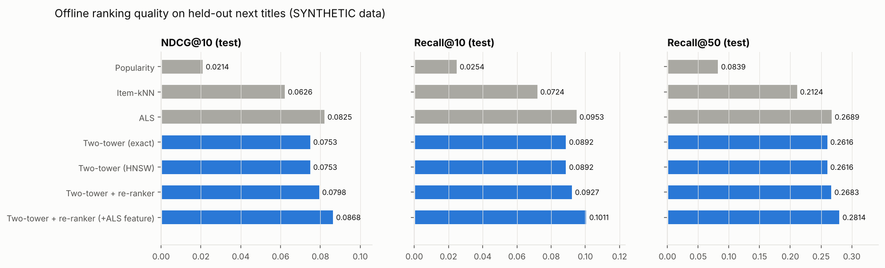
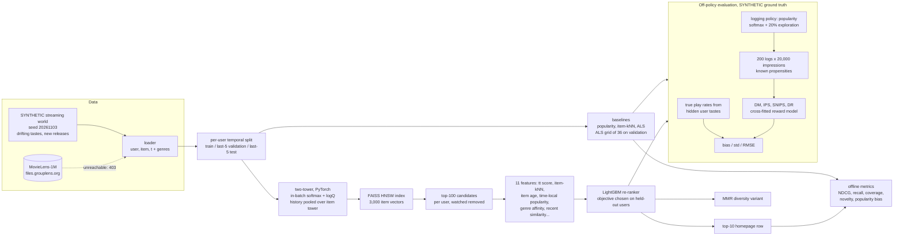
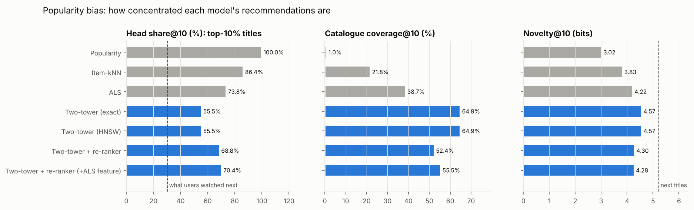
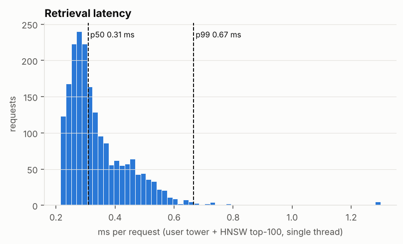
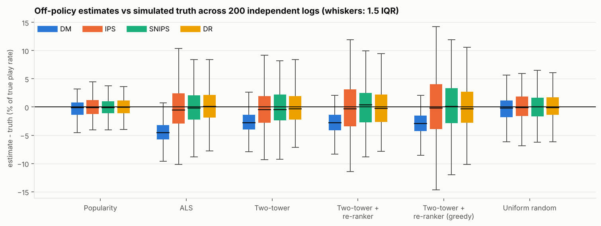
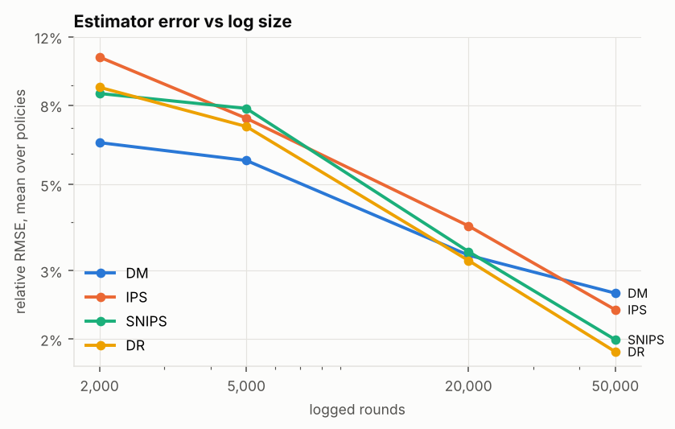

# Day 24: Recommender System with Two-Tower Retrieval and Off-Policy Evaluation

**Tier IV - Distinguished** | **Domain:** Media streaming | **Tools:** PyTorch (two-tower model), FAISS (in-process HNSW index), implicit (ALS, item-kNN), LightGBM (re-ranker, reward model), NumPy, pandas, matplotlib | **Data:** SYNTHETIC streaming world (6,000 viewers, 3,000 titles, 355,554 watch events). MovieLens-1M is tried first and was unreachable from the build network.

## Executive summary

On a simulated catalogue of 3,000 titles, the new two-stage recommender (a two-tower retrieval model served from a FAISS index, then a LightGBM re-ranker) scores **NDCG@10 0.0798**. That is **3.3% below** the tuned ALS baseline (0.0825), so on its own it does **not** clear the bar; once the ALS score is added as one more re-ranker input, it scores **0.0868, 5.2% above ALS** (95% CI +0.0022 to +0.0062 NDCG). Both are 3.7-4x the popularity homepage (0.0214), and the two-tower stage alone covers **64.9%** of the catalogue in top-10 lists against **38.7%** for ALS. For screening policies without A/B slots, doubly robust off-policy evaluation recovers the simulated true play rate of each candidate policy with **3.2%** mean relative error from 20,000 logged impressions (IPS 3.9%), and the reward-model-only estimate is biased by up to **4.5%** of the truth.



Full outputs: [`results/metrics.json`](results/metrics.json) (every number), [`results/report.md`](results/report.md) (every table below, generated by the run) and [`results/figures/`](results/figures/).

## Architecture



## Data provenance

- **Path used: `synthetic_generator`** (`results/metrics.json → data.path_used`). The loader first downloads MovieLens-1M from `files.grouplens.org`. In this build the proxy refused the connection (`URLError: Tunnel connection failed: 403 Forbidden`, recorded in `data.movielens_attempt`), so it fell back to the generator automatically. `RECSYS_DATA=movielens make run` forces the public path. It parses `ratings.dat` (ratings of 4 or more count as positives) and `movies.dat` (18 genres plus the release year), and it is unit-tested on a small fixture. On that path the off-policy part still runs on the synthetic world, because it needs ground truth.
- **Everything reported here is SYNTHETIC.** The generator is [`data.py`](src/recsys24/data.py) (seed 20261103). It is sized like MovieLens-1M: 6,000 users, 3,000 titles and 355,554 watch events, a density of 1.98%.
  - **Titles:** a 16-dimensional taste vector near one of 18 genre centroids, 1-3 genres, a quality / popularity term (sd 0.7) and a release time. About half of the catalogue is released during the observation window.
  - **Viewers:** a taste near one or two genres that rotates by 45 degrees over the viewer's active window, so recent history predicts better than old history. Activity is log-normal (16-300 events, median 43).
  - **Choice model at each event:** 8 x <taste(t), title> + quality + a new-release boost that fades + Gumbel noise. The choice is over titles already released and not yet watched, so each title is watched at most once.
- **Sample:** [`data/sample/`](data/sample/) holds the events of the first 300 users (`interactions_SYNTHETIC_sample.csv`, 294 KB) and the genre table (`items_SYNTHETIC.csv`, 32 KB). `make run` regenerates everything else in about 25 seconds, and nothing else under `data/` is committed.

## Method

1. **Split.** For each user, the last 5 events are the test set, the 5 before are validation, and the rest are training. Every model is selected on validation. Baselines are then refit on train+validation and scored on test, with watched titles removed from every list.
2. **Baselines.** Popularity; item-kNN (cosine, 100 neighbours, from `implicit`); and ALS (`implicit`, Hu-Koren-Volinsky). ALS was tuned over 36 configurations on validation (factors 16-128, regularisation 0.1-5, alpha 1-10), and the winner was 16 factors, regularisation 1.0, alpha 10.
3. **Two-tower retrieval** ([`two_tower.py`](src/recsys24/two_tower.py)).
   - **Item tower:** item-id embedding + genre projection + release-bucket embedding, then a residual MLP, L2-normalised to 64 dimensions.
   - **User tower:** the mean of the item-tower vectors of the last 50 titles and of the last 10, then an MLP. There is no user-id embedding: it memorised users and lowered validation NDCG@10.
   - **Training:** causal next-title prediction (the history is only what came before the target), using in-batch sampled softmax over 1,024 examples. Logits are scaled by temperature 0.1 and corrected by logQ, and in-batch duplicates are masked. Training runs 12 epochs on 277,554 pairs, about 80 s on 4 CPU threads, deterministic.
   - **Serving:** the model is trained once. At test time it is not refit; the user tower simply re-encodes the longer history, as a production system would.
   - **Tuning:** temperature, epochs, weight decay, dropout and history tying were tuned by hand on validation NDCG with a smaller world of 3,000 users from the same generator. The test split was not used.
4. **ANN serving** ([`ann.py`](src/recsys24/ann.py)). Item vectors go into an in-process FAISS `IndexHNSWFlat` (inner product, M=32, efConstruction=200, efSearch=128); no vector-database server is needed. Candidates are the top 100 after removing watched titles. Latency is timed for 2,000 single-user requests, each a user-tower forward pass plus an HNSW top-100 search, on one thread, after 50 warm-up requests.
5. **Re-ranker** ([`rerank.py`](src/recsys24/rerank.py)).
   - **Features (11 per candidate):** two-tower score; overall, recent and time-local popularity (the popularity at the user's own last-watch time); item age; genre affinity to the last 20 titles; item-kNN score over the full history and over the last 10 titles; similarity to the last 5 titles; history length; and the user's taste for popular titles.
   - **Training:** on stage-A candidates, labelled by the validation titles. Binary log-loss and LambdaRank were compared on 20% held-out validation users. Binary won (0.0810 against 0.0808; the two-tower order alone scored 0.0787).
   - **Stacked variant:** a second variant adds the ALS score as a twelfth feature.
   - **MMR:** re-ranks for diversity using item-vector cosine similarity.
6. **Offline metrics** ([`metrics.py`](src/recsys24/metrics.py)):
   - recall@10/50 and NDCG@10;
   - catalogue coverage@10;
   - novelty (mean -log2 share of users who watched the title);
   - popularity bias: head share@10, the share of recommendations from the 10% most-watched titles, and ARP, the mean popularity of recommended titles;
   - intra-list genre diversity.

   The NDCG differences come with a paired bootstrap over users (1,000 resamples).
7. **Off-policy evaluation** ([`ope.py`](src/recsys24/ope.py)). The setting is one homepage hero slot.
   - **Slates:** each user has 30 eligible unwatched titles, drawn with weight popularity^0.5, independently of every model.
   - **Logging policy:** today's popularity homepage, (1-0.2) x softmax(z-scored log popularity / 0.5) + 0.2 / 30. Every propensity is known and at least 0.0067.
   - **Reward:** a play, drawn from sigmoid(-3 + 0.8 x true current affinity), which uses the world's hidden end-of-window tastes.
   - **Target policies:** softmax(z-scored model score / 0.3) over the slate for popularity, ALS, two-tower and two-tower + re-ranker; a greedy version of the re-ranker; and uniform random.
   - **Estimators:** DM, IPS, SNIPS and DR. The reward model is a 2-fold cross-fitted LightGBM classifier on 6 features (two-tower, ALS and re-ranker scores, popularity, genre affinity, item-kNN). The estimators are replayed on 200 independent logs of 20,000 impressions, plus 30 logs each at 2,000, 5,000 and 50,000.
   - **Truth:** the exact expected play rate, Σ_a π(a|u) p(u,a), averaged over users.

## Results

All numbers come from `make run` (seeded, deterministic apart from wall-clock latency; total runtime 418 s on 4 CPU cores). Data: **SYNTHETIC**.

### Offline ranking (test: each user's last 5 events)

| Model | NDCG@10 | Recall@10 | Recall@50 | Coverage@10 | Novelty (bits) | Head share@10 | ILD@10 |
|---|---|---|---|---|---|---|---|
| Popularity | 0.0214 | 0.0254 | 0.0839 | 1.0% | 3.02 | 100.0% | 0.770 |
| Item-kNN | 0.0626 | 0.0724 | 0.2124 | 21.8% | 3.83 | 86.4% | 0.635 |
| **ALS** (tuned) | **0.0825** | 0.0953 | 0.2689 | 38.7% | 4.22 | 73.8% | 0.673 |
| Two-tower (exact search) | 0.0753 | 0.0892 | 0.2616 | 64.9% | 4.57 | 55.5% | 0.635 |
| Two-tower (FAISS HNSW) | 0.0753 | 0.0892 | 0.2616 | 64.9% | 4.57 | 55.5% | 0.635 |
| **Two-tower + re-ranker** | **0.0798** | 0.0927 | 0.2683 | 52.4% | 4.30 | 68.8% | 0.644 |
| Two-tower + re-ranker (+ALS feature) | **0.0868** | 0.1011 | 0.2814 | 55.5% | 4.28 | 70.4% | 0.661 |
| *Titles users actually watched next* | | | | | 5.23 | 30.4% | |

- Two-tower + re-ranker minus ALS, NDCG@10: **-0.0027** (95% CI -0.0054 to -0.0002; -3.3%).
- With the ALS feature: **+0.0043** (95% CI +0.0022 to +0.0062; +5.2%).
- The re-ranker adds +0.0045 NDCG@10 (+6.0%) to the two-tower order.
- Over 100 candidates, retrieval recall is 0.3869.



**Popularity bias.** Every model over-recommends the head of the catalogue. In this world 30.4% of the titles users actually watch next are among the 10% most-watched. ALS puts 73.8% of its top-10 slots there and the popularity baseline 100%. The two-tower stage, trained with logQ correction, is the least biased model (55.5% head share, 64.9% coverage, the highest novelty at 4.57 bits). The re-ranker trades some of that back for accuracy, to a 68.8% head share and 52.4% coverage.

### Retrieval serving

| Quantity | Value |
|---|---|
| HNSW recall@100 vs exact search | 0.9969 (identical NDCG@10 and recall to exact search) |
| HNSW index build (3,000 x 64) | 0.32 s |
| **Latency per request, p50 / p95 / p99** (user tower + HNSW top-100, one thread) | **0.309 / 0.538 / 0.666 ms** |
| of which HNSW search p99 / user tower p99 | 0.200 / 0.503 ms |
| p99 with exact (flat) search instead | 0.513 ms |



### Off-policy evaluation against simulated truth (200 logs x 20,000 impressions)

| Target policy | True play rate | DM bias / RMSE | IPS bias / RMSE | SNIPS bias / RMSE | DR bias / RMSE | Closest (RMSE) |
|---|---|---|---|---|---|---|
| Popularity (softmax) | 0.2344 | -0.0005 / 0.0038 | -0.0001 / 0.0041 | -0.0001 / 0.0038 | -0.0001 / **0.0037** | DR |
| ALS | **0.3874** | -0.0176 / 0.0193 | +0.0000 / 0.0171 | +0.0004 / 0.0139 | +0.0007 / **0.0132** | DR |
| Two-tower | 0.3516 | -0.0098 / 0.0124 | -0.0009 / 0.0143 | -0.0005 / 0.0120 | -0.0003 / **0.0117** | DR |
| Two-tower + re-ranker | 0.3521 | -0.0100 / **0.0127** | -0.0001 / 0.0177 | +0.0005 / 0.0145 | -0.0001 / 0.0135 | DM |
| Two-tower + re-ranker (greedy) | 0.3652 | -0.0107 / **0.0135** | -0.0001 / 0.0207 | +0.0005 / 0.0179 | -0.0002 / 0.0162 | DM |
| Uniform random | 0.1376 | -0.0004 / **0.0032** | +0.0000 / 0.0035 | -0.0000 / 0.0034 | +0.0000 / 0.0034 | DM |

For reference, the logging policy's true play rate is 0.1947 and an oracle's is 0.6257.

| Estimator | Mean relative RMSE (20k) | at 2k | at 50k | Kendall tau vs true policy ranking | Logs that pick the true best policy |
|---|---|---|---|---|---|
| DM | 3.29% | **6.40%** | 2.62% | **0.935** | **100%** |
| IPS | 3.91% | 10.64% | 2.38% | 0.895 | 88% |
| SNIPS | 3.36% | 8.57% | 1.99% | 0.895 | 91% |
| **DR** | **3.18%** | 8.89% | **1.85%** | 0.909 | 93% |





**What OPE says about the business question.** Every learned policy raises the true play rate by 81-99% over the popularity homepage that is live today (0.1947). ALS is the best homepage policy in this world (0.3874 against 0.3521 for the re-ranker softmax policy), which agrees with the offline NDCG ranking. All four estimators get the ordering mostly right, so OPE would have screened out the weaker candidates without spending an A/B slot.

### MMR diversity re-ranking (stretch goal)

| λ | NDCG@10 | ILD@10 | Coverage@10 | Head share@10 |
|---|---|---|---|---|
| 1.0 (no diversification) | 0.0798 | 0.644 | 52.4% | 68.8% |
| 0.8 | 0.0796 | 0.666 | 52.4% | 68.3% |
| 0.6 | 0.0788 | 0.705 | 52.3% | 66.8% |
| 0.4 | 0.0707 | 0.779 | 59.1% | 61.4% |

λ = 0.6 buys 9.5% more genre diversity for 1.3% of NDCG. Below that the accuracy cost grows quickly.

## Acceptance criteria

| Criterion | Status |
|---|---|
| Two-tower + re-ranker beats ALS on NDCG@10 | **Not met as specified.** The clean pipeline scores 0.0798 against 0.0825, and the paired-bootstrap CI excludes zero. Adding the ALS score as a re-ranker feature gives 0.0868, +5.2% with a CI that excludes zero. See Limitations. |
| DR estimate closest to the simulated truth (or explain) | **Met on average, not for every policy.** DR has the lowest mean relative RMSE at 20,000 impressions (3.18%) and at 50,000 (1.85%), and it is closest for 3 of 6 policies. DM wins for the 3 policies where its bias is small next to the IPS variance, and at small sample sizes. Explained below. |
| Retrieval latency p99 reported | **Met.** 0.666 ms per request (user tower + HNSW top-100, one thread). |
| `make test` passes from a clean checkout | **Met.** 16 tests, about 15 s. |
| `make run` reproduces every number and figure | **Met.** Seeded and deterministic (two full runs gave identical metrics except wall-clock latency). |

**Why DR is not always closest.**
- DR = DM + an importance-weighted correction of the reward model's residuals. It removes DM's bias, which for ALS is -0.0176, or 4.5% of the truth, but it keeps part of the IPS variance.
- When the reward model is already nearly unbiased for a policy (uniform random), or when the target policy is far from the logging policy, the variance term dominates and DM's lower variance wins on RMSE. For the greedy re-ranker the effective sample size is only 591 of 20,000.
- With more data the variance shrinks while DM's bias does not, so DR moves ahead: 50,000 impressions give DR 1.85% against DM 2.62%.
- DM's perfect best-policy pick rate comes from its bias being similar across the close re-ranker policies, not from accuracy. Its RMSE for ALS is the worst of the four estimators.

## What this demonstrates

- **Recommender systems.**
  - A two-stage architecture: ANN retrieval, then feature-based re-ranking.
  - Implicit-feedback baselines (popularity, item-kNN, ALS) tuned fairly on validation.
  - Leakage-safe temporal evaluation with watched-title filtering.
  - Beyond-accuracy metrics: coverage, novelty, popularity bias and diversity, with an MMR trade-off curve.
  - Production details: an in-process FAISS HNSW index with measured recall and p99 latency, and a history-based user tower that serves new events without retraining.
- **Deep learning.** A PyTorch two-tower model:
  - in-batch sampled softmax with logQ sampling-bias correction and duplicate masking;
  - causal next-item training;
  - an item tower shared with the history encoder;
  - regularisation chosen on validation;
  - deterministic CPU training.
- **Counterfactual evaluation.**
  - A logging policy with known propensities.
  - DM, IPS, SNIPS and DR with a cross-fitted reward model.
  - Bias, variance and RMSE against exact simulated truth over 200 replicate logs.
  - Sample-size curves, effective sample size, and whether each estimator ranks policies correctly.

## Limitations

- **The headline criterion is not met in its clean form.** The two-tower + re-ranker trails ALS by 3.3% NDCG@10.
  - **Why ALS is strong here:** the world's choice model is a low-rank (16-d) dot product plus an item bias, which is exactly ALS's model class. ALS with 16 factors is close to the true model.
  - **What was tried:**
    - stronger weight decay (the largest gain);
    - tying the history encoder to the item tower;
    - dropping the user-id embedding;
    - temperature 0.05-0.2;
    - 4-16 epochs;
    - larger batches;
    - dropping logQ correction (much worse);
    - a stronger taste drift;
    - 3 extra recency and time-local features;
    - LambdaRank vs binary objectives;
    - smaller, more regularised LightGBM models (larger ones overfit the 5 labels per user and fell below the two-tower order).
  - **Not refit:** the two-tower is not refit on validation events, while ALS is. This is the production-realistic choice and it keeps re-ranker features calibrated, but it slightly favours ALS.
  - **Refit checked in a follow-up (`scripts/refit_check.py`, `results/refit_check.json`):** retraining the two-tower on train+val, as ALS is, lifts the two-tower alone from 0.0753 to 0.0768 NDCG@10, still below ALS at 0.0825. The re-ranker gets worse with the refit tower (0.0798 to 0.0768), because its tt_score feature was learned on the train-only tower's scale. So refitting does not close the gap, and the main pipeline keeps the train-only tower.
  - **What does clear the bar:** only the stacked re-ranker that also uses the ALS score. That is a legitimate production design (rankers usually consume several retrieval scores), but it is not the comparison the prompt asked for.
- **Synthetic data only.** MovieLens-1M was blocked by the build network's proxy (HTTP 403). The public path is implemented and unit-tested but was not exercised, so no real-data number is reported. The world parameters were chosen to make personalisation matter: with weaker tastes, popularity and item-kNN beat every factor model. Results would differ on real logs.
- **Hand-tuned on a smaller world.** The two-tower hyperparameters were tuned by hand on validation NDCG in a smaller world (3,000 users) built by the same generator. The test split was never used, but the generator is shared.
- **Leave-last-out split.** The per-user split leaves a global-time overlap: one user's test events can come before another user's training events. Popularity features may therefore contain a little future information for some users, which helps every model, the popularity baseline included.
- **Latency is for a small catalogue.** It is measured on a 3,000-title catalogue on a shared 4-core VM. At this size exact search is as fast as HNSW (p99 0.513 ms vs 0.666 ms). HNSW pays off at 10^5-10^7 items, which were not tested. The user tower dominates request time.
- **The OPE setting is simple.** It is a single slot with a fixed eligible slate. Slate or position effects, delayed rewards and non-stationarity are not modelled, and the reward model's features overlap with the target policies' scores, which helps DM. Sweep points other than 20,000 impressions use only 30 replicate logs.
- **Stretch goals.** MMR was done. Content-based cold-start, where the item tower already takes genre and release features, was not evaluated.
- **Substitutions.** None. PyTorch, FAISS (`faiss-cpu`) and implicit installed as planned. torch comes from the CPU wheel index; if that index is unreachable, pip falls back to the larger PyPI wheel.

## How to run

```bash
cd day-24-streaming-recsys-off-policy-eval
make setup   # pip install -r requirements.txt (Python 3.11+, CPU-only torch index; no vector DB or Docker)
make test    # 16 pytest tests, ~15 s
make run     # data -> baselines -> two-tower + FAISS -> re-ranker -> metrics -> OPE -> results/ (about 7 min on 4 cores)
make data    # optional: tiny smoke run into data/smoke_results/
RECSYS_DATA=movielens make run   # force the public MovieLens-1M path (fails loudly if unreachable)
```

## Layout

```
src/recsys24/   data.py (generator + MovieLens loader + split), baselines.py, two_tower.py, ann.py,
                rerank.py (features, LightGBM, MMR), metrics.py, ope.py, pipeline.py, figures.py, report.py
scripts/        run_pipeline.py
tests/          16 tests: generator, split, MovieLens parser, metrics, baselines, two-tower + FAISS, re-ranker/MMR, OPE, end-to-end
data/sample/    SYNTHETIC sample (first 300 users) + genre table
results/        metrics.json, report.md, figures/
```
