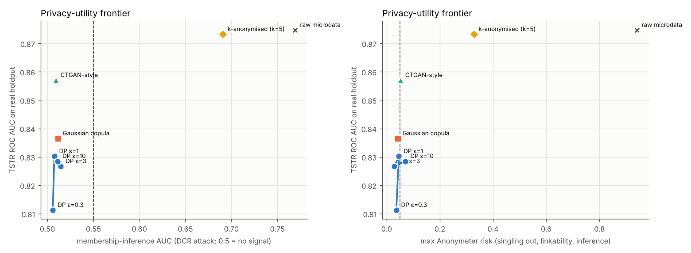
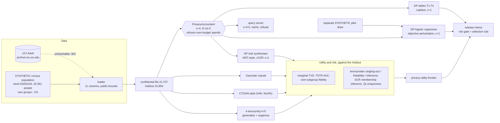
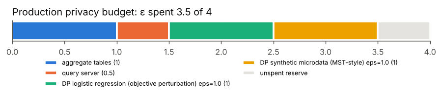
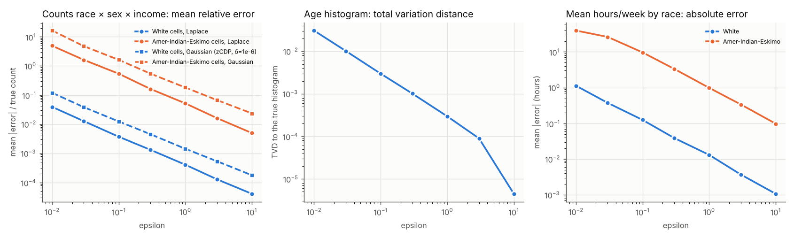
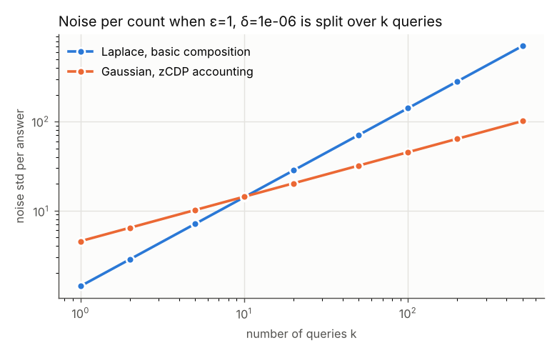
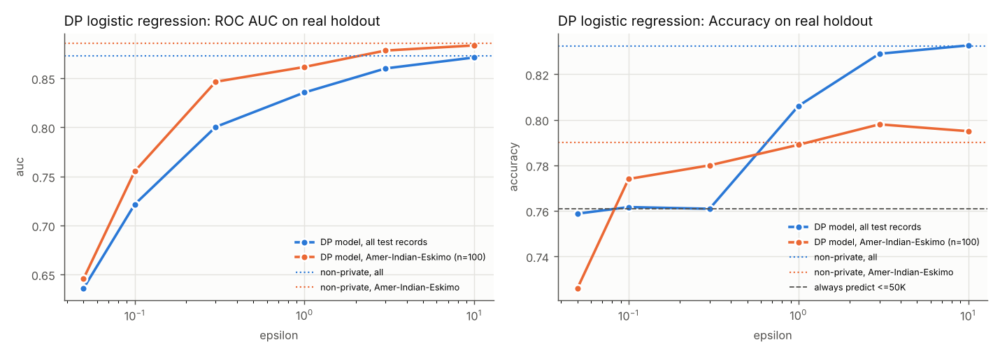
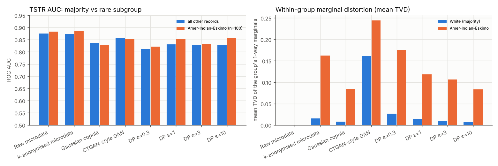

# Day 25: Privacy-Preserving Analytics: Differential Privacy and Synthetic Data

**Tier IV - Distinguished** | **Domain:** Census & health statistics | **Tools:** diffprivlib (Laplace and analytic-Gaussian mechanisms; its DP logistic regression is run as a cross-check), Anonymeter (singling-out, linkability and inference attacks), scikit-learn, pandas, SciPy, NumPy, matplotlib | **Data:** SYNTHETIC census-like population (32,561 people, the size of UCI Adult). UCI Adult is tried first; it was unreachable from the build network.

## Executive summary

A statistics office can publish this census file's key tables, a researcher microdata file and a prediction model while spending a provable privacy budget of **ε = 3.5 of a 4.0 allowance**. Every request beyond that allowance is refused. The recommended differentially private (DP) synthetic file trains income models with **AUC 0.830**, against 0.875 on the real records. In attack tests it leaks no more than a fresh sample from the same population: membership-inference AUC is **0.508**, where 0.5 is chance, and the 95% confidence interval of every Anonymeter risk reaches below 5%. The classic alternative, k-anonymised microdata, keeps more utility (AUC 0.873) but fails: an attacker who knows the other fields can infer a person's exact capital gain, with an Anonymeter risk of **0.33**, and membership inference reaches AUC **0.69**. The price of privacy falls on small groups. A 1%-of-population group (Amer-Indian-Eskimo) gets about **125 times** the relative error of the majority in every DP count table, and the DP synthesiser roughly doubles its high-income rate (**26.4% vs 14.2%**).



Full outputs: [`results/metrics.json`](results/metrics.json) (every number), [`results/report.md`](results/report.md) (every table, generated by the run), [`results/release_memo.md`](results/release_memo.md) (the release recommendation, generated by the run) and [`results/figures/`](results/figures/).

## Architecture



## Data provenance

- **Path used: `synthetic_generator`** (`results/metrics.json → data.path_used`). The loader first downloads `adult.data` from `archive.ics.uci.edu`. In this build the proxy refused the connection (`URLError: Tunnel connection failed: 403 Forbidden`, recorded in `data.attempts`), so the loader fell back to the generator automatically. `PRIVACY_DATA=uci make run` forces the public path. The UCI parser maps 41 countries to 5 regions, drops rows with missing values and is unit-tested on a fixture.
- **Everything reported here is SYNTHETIC.** The generator is [`data.py`](src/privacy25/data.py) (seed 20261104). It has the Adult schema minus `fnlwgt`, `relationship`, `education_num` and `capital_loss`: age, workclass, education (16 levels), marital status, occupation (14), race (5), sex, capital gain, hours per week, native region and income (>50K).
  - **Dependencies:** region depends on race; education on race, region and age; marital status on age and sex; occupation on education and sex; workclass on occupation; hours on sex, occupation and age, with a 46% spike at exactly 40. Income comes from a logistic model (24.0% positive), and capital gain is zero-inflated, log-normal and top-coded at 99,999.
  - **Rare subgroups:** Amer-Indian-Eskimo (1.0%), race Other (0.9%), Married-AF-spouse (0.1%), Armed-Forces (0.04%) and Preschool education (0.2%).
  - **Analysis subgroup:** the rare-subgroup analysis follows Amer-Indian-Eskimo: 225 people in the confidential file and 100 in the holdout. That group also has a lower income rate (14.2% vs 24.0%).
- **Public knowledge vs private data.** Clipping bounds (age 17-90, hours 1-99, gain 0-99,999), histogram bins and category lists are fixed in code from the questionnaire design, never read from the records. DP needs this: data-derived bounds would leak.
- **Pilot data.** The DP model's regulariser is chosen on a separate generator draw (seed + 1), so tuning spends no budget. On the UCI path this pilot would still be synthetic.
- **Sample:** [`data/sample/census_SYNTHETIC_sample.csv`](data/sample/) holds the first 3,000 rows (265 KB). Nothing else under `data/` is committed. The generator makes the full file in 0.1 s.

## Method

1. **Budget accounting** ([`accounting.py`](src/privacy25/accounting.py)).
   - **Production budget:** `PrivacyAccountant` holds the file's budget (ε = 4, δ = 1e-5) under basic sequential composition. A spend is checked before any noise is drawn: if it would push the total over, `BudgetExceededError` is raised and nothing is recorded.
   - **Sub-budgets:** each component (tables, query server) receives a nested sub-budget that is charged to the parent up front.
   - **zCDP:** `ZCDPAccountant` tracks ρ. It converts ρ to (ε, δ) with the tight bound of Canonne, Kamath and Steinke (2020), min over α of ρα + (log(1/δ) + (α-1)log(1-1/α) - log α)/(α-1).
2. **DP aggregate tables** ([`release.py`](src/privacy25/release.py)). Neighbouring datasets differ by adding or removing one person. The four tables, ε = 1 in total:
   - **T1:** race × sex × income counts, ε = 0.4.
   - **T2:** age histogram, 13 public bins, ε = 0.2.
   - **T3:** mean hours by race, ε = 0.2. This is a clipped sum (sensitivity 99, with parallel composition over races) divided by the T1 counts; the division is post-processing.
   - **T4:** education × income counts, ε = 0.2.

   Every cell of the full public domain is released, zeros included, rounded and clipped at 0. The noise comes from diffprivlib's `Laplace` mechanism. The accuracy-vs-ε curves redraw the same noise law 300 times per ε with vectorised NumPy, and a test checks that the scale matches diffprivlib's variance.
3. **zCDP comparison (stretch goal).** For a budget of ε = 1, δ = 1e-6 split over k count queries, the run compares two options: Laplace noise with basic composition, std √2·k/ε, and Gaussian noise with zCDP accounting, std √(k/2ρ).
4. **Query server (stretch goal)** ([`query_server.py`](src/privacy25/query_server.py)). It answers `COUNT` and clipped `MEAN` queries. Filters must use public category levels. Every new answer is charged to a sub-budget of ε = 0.5 before computation. Repeats are served from a cache at no cost, which also blocks averaging attacks. Once the budget is gone, queries are refused. A scripted analyst session of 20 queries is replayed.
5. **DP model** ([`dp_model.py`](src/privacy25/dp_model.py)).
   - **Algorithm:** L2-regularised logistic regression by objective perturbation (Chaudhuri, Monteleoni and Sarwate 2011, Algorithm 2). It runs on 59 features: one-hot categoricals plus numerics scaled to [0, 1] by their public bounds. Every row then has a public L2 bound, √10, so no data-dependent norm is needed.
   - **Tuning:** λ is chosen per ε on the pilot data.
   - **Runs:** 10 noise seeds per ε, against a non-private `LogisticRegression`.
   - **Membership check:** a loss-threshold membership attack (Yeom et al.) on 3,000 members against 3,000 non-members.
   - **diffprivlib cross-check:** diffprivlib's own `LogisticRegression` is run on the same data. See Limitations for why it is not the main model.
6. **Synthesisers** ([`synth/`](src/privacy25/synth/)). Each one produces 21,707 rows.
   - **Gaussian copula** (not DP): SDV-style. Numerics use the empirical CDF with random tie-breaking, categoricals use frequency intervals, and a full correlation matrix links them.
   - **CTGAN-style GAN** (not DP, NumPy). It follows the CTGAN paper's main pieces:
     - variational-GMM mode-specific normalisation;
     - a conditional vector with training-by-sampling, plus a generator cross-entropy term;
     - Gumbel-softmax (τ = 0.2) and PacGAN (pac = 10).

     It differs from the reference: a BCE loss instead of WGAN-GP, plain 256-256 MLPs, and no dropout in the discriminator (no dropout gave lower marginal error than CTGAN's 0.5 in a 60-epoch pilot). It trains for 150 epochs, Adam lr 2e-4, about 350 s.
   - **DP tree synthesiser** (MST-style, (ε, 1e-6)-DP), all accounted in zCDP:
     - a third of ρ measures all eleven 1-way marginals with Gaussian noise (L2 sensitivity √11);
     - a third picks a maximum spanning tree of attribute pairs with the exponential mechanism over 10 rounds, scoring each pair by the L1 gap between its true 2-way marginal and the product of the noisy 1-way marginals;
     - a third measures the 10 chosen 2-way marginals.

     Sampling is ancestral along the tree. It is run at ε = 0.3, 1, 3 and 10.
7. **Statistical disclosure control baseline** ([`sdc.py`](src/privacy25/sdc.py)). The quasi-identifiers (QIs) are age, sex, race, region, marital status and education. k-anonymity (k = 5) is reached by generalisation (age in 10-year bands, non-US regions merged) followed by suppression of records in classes smaller than 5.
8. **Utility** ([`evaluate.py`](src/privacy25/evaluate.py)).
   - **Marginal fidelity:** the total variation distance (TVD) of all 11 one-way and 55 two-way marginals on the public bins.
   - **TSTR:** train on the release and test on the real holdout, with a HistGradientBoosting classifier for income. AUC and accuracy are reported for everyone and for the rare subgroup.
   - **Rare-subgroup fidelity:** the group's share and income rate in the release, and the mean TVD of its within-group marginals against the majority group's.
9. **Disclosure risk** ([`evaluate.py`](src/privacy25/evaluate.py)).
   - **Anonymeter** (Giomi et al. 2023), on 10,000 confidential rows with 5,000 holdout rows as control:
     - singling-out, multivariate with 4-column predicates and 500 attacks requested;
     - linkability, between QIs and job/income columns, 500 attacks;
     - inference of exact capital gain from the other non-income columns, 2,000 attacks.

     Each risk is reported as (attack success - control success) / (1 - control success) with a 95% CI.
   - **Membership inference:** a distance-to-closest-record attack with Gower distance, on 2,000 members against 2,000 non-members.
   - **QI uniqueness:** the share of released rows that match a QI combination unique in the confidential file, compared with the same share for fresh holdout rows.
10. **Release memo** ([`report.py`](src/privacy25/report.py)).
    - **Risk gate:** no Anonymeter risk may be significantly above 0.05 (95% CI lower bound ≤ 0.05), and membership AUC must be ≤ 0.55.
    - **Selection rule:** among DP files that pass, take the smallest ε whose TSTR AUC is within 0.005 of the best DP file.
    - **Reference row:** the raw confidential file is evaluated too, as the no-protection reference.

## Results

All numbers come from `make run` (seeded and deterministic apart from wall-clock timings; 500 s on 4 CPU cores in a fresh Python 3.11 venv, 353 s of it CTGAN training). Data: **SYNTHETIC**.

### Privacy budget (acceptance: never exceeds the configured total)



| Spend | ε | δ |
|---|---|---|
| aggregate tables (T1-T4) | 1 | 0 |
| query server | 0.5 | 0 |
| DP logistic regression (objective perturbation) | 1 | 0 |
| DP synthetic microdata (MST-style) | 1 | 1e-06 |
| **Total spent / budget** | **3.5 / 4** | 1e-06 / 1e-05 |

At the end of the run, a request for the remaining ε + 0.25 was **refused** (`budget.over_budget_request_refused = true`). The DP synthesiser's internal zCDP ledger spent ρ = 0.02436, which converts back to exactly ε = 1.0 at δ = 1e-6.

### DP aggregate tables

| Table | ε | Cells | Mean abs error | Max abs error | Median relative error |
|---|---|---|---|---|---|
| T1 race × sex × income | 0.4 | 20 | 2.70 | 8 | 1.43% |
| T2 age histogram | 0.2 | 13 | 6.54 | 22 | 0.57% |
| T4 education × income | 0.2 | 32 | 5.97 | 30 | 1.57% |

- **T3, mean hours by race:** off by 0.01 hours for White and **8.02 hours for Amer-Indian-Eskimo**. The released value is 49.70 against a true 41.68: the same sum noise (scale 99/0.2) is divided by 225 people instead of 18,500.
- **T1, rare cells:** the Amer-Indian-Eskimo cells have a mean relative error of **16.6%**, against 4.2% for the other groups. The released counts are 119/21/67/10 against true counts of 123/25/70/7.



| ε | Count rel. error, White cells | Count rel. error, Amer-Indian-Eskimo cells | Age histogram TVD | Mean-hours abs error, White / Amer-Indian-Eskimo |
|---|---|---|---|---|
| 0.01 | 3.94% | 493.6% | 0.0310 | 1.13 / 39.5 |
| 0.1 | 0.373% | 54.3% | 0.0030 | 0.13 / 9.67 |
| 0.3 | 0.132% | 16.2% | 0.0010 | 0.04 / 3.33 |
| 1 | 0.041% | 5.20% | 0.0003 | 0.013 / 0.99 |
| 10 | 0.004% | 0.50% | 0.000004 | 0.001 / 0.10 |

The rare-group cells carry **122-146 times** the relative error of the White cells at every ε (Laplace error is absolute, so it is divided by a count about 125 times smaller). The full 7-point grid is in `results/report.md`.

**zCDP accounting (stretch goal).** For a single query Laplace is better: noise std 1.4 against 4.5. Gaussian noise with zCDP accounting overtakes it at **k = 20 queries** (20.3 against 28.3). At 500 queries its noise is **7x smaller** (101 against 707).



### Query server (stretch goal)

- **Session:** 20 scripted queries at ε = 0.05 each.
  - **10 answered**, for the full ε = 0.5.
  - **6 repeats** served from the cache at ε = 0.
  - **4 refused** once the budget was gone.
- **Large groups:** the count of high-income White people was answered as 4,564.1 against a true 4,564.
- **Rare groups:** the count of high-income Amer-Indian-Eskimo people was answered as 22.9 against a true 32. The full log is in `results/report.md`.

### DP model vs non-private baseline



| Model | ε | AUC | Accuracy | AUC, Amer-Indian-Eskimo (n=100) | Accuracy, Amer-Indian-Eskimo | Membership AUC |
|---|---|---|---|---|---|---|
| Non-private logistic regression | ∞ | **0.8731** | 0.8324 | 0.8858 | 0.7900 | 0.5041 |
| DP objective perturbation (10 seeds) | 0.1 | 0.7215 ± 0.040 | 0.7617 | 0.7551 ± 0.071 | 0.7740 | 0.5002 |
| DP objective perturbation | 0.3 | 0.8005 ± 0.007 | 0.7609 | 0.8465 ± 0.025 | 0.7800 | 0.5040 |
| **DP objective perturbation (released)** | **1** | **0.8356** ± 0.003 | 0.8061 | 0.8616 ± 0.011 | 0.7890 | 0.5036 |
| DP objective perturbation | 3 | 0.8601 ± 0.003 | 0.8290 | 0.8783 ± 0.006 | 0.7980 | 0.5043 |
| DP objective perturbation | 10 | 0.8713 ± 0.001 | 0.8327 | 0.8836 ± 0.004 | 0.7950 | 0.5039 |
| diffprivlib 0.6.5 `LogisticRegression` | 1 / 10 | 0.4724 / 0.4750 | 0.4809 / 0.4883 | | | |
| Always predict <=50K | | 0.5 | 0.7609 | 0.5 | 0.7800 | |

- **ε = 1 cost:** 0.038 AUC and 2.6 points of accuracy.
- **Rare-group accuracy below ε = 1:** at ε ≤ 0.3 the DP model's accuracy is no better than always predicting <=50K, both overall (0.7609) and for the rare group (0.78). Only the AUC still shows ranking skill.
- **Membership inference:** the loss-threshold attack is at chance even for the non-private model (0.504). A 59-parameter linear model on 21,707 rows barely memorises, so the guarantee matters more for richer models.

### Synthetic and SDC microdata: utility (acceptance: utility for each synthesiser)

| Release | Formal DP | 1-way TVD | 2-way TVD (mean / max) | TSTR AUC | TSTR accuracy | TSTR AUC, Amer-Indian-Eskimo |
|---|---|---|---|---|---|---|
| Raw microdata (reference) | no | 0 | 0 / 0 | 0.8747 | 0.8343 | 0.8829 |
| k-anonymised (k=5), 12.7% suppressed | no | 0.0231 | 0.0381 / 0.074 | 0.8732 | 0.8349 | 0.8846 |
| Gaussian copula | no | **0.0046** | 0.0356 / 0.228 | 0.8365 | 0.7771 | 0.8275 |
| CTGAN-style GAN | no | 0.1522 | 0.2418 / 0.520 | **0.8570** | 0.8063 | 0.8526 |
| DP tree ε=0.3 | (0.3, 1e-6) | 0.0291 | 0.0634 / 0.181 | 0.8113 | 0.8146 | 0.8211 |
| **DP tree ε=1** | (1, 1e-6) | 0.0125 | 0.0353 / 0.094 | **0.8302** | 0.8146 | 0.8529 |
| DP tree ε=3 | (3, 1e-6) | 0.0075 | 0.0259 / 0.095 | 0.8267 | 0.8184 | 0.8319 |
| DP tree ε=10 | (10, 1e-6) | 0.0054 | **0.0237** / 0.091 | 0.8285 | 0.8179 | 0.8549 |

### Synthetic and SDC microdata: disclosure risk (acceptance: risk for each synthesiser)

| Release | Singling-out [95% CI] | Linkability [95% CI] | Inference, capital gain [95% CI] | DCR membership AUC | Rows matching a train-unique QI combo (holdout: 9.7%) | Passes gate |
|---|---|---|---|---|---|---|
| Raw microdata (reference) | 0.356 [0.310, 0.403] | 0.427 [0.382, 0.471] | 0.941 [0.912, 0.970] | 0.7694 | 19.4% | reference |
| k-anonymised (k=5) | 0.083 [0.051, 0.114] | 0.038 [0.018, 0.059] | **0.328** [0.212, 0.443] | **0.6906** | 0.0% (holdout in generalised space: 3.3%) | **no** |
| Gaussian copula | 0.042 [0.010, 0.074] | 0.008 [0.000, 0.020] | 0.000 [0.000, 0.067] | 0.5114 | 9.6% | yes |
| CTGAN-style GAN | 0.052 [0.023, 0.080] | 0.000 [0.000, 0.001] | 0.000 [0.000, 0.054] | 0.5090 | 10.9% | yes |
| DP tree ε=0.3 | 0.036 [0.009, 0.063] | 0.004 [0.000, 0.019] | 0.000 [0.000, 0.159] | 0.5058 | 8.1% | yes |
| **DP tree ε=1** | 0.046 [0.017, 0.074] | 0.006 [0.000, 0.019] | 0.000 [0.000, 0.080] | **0.5075** | 9.1% | yes |
| DP tree ε=3 | 0.029 [0.001, 0.057] | 0.002 [0.000, 0.016] | 0.000 [0.000, 0.071] | 0.5145 | 9.2% | yes |
| DP tree ε=10 | 0.071 [0.041, 0.101] | 0.002 [0.000, 0.016] | 0.000 [0.000, 0.126] | 0.5111 | 9.6% | yes |

- **The raw file is highly identifying.** On the six QIs, **19.4%** of people are unique and **38.9%** sit in classes smaller than 5 (6,788 equivalence classes).
- **k-anonymity removes uniqueness but not inference.** Equivalence classes hide who is who but not what the class members have in common, so knowing someone's quasi-identifiers still reveals their exact capital gain (risk 0.33). Because the release keeps real records, members are also found by distance: 64.5% of members have an exact (generalised) copy in the release, against 23.1% of non-members.
- **The synthesisers sit at the chance level of every attack.** Their membership AUCs are 0.506-0.515. Their QI-unique match rates are 8.1-10.9%, close to the 9.7% that fresh holdout people reach by chance.
- **Singling-out is the noisiest measure.** All synthesisers score 0.03-0.07 with overlapping CIs. The ε = 10 file has a CI lower bound of 0.041, just under the gate.

### Rare-subgroup accuracy loss (acceptance: analysed explicitly)



| Release | Group share (real 1.04%) | >50K rate in group (real 14.2%) | Within-group TVD, rare / White | TSTR AUC rare minus other |
|---|---|---|---|---|
| k-anonymised (k=5) | 0.31% | 17.2% | 0.162 / 0.015 | +0.011 |
| Gaussian copula | 1.08% | 19.2% | 0.085 / 0.008 | -0.009 |
| CTGAN-style GAN | **0.26%** | 14.0% | 0.244 / 0.161 | -0.005 |
| DP tree ε=0.3 | 2.05% | 23.0% | 0.176 / 0.027 | +0.010 |
| DP tree ε=1 | 1.43% | **26.4%** | 0.118 / 0.014 | +0.023 |
| DP tree ε=10 | 1.10% | 25.2% | 0.083 / 0.007 | +0.027 |

What happens to the small group:

1. **DP tables.** Laplace error is the same in absolute terms for every cell, so the group's relative error is about 125 times the majority's at any ε. At the released ε = 0.4, its four T1 cells are off by 3-4 people each (16.6% mean relative error). Its mean hours are off by 8 hours.
2. **DP synthesiser.**
   - **Structure:** at every ε the selected tree links race only to native region. Race is therefore independent of income in the synthetic file, and the group inherits the population's income rate (26.4% at ε = 1 against a true 14.2%). This error does not shrink with ε.
   - **Within-group marginals:** at ε ≥ 1 they are 8-12 times more distorted than the majority's (6.5 times at ε = 0.3). At ε = 0.3 the noise in the region marginal doubles the group's share (2.05%).
   - **Mitigation:** a public, pre-registered edge (race-income) or a 3-way marginal would remove the structural error, at the cost of more noise elsewhere.
3. **Non-DP synthesisers and SDC.** CTGAN under-represents the group 4-fold (0.26%). k-anonymity suppresses 74% of the group (58 of 225 people are left), because rare races fall into small equivalence classes.
4. **TSTR on the group's real records** (n = 100) does not drop more than for everyone else: the gaps are -0.009 to +0.027 AUC. The model can still score the group well even when the released marginals are wrong. With 100 test records, these AUCs carry a standard error of a few points.
5. **DP model.** At ε = 1 the group's accuracy is 0.789 against 0.790 non-private (overall: 0.806 against 0.832). Below ε = 0.3 both collapse to the majority-class rate.

### Recommendation (from [`results/release_memo.md`](results/release_memo.md))

1. **Publish T1-T4** (ε = 1). Flag the rare-group cells with their noise scale.
2. **Release the DP tree file at ε = 1** as researcher microdata. It is the smallest ε within 0.005 AUC of the best DP file, and its TSTR AUC is 0.8302.
3. **Keep the CTGAN-style file (AUC 0.8570) and the Gaussian copula inside a secure enclave.** Both pass the empirical gate, but neither has a formal guarantee.
4. **Do not release the k-anonymised file.**
5. **Release the ε = 1 DP model** (AUC 0.8356).

## Acceptance criteria

| Criterion | Status |
|---|---|
| Privacy budget never exceeds the configured total (test) | **Met.** `test_budget_never_exceeds_total_under_random_spends` (50 random budgets x 60 spends), plus tests for an exact budget, sub-budgets, zCDP and the query server. The run spent 3.5 of 4 and refused an over-budget request. |
| Utility and risk reported for each synthesiser | **Met.** Gaussian copula, CTGAN-style GAN, DP tree at 4 ε values and k-anonymity (plus the raw reference). Each has 1-/2-way TVD, TSTR overall and for the rare group, three Anonymeter risks with CIs, DCR membership AUC and QI uniqueness. |
| Rare-subgroup accuracy loss explicitly analysed | **Met.** Covered for DP tables, the DP model, every synthesiser and k-anonymity (section above). |
| `make test` passes from a clean checkout | **Met.** 20 tests, about 20 s, in a fresh Python 3.11 venv from `requirements.txt`. |
| `make run` reproduces every number and figure | **Met.** Seeded. Two consecutive full runs gave identical `metrics.json` apart from timings. |
| Stretch: zCDP accounting | **Done.** `ZCDPAccountant` with the tight conversion. The DP synthesiser is accounted in zCDP, and there is a composition comparison. |
| Stretch: query server with budget enforcement | **Done.** Caching and refusal are shown in the run. |

## What this demonstrates

- **Differential privacy.**
  - Calibrated Laplace and Gaussian mechanisms with public-domain sensitivity reasoning.
  - Sequential and parallel composition, a hard-enforced budget ledger with nested sub-budgets, and zCDP accounting with a tight (ε, δ) conversion.
  - Objective-perturbation logistic regression with data-independent norm bounds and pilot-data tuning.
  - An MST-style synthesiser (Gaussian measurements, exponential-mechanism structure selection) and an interactive query server.
- **Synthetic data.**
  - A Gaussian copula and a CTGAN-style conditional GAN written from the paper, with mode-specific normalisation, training-by-sampling and PacGAN.
  - Evaluation by marginal TVD and train-synthetic-test-real.
- **Statistical disclosure control.**
  - k-anonymity by generalisation and suppression.
  - Anonymeter singling-out, linkability and inference attacks, distance-to-closest-record membership inference and quasi-identifier uniqueness.
  - A privacy-utility frontier, an explicit rare-subgroup analysis and a generated release memo with a stated risk gate.

## Limitations

- **SYNTHETIC data only.** UCI Adult was unreachable (403 from the proxy). The generator has realistic but invented dependencies, so the numbers show the method, not facts about any real population. The UCI path is implemented and tested on a fixture.
- **Library substitutions** (the conventions allow equivalents when a library cannot be installed):
  - **SDV, CTGAN and OpenDP:** SDV and the `ctgan` package need PyTorch. The CPU wheel index (`download.pytorch.org`) was blocked, and the default PyPI wheel pulls several GB of CUDA libraries. The Gaussian copula and the CTGAN-style GAN are therefore written here following SDV's and the CTGAN paper's designs. OpenDP was not needed once diffprivlib was in.
  - **Dependency pins:** Anonymeter 1.1.0 requires numpy < 1.27, so the newest diffprivlib that accepts numpy 1.x (0.6.5) is used. That version imports scikit-learn internals that were removed after 1.6, so scikit-learn is pinned to 1.6.1.
- **diffprivlib's `LogisticRegression` scores at chance level in this environment** (AUC 0.47 at ε = 1 and 10). Reading its source: with scikit-learn 1.6.1, whose `LinearModelLoss` returns the *averaged* loss, it perturbs that averaged loss with a vector whose norm is not divided by n, so the noise is about n = 21,707 times larger than objective perturbation needs. That is still private, but useless. The released model uses a small, tested implementation of the same algorithm with the 1/n scaling, and diffprivlib's result is kept in the table as a cross-check.
- **The CTGAN-style GAN is weaker than the reference CTGAN:**
  - its 1-way marginals are far off (mean TVD 0.152; worst are capital gain at 0.41 and native region at 0.26, and it under-produces the rare race 4-fold);
  - it trains for 150 epochs, not 300, uses BCE instead of WGAN-GP, and has no batch norm;
  - a 60-epoch pilot of four variants (default, no D dropout, lr 1e-3, pac 1) gave marginal TVDs of 0.125-0.280. The pilot ran on the same confidential split, which is acceptable for a non-DP model.

  Its good TSTR AUC (0.857) shows it learned the income relationship despite the marginal errors.
- **The DP synthesiser is a tree, not Private-PGM.** It only models 10 pairwise relationships, which caps TSTR AUC at about 0.83 from ε = 1 upward and causes the rare-group income error above. MST proper (with Private-PGM) or AIM would let 3-way marginals in.
- **The risk gate was revised once after seeing results.**
  - **Before:** the first version compared Anonymeter point estimates with 0.05.
  - **Why it changed:** singling-out risks of all synthesisers sit at 0.03-0.07, with 95% CIs about ±0.03 wide. The pass/fail verdicts flipped between DP files on sampling noise, and Anonymeter's singling-out query generation was not seeded (it is now).
  - **Now:** the gate requires the CI lower bound to be ≤ 0.05, i.e. no risk significantly above 5%. The DP-file choice also prefers the smallest ε within 0.005 AUC of the best DP file, instead of the highest point AUC.
- **Anonymeter limits.**
  - The multivariate singling-out attack generated only about 200 of the 500 requested queries within its attempt limit (Anonymeter warns that this can underestimate risk).
  - The inference attack targets exact capital gain, where 92% of people have 0, so control success is high and the CI wide.
  - All empirical attacks are lower bounds on risk.
- **The sweeps spend budget only in this analysis.** The accuracy curves and the model and synthesiser grids run on the confidential file. In production only the four ledger entries would be run. The ledger, not the sweeps, is what the budget test covers.
- **Rare-group statistics are noisy.** There are 100 Amer-Indian-Eskimo records in the holdout, so their AUC and accuracy differences of under about 0.03 are not significant.

## How to run

```bash
cd day-25-privacy-dp-synthetic-data
make setup     # pip install -r requirements.txt (Python 3.11+, CPU only, no PyTorch)
make test      # 20 tests, ~20 s
make run       # ~8 min: UCI Adult if reachable, else the SYNTHETIC population -> results/
make data      # ~20 s smoke run of the whole pipeline on 3,000 SYNTHETIC people -> data/smoke_results/
PRIVACY_DATA=synthetic make run   # force a path: auto (default) | uci | synthetic
```
