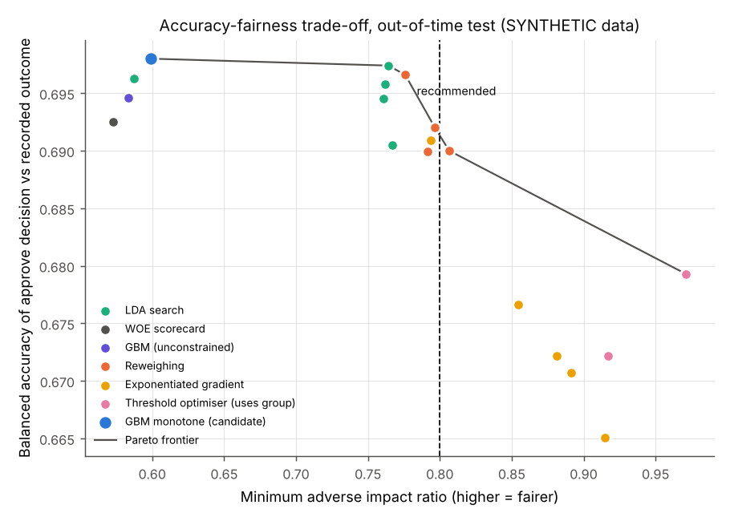
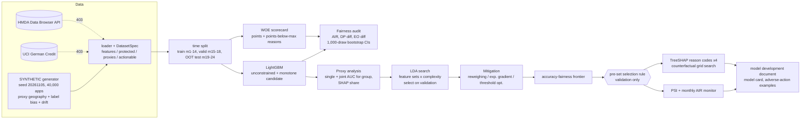
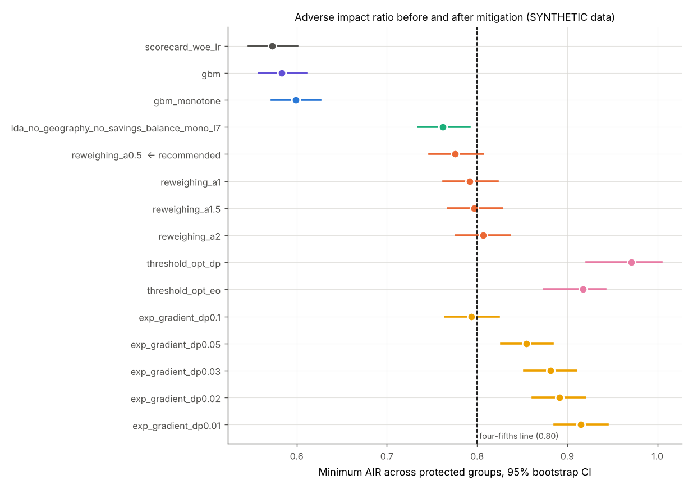
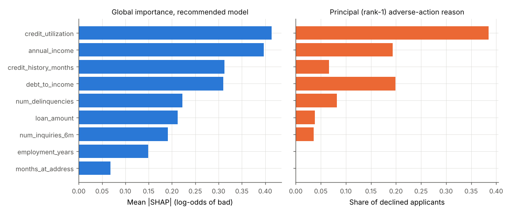
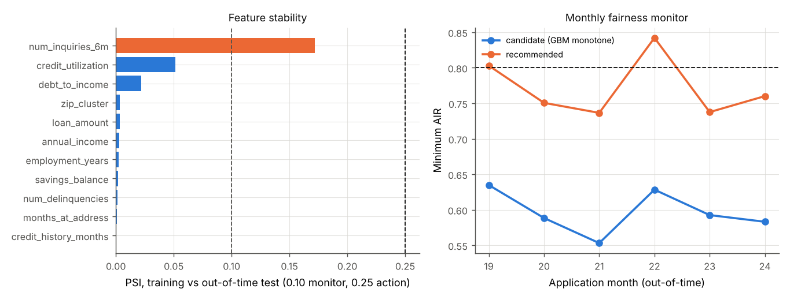

# Day 26: Responsible Credit Decisioning: Fairness, Explainability and Model Governance

**Tier IV - Distinguished** | **Domain:** Lending | **Tools:** Fairlearn (metrics, ThresholdOptimizer, ExponentiatedGradient), SHAP (TreeExplainer), LightGBM (monotone constraints), scikit-learn, pandas, matplotlib | **Data:** SYNTHETIC loan applications (40,000 over 24 months). HMDA and German Credit were tried first; both were unreachable from the build network.

## Executive summary

A gradient-boosted model is barely more accurate than the incumbent scorecard (out-of-time AUC **0.768 vs 0.765**). Both approve protected group B at only **0.60 and 0.57 times** the reference group's rate. Most of that gap comes from a geography feature that acts as a proxy for group. Removing it and reweighing the training data raises the worst adverse impact ratio (AIR) to **0.776** at an AUC cost of 0.004. Every declined applicant gets four ranked SHAP reason codes, and **99.9%** get a concrete "what would change the decision" counterfactual. The recommended model still falls short of the 0.80 four-fifths screen in the out-of-time months, so the generated model development document marks it **not ready for deployment**. Two fixes reach parity, group-specific thresholds (AIR 0.971) and exponentiated gradient (AIR up to 0.915), but they cost legality or explainability.



Full outputs: [`results/metrics.json`](results/metrics.json) (every number), [`results/report.md`](results/report.md) (all tables), [`results/model_development_document.md`](results/model_development_document.md) (SR 11-7-style governance document), [`results/model_card.md`](results/model_card.md), [`results/adverse_action_examples.md`](results/adverse_action_examples.md), [`results/reason_codes_declined_test.csv`](results/reason_codes_declined_test.csv) (4 codes for each of 3,314 declines), [`results/counterfactuals_declined_test.csv`](results/counterfactuals_declined_test.csv) and [`results/figures/`](results/figures/). All of these are generated by `make run`.

## Architecture



## Data provenance

- **Path used: `synthetic_generator`** (`results/metrics.json -> data.path_used`). The loader tries the public sources in order:
  1. The HMDA Data Browser CSV API (Delaware, 2022, originated vs denied).
  2. UCI Statlog German Credit.

  Both failed through the build proxy with `URLError: Tunnel connection failed: 403 Forbidden`, recorded in `data.attempts`. The loader then fell back to the generator automatically. `CREDIT_DATA=hmda make run` or `CREDIT_DATA=german make run` forces a public path. Both parsers are unit-tested on small fixtures, and the rest of the pipeline is driven by a `DatasetSpec`, so it does not depend on the synthetic schema.
- **Everything reported here is SYNTHETIC.** The generator is [`data.py`](src/credit26/data.py) (seed 20261105). It produces 40,000 applications over 24 months:
  - **Protected attribute:** `group` A/B/C (62/23/15%), a stand-in for race or ethnicity. Sex and an age band are used as secondary attributes. None of these is ever a model input.
  - **Structural gaps:** groups B and C have lower income, shorter credit files, lower savings and slightly higher utilisation and DTI.
  - **Proxy:** `zip_cluster` (20 areas) follows residential segregation. On its own it predicts group membership with AUC 0.835.
  - **Label bias:** the true default model has no group or geography term. The *recorded* label adds historical bias against groups B and C and against "redlined" clusters. The recorded bad rate is 15.7%, against 11.4% for the unbiased outcome, so 27.6% of recorded bads are spurious. Real data never shows the unbiased label; it is kept here so the run can measure what training on biased outcomes does.
  - **Drift:** utilisation, inquiries and DTI rise over time, so the out-of-time months shift (inquiries PSI 0.172).
- **Sample:** [`data/sample/applications_SYNTHETIC_sample.csv`](data/sample/) holds the first 3,000 rows (246 KB). The generator makes the full file in under a second.

## Method

1. **Split.** By time: train on months 1-14 (23,547), validate on months 15-18 (6,586) and test out of time on months 19-24 (9,867). The approval cutoff approves 70% of validation applicants and is then frozen. All selection decisions use validation data only.
2. **Baseline scorecard** ([`scorecard.py`](src/credit26/scorecard.py)):
   - quantile binning and smoothed WOE/IV, then L2 logistic regression;
   - points scaled to 600 at 50:1 odds, with 20 points to double the odds;
   - reason codes by the classic points-below-maximum method.
3. **Gradient boosting** ([`models.py`](src/credit26/models.py)). LightGBM, trained unconstrained and with **monotone constraints** (stretch goal) in the business-expected direction for every numeric feature. Performance is reported as AUC, Gini, KS and Brier score, and stability as score and feature PSI.
4. **Fairness audit** ([`fairness.py`](src/credit26/fairness.py)). Point estimates come from Fairlearn `MetricFrame`: AIR per group against reference A, demographic-parity difference, and equalised-odds difference with approve = favourable and repaid = positive. 95% CIs come from 1,000 bootstrap resamples, run as multinomial draws on the group × outcome × decision cell counts; a test checks this against Fairlearn.
5. **Proxy discrimination analysis.**
   - Single-feature AUC for predicting membership of a protected group.
   - Joint 5-fold LightGBM AUC, with and without geography.
   - How well the candidate score separates the groups.
   - Each feature's share of mean |SHAP|.
6. **Less-discriminatory-alternative search** (stretch goal). Monotone GBMs over 3 feature sets × 2 complexities:
   - all features;
   - without geography;
   - without geography and without the strongest numeric proxy.

   The search picks the highest validation AIR within 0.02 AUC of the candidate.
7. **Mitigation** ([`mitigation.py`](src/credit26/mitigation.py)), applied to the LDA-selected feature set:
   - **Reweighing** (Kamiran and Calders) at strength α ∈ {0.5, 1, 1.5, 2}, where w = (P(g)P(y)/P(g,y))^α.
   - **Fairlearn `ExponentiatedGradient`** with a demographic-parity bound ∈ {0.10, 0.05, 0.03, 0.02, 0.01}. Its cost-sensitive objective sets FP cost = (1-c)/c from the base cutoff c, so it approves near 70% rather than about 95%.
   - **Fairlearn `ThresholdOptimizer`** with demographic-parity and equalised-odds constraints.
8. **Selection rule**, applied to validation data. Pick the highest validation AUC among single, explainable, monotone GBMs that are within the AUC tolerance and have validation AIR ≥ 0.80.
   - Threshold optimisation is excluded because it applies group-specific cutoffs (disparate treatment).
   - Exponentiated gradient is excluded because its randomised mixture of classifiers cannot give stable, specific adverse-action reasons.
9. **Reason codes and counterfactuals** ([`explain.py`](src/credit26/explain.py)).
   - **Reason codes:** exact TreeSHAP in log-odds of default. For each declined applicant, the four largest contributions towards decline become ranked reason codes R01-R09, mapped to Regulation B-style statements.
   - **Counterfactuals:** an exhaustive grid search (12 steps per feature, every single feature and every pair) over actionable features only: utilisation and DTI down, inquiries down, loan amount down to half, savings up to double. Cost is measured in IQR units. Protected attributes, history, income, employment and geography are never changed.
10. **Governance** ([`governance.py`](src/credit26/governance.py)). The run writes an SR 11-7-structured model development document (data, methodology, performance, stability, fair-lending testing, explainability, limitations, monitoring plan with thresholds, validation evidence, approvals), a model card and sample adverse-action notices. All of them are filled from `metrics.json`.

## Results

All numbers are for the out-of-time test months (9,867 SYNTHETIC applications) and come from `results/metrics.json`.

### Scorecard vs gradient boosting (performance and stability)

| Model | AUC | KS | Score PSI train vs OOT | Bad rate among approved | Min AIR [95% CI] |
|---|---|---|---|---|---|
| WOE scorecard (incumbent) | 0.765 | 0.407 | 0.050 | 9.5% | 0.573 [0.546, 0.601] |
| GBM, unconstrained | 0.766 | 0.398 | 0.054 | 9.3% | 0.583 [0.558, 0.611] |
| GBM, monotone (candidate) | 0.768 | 0.402 | 0.056 | 9.2% | 0.599 [0.572, 0.626] |
| **Recommended: `reweighing_a0.5`** (no geography, no savings, reweighed) | 0.763 | 0.396 | 0.061 | 9.2% | **0.776 [0.747, 0.807]** |

The monotone constraints cost no accuracy. In a sampled check of 200 applicants, the unconstrained GBM moved risk in the business-expected direction along every feature for only 0-99% of applicants, depending on the feature; the monotone model did so for 100% on every feature.

### Adverse impact ratio before and after mitigation (acceptance criterion)

| Model | Approval A / B / C | AIR B [95% CI] | AIR C [95% CI] | DP diff | EO diff |
|---|---|---|---|---|---|
| Candidate GBM monotone (before) | 77.4% / 46.4% / 55.2% | 0.599 [0.572, 0.626] | 0.713 [0.680, 0.747] | 0.310 | 0.260 |
| LDA: drop geography and savings | 72.3% / 55.1% / 60.6% | 0.762 [0.735, 0.791] | 0.837 [0.798, 0.870] | 0.172 | 0.113 |
| + reweighing α=0.5 (recommended) | 71.7% / 55.6% / 61.3% | 0.776 [0.747, 0.807] | 0.855 [0.815, 0.892] | 0.161 | 0.097 |
| + reweighing α=2 | 71.5% / 57.6% / 61.9% | 0.806 [0.776, 0.837] | 0.867 [0.828, 0.902] | 0.138 | 0.078 |
| Exponentiated gradient, bound 0.02 | 72.7% / 64.8% / 67.9% | 0.891 [0.862, 0.921] | 0.933 [0.899, 0.970] | 0.079 | 0.025 |
| Threshold optimiser, DP (uses group) | 56.6% / 55.7% / 55.0% | 0.985 [0.945, 1.028] | 0.971 [0.921, 1.021] | 0.016 | 0.061 |



The trade-off frontier above prices each option:
- **Exponentiated gradient** buys AIR 0.89 for an AUC drop to 0.705.
- **Threshold optimisation** reaches parity but approves only 56.1% of applicants, and does it with group-specific cutoffs.
- **Against the unbiased outcome**, the recommended model is *more* accurate than the candidate (AUC 0.749 vs 0.737). Some of the candidate's accuracy on recorded labels was accuracy at reproducing historical bias.

### Proxy discrimination

| Evidence | Value |
|---|---|
| Geography alone predicts protected-group membership | AUC 0.835 |
| All candidate features jointly / without geography | AUC 0.870 / 0.681 |
| Geography's share of the candidate's mean abs SHAP | 10.2% |
| Candidate score separates protected from reference applicants | AUC 0.708 |
| Min AIR with geography → without (LDA search) | 0.599 → 0.762, AUC 0.768 → 0.763 |

### Reason codes and counterfactuals (acceptance criterion)

| Metric | Value |
|---|---|
| Declined applicants with 4 ranked reason codes | **3,314 of 3,314 (100%)** |
| Declines whose 4 reasons all push towards decline | 99.5% |
| SHAP additivity error vs raw model score | 0.0 |
| Principal reason agrees with scorecard points-below-max (2,591 declined by both) | 72.8% (top-4 overlap 74.5%) |
| Most common principal reason | credit utilisation (1,276), DTI (660), income (642) |
| Counterfactual found within actionable bounds | 99.9% of 3,314 |
| ...of which a single change suffices | 44.9%; median cost 0.64 IQR units |

Example (SYNTHETIC application 5, p(default) 28.7%): R06 income insufficient for amount requested, R01 utilisation too high, R05 short credit history, R03 delinquencies. The decision flips if DTI falls from 0.328 to 0.282 and the loan amount falls from 9,100 to 5,688. More examples are in [`adverse_action_examples.md`](results/adverse_action_examples.md).



### Governance document (acceptance criterion)

[`model_development_document.md`](results/model_development_document.md) has the following sections:
- 0 conclusion
- 1 purpose
- 2 data (source attempts, label bias, proxies)
- 3 methodology
- 4 performance testing
- 5 stability
- 6 fair-lending testing (before and after AIR, mitigation options, proxy analysis, secondary attributes)
- 7 explainability
- 8 limitations
- 9 monitoring plan (PSI, AIR, AUC, reason-code drift, override thresholds)
- 10 validation evidence
- 11 approvals

The monthly monitor below shows the candidate never reaches 0.65. The recommended model is above 0.80 in 2 of the 6 out-of-time months, at 0.803 and 0.842.



## Acceptance criteria

| Criterion | Status |
|---|---|
| Adverse impact ratio reported before and after mitigation | Met: 20 models with bootstrap CIs, from 0.599 before to 0.776 for the recommended model |
| Every declined applicant gets 4 ranked reason codes | Met: 3,314 / 3,314 |
| Governance document covers data, methodology, testing, limitations and monitoring | Met: generated by the run, all sections present (tested) |
| `make test` passes from a clean checkout | Met: 18 tests, about 20 s |
| `make run` reproduces every number and figure | Met: 136 s on one CPU thread |
| Stretch: less-discriminatory-alternative search | Done (6 candidates) |
| Stretch: monotonic constraints | Done; 100% monotone on every feature, AUC 0.768 vs 0.766 unconstrained |

## What this demonstrates

- **Responsible AI:**
  - Fairlearn metrics with bootstrap uncertainty.
  - All three families of mitigation (pre-, in- and post-processing) compared on one frontier.
  - A legal lens on which of them are deployable: disparate treatment, and explainability of randomised classifiers.
  - Quantified proxy discrimination and label bias.
- **Model risk management:**
  - An SR 11-7-structured development document, generated from the run so it cannot drift from the evidence.
  - A pre-registered selection rule on validation data, with out-of-time testing.
  - A monitoring plan with numeric thresholds, a model card, and an honest "not ready" status when the evidence says so.
- **Credit risk:**
  - WOE/IV scorecard with points scaling and points-below-max reasons.
  - Monotone GBM challenger with KS/Gini/PSI, approval-rate cutoff policy and bad rate among approved.
  - Regulation B-style adverse-action reasons and actionable counterfactuals.

## Limitations

- **The recommended model does not pass the four-fifths screen out of time.**
  - **What happened:** its minimum AIR is 0.776 (CI 0.747-0.807). It passed on validation (0.804), but the test months drifted. The bootstrap probability that its AIR is below 0.80 is 94.1%.
  - **What was tried:**
    - dropping proxies (best AIR 0.767 on test);
    - reweighing up to α=2 (0.806, AUC 0.758);
    - exponentiated gradient (up to 0.915, but AUC 0.68-0.71 and a randomised classifier);
    - threshold optimisation (0.971, but disparate treatment).
  - **Why it was not fixed by hand:** picking `reweighing_a2` because it passes on the test set would be selection on test data. The governance document says "do not deploy" and lists next steps instead.
  - **Follow-up check (added after the first run):** a stricter rule, decided on validation alone, asks for the bootstrap 95% lower bound of validation AIR to clear 0.80 rather than the point estimate. No eligible model clears it; the best lower bound is 0.794 (`reweighing_a1.5`, AUC 0.735), so the honest answer under this rule is "no model to recommend yet". Because the committed test months have already been seen, the candidates were also scored on a fresh out-of-time draw from the generator (seed + 1, months 19-24, 10,082 rows) that no earlier step used. There the original pick scores 0.783 and `reweighing_a1.5` 0.801 [0.772, 0.831], so drift, not bad luck in one split, is what pushes these models under the line. The check is in `metrics.json` under `robust_selection_check` and does not change the recommendation.
- **AUC tolerance changed after the first run.** The tolerance was first set at 0.01. With that value, every no-geography model missed by 0.013-0.016 validation AUC, so the search kept the geography proxy. It was raised to 0.02, a common business tolerance for an LDA search, and the change is recorded here. The validation AUC gap overstates the cost: on the test months, dropping geography costs only 0.005 AUC.
- **The data is SYNTHETIC.** The size of the label bias, segregation and drift are simulator choices. Real HMDA data has denials, not defaults, and no credit-bureau attributes. The HMDA and German Credit loaders were exercised only on fixtures, because both sources returned 403 through the proxy.
- **Fairness is measured at one cutoff** (70% approval on validation; 66.4% realised out of time). The Threshold optimiser picks its own approval rate (56.1%) because Fairlearn optimises balanced accuracy, so its row is not at the same operating point.
- **Exponentiated gradient is scored on fewer AUC points:** its score is the mixture's approval probability, which takes few distinct values, so its AUC understates its ranking quality.
- **The four-fifths rule is a convention, not the legal test in US lending.** It comes from EEOC employment practice. Group membership is assumed known; in practice it is self-reported or BISG-imputed, which adds error.
- **Reweighing uses the protected attribute in training.** Its permissibility depends on the jurisdiction.
- **No reject inference.** Counterfactuals are grid-based, assume features can move independently, and are not financial advice.

## How to run

```bash
cd day-26-lending-fairness-model-governance
make setup     # pip install -r requirements.txt (Python 3.11+, CPU only)
make test      # 18 tests, ~20 s
make run       # tries HMDA -> German Credit -> SYNTHETIC; writes results/ (~2.5 min)
make data      # optional smoke run on 6,000 SYNTHETIC applications -> data/smoke_results/
CREDIT_DATA=synthetic make run   # skip the network attempts
```

Results were produced with Python 3.11.17 and the pins in `requirements.txt`, using one CPU thread.
