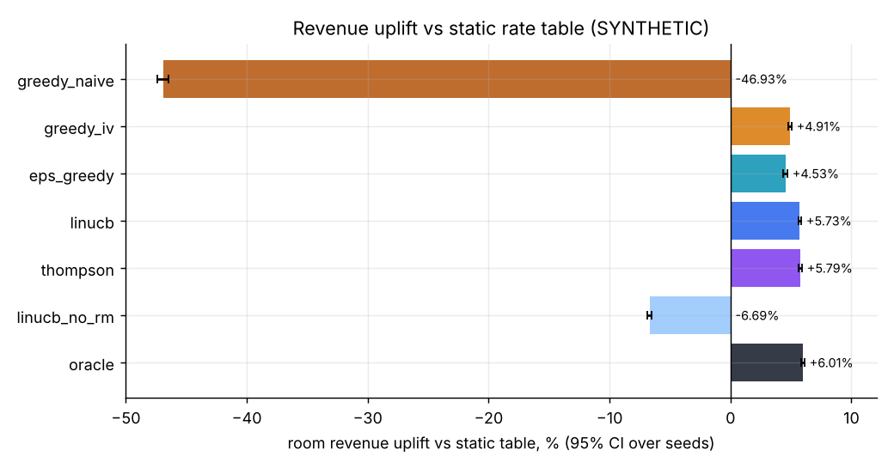
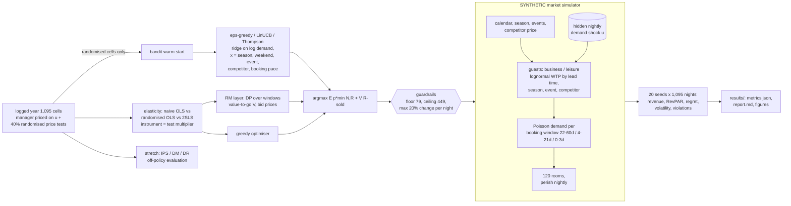
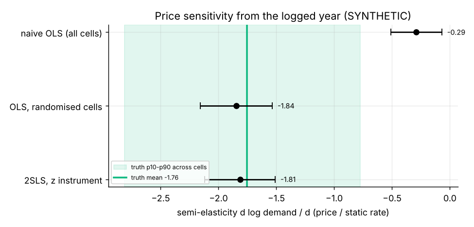
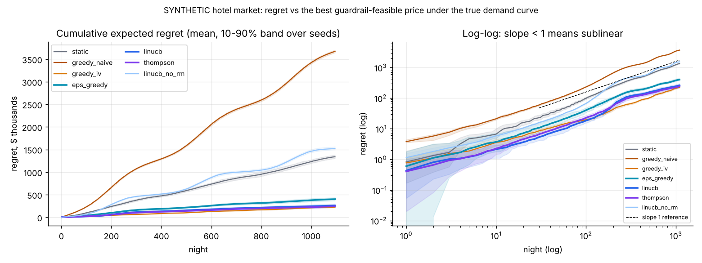
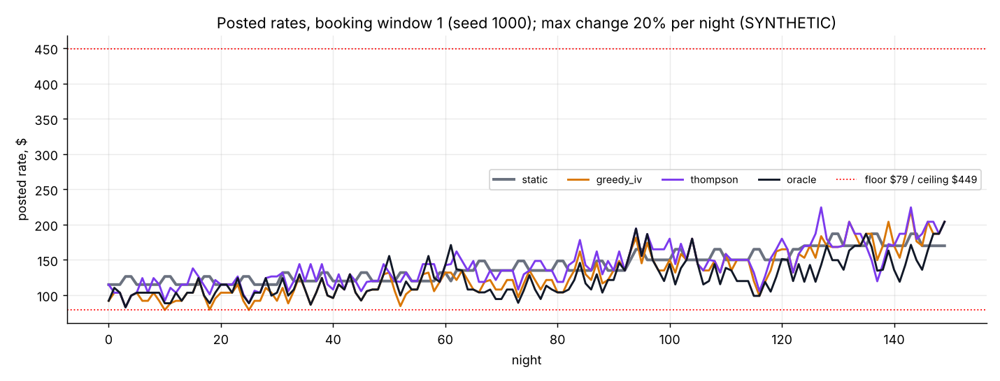

# Day 27: Dynamic Pricing for Hospitality with Contextual Bandits

**Tier IV - Distinguished** | **Domain:** Travel & hospitality | **Tools:** NumPy, SciPy, pandas, Plotly, matplotlib (PyTorch not needed: every model is linear, so the bandits are plain NumPy) | **Data:** SYNTHETIC hotel market simulator (no public dataset; the prompt asks for a simulator)

## Executive summary

In a simulated 120-room hotel, contextual-bandit pricing with inventory control earns **+5.79% more room revenue than the static seasonal rate table** (Thompson sampling, 95% CI +5.65% to +5.92%, over 20 simulated three-year runs). That is close to the **+6.01%** earned by an oracle that knows the true demand curve. The bandits keep learning: regret per night falls from **$321 in year 1 to $145 in year 3**. Across 65,700 pricing decisions per policy, the floor, ceiling and 20% max-nightly-change guardrails were **never violated**. Getting price sensitivity right comes first. A naive regression on the hotel's own history underestimates price sensitivity about sixfold, and pricing on it loses **47%** of revenue.



Every number below comes from [`results/metrics.json`](results/metrics.json), and the tables are in [`results/report.md`](results/report.md). Both are written by `make run`.

## Architecture



## Data provenance

- **Path used: `synthetic_simulator`** (`metrics.json -> data.path_used`). The prompt asks for a market simulator, so no public source was tried and nothing is downloaded. Everything in this folder is **SYNTHETIC**.
- **Simulator** ([`simulator.py`](src/pricing27/simulator.py)):
  - One hotel with 120 rooms. Each stay night is sold in three booking windows (22-60, 4-21 and 0-3 days out), and the hotel posts one price per window. Unsold rooms perish when the night arrives.
  - **Guests.** Business and leisure shoppers arrive as Poisson streams. Each books if their lognormal willingness-to-pay (WTP) is at least the posted price.
  - **What drives demand.** Shopper volume and WTP depend on segment, lead time (business WTP rises close to arrival, leisure WTP falls), season (peaking in July), day of week (leisure on Friday and Saturday), events (6% of nights; more shoppers, WTP +22%) and the competitor's price.
  - **Hidden shock.** An unobserved nightly demand shock *u* raises both shopper volume and WTP.
  - **Unconstrained demand.** The booking engine records denials as well as bookings, so demand is observed even on sold-out nights.
- **Logged history** ([`estimation.py`](src/pricing27/estimation.py), seed 20261106):
  - One year, 1,095 (night, window) cells.
  - A revenue manager priced at static × exp(0.12·*u*): they saw the shock (group enquiries, calls) and the analyst does not. On these cells, log price and log demand are correlated at **+0.294**.
  - On a random 40% of cells (**471**), a randomised price test overrode the manager with a multiplier from {0.8, 0.9, 1.0, 1.1, 1.2}.
  - Logged occupancy was 81.7%, and 38.9% of nights sold out.
- **Sample:** [`data/sample/booking_logs_SYNTHETIC_sample.csv`](data/sample/) is the complete logged year (85 KB). Its `true_semi_elasticity` column is simulator ground truth and is used only for evaluation. Runs regenerate it exactly from the seed.
- **Scale:** 20 seeds × 1,095 simulated nights (3 years) × 3 windows = 65,700 decisions per policy, plus a 10-seed competitor-reaction study. `make run` takes **102 s** on 4 CPU processes.

## Method

1. **Price-elasticity estimation with confounding addressed.** The demand model is semi-log: log(D+0.5) = x'β + θ·m, where m = price / static rate. The controls x are season, weekend, event, competitor price, booking window and their interactions. Three estimators are compared:
   - **naive OLS** on all cells, which is confounded because the manager raised prices when demand was strong;
   - **OLS on the randomised test cells only**;
   - **2SLS on all cells**, using the randomised multiplier as the instrument for price, with HC1 standard errors and a first-stage F statistic.
2. **Inventory control (RM layer, [`rm.py`](src/pricing27/rm.py)).** For each night, an exact finite-horizon DP over the remaining booking windows gives V_j(R), the expected revenue to come with R rooms left. Sales are min(Poisson demand, R). The bid price is V_{j+1}(R) − V_{j+1}(R−1). Every policy except static prices a window by maximising **E[p·min(N,R) + V_{j+1}(R − min(N,R))]**, so selling a room today is charged its opportunity cost.
3. **Policies** ([`policies.py`](src/pricing27/policies.py)). All choose from a price grid of 0.6-1.8 × the static rate.
   - **static**: the incumbent table, a rounded monthly rate plus 10% at weekends.
   - **greedy_naive / greedy_iv**: the semi-log demand model from step 1 plugged into the DP, with no exploration.
   - **Bandits.** **eps_greedy** (ε_t = min(0.3, t^-1/3)), **LinUCB** (α = 1) and **Thompson sampling** each fit one online ridge regression of log demand per booking window. The features are x ⊗ [1, m, m²], where x is season, weekend, event, log competitor price and **booking pace** (demand already seen for that night).
     - The bandits are warm-started on the **randomised cells only**. The manager-priced cells are confounded and would bias the slope.
     - The demand estimate (UCB-optimistic, or one posterior draw for Thompson) feeds the DP objective above, with continuation values from the RM layer.
   - **linucb_no_rm**: an ablation that sets V to 0, so the bandit ignores inventory.
   - **oracle**: uses the true demand curve and the true DP. It does not see *u*, but it updates its belief about *u* from booking pace by exact Bayes.
4. **Guardrails.** Each night, a candidate set is built inside [max(79, 0.8·prev), min(449, 1.2·prev)], where prev is the same window's price on the previous night. The simulator then re-checks every posted price and clips anything outside the set. A test confirms this safety layer catches a rogue policy.
5. **Simulation study** ([`study.py`](src/pricing27/study.py)).
   - All policies see the same worlds and the same demand random numbers (common random numbers), so comparisons are paired.
   - **Regret** is expected regret against the best guardrail-feasible price under the true demand curve, given the same rooms left and the RM layer's continuation value. The true demand curve integrates out *u* using the shock posterior implied by booking pace.
   - The **regret exponent** is the slope of log cumulative regret against log night over the last 75% of the horizon. A value of 1 means linear regret.
   - **Uplift** is computed per seed against static and reported with a 95% t-interval and a 10,000-draw bootstrap interval.
6. **Stretch goals.**
   - **Competitor reaction:** the competitor moves its price by (our previous multiplier)^0.5.
   - **Off-policy evaluation:** five pricing rules are evaluated from the 471 randomised cells with IPS, self-normalised IPS, a direct method and doubly robust estimators, against the simulator's truth.

## Results

### Price sensitivity from the logs

| Estimator | Semi-elasticity θ | 95% CI | Covers truth |
|---|---|---|---|
| Naive OLS, all 1,095 cells | -0.290 | [-0.51, -0.07] | No |
| OLS, 471 randomised cells | -1.845 | [-2.16, -1.53] | Yes |
| **2SLS, randomised multiplier as instrument** | **-1.814** | [-2.12, -1.51] | Yes |
| Truth (simulator, mean over cells at the static rate) | -1.756 | cell p10-p90: -2.81 to -0.78 | |

The first-stage F is 997. Naive OLS, which ignores that price follows demand, makes demand look about six times less price-sensitive than it is.



### Policy study (20 seeds × 1,095 nights, acceptance criteria)

| Policy | Revenue uplift vs static [95% CI] | RevPAR | Occupancy | ADR | Regret $/night, year 1 → 2 → 3 | Regret exponent | Price volatility | Guardrail violations |
|---|---|---|---|---|---|---|---|---|
| static table | — | $126.57 | 81.1% | $156.15 | 1,225 → 1,217 → 1,231 | 1.00 | 2.9% | 0 |
| greedy, naive OLS | -46.93% [-47.38, -46.48] | $67.17 | 24.2% | $277.13 | 3,354 → 3,360 → 3,351 | 1.00 | 3.0% | 0 |
| greedy, 2SLS | +4.91% [+4.76, +5.06] | $132.79 | 89.0% | $149.25 | 206 → 209 → 205 | 0.99 | 11.0% | 0 |
| ε-greedy | +4.53% [+4.34, +4.72] | $132.30 | 82.3% | $160.73 | 497 → 334 → 270 | **0.73** | 11.5% | 0 |
| LinUCB | +5.73% [+5.60, +5.86] | $133.83 | 80.7% | $165.87 | 349 → 209 → 154 | **0.66** | 11.0% | 0 |
| **Thompson sampling** | **+5.79% [+5.65, +5.92]** | $133.89 | 81.9% | $163.53 | 321 → 195 → 145 | **0.67** | 11.7% | 0 |
| LinUCB without RM (ablation) | -6.69% [-6.88, -6.50] | $118.10 | 91.6% | $128.99 | 1,358 → 1,405 → 1,409 | 1.01 | 11.6% | 0 |
| oracle (true demand curve) | +6.01% [+5.88, +6.13] | $134.17 | 89.5% | $149.86 | n/a | n/a | 12.3% | 0 |

Notes on the table:
- **Uplift CIs** are 95% t-intervals over 20 seeds. Percentile-bootstrap intervals (in `report.md`) differ from them by at most 0.06 pp. Every learning policy and greedy 2SLS beat static in 20 of 20 seeds.
- **Price volatility** is the mean absolute night-over-night change in the posted rate.
- **Guardrail violations** are counted over all 65,700 decisions per policy. The largest nightly change any policy posted was exactly 20.0%.

What the table shows:
- **Regret is sublinear for all three bandits.**
  - Their mean-curve exponents are 0.66-0.73.
  - Every seed is below 0.9: per-seed ranges are LinUCB 0.45-0.78, Thompson 0.56-0.78 and ε-greedy 0.60-0.89.
  - Regret per night falls every year.
  - The static table and both greedy policies have exponent ≈ 1 and flat yearly regret, because they never learn.
- **Greedy 2SLS is a strong non-learning baseline (+4.91%).** The bandits beat it after learning. They also use booking pace, which the greedy model ignores.
- **Inventory control matters as much as demand learning.** The same LinUCB without the DP continuation value sells out early at low prices and loses 6.69% against static.
- The oracle and greedy 2SLS fill more rooms at a lower ADR than the bandits (89% vs 81-82% occupancy). The bandits make up for it on rate.



An interactive version of the regret curves is in [`results/figures/regret_curves.html`](results/figures/regret_curves.html) (Plotly). [`price_paths.png`](results/figures/price_paths.png) shows posted rates against the guardrail band, and [`revpar_vs_volatility.png`](results/figures/revpar_vs_volatility.png) shows the RevPAR-volatility trade-off.



### Stretch: competitor reaction (strength 0.5, 10 seeds)

| Policy | Uplift vs static [95% CI] | Regret $/night by year | Violations |
|---|---|---|---|
| greedy, 2SLS | +5.04% [+4.81, +5.27] | 195 → 197 → 191 | 0 |
| LinUCB | +5.51% [+5.27, +5.74] | 345 → 206 → 147 | 0 |
| Thompson | +5.53% [+5.26, +5.80] | 314 → 196 → 144 | 0 |

Here the competitor partly follows our price moves. The bandits still learn sublinearly (exponents 0.65 and 0.68) and still beat static and greedy, because competitor price is one of their context features.

### Stretch: off-policy evaluation from 471 randomised cells

| Target rule | Truth $/cell | IPS (rel. error) | Direct method | Doubly robust [95% CI] |
|---|---|---|---|---|
| static rate | 6,349 | 6,370 (+0.3%) | 6,456 (+1.7%) | 6,319 (-0.5%) [5,759, 6,915] |
| premium ×1.1 | 5,791 | 5,845 (+0.9%) | 5,992 (+3.5%) | 5,938 (+2.5%) |
| discount ×0.9 | 6,774 | 8,069 (+19.1%) | 6,709 (-1.0%) | 6,888 (+1.7%) |
| late-window premium | 6,327 | 6,564 (+3.7%) | 6,424 (+1.5%) | 6,239 (-1.4%) |
| greedy 2SLS (myopic) | 6,946 | 5,730 (-17.5%) | 6,702 (-3.5%) | 6,860 (-1.2%) [6,307, 7,484] |

With only 81-107 matched cells per rule, IPS has 95% intervals of roughly ±$1,400-1,800 and errors of up to 19%. Doubly robust stays within 2.5% of the truth for every rule. It still cannot separate the two best rules: it puts the 0.9 discount ($6,888) slightly above greedy 2SLS ($6,860), while the truth has greedy 2SLS ahead by $172 per cell.

## Acceptance criteria

| Criterion | Status |
|---|---|
| Bandit policies achieve sublinear regret curves in simulation | **Met.** Mean-curve exponents are 0.73 (ε-greedy), 0.66 (LinUCB) and 0.67 (Thompson), every seed is below 0.9, and regret per night falls every year (`acceptance.bandits_sublinear_regret`). |
| Guardrails (max daily price change, floor/ceiling) are never violated (test) | **Met.** 0 violations over 8 policies × 65,700 decisions. `tests/test_guardrails.py` checks every policy, a random policy in an extreme market with tight guardrails, 5,000 random candidate sets, and a rogue policy that the safety layer clips. |
| Revenue uplift vs static reported with confidence intervals | **Met.** t and bootstrap 95% CIs over 20 seeds for every policy. |
| `make test` passes from a clean checkout | **Met.** 29 tests, about 15 s. |
| `make run` reproduces every number and figure | **Met.** 102 s, fully seeded. Results do not depend on the worker count. |
| Stretch: off-policy evaluation from logs | Done (IPS, SNIPS, DM, DR). |
| Stretch: competitor reaction modelling | Done (10 seeds). |

## What this demonstrates

- **Sequential decision-making:**
  - LinUCB, Thompson sampling and ε-greedy with a nonlinear (DP) objective and a log-linear demand model.
  - Expected-regret accounting against a Bayes oracle, with sublinearity checked by log-log slope and by year.
  - Warm starting from only the unconfounded logs.
  - Off-policy evaluation with IPS, DM and DR.
- **Pricing science:**
  - Shows how confounding biases elasticity estimates, and fixes it with randomised price tests and 2SLS (instrument strength reported).
  - Semi-log demand estimation.
  - Bid prices and finite-horizon DP revenue management for perishable inventory.
  - Guardrails designed as a hard constraint layer, plus a measured volatility trade-off.
- **Simulation:**
  - A structural guest-level market with segments, lead time, seasonality, events and competitor effects.
  - Common random numbers across policies, 20 seeds with paired CIs, and ablations (no RM, naive elasticity).

## Limitations

- **Synthetic market only.** The simulator's structure (lognormal WTP, Poisson arrivals, independent windows given *u*) matches the bandits' modelling assumptions better than a real market would. Real uplift will differ, and the +5.79% should be read as a property of this simulator, not a forecast.
- **The bandits do not reach the oracle.** Thompson is at +5.79% against the oracle's +6.01%, and its regret was still falling in year 3. The linear-in-features demand model is misspecified, so regret would eventually flatten to a small linear floor. The sublinear result holds over the simulated three-year horizon.
- **Bandits over-price slightly** relative to the oracle: 81-82% occupancy against 89.5%, with a higher ADR.
- **Simplified timing.** Windows are priced in stay-night order with immediate feedback. In reality, decisions for different stay nights interleave in calendar time, and demand from a window is observed only when that window closes.
- **Guardrail scope.** The 20% limit applies night over night within the same booking window, not between windows of the same night. The static table also passes through the guardrails: its own month-end and weekend jumps are clipped at 20%.
- **Price volatility.** The dynamic policies move rates about 11-12% a night on average, against 2.9% for the static table. This is within the guardrail but may still be too much for a brand. Tightening `max_change` trades revenue for stability; that trade-off was not swept.
- **The RM layer's continuation value** comes from the 2SLS model estimated once on the logged year. It is not re-estimated from bandit data.
- **Off-policy evaluation** uses one logged year with 81-107 matched cells per rule and ignores capacity, so cells are treated as independent.
- **No PyTorch.** The prompt lists it as optional, and the linear models did not need it.

## How to run

```bash
cd day-27-hospitality-dynamic-pricing-bandits
make setup   # pip install -r requirements.txt (Python 3.11+, CPU only)
make test    # 29 pytest tests, ~15 s
make run     # ~100 s on 4 processes (WORKERS=1 make run for one process; same numbers) -> results/
make data    # optional smoke run (2 seeds x 120 nights) -> data/smoke_results/
```

Layout: [`src/pricing27/`](src/pricing27/) contains `simulator`, `estimation`, `rm`, `policies`, `study`, `ope`, `pipeline`, `figures` and `report`. The entry point is [`scripts/run_pipeline.py`](scripts/run_pipeline.py), and tests are in [`tests/`](tests/).
