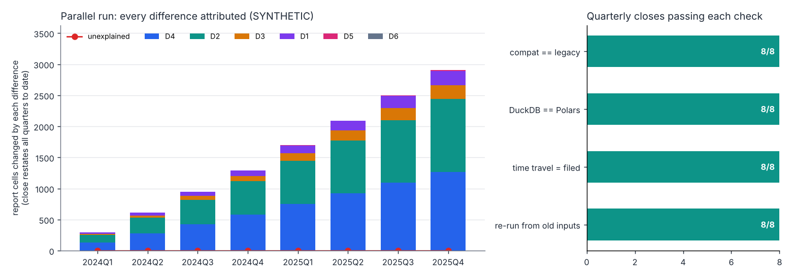
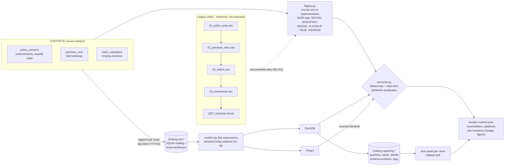
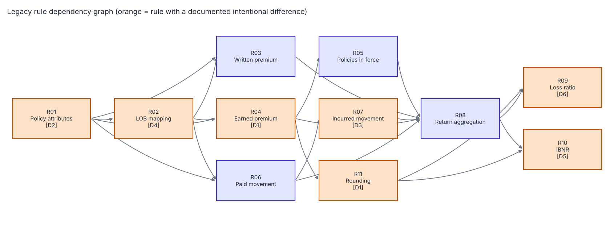
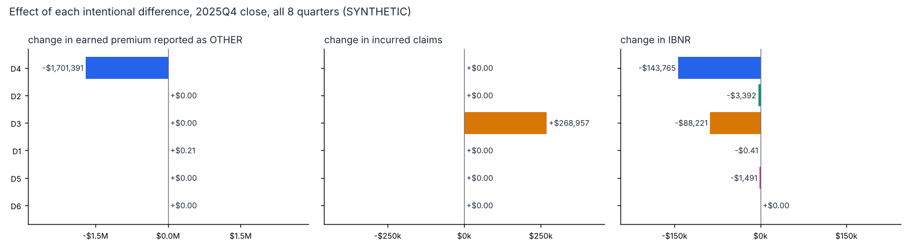
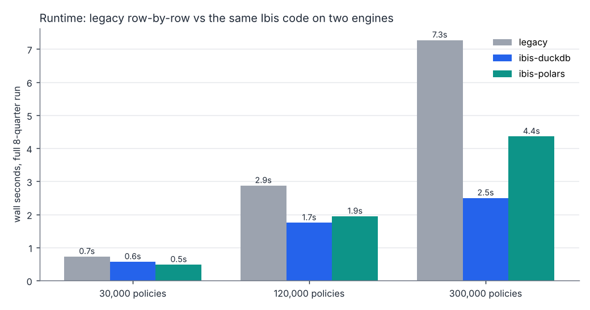

# Day 28: Legacy Reporting Modernisation: SAS/Excel to Iceberg + Ibis

**Tier IV - Distinguished** | **Domain:** Financial reporting & insurance | **Tools:** Apache Iceberg (pyiceberg, local SQLite catalog), Ibis, DuckDB, Polars, datacompy, pandas, matplotlib | **Data:** SYNTHETIC insurer extracts (seeded generator)

## Executive summary

We rebuilt a quarterly regulatory return, previously produced by four SAS programs and an Excel macro, as one set of Ibis expressions writing Apache Iceberg tables. Across 8 parallel-run quarters there were **0 unexplained differences**. The same code gives identical results on DuckDB and Polars, and every filed return can be reproduced exactly from Iceberg time travel. The rebuild exposed six legacy defects, each documented and switched off for comparison. Fixing two of them restores **$268,957 (+1.58%)** of incurred claims that the legacy chain silently dropped, and moves **$1.70M** of earned premium out of the "OTHER" line it was misfiled under (all figures are on synthetic data).



Every number below comes from [`results/metrics.json`](results/metrics.json), and the detail is in [`results/reconciliation.md`](results/reconciliation.md) and [`results/migration_playbook.md`](results/migration_playbook.md). All of them are written by `make run`.

## Architecture



## Data provenance

- **Path used: `synthetic_generator`** (`metrics.json -> data.path_used`). No public policy-level insurer dataset exists, and the prompt specifies synthetic policy, premium and claims tables, so no public source was tried and nothing is downloaded. Everything in this folder is **SYNTHETIC**.
- **Generator** ([`generator.py`](src/legacy28/generator.py), seed 20261107):
  - **30,000 policies** incepting 2023-01 to 2025-12 across five lines (MOTOR, HOME, COMMERCIAL, TRAVEL, LIABILITY) plus a 1.5% run-off PET book with no mapping.
  - **36,468 policy versions**, including endorsements, 60% of which move the policy to another region. A "2025 backfill" placed later versions ahead of version 1 in the extract for 15% of multi-version policies.
  - **36,468 premium transactions** (new business and endorsements). 3-5% of them are booked 20-75 days late, so they arrive after the quarter closes.
  - **2,655 claims with 11,692 quarterly valuations** (cumulative paid and case reserve). 2% of reserves are missing, standing in for a reserve-feed outage.
  - About 6% of LOB codes are mis-cased or padded (`Motor`, `home `).
- **Dates** are SAS date integers and **money** is integer cents, as the legacy extracts deliver them. All arithmetic (micro-cents, basis points) is in integers, so results are bit-identical across engines.
- **Sample:** [`data/sample/`](data/sample/) holds the first 1,500 policies of each extract (150 KB in total). `make run` regenerates the full data from the seed.
- **Legacy code:** [`legacy/sas/*.sas`](legacy/sas/) and [`legacy/excel/QRT_build.bas`](legacy/excel/QRT_build.bas) are committed as the source of record, written for this case study. They are **not executed**: no SAS licence or Excel is needed. [`legacy.py`](src/legacy28/legacy.py) re-implements them step by step, and that re-implementation is the reference the modern pipeline reconciles against.

## Method

1. **Rule inventory and dependency graph** ([`rules.py`](src/legacy28/rules.py) → [`results/rule_inventory.md`](results/rule_inventory.md)). The legacy logic is captured as 11 business rules, R01-R11. Each rule records its legacy source line, its modern function and its dependencies. A test checks that the graph is acyclic and that every rule points at real legacy and modern code.

   

2. **Legacy quirks reproduced faithfully** in `legacy.py`:
   - `PROC SORT NODUPKEY` keeps the first record in file order (merge-order dependence).
   - SAS missing arithmetic: `paid + .` = `.`, while `PROC SUMMARY` SUM ignores missing.
   - Cell-level `ROUND` (half away from zero).
   - `VLOOKUP(...,TRUE)` approximate match.
   - `IFERROR(...,0)`.
3. **Modern model** ([`modern.py`](src/legacy28/modern.py)). It is one set of Ibis expressions, executed unchanged on DuckDB and on Polars. Each intentional change is a switch on `ModernConfig`:

   | ID | Legacy behaviour | Modern behaviour |
   |---|---|---|
   | D1 | Earned premium rounded to the cent on every txn × quarter row | Earned in 1/10,000 cent; rounded once per report cell |
   | D2 | Policy attributes from the first version in file order | Version in force at each quarter end |
   | D3 | Missing reserve makes incurred missing, so paid drops out | Missing reserve = 0 |
   | D4 | Case- and blank-sensitive LOB match (`Motor` → OTHER) | `TRIM(UPPER())` before mapping |
   | D5 | `VLOOKUP TRUE`: OTHER silently gets MOTOR's 71% ELR | Exact lookup; explicit OTHER row (65%) |
   | D6 | `IFERROR` turns the loss ratio on zero earned into 0% | NULL |

4. **Reconciliation** ([`reconcile.py`](src/legacy28/reconcile.py)), at every close:
   - **(a) Compat check.** **Compat** mode (all switches off) must equal legacy on every row and column of all three outputs (premium detail, claims detail, report). This is checked with `datacompy` at zero tolerance.
   - **(b) Attribution.** Switches D4 → D2 → D3 → D1 → D5 → D6 are turned on one at a time. Every cell that changes must satisfy that difference's documented predicate: which rows may change (derived from the source data, e.g. claim-quarters with a missing reserve), which columns, and by how much (D1: ≤ 0.5 cent per detail row). A changed cell outside its predicate counts as **unexplained**.
   - **(c) Trace.** Every final legacy-vs-target difference is traced to the step that introduced it.
   - **Tests of the checker.** They confirm that a planted one-cent bug, and a rounding change attributed to the wrong difference, are both flagged.
5. **Iceberg lakehouse** ([`iceberg_store.py`](src/legacy28/iceberg_store.py)). pyiceberg `SqlCatalog` on SQLite with a local file warehouse; no server, Spark or Docker.
   - **Each close:** append the newly booked source rows to `raw.*`, re-run the pipeline from the raw tables, then overwrite `reporting.*`.
   - **Tags:** every snapshot is tagged `close-<quarter>`.
   - **Schema evolution:** at the 2025Q1 close, `ibnr_cents` is added (IBNR became a required column).
   - **Time travel:** each filed return is read back from its tag. The pipeline is also re-run on the raw tables *as they were at that tag*.
   - **Rollback drill:** a corrupted run is rolled back with `rollback_to_snapshot`.
6. **Benchmark** ([`pipeline.py`](src/legacy28/pipeline.py)). The full 8-quarter run at 30k, 120k and 300k policies, for the legacy re-implementation, Ibis-DuckDB and Ibis-Polars (output to Arrow). It reports median wall time, CPU seconds (a cost proxy) and storage bytes.

## Results

### Acceptance criteria

| Criterion | Result | Status |
|---|---|---|
| Reconciliation passes with zero unexplained differences | **0** unexplained over 8 closes. At the 2025Q4 close, 131,186 cells differ between legacy and target (127,271 premium detail, 2,590 claims detail, 1,325 report), and **all 131,186** trace to D1-D6 with **0 untraced**. Compat equals legacy exactly in **8/8** closes (109,471 + 11,692 + 192 rows at the final close). | **Met** |
| Same Ibis code runs on two backends with identical results (test) | DuckDB = Polars on all three outputs in **8/8** closes. `tests/test_modern.py` checks this for all 7 configurations. | **Met** |
| Iceberg time travel reproduces the previous quarter's report | The 2025Q3 return was reproduced exactly from tag `close-2025Q3` (**8/8** filed quarters reproduced). Re-running on time-travelled raw inputs reproduced **8/8**. | **Met** |
| `make test` passes from a clean checkout | 30 tests, about 40 s | **Met** |
| `make run` reproduces every number and figure | 122.5 s on 4 CPUs, fully seeded | **Met** |
| Stretch: column-level lineage | [`results/lineage.md`](results/lineage.md): 10 report columns → source columns → rules → legacy code → modern code → differences | Done |
| Stretch: cloud warehouse vs lakehouse cost model | Not attempted, see Limitations | Not done |

### What the intentional differences change (2025Q4 close, all 8 quarters)

| ID | Report cells changed | Detail rows changed | Effect |
|---|---|---|---|
| D4 LOB normalisation | 1,264 | 7,030 | Earned premium reported as OTHER falls from $1,796,677.74 to $95,287.33 (−$1,701,390.62 from D4) |
| D2 as-at-quarter-end attributes | 1,178 | 14,286 | Premium and claims move between regions/LOBs; totals unchanged; IBNR −$3,392.44 |
| D3 missing reserve = 0 | 221 | 455 | Incurred **+$268,957.02** (+1.58%), restored to the return; IBNR −$88,221.45 |
| D1 single rounding | 232 | 107,572 | Total earned premium −$0.46 on $28,593,539.89; IBNR −$0.41 |
| D5 exact ELR lookup | 9 | 0 | IBNR on OTHER −$1,491.20 |
| D6 NULL loss ratio | 0 | 0 | Dormant here (no zero-earned cells); covered by a unit test |

Overall, IBNR goes from $2,109,828.14 to $1,872,958.08 (**−11.2%**). Most of that is premium moving out of OTHER, which the legacy VLOOKUP priced at MOTOR's ELR, and claims paid that are now counted in incurred.



### Iceberg: snapshots, schema evolution, restatements

- 17 snapshots and 2 schemas on `reporting.quarterly_report`. The 2024Q4 tag reads without `ibnr_cents`, and the 2025Q1+ tags read with it (8/8 schemas correct).
- **Restatements:**
  - Late bookings change earlier quarters in the current table. For example, 2025Q3 has 100 restated cells, with written premium +$230,671.70 and earned +$8,685.09 versus the filed version.
  - The filed figures stay retrievable by tag.
  - This is why "reproduce the previous quarter" needs time travel and cannot just re-query the current table.
- **Rollback drill:** a run that zeroed earned premium was rolled back to the `close-2025Q4` snapshot, and the table matched the good report (`rollback_drill_ok: true`).

### Benchmark (full 8-quarter run, median of 3; legacy at 120k/300k is 1 run)

| Policies | Detail rows | Legacy (row-by-row Python) | Ibis-DuckDB | Ibis-Polars | DuckDB CPU-s vs legacy |
|---|---|---|---|---|---|
| 30,000 | 120,769 | 0.725 s | 0.568 s (1.3×) | 0.481 s (1.5×) | 0.754 vs 0.720 |
| 120,000 | 483,814 | 2.871 s | 1.747 s | 1.943 s | 2.502 vs 2.843 |
| 300,000 | 1,203,872 | 7.270 s | 2.496 s (**2.9×**) | 4.357 s (1.7×) | 5.840 vs 7.233 |



**Cost proxies:**
- **Compute:** at 300k policies, DuckDB uses 19% fewer CPU-seconds than legacy. Polars is faster in wall time but uses 45% more CPU-seconds (10.48 vs 7.23), because it parallelises more aggressively.
- **Storage:** the raw extracts take 990,808 bytes as Iceberg Parquet against 3,124,132 bytes as CSV, 68% smaller. All 8 closes' report and detail snapshots together take 6,452,080 bytes.

### Migration playbook

[`results/migration_playbook.md`](results/migration_playbook.md) covers the parallel-run procedure, cut-over criteria C1-C7 with their evidence, rollback (snapshot rollback, re-filing by tag, falling back to legacy during a shadow period), and the schema-change and restatement handling. Status of the criteria:
- **C1-C6 pass** in this run.
- **C7** (business sign-off of D1-D6 by Finance and Actuarial) is manual and is listed as open.

## What this demonstrates

- **Data modernisation:**
  - Legacy SAS/Excel logic is reverse-engineered into a rule inventory with a dependency graph, and re-implemented quirk for quirk: NODUPKEY file-order dependence, SAS missing arithmetic, cell-level ROUND, VLOOKUP approximate match, IFERROR.
  - The legacy logic is then rebuilt as engine-portable Ibis expressions, with integer arithmetic so results are deterministic across engines.
- **Open table formats:**
  - Apache Iceberg via pyiceberg with a local SQLite catalog.
  - Append and overwrite snapshots, with tags per close.
  - In-place schema evolution, read back with the old schemas.
  - Time travel on both outputs and inputs.
  - Snapshot rollback.
- **Migration engineering:**
  - A compat/target switch design that separates "did we capture the legacy logic?" from "which changes are intentional?".
  - datacompy row-by-row reconciliation.
  - Predicate-based attribution of every difference, with tests showing the checker catches a planted bug.
  - Parallel-run evidence over 8 closes, cut-over criteria, a rollback drill, a benchmark with cost proxies, and column-level lineage.

## Limitations

- **Synthetic data and synthetic legacy code.** The SAS programs, VBA macro, data and quirks were written for this case study. Real legacy estates have more rules, undocumented manual steps and data the extracts do not show. The dollar impacts above describe this generator, not any insurer.
- **The legacy chain is a Python re-implementation, not SAS or Excel.** No SAS licence was available, by design. Reconciliation proves the modern code matches *our reading* of the legacy source. In a real migration, step (a) would compare against the actual SAS datasets and filed workbooks. Likewise, the benchmark compares against row-by-row Python, not SAS. The speed-ups (1.3× at 30k policies, 2.9× at 300k) say nothing about SAS performance, and they exclude the manual Excel steps, which are often the real bottleneck.
- **Modest speed-ups at small volume.** At 30k policies, everything finishes in under a second, and Ibis is only 1.3-1.5× faster. Expression building and Arrow hand-off dominate at this size. The DuckDB advantage grows with volume.
- **Predicates are necessary conditions.** A changed cell is "explained" if it lies in the documented rows/columns (and, for D1, within the rounding bound). For D2 and D4, the report-level predicate is any cell containing an affected policy. An unintended change confined to exactly those cells would not be caught by this check alone. It would still have to survive the exact compat-equals-legacy check, which it would fail.
- **D6 is dormant** in this data: no report cell had claims but zero earned premium. Its behaviour is tested only on a constructed case.
- **Restatement policy is simplified.** Each close re-states all prior quarters from the latest bookings. Real regulatory regimes may require filed quarters to be frozen, with adjustments booked to the current quarter.
- **Single-process local catalog.** The SQLite catalog does not support concurrent writers. A production lakehouse would use a REST, Glue or Nessie catalog and object storage. The table format and the code would not change.
- **Stretch cost model not attempted.** A cloud-warehouse vs lakehouse cost comparison needs vendor prices and workload assumptions that cannot be measured here. Only measured proxies (CPU-seconds and bytes) are reported.
- **Library substitutions:** none. datacompy 1.2 is used through its `PandasCompare` class (the older `Compare` name was removed). Ibis `memtable` is used for inputs, because Ibis 12's DuckDB `create_table` failed with DuckDB 2.0 in this environment.

## How to run

```bash
cd day-28-legacy-reporting-modernisation-iceberg
make setup   # pip install -r requirements.txt (Python 3.11+, CPU only; no SAS, Spark, catalog server or Docker)
make test    # 30 pytest tests, ~40 s
make run     # ~2 min on 4 CPUs -> results/ (Iceberg warehouse in data/lakehouse/, git-ignored)
make data    # optional smoke run (2,000 policies) -> data/smoke_results/
```

To inspect the lakehouse after `make run` (with `PYTHONPATH=src`):

```python
from legacy28.iceberg_store import Lakehouse
lake = Lakehouse("data/lakehouse", fresh=False)
lake.read_report("2025Q3")          # the 2025Q3 close, as filed (time travel by tag)
lake.table("reporting.quarterly_report").history()
```
