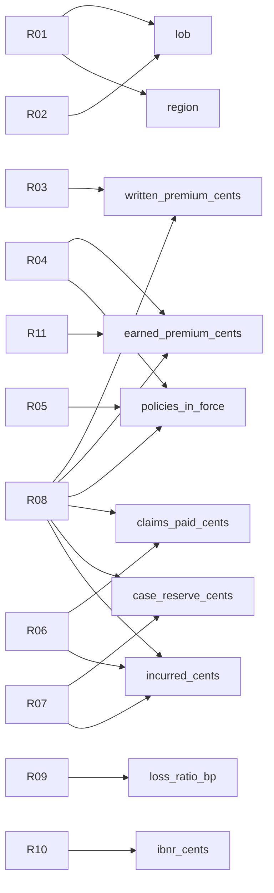

# Column-level lineage: legacy rule -> modern model

Generated by `make run` from `src/legacy28/rules.py`.

| Report column | Source columns | Rules | Legacy code | Modern code | Differences |
|---|---|---|---|---|---|
| `lob` | `policy_versions.lob_code_raw`, `policy_versions.load_seq`, `policy_versions.version_eff` | R01, R02 | `sas/01_policy_prep.sas: PROC SORT NODUPKEY BY policy_id` `sas/01_policy_prep.sas: DATA pol_dedup IF lob_code_raw IN (...)` | `modern.map_lob`, `modern.policy_attributes` | D2, D4 |
| `region` | `policy_versions.region`, `policy_versions.load_seq`, `policy_versions.version_eff` | R01 | `sas/01_policy_prep.sas: PROC SORT NODUPKEY BY policy_id` | `modern.policy_attributes` | D2 |
| `written_premium_cents` | `premium_txns.premium_cents`, `premium_txns.txn_eff` | R03, R08 | `sas/02_premium_earn.sas: IF qs <= txn_eff <= qe` `sas/04_summarise.sas: PROC SUMMARY NWAY; MERGE` | `modern.premium_detail`, `modern.quarterly_report` | - |
| `earned_premium_cents` | `premium_txns.premium_cents`, `premium_txns.txn_eff`, `premium_txns.txn_exp` | R04, R08, R11 | `sas/02_premium_earn.sas: earned_cents = ROUND(premium*days/term, 1)` `sas/04_summarise.sas: PROC SUMMARY NWAY; MERGE` `sas/02_premium_earn.sas ROUND(...,1); excel ROUND(...,0)` | `modern.half_up_div`, `modern.premium_detail`, `modern.quarterly_report` | D1 |
| `policies_in_force` | `premium_txns.policy_id` | R04, R05, R08 | `sas/02_premium_earn.sas: earned_cents = ROUND(premium*days/term, 1)` `sas/04_summarise.sas: PROC SORT NODUPKEY WHERE earned > 0` `sas/04_summarise.sas: PROC SUMMARY NWAY; MERGE` | `modern.premium_detail`, `modern.quarterly_report` | D1 |
| `claims_paid_cents` | `claim_valuations.cum_paid_cents` | R06, R08 | `sas/03_claims.sas: RETAIN prev_paid; FIRST.claim_id` `sas/04_summarise.sas: PROC SUMMARY NWAY; MERGE` | `modern.claims_detail`, `modern.quarterly_report` | - |
| `case_reserve_cents` | `claim_valuations.case_reserve_cents` | R07, R08 | `sas/03_claims.sas: incurred_cum = cum_paid + case_reserve` `sas/04_summarise.sas: PROC SUMMARY NWAY; MERGE` | `modern.claims_detail`, `modern.quarterly_report` | D3 |
| `incurred_cents` | `claim_valuations.cum_paid_cents`, `claim_valuations.case_reserve_cents` | R06, R07, R08 | `sas/03_claims.sas: RETAIN prev_paid; FIRST.claim_id` `sas/03_claims.sas: incurred_cum = cum_paid + case_reserve` `sas/04_summarise.sas: PROC SUMMARY NWAY; MERGE` | `modern.claims_detail`, `modern.quarterly_report` | D3 |
| `loss_ratio_bp` | `incurred_cents`, `earned_premium_cents` | R09 | `excel/QRT_build.bas: =IFERROR(ROUND(H2/E2,4),0)` | `modern.quarterly_report` | D6 |
| `ibnr_cents` | `earned_premium_cents`, `incurred_cents`, `ELR table` | R10 | `excel/QRT_build.bas: =MAX(0,ROUND(E2*VLOOKUP(B2,ELR,2,TRUE),0)-H2)` | `modern.quarterly_report + modern.elr_bp` | D5 |

