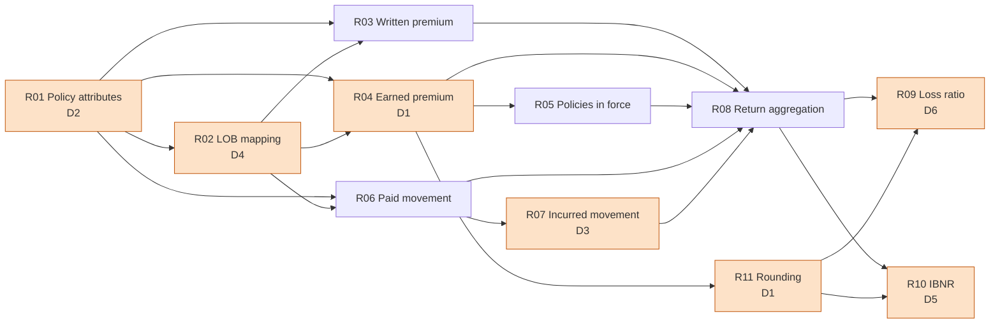

# Legacy rule inventory

Generated by `make run` from `src/legacy28/rules.py`.

| Rule | Name | Business rule | Legacy source | Modern implementation | Depends on | Intentional differences |
|---|---|---|---|---|---|---|
| R01 | Policy attributes | Each policy contributes its LOB and region from one policy version. | `sas/01_policy_prep.sas: PROC SORT NODUPKEY BY policy_id` | `modern.policy_attributes` | - | D2 |
| R02 | LOB mapping | Raw LOB codes map to the five reporting LOBs; anything else is OTHER. | `sas/01_policy_prep.sas: DATA pol_dedup IF lob_code_raw IN (...)` | `modern.map_lob` | R01 | D4 |
| R03 | Written premium | Premium is written in the quarter containing the transaction effective date. | `sas/02_premium_earn.sas: IF qs <= txn_eff <= qe` | `modern.premium_detail` | R01, R02 | - |
| R04 | Earned premium | Premium earns daily pro rata over [txn_eff, txn_exp). | `sas/02_premium_earn.sas: earned_cents = ROUND(premium*days/term, 1)` | `modern.premium_detail` | R01, R02 | D1 |
| R05 | Policies in force | Distinct policies with earned premium > 0 in the quarter. | `sas/04_summarise.sas: PROC SORT NODUPKEY WHERE earned > 0` | `modern.quarterly_report` | R04 | - |
| R06 | Paid movement | Quarterly paid = cumulative paid minus previous valuation's cumulative paid. | `sas/03_claims.sas: RETAIN prev_paid; FIRST.claim_id` | `modern.claims_detail` | R01, R02 | - |
| R07 | Incurred movement | Incurred = paid + case reserve; quarterly incurred is its movement. | `sas/03_claims.sas: incurred_cum = cum_paid + case_reserve` | `modern.claims_detail` | R06 | D3 |
| R08 | Return aggregation | Sum all measures by quarter x LOB x region (outer merge of premium and claims). | `sas/04_summarise.sas: PROC SUMMARY NWAY; MERGE` | `modern.quarterly_report` | R03, R04, R05, R06, R07 | - |
| R09 | Loss ratio | Loss ratio = incurred / earned to 4 dp (basis points). | `excel/QRT_build.bas: =IFERROR(ROUND(H2/E2,4),0)` | `modern.quarterly_report` | R08, R11 | D6 |
| R10 | IBNR | IBNR = max(0, earned x expected loss ratio - incurred), from 2025Q1. | `excel/QRT_build.bas: =MAX(0,ROUND(E2*VLOOKUP(B2,ELR,2,TRUE),0)-H2)` | `modern.quarterly_report + modern.elr_bp` | R08, R11 | D5 |
| R11 | Rounding | Money is reported in whole cents, rounded half away from zero. | `sas/02_premium_earn.sas ROUND(...,1); excel ROUND(...,0)` | `modern.half_up_div` | R04 | D1 |

## Dependency graph

## Intentional differences

| ID | Change | Legacy behaviour | Modern behaviour | Why | Reconciliation predicate (what may change) |
|---|---|---|---|---|---|
| D1 | Single rounding instead of row-level rounding | Earned premium rounded to the cent on every txn x quarter row, then summed. | Earned in 1/10,000 cent per row; rounded to the cent once per report cell. | Row-level rounding accumulates up to 0.5 cent per row; the regulator's rule is to round the reported figure. | Detail: only earned_ucents changes, by <= 0.5 cent. Report: earned changes by <= 0.5 cent x rows in cell + 1; loss_ratio_bp / ibnr_cents may change only where earned changed. |
| D2 | Policy attributes as at quarter end | First policy version in physical file order (NODUPKEY): stale after endorsements, wrong after the 2025 backfill. | Latest version effective on or before each quarter end. | Region moves after endorsements must follow the policy; the result must not depend on file order. | Detail: only lob/region change, only for (policy, quarter) pairs whose legacy version differs from the as-of version. Report: only cells that contain such a pair. |
| D3 | Missing case reserve treated as zero | SAS '+' makes incurred missing when the reserve is missing; PROC SUMMARY then drops it (and the next quarter's movement). | Missing reserve coalesced to 0, so paid stays in incurred. | Paid claims must never disappear from incurred because a reserve feed failed. | Detail: only reserve/incurred columns, only claim-quarters with a missing reserve at q or q-1. Report: only incurred/loss ratio/IBNR in cells containing such claim-quarters. |
| D4 | LOB codes trimmed and upper-cased | Case- and blank-sensitive IN() list: 'Motor', 'home ' become OTHER. | TRIM + UPPER before mapping; only genuinely unmapped codes (PET) are OTHER. | Premium and claims were being reported under the wrong line of business. | Detail: only lob changes, only for policies with a fixable raw code. Report: only cells containing those policies. |
| D5 | Exact ELR lookup with an explicit OTHER row | VLOOKUP(...,TRUE) on an A-Z table: OTHER silently takes MOTOR's 71% ELR. | Exact lookup; OTHER has its own 65% ELR row. | Approximate match on text keys is a known Excel defect. | Report only: ibnr_cents on lob = OTHER rows. |
| D6 | Loss ratio NULL when earned premium is zero | IFERROR(...,0) reports a 0% loss ratio. | NULL (not meaningful). | A 0% loss ratio on a cell with claims but no premium is misleading. | Report only: loss_ratio_bp goes from 0 to NULL where earned premium is 0. |
