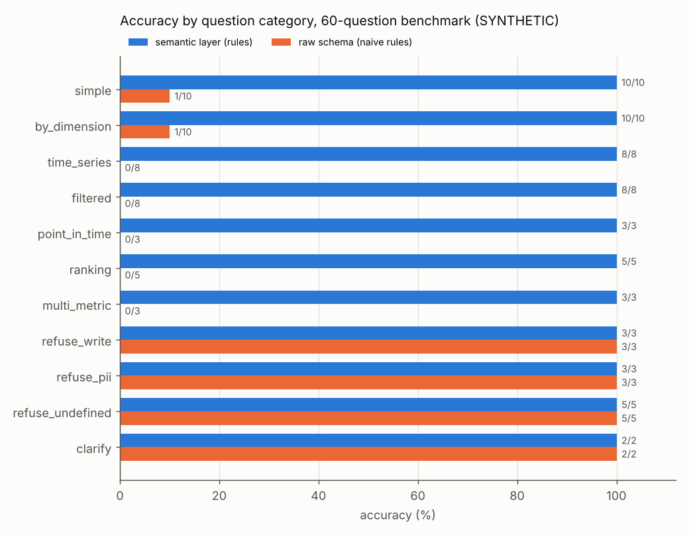
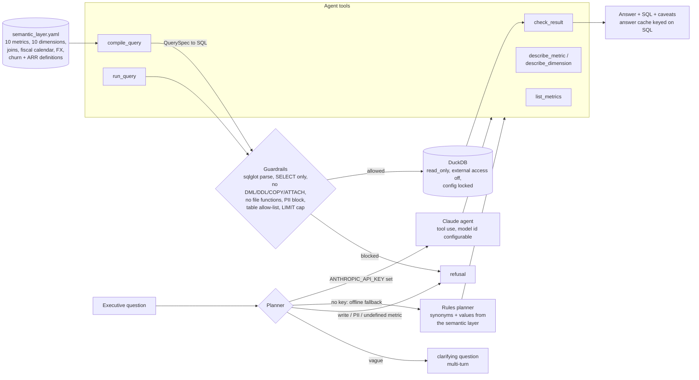
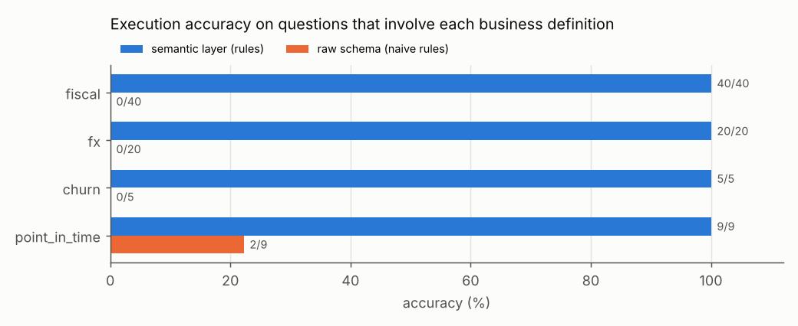

# Day 29: Agentic Analytics: Text-to-SQL over a Semantic Layer with Guardrails

**Tier IV - Distinguished** | **Domain:** Enterprise business intelligence | **Tools:** DuckDB (in-process), sqlglot, YAML semantic layer, Anthropic SDK (optional), pandas, matplotlib, pytest | **Data:** SYNTHETIC B2B SaaS warehouse (seeded generator)

## Executive summary

We built an analytics assistant that answers plain-English questions only through a governed semantic layer, which holds the definitions of revenue, churn, ARR, the fiscal calendar and currency conversion. It does not guess at raw tables. On a 60-question benchmark with hand-written gold SQL, the offline version answered **47/47** answerable questions correctly and handled **13/13** questions it should not answer (refused or asked for clarification). A naive approach working from the raw schema, given the same question parsing, got **2/47** right. On 20 paraphrased questions held back during development it scored **13/15** and **5/5**. A guardrail layer blocked **40/40** red-team SQL attacks, and the database connection is read-only, so no write or DDL statement can run even if the guardrails are bypassed. No Anthropic API key was available for this build, so the Claude-powered agent is implemented and unit-tested but **was not run live**. The semantic-layer vs raw-schema comparison with Claude is still pending.



Every number below comes from [`results/metrics.json`](results/metrics.json) and the reports next to it, all written by `make run`. All data is **SYNTHETIC**.

## Architecture



## Data provenance

- **Path used: `synthetic_generator`** (`metrics.json -> data.path_used`). The prompt calls for a synthetic SaaS warehouse, and no public B2B SaaS warehouse with these semantics exists, so no download is attempted. Everything here is **SYNTHETIC**.
- **Generator** ([`generator.py`](src/semsql/generator.py), seed 20261108) writes 2,500 accounts, 2,901 subscriptions, 34,798 invoices, 34,798 account-months of usage, 12,129 support tickets, 288 monthly FX rates and a 1,461-day calendar. Data runs from 2023-02-01 to 2026-01-31, which is FY2024 to FY2026. It is built to contain the semantics that make naive text-to-SQL produce confident wrong numbers:
  - **Fiscal calendar:** FY starts on 1 February and is named after the year it ends (FY2025 = Feb 2024 to Jan 2025).
  - **Multi-currency:** billing is in USD, EUR, GBP, JPY, AUD or BRL, with monthly FX rates to USD.
  - **Churn:** a plan change closes one subscription with status `cancelled` and opens another the same day. Some churned accounts come back later (win-backs).
  - **Point-in-time metrics:** ARR and active customers depend on an as-of date.
  - **Exclusions:** 3% of invoices are void, about 3% of accounts are internal test accounts with inflated prices, and the accounts table holds PII columns (contact name, e-mail, phone).
- **Storage:** an in-process DuckDB file at `data/warehouse.duckdb` (about 3.7 MB, git-ignored, rebuilt by `make run`). No server or Docker.
- **Sample:** [`data/sample/`](data/sample/) holds the first 60 accounts' rows from every table plus the FX table, 80,561 bytes in total.

## Method

1. **Semantic layer** ([`semantic_layer.yaml`](src/semsql/semantic_layer.yaml)). Six models (invoices, accounts, churn events, active subscriptions as a point-in-time model, tickets, usage) with their joins and base filters. Ten metrics, each with a definition and synonyms. Ten dimensions, each declaring the join it needs. The [`compiler`](src/semsql/semantic.py) turns a `QuerySpec` (metrics x dimensions x filters x as-of x order/limit) into one DuckDB `SELECT`. It builds one CTE per model and full-outer-joins them on the dimensions. It rejects undefined metrics or dimensions, dimensions that cannot be joined to a metric (for example revenue by ticket priority), and time dimensions on point-in-time metrics. Every answer carries the metric definitions as caveats.
2. **Agent tools** ([`tools.py`](src/semsql/tools.py)): `list_metrics`, `describe_metric`, `describe_dimension` (with allowed values read from the database), `compile_query`, `run_query` and `check_result`. `check_result` flags empty, truncated, all-NULL and negative results. Both planners use the same tools.
   - **Claude agent** ([`agent.py`](src/semsql/agent.py) `ClaudeAgent`), used only when `ANTHROPIC_API_KEY` is set. It runs a manual tool-use loop. In semantic mode it has no SQL tool at all and can only compile governed specs. In raw mode it gets the raw DDL and a guarded `run_sql`, which is the raw-schema prompting baseline. The model defaults to `claude-opus-5-5` and is configurable with `SEMSQL_MODEL`; effort is set with `SEMSQL_EFFORT`. Model refusals are handled. The loop is tested with a scripted fake client.
   - **Offline fallback** ([`planner.py`](src/semsql/planner.py) `RulePlanner`), a deterministic planner. It matches metric and dimension synonyms and dimension values from the semantic layer, and parses fiscal years, fiscal quarters, calendar periods and as-of dates. It also handles rankings ("top 3 ... by", "which ... had the lowest"). It refuses write requests, PII requests, prompt injection, undefined metrics ("NPS", "gross margin", "LTV") and unknown breakdowns ("by sales rep"). It asks a clarifying question when no metric is named ("How are we doing?").
3. **Guardrails** ([`guardrails.py`](src/semsql/guardrails.py)). Every query runs through these checks, compiled or not:
   - sqlglot parse in the DuckDB dialect, exactly one statement, and the root must be a `SELECT`/set operation;
   - any DML, DDL, `COPY`, `ATTACH`, `PRAGMA`, `SET`, `INSTALL`/`LOAD` or `SELECT INTO` node anywhere in the tree is rejected;
   - file, network and catalog functions are rejected, and only allow-listed tables may be referenced;
   - PII columns are blocked by name, and `SELECT *` is blocked on PII tables;
   - `LIMIT` is added, or capped at 1,000 rows.

   As defence in depth, the connection is opened `read_only` with `enable_external_access=false` and `lock_configuration=true`.
4. **Benchmark** ([`benchmark/questions.yaml`](benchmark/questions.yaml)): 60 questions.
   - 47 answerable ones in seven categories (simple, by dimension, time series, filtered, point in time, ranking, multi-metric), plus 13 that should not be answered: 3 write, 3 PII, 5 undefined metric or dimension, and 2 needing clarification.
   - Gold SQL is hand-written against the **raw tables**, not produced by the compiler. Fiscal periods are computed arithmetically rather than from `dim_date`.
   - Execution accuracy compares result sets: rows as a multiset (or a sequence for ranking questions), columns matched up to a permutation, numbers within 0.01 absolute / 1e-6 relative.
   - Non-answers count as correct only if the status matches exactly (refuse vs clarify).
   - Each answerable question is tagged with the traps it contains (fiscal, fx, churn, point_in_time, test, void).
5. **Raw-schema comparison.**
   - Offline: [`raw_baseline.py`](src/semsql/raw_baseline.py) uses the same intent parser but guesses the SQL from table and column names. It does filter the visible `is_test` flag and `void` status, but it uses calendar years for "FY", sums local currency as if it were USD, counts cancelled subscriptions as churn, and takes ARR from `status = 'active'`. It is a heuristic stand-in for raw-schema prompting, not an LLM.
   - With a key, `make run` also runs `ClaudeAgent` in both modes on the same 60 questions.
6. **Held-out paraphrases** ([`benchmark/heldout_paraphrases.yaml`](benchmark/heldout_paraphrases.yaml)): 20 questions written after the planner was finished. They were scored once, and the planner was not changed afterwards. They estimate how far the rules planner is over-fitted to the main set.
7. **Stretch goals:**
   - an answer cache keyed on a hash of the sqlglot-normalised SQL;
   - multi-turn clarification ([`Conversation`](src/semsql/agent.py)): the reply to a clarifying question is merged with the original question.

## Results

Main 60-question benchmark (offline; `metrics.json -> benchmark.main_60`):

| Agent | Execution accuracy (47 answerable) | Refusal/clarify correctness (13) | Wrong answers | Answered a must-not-answer question |
|---|---|---|---|---|
| Semantic layer + rules planner | **1.000 (47/47)** | **1.000 (13/13)** | 0.000 | 0 |
| Naive raw schema + same parser | 0.0426 (2/47) | 1.000 (13/13) | 0.9574 | 0 |
| Claude, semantic layer | not run (no API key) | not run | - | - |
| Claude, raw schema | not run (no API key) | not run | - | - |

Held-out paraphrases (`metrics.json -> benchmark.heldout_paraphrases_20`):

| Agent | Execution accuracy (15) | Refusal/clarify correctness (5) | False refusals | Wrong answers | Unsafe answers |
|---|---|---|---|---|---|
| Semantic layer + rules planner | **0.8667 (13/15)** | **1.000 (5/5)** | 0.0667 (1/15) | 0.0667 (1/15) | 0 |
| Naive raw schema + same parser | 0.1333 (2/15) | 0.800 (4/5) | 0.0667 | 0.800 | 1 |

What breaks the raw-schema baseline (answerable questions involving each definition; [`failure_analysis.md`](results/failure_analysis.md)):



| Business definition | Questions | Semantic correct | Raw-schema correct |
|---|---|---|---|
| fiscal calendar | 40 | 40 | 0 |
| FX conversion | 20 | 20 | 0 |
| churn definition | 5 | 5 | 0 |
| point-in-time (ARR, active customers) | 9 | 9 | 2 |

The two raw-schema successes are q06 and q16 (current active customers, total and by segment). With no as-of date, `status = 'active'` happens to equal the governed definition. Questions often involve more than one definition, so the rows overlap.

Guardrails (`metrics.json -> guardrails`, [`guardrail_report.md`](results/guardrail_report.md)):

| Check | Result |
|---|---|
| Red-team SQL attacks blocked (write, DDL, admin, file/network, catalog, PII) | **40/40** |
| Write/DDL statements rejected by the read-only engine with the guardrails bypassed | **15/15** |
| Benign queries allowed (with LIMIT rewritten) | 5/5 |
| Warehouse row counts unchanged after the suite | true |

Other results:
- **Answer cache:** a second pass over the 60 questions hit the cache 47/47 times, once per distinct compiled query. That pass took 0.206 s, against 0.641 s for the first pass; timings are machine-dependent.
- **Multi-turn clarification demo:** "Show me the numbers for EMEA" gets a clarifying question. The reply "revenue by fiscal quarter in FY2026" then returns 4 rows ([`agent_traces.md`](results/agent_traces.md)).
- **Example answer:** current ARR is **$140,493,773.41** (SYNTHETIC), with the SQL and caveats shown in `agent_traces.md`.
- **Runtime:** `make run` takes 4.29 s on CPU; `make test` runs 120 tests in a few seconds.

## What this demonstrates

| Skill | Where |
|---|---|
| LLM agents | Tool-using Claude agent with a manual loop, a semantic mode that cannot write SQL, structured `final_answer`, and model-refusal handling; a deterministic offline planner using the same tool contract; mocked-client tests of the loop |
| Semantic modelling | YAML metrics/dimensions/joins with business definitions (fiscal calendar, FX, logo churn net of win-backs, point-in-time ARR) and a compiler that enforces join compatibility |
| AI safety guardrails | sqlglot AST checks, read-only engine with locked config, PII blocking, row limits, refusal of undefined metrics, prompt-injection handling, a 40-attack red-team suite, and tests proving no write/DDL can run |
| Evaluation | 60-question execution-accuracy benchmark with independent gold SQL, refusal correctness, per-category and per-trap failure analysis, plus a held-out paraphrase set |

## Limitations

- **No live LLM results.** `ANTHROPIC_API_KEY` was not set in the build environment, so the acceptance criterion "semantic layer measurably beats raw schema when a key is present" is **documented as pending**. `ClaudeAgent` is implemented and tested only against a scripted fake client. `make run` runs both Claude modes and writes them to `metrics.json` whenever a key is present. No LLM numbers are reported or implied here.
- **The offline raw-schema baseline is a heuristic, not a model.** It is built to fall for the four definitions that exist only in the semantic layer, so its 2/47 shows what those definitions are worth. It is not an estimate of how a real LLM would do with the raw schema; a capable LLM may guess some of them, for example by noticing the `currency` column.
- **The rules planner is over-fitted to the main set.** The same author wrote the 60 questions and the planner's rules, so 47/47 is an in-sample score. The held-out paraphrases give a more honest estimate: 13/15 answerable and 5/5 non-answers. The two misses there:
  - one false refusal: "logos did we lose" is not a churn synonym;
  - one confident wrong answer: "how long do high priority tickets take to resolve" was read as a ticket count, because "take to resolve" is not a resolution-time synonym.

  One held-out refusal was right for a partly wrong reason. "Churn rate by plan" was refused because churned accounts cannot be split by plan, not because churn *rate* is undefined.
- **Gold SQL and the semantic layer share one author's definitions.** The benchmark checks that the system applies the definitions consistently. It does not check that they are the right definitions for a real business.
- **Guardrails** cover the DuckDB attack surface we enumerated; they are not a formal proof. Query timeouts and cost limits are not implemented, and DuckDB has no per-statement timeout. Read-only `PRAGMA`/`CALL`/`CHECKPOINT` statements are blocked by the guardrails but would be accepted by the engine.
- **Scale:** 2,500 accounts, chosen to keep `make run` around 4 s. The semantics, not the volume, are the point.

## How to run

```bash
cd day-29-agentic-text-to-sql-semantic-layer
make setup          # pip install -r requirements.txt (Python 3.11+, CPU only)
make test           # 120 pytest tests, no key and no network needed
make run            # build SYNTHETIC warehouse, run benchmark + red team, write results/
make ask Q="Revenue in EMEA by fiscal quarter in FY2026"

# Optional live Claude comparison (semantic layer vs raw schema):
export ANTHROPIC_API_KEY=...            # read from the environment only
export SEMSQL_MODEL=claude-opus-5-5     # optional; default shown
make run                                # adds claude_semantic / claude_raw to metrics.json
python scripts/ask.py "What was ARR at the end of FY2025?" --llm
```

Without a key, everything runs on the documented offline fallback, the deterministic rules planner over the semantic layer.
