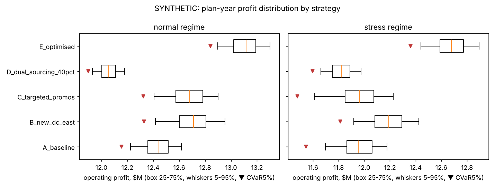
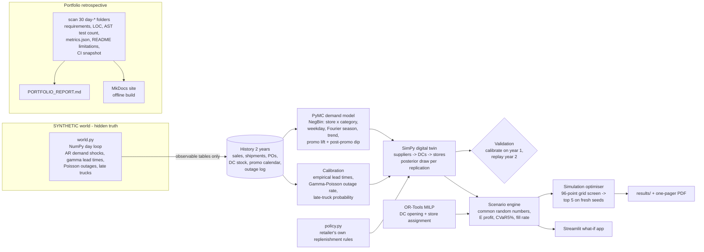
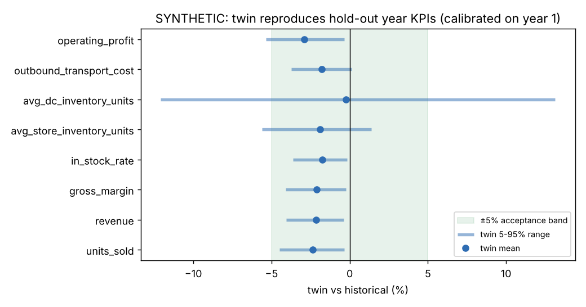
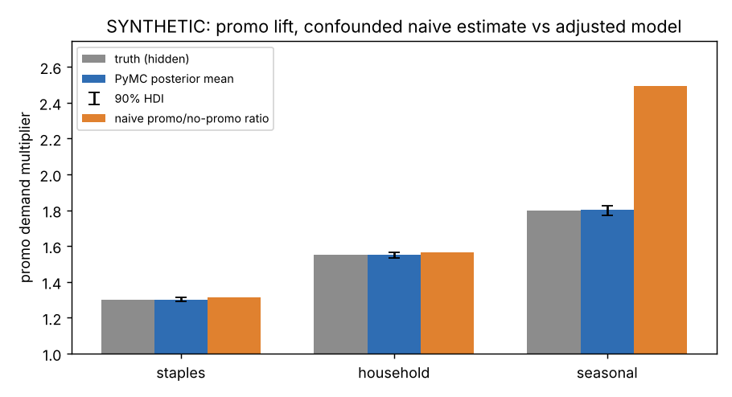
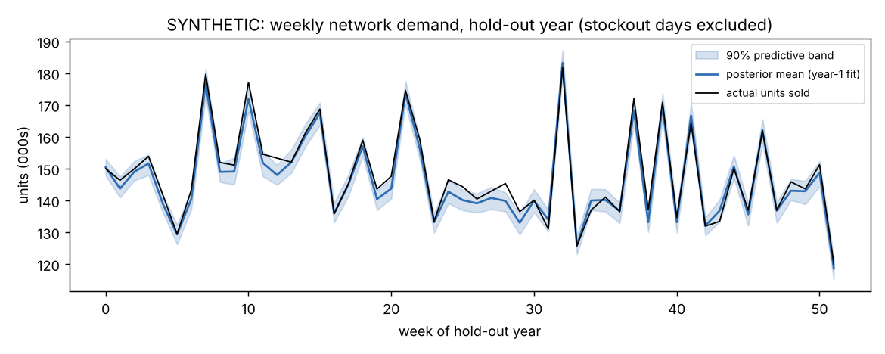
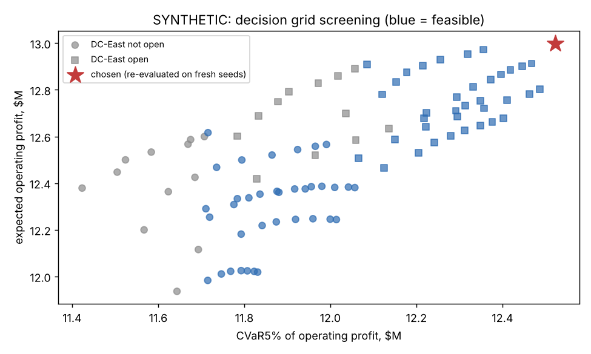
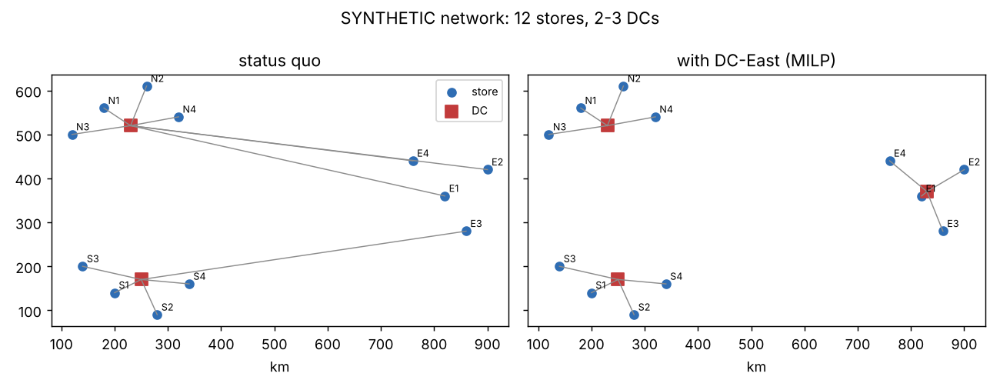

# Day 30: Capstone: Decision-Intelligence Digital Twin and Portfolio Retrospective

**Tier IV - Distinguished** | **Domain:** Cross-industry (retail supply chain) | **Tools:** SimPy, OR-Tools (SCIP MILP), PyMC + ArviZ, Streamlit, MkDocs, NumPy/pandas, matplotlib, pytest | **Data:** SYNTHETIC retailer (seeded generator)

## Executive summary

We built a digital twin of a retailer's supply chain (2 suppliers, 2 distribution centres plus a candidate third, 12 stores, 3 categories). It learns demand, promo effects, lead times and outage risk from two years of history, and when calibrated on year 1 it reproduced all 8 hold-out-year KPIs within **2.9%**. Of the single moves tested, opening DC-East (**+$264k** a year) and cutting margin-losing staples promotions (**+$235k**) both pay in a normal year. Moving 40% of buying to the nearshore supplier costs **$378k** a year and only pays back as insurance against a long outage. The plan the optimiser picked adds **+$671k** expected operating profit a year (paired 90% range +$449k to +$915k). It also raises worst-case (CVaR 5%) profit by **$686k** and still comes out ahead in a year with a 28-day offshore outage (**+$726k**). This folder also holds the 30-day portfolio retrospective in [`PORTFOLIO_REPORT.md`](PORTFOLIO_REPORT.md) and an MkDocs site that indexes all 30 projects.



Every number below comes from [`results/metrics.json`](results/metrics.json) and the CSVs next to it, all written by `make run`. All data is **SYNTHETIC**.

## Architecture



## Data provenance

- **Path used: `synthetic_generator`** (`metrics.json -> data.path_used`). The capstone checks recovered promo effects, lead times and outage rates against ground truth, and no public dataset publishes those, so no download is attempted. The prompt allows reusing or re-creating earlier generators; this one is new but compatible in spirit with Day 7 (inventory) and Day 18 (promo/MMM). Everything here is **SYNTHETIC**.
- **World** ([`world.py`](src/twin30/world.py), seed 20261109): 728 days of history from 2024-11-04 to 2026-11-01, after an 8-week burn-in that is not recorded.
  - **Network:** 12 stores in three regions (North, South, East), each selling 3 categories (staples, household, seasonal). DC-North and DC-South serve them; DC-East is a candidate site.
  - **Demand:** Poisson demand around a mean with store size, weekday, a two-harmonic annual season, a 3% a year trend, promo lift and a post-promo dip, plus AR(1) log shocks (phi 0.5, sd 0.10).
  - **Promotions:** the merchandisers' rule promotes 10/8/6 weeks a year, preferring high-season weeks. This makes a naive promo comparison confounded by seasonality.
  - **Supply:** an offshore supplier (gamma lead time, mean 24 days, 2 outages a year) and a nearshore supplier (6 days, +7% cost, 0.5 outages a year). 8% of trucks arrive a day late. Sales above stock are lost.
- **What the twin sees:** only the observable tables written by `history_tables`: sales (with stockout flags), shipments, purchase orders, DC stock, the promo calendar and the outage log. True demand and parameters go to `data/generated/_truth/` and are used only for scoring. The history is 26,208 store-category-days, 25,142 shipment lines, 1,062 PO lines and 6 outages.
- **Committed sample:** [`data/sample/`](data/sample/) holds the first 8 weeks of every observable table (26,495 bytes). `tests/test_world.py` checks that the generator rebuilds it exactly. The full history (336 KB gzipped) is rebuilt by `make run` into `data/generated/` (git-ignored).
- `data/sample/ci_snapshot.json` is a snapshot of GitHub Actions results used by the portfolio report (see below). It is not data for the twin.

## Method

1. **Bayesian demand and promo model** ([`demand.py`](src/twin30/demand.py), PyMC NUTS, 2 chains x 600 draws after 600 tuning steps):
   - log mean = store x category intercept + weekday (zero-sum) + 2-harmonic Fourier season per category + trend + promo lift + post-promo dip; negative-binomial likelihood.
   - Fitted on 8,000 randomly chosen non-stockout store-category-days. On stockout days sales are censored demand, so those days are dropped.
   - The promo coefficients are the causal estimate. Because they are adjusted for season, weekday and trend, they can be compared both with the naive promo/no-promo ratio and with the hidden truth.
2. **Calibration** ([`calibrate.py`](src/twin30/calibrate.py)):
   - Lead times are bootstrapped from observed dispatch-to-receipt times per supplier.
   - Each supplier's outage rate has a Gamma(1 + n, 1 + years) posterior; outage durations are bootstrapped from the log.
   - The late-truck probability is estimated from shipments.
3. **SimPy digital twin** ([`twin.py`](src/twin30/twin.py)):
   - Deliveries land at the start of day t. Trading and ordering happen at t + 0.5, and DCs order from suppliers on Mondays.
   - Each replication draws one posterior parameter set, negative-binomial daily demand, lead times, outage windows and late trucks.
   - The replenishment rules are the retailer's own ([`policy.py`](src/twin30/policy.py)), shared with the world:
     - stores use order-up-to on a trailing 28-day forecast, with a space cap of 4.5 days of cover;
     - DCs use weekly base stock on quoted supplier lead times;
     - when a DC is short it rations pro rata, within its throughput cap.
   - KPIs share one definition with the historical ledger ([`kpis.py`](src/twin30/kpis.py)): revenue, gross margin, holding, outbound freight, handling and DC fixed cost give operating profit.
4. **Validation:** calibrate on year 1 only, then simulate year 2 from the recorded day-364 state, with the observed promo calendar and the logged outages replayed. Compare 500 replications with the historical ledger.
5. **Plan year** (2026-11-02 onwards): refit demand and calibration on the full two years.
   - **Network MILP** ([`network_opt.py`](src/twin30/network_opt.py), OR-Tools SCIP): chooses which DCs open and assigns stores, minimising DC fixed cost + freight + handling + transit-proportional holding, under DC throughput capacity.
   - **Targeted promotions:** each category keeps its promo-week budget, but weeks go to the highest posterior expected incremental gross margin, net of discount and post-promo dip. Weeks with negative value get no promo.
6. **Scenario engine** ([`scenarios.py`](src/twin30/scenarios.py)):
   - Options: A status quo; B DC-East with the MILP assignment; C targeted promos; D 40% nearshore sourcing; E the optimiser's choice.
   - Each option runs 1,000 replications in each of two regimes. "normal" draws outages from the calibrated rate. "stress" adds a forced 28-day offshore outage from plan day 14.
   - Replications share seeds across options (common random numbers), so differences are paired.
   - Metrics: expected profit, P5, CVaR 5% (mean of the worst 5% of years), fill rate, P(fill < 95%) and P(beats status quo).
7. **Simulation optimiser:**
   - Screens a 96-point grid: DC-East {no, yes} x nearshore share {10, 25, 40%} x store safety factor z {1.0..4.5} x promos {current, targeted}. Each point gets 60 replications in a "mixed" regime, where 1 year in 4 carries the stress outage.
   - Objective: maximise expected profit subject to CVaR 5% >= status quo and mean fill rate >= 95%.
   - The top 5 feasible points are re-run on 500 **fresh** seeds before one is chosen, so the winner is not picked on its own noise.
8. **Streamlit app** ([`app/streamlit_app.py`](app/streamlit_app.py)): sliders for each lever and the regime. It runs the twin live against the status quo on paired seeds, using the committed posterior and plan state in `results/model/`.
9. **Portfolio retrospective** ([`scripts/build_portfolio.py`](scripts/build_portfolio.py), [`src/portfolio/`](src/portfolio/)): scans all 30 `day-*` folders. See [Portfolio retrospective](#portfolio-retrospective) below.
10. **Stretch:** an executive one-pager PDF ([`results/executive_one_pager.pdf`](results/executive_one_pager.pdf)) is generated from `metrics.json`. The reinforcement-learning replenishment agent was not attempted.

## Results

**Twin validation, hold-out year** (calibrated on year 1, 500 replications; [`validation_kpis.csv`](results/validation_kpis.csv)):



| KPI | Historical | Twin mean | Error | Within 5% |
|---|---|---|---|---|
| Units sold | 7,914,719 | 7,726,268 | -2.38% | yes |
| Revenue | $50.16M | $49.09M | -2.14% | yes |
| Gross margin | $18.93M | $18.53M | -2.12% | yes |
| In-stock rate | 94.47% | 92.82% | -1.76% | yes |
| Avg store inventory (units) | 28,984 | 28,433 | -1.90% | yes |
| Avg DC inventory (units) | 314,290 | 313,531 | -0.24% | yes |
| Outbound freight | $2.507M | $2.462M | -1.79% | yes |
| Operating profit | $12.08M | $11.73M | -2.89% | yes |

Acceptance criterion "twin reproduces baseline KPIs within 5%": **met** (max |error| 2.89%). The twin is consistently conservative. The historical value lies inside the twin's 5-95% band for only 3 of 8 KPIs (see Limitations).

**Demand and promo model** ([`promo_effects.csv`](results/promo_effects.csv)):



| Category | True lift | Posterior mean (90% HDI) | Naive promo/no-promo ratio | True post-promo dip | Posterior |
|---|---|---|---|---|---|
| staples | 1.30 | 1.302 (1.290-1.314) | 1.313 | 0.93 | 0.928 |
| household | 1.55 | 1.551 (1.534-1.567) | 1.566 | 0.88 | 0.873 |
| seasonal | 1.80 | 1.801 (1.771-1.825) | 2.494 | 0.92 | 0.917 |

- **Recovery:** the truth lies inside the 90% HDI for 3/3 lifts and 3/3 post-promo dips.
- **Confounding:** the naive ratio overstates the seasonal lift (2.49 vs 1.80), because seasonal promos land in peak weeks.
- **Sampler:** max R-hat 1.01, min bulk ESS 974, 0 divergences on the year-1 fit; 1.02, 669 and 0 on the full-history fit.
- **Hold-out forecast:** WAPE is **8.5%**, against 22.0% for seasonal-naive (same weekday last year) and 17.5% for the retailer's trailing 28-day mean. 90% predictive intervals cover 88.8% of store-days but only 78.8% of network weeks.



**Strategic scenarios, plan year** (1,000 replications per regime, paired seeds; [`scenario_comparison.csv`](results/scenario_comparison.csv)):

| Scenario | Regime | E[profit] | CVaR 5% | Fill rate | P(fill < 95%) | Δ profit vs A (P5 to P95) | P(beats A) |
|---|---|---|---|---|---|---|---|
| A status quo | normal | $12.43M | $12.15M | 96.5% | 1.7% | - | - |
| B DC-East (MILP assignment) | normal | $12.70M | $12.33M | 94.6% | 69.9% | +$264k (+$67k to +$460k) | 97.8% |
| C targeted promos | normal | $12.67M | $12.32M | 96.0% | 11.2% | +$235k (-$54k to +$505k) | 92.3% |
| D 40% nearshore | normal | $12.06M | $11.90M | 97.8% | 0.0% | -$378k (-$486k to -$235k) | 0.0% |
| **E optimised** | normal | **$13.11M** | **$12.84M** | **97.2%** | 0.0% | **+$671k (+$449k to +$915k)** | **100%** |
| A status quo | stress | $11.95M | $11.55M | 94.8% | 57.0% | - | - |
| B DC-East | stress | $12.18M | $11.81M | 92.7% | 100% | +$232k (+$58k to +$403k) | 98.5% |
| C targeted promos | stress | $11.95M | $11.48M | 92.9% | 99.4% | -$2k (-$367k to +$326k) | 50.3% |
| D 40% nearshore | stress | $11.82M | $11.60M | 96.8% | 0.8% | -$131k (-$279k to +$41k) | 9.5% |
| **E optimised** | stress | **$12.68M** | **$12.36M** | **95.8%** | 8.2% | **+$726k (+$445k to +$1,005k)** | **99.9%** |

Acceptance criterion "at least 3 strategic scenarios compared with uncertainty": **met** (4 single-lever strategies plus the optimised plan, in 2 regimes).

What the scenarios say:
- **New DC (B).** The deterministic MILP opens DC-East. It moves the four East stores there and saves **$587k** a year against the status-quo network ($6.716M to $6.129M of modelled cost), for 8.34M expected plan-year units. The twin finds about half that, **+$264k**. With one day of transit the stores' order-up-to cover shrinks, so fill rate falls from 96.5% to 94.6%. The extra profit comes from lower freight and lower DC stock (338k to 235k units), not from service.
- **Targeted promos (C).** Of the current 10/8/6 promo weeks, targeting keeps 0/8/6. Staples promos lose margin: the 1.30 lift does not cover a 10% discount on a 35% margin. That is worth +$235k in a normal year, but nothing in the stress year, when there is no stock to sell into promotions.
- **Dual sourcing (D)** costs $378k a year at a 7% price premium. It is the only single lever that lifts CVaR under stress (+$50k), and it keeps fill at 96.8% through the outage. It is insurance, not a profit lever.
- **Optimised plan (E):** DC-East + 25% nearshore + store z = 4.5 + targeted promos. The extra store safety stock offsets the new DC's service loss, and the 25% nearshore share hedges outages.
  - Screening: 72 of the 96 grid points were feasible.
  - On 500 fresh seeds of the mixed regime it scored $13.00M against $12.30M for the status quo (+$694k).
  - On the separate 1,000-replication scenario seeds it gains +$671k (normal) and +$726k (stress).

 

**Run:** `make run` took 485 s for the twin pipeline on a 4-vCPU container ([`metrics.json`](results/metrics.json) `runtime_s`), plus a few seconds for the portfolio report and docs site.

## Portfolio retrospective

[`PORTFOLIO_REPORT.md`](PORTFOLIO_REPORT.md) is regenerated by `make run` from the committed files of all 30 `day-*` folders; none of the other 29 projects is re-run. Headline facts, from [`results/portfolio/summary.json`](results/portfolio/summary.json):

| Measure | Value |
|---|---|
| Projects covered | 30/30 (30 domains, Tiers I-IV) |
| Distinct tools (excluding pytest, ruff, coverage) | 101, in 16 capability families ([`tools_matrix.csv`](results/portfolio/tools_matrix.csv)) |
| Lines of code (non-blank, non-comment) | 49,467 Python source + 7,140 Python tests + 864 SQL |
| Tests, static AST count | 655 test functions, 708 cases with literal parametrisation |
| CI (GitHub Actions snapshot) | last job passed for 29/29 earlier folders; Day 30 pending at generation time |
| Public data | tried in 18 projects (25 sources), reached in 5 (6 sources), used in results in 4 (Days 11, 12, 15, 23); 26 projects ran on synthetic data |
| Acceptance criteria not met | 7, in Days 06, 11, 12, 21, 24, 26, 29 |
| LLM projects with offline fallback only | Days 20, 21, 29 (no API key, no live LLM numbers) |

How it is built:
- **Tools:** parsed from each `requirements.txt`, with markers, extras and URLs handled.
- **LOC:** counted from `.py` and `.sql` files.
- **Tests:** counted statically with Python's `ast`, without running them. Running all 30 suites would break the 20-minute budget and need every project's dependencies.
- **CI status:** read from a committed snapshot of the GitHub Actions API (`make ci-snapshot`, fetched 2026-11-09 with `gh`), so the report builds offline.
- **Key metrics, provenance and unmet criteria:** curated in [`registry.yaml`](src/portfolio/registry.yaml). Each key metric is read from that project's `results/metrics.json`. Tests check that every JSON path resolves and every quoted piece of README evidence exists.
- **Docs site:** [`mkdocs.yml`](mkdocs.yml) plus [`docs/`](docs/) give a home page, the report, and one page per project. It uses the built-in `readthedocs` theme with no plugins or CDN. A test builds it with every proxy pointed at a closed port, to prove the build needs no network.

## What this demonstrates

| Skill | Where |
|---|---|
| Decision intelligence | Forecasting (PyMC), causal promo effects (confounding-adjusted, checked against truth), optimisation (OR-Tools MILP + simulation optimisation) and simulation (SimPy) joined into one what-if system. Risk metrics (CVaR, P(fill < 95%), P(beats baseline)) and fresh-seed re-evaluation of the winner |
| Systems integration | The world, calibration, Bayesian model, twin, MILP, scenario engine, Streamlit app and docs site share one KPI definition and one policy module. The twin is validated out of sample against an independent world implementation |
| Technical leadership | A portfolio audit across 30 projects: tools, LOC, tests, CI, headline metrics, provenance, and an honest list of missed criteria and fallbacks, all generated and test-checked |

## Limitations

- **The twin is conservative, and its bands are too narrow.** All 8 KPIs fall within 5%, but every level KPI is below history (units -2.38%, profit -2.89%). The historical value lies inside the twin's 5-95% band for only 3 of 8 KPIs. Things that contribute:
  - **The world's hold-out year was favourable.** Offshore lead times averaged 23.5 days in year 2, against 24.9 days in the calibration year. On eight other world seeds, year-2 fill ranges 91.5% to 95.5%, against 97.4% on the committed seed.
  - **Hidden demand truth.** The twin's year-2 fill rate (96.0%) is below the true 97.4%.
  - **Missing demand shocks.** The twin has no AR(1) demand shocks, so its intervals miss a source of variance. Network-week forecast intervals cover only 78.8% instead of 90%.
- **Twin and world share their author and their policy code.** They are separate implementations with deliberately different noise (AR shocks, gamma vs bootstrapped lead times). They still share the replenishment rules and the KPI ledger, so validation tests the learned uncertainty, not the structure. A real twin would also have to learn the policy as actually executed.
- **The optimiser's store safety factor sits at the top of the grid** (z = 4.5) for the DC-East configuration. In screening, profit was still rising, by about $19k from z = 4.0 to 4.5. For the status-quo network (10% nearshore, current promos) it peaks inside the grid, at z = 4.0.
  - Early runs had no store space limit and kept hitting the grid edge, because holding cost was the only cost of store stock. A space cap of 4.5 days of cover was added to the shared policy (it changes the history's year-2 fill rate by less than 0.01 points).
  - A real decision would also price shrink and markdowns, which this model does not.
- **The MILP is deterministic.** It ignores risk pooling and service effects, which is why its $587k DC-East saving shrinks to $264k in the twin. That gap is the point of re-evaluating MILP answers in simulation, but the MILP's own cost terms (transit-proportional holding) are approximations.
- **The PyMC model is fitted on a random subsample of 8,000 non-stockout store-category-days** (of 12,233 in year 1 and 24,613 in the full history), to keep `make run` around 8 minutes. Dropping stockout days ignores censoring rather than modelling it, which biases demand slightly low on busy days.
- **Stretch goals:** the executive one-pager is done. The reinforcement-learning replenishment agent was not attempted.
- **Portfolio report limits:**
  - Test counts are static. Two projects parametrise over computed lists, so their case counts are lower bounds; their README-stated counts are shown alongside.
  - CI status is a snapshot, not live, and Day 30's own CI result is not in it.
  - The tool-family mapping and the per-project key metric are editorial choices recorded in `registry.yaml`.
- **Scale:** 12 stores, 3 categories and 2 suppliers keep about 19,000 simulated years inside the time budget. The structure, not the size, is the point.

## How to run

```bash
cd day-30-capstone-supply-chain-digital-twin
make setup          # pip install -r requirements.txt (Python 3.11+, CPU only, no PyTorch; needs gcc/g++ for PyTensor)
make test           # 40 pytest tests, under a minute, offline
make run            # SYNTHETIC history -> PyMC -> validation -> scenarios -> optimiser -> results/, then
                    # PORTFOLIO_REPORT.md + docs/ + mkdocs.yml + site/ (about 8 minutes on 4 CPUs)
make app            # Streamlit what-if explorer (reads results/model/)
make docs           # serve the MkDocs site locally
make ci-snapshot    # optional, needs network + gh: refresh the CI status snapshot used by the report
```

`TWIN_QUICK=1 python scripts/run_all.py` runs the whole pipeline on tiny budgets in about 30 s and writes to `data/quick/` (git-ignored), not to `results/`. `TWIN_JOBS` sets the number of worker processes (default: min(4, CPUs)). Results are the same for any worker count, because every replication has its own seed.
